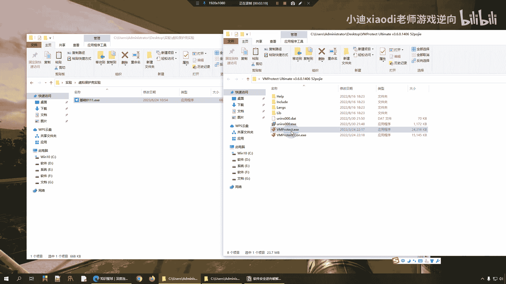
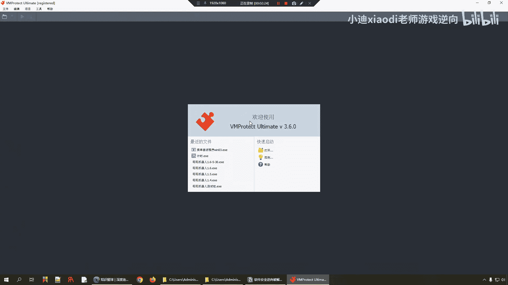
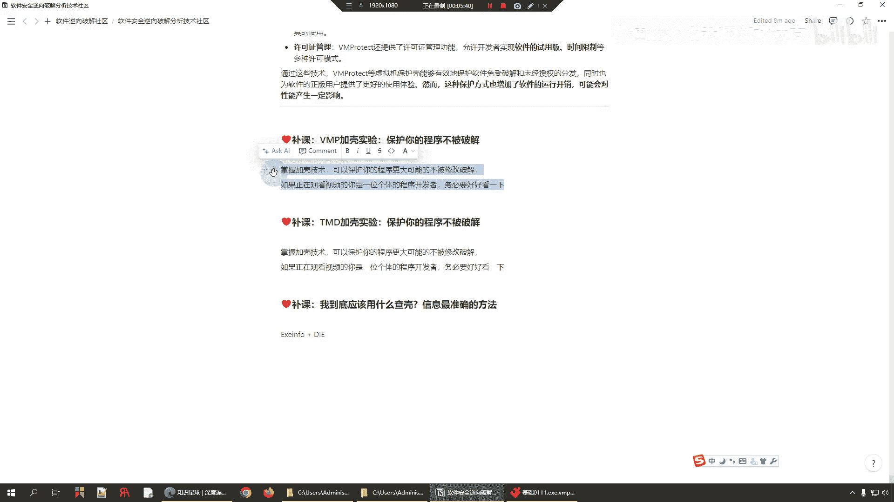

# VMP加壳实验：第六章：高级进阶逆向分析技术——保护程序不被破解 🛡️

## VMP加壳实验：6.1：课程概述 📖

在本节课中我们将要学习 VMP 加壳实验，核心目标是保护程序不被破解。课程讲师小李老师表示，想学习软件安全、逆向破解相关内容可以来找他；课程强调自身定位是实惠，并且在实惠方案里比较全面。今天是第六章高级进阶逆向分析技术，同时是一节补课性质的 VMP 加壳实验课。

这节课面向软件作者、个体软件作者和程序开发者。掌握加壳技术之后，就可以保护自己的程序，让程序更大可能不被修改和破解，或者说最大可能不被破解。该内容定位为游戏安全、软件安全、网络安全和 CTF 比赛必备基础，面向小白、软件破解、反汇编、逆向和安全工程师等学习人群，并标注为 2024 最新内容，对应视频编号为 BV1Qj421o7oX-。

上一段说明了课程定位，接下来看壳的基本背景。壳的种类在前几节课已经讲完；如果不了解壳，可以从第十三节课开始看，第十三、十四、十五、十六节都值得回顾，到第十六节就能了解到一种比较强的保护方式，也就是虚拟机保护。课程安排了两个实验，今天讲第一个实验，它使用的就是虚拟机保护，属于最牛的壳之一。接下来用这种保护方式保护程序，程序已经准备好，保护工具也已经准备好。

## VMP加壳实验：6.2：为什么软件需要加壳 🧩

上一节概述了课程目标和壳的背景，本节先看为什么软件需要加壳。假设你是一个软件开发人员，开发了一个程序；如果程序直接裸奔，直接发到网上，或者直接流通在市场上，这个软件就很容易被破解。软件标题、各种界面信息和一些功能都很容易被剽窃。出现这种情况时，就可以使用加壳工具进行保护。

从概念上看，加壳可以理解为用壳程序包裹原始程序，公式如下：

\[
\text{加壳后的程序} = \text{壳}(\text{原始程序})
\]

上一段用公式说明了加壳的基本关系，下面列出裸奔与加壳的主要差别。以下是软件加壳要解决的问题：

- 裸奔程序直接发布到网上或市场，容易被破解。
- 程序的标题、界面和各种功能信息容易被剽窃。
- 加壳后可以增加修改和破解难度。
- 加壳的目标是让程序更大可能不被修改和破解。

理解了裸奔风险之后，下一节看保护工具从哪里获取、如何启动。这里需要强调，加壳不是让程序绝对无法破解，而是尽可能提高破解成本，让普通修改和简单破解变得更困难。

## VMP加壳实验：6.3：保护工具获取与启动 🛠️

上一节说明了软件裸奔的风险，本节看看保护工具的获取和启动方式。保护工具可以来到星球加入“软件安全逆向破解分析技术社区”，加入社区后社区里就有这个工具。进入社区后可以点一下对应位置，也可以点击提供的链接，两种方式都可以。

下面是工具获取与启动的操作要点：

- 加入“软件安全逆向破解分析技术社区”星球，社区内提供保护工具。
- 在社区里点一下对应位置，或者点击链接，都可以获取工具。
- 下载后解压，放到桌面上。
- 运行不带 `CON` 的那个程序，也就是运行 `VMProtect` 主程序。

上一段列出了获取与启动步骤，接下来把操作流程写成代码形式，方便初学者照着做：



```text
加入社区 -> 获取工具 -> 下载并解压到桌面 -> 运行不带 CON 的 VMProtect 主程序
```



工具运行起来之后，可以拖动窗口调整位置。下一节把待保护程序拖入工具，并认识界面上的检测选项。

## VMP加壳实验：6.4：把程序拖入工具并认识界面 🖱️

上一节完成了工具启动，本节把程序拖入工具并认识界面。工具运行后可以拖动窗口，把自己的软件直接拖过来；假设这个软件就是你自己写的程序，直接拖入即可，然后调整窗口位置。拖过来之后点击“选项”，可以看到“检测到调试器”“检测到虚拟机”等设置。

下面列出界面中需要认识的检测与提示功能。以下是选项界面里比较常见的内容：

- 可以设置自定义消息提示，默认提示是英文。
- 文件受损检测可以在文件被修改时进行检测。
- 虚拟机运行检测可以检测程序是否运行在虚拟机里。
- 检测调试器和检测虚拟机都属于防护设置的一部分。

上一段介绍了检测选项，下面用伪代码描述这类防护逻辑，帮助理解它的作用：

```text
if 检测到调试器 or 检测到虚拟机:
    显示提示消息
    拒绝或限制程序继续运行
```

了解这些检测选项后，下一节继续看保护属性如何设置。界面里的选项不需要一次全部理解，先知道它们分别负责检测、提示和防护即可。

## VMP加壳实验：6.5：设置保护选项 ⚙️

上一节认识了检测与提示选项，本节看保护属性的设置。界面上方有若干保护属性，内存保护可以尝试开启；导入表保护、资源保护或资源防护可以保护界面之类的资源；压缩输出文件可以处理输出文件；还可以设置输出文件的名字。保护完成之后，工具会生成一个受保护的程序。

下面列出保护选项中需要关注的几个项目。以下是保护设置里比较关键的选项：

- 内存保护可以开启并测试。
- 导入表保护用于保护导入表相关信息。
- 资源保护或资源防护用于保护界面等资源。
- 压缩输出文件用于处理输出文件。
- 输出文件名字可以自行设置，保护后会生成新的程序。
- 调试器选项选择 `user mode`，此外还有 `user mode + kernel mode` 模式；默认是用户模式进行检测。
- 虚拟化工具处勾选检测，至少开启一个检测项。
- VM 分段默认即可。
- 移除调试信息、水印等项目不用管。

上一段列出了保护选项，完成这些设置后，基本上就开启了一个比较大的防护。下一节点击编译，观察生成程序并测试防护效果。这里不需要一开始就追求复杂配置，先把默认防护跑通，再逐步理解每个选项的作用。

## VMP加壳实验：6.6：编译、运行与防护效果测试 🧪

上一节完成了保护选项设置，本节点击编译并测试效果。点击“编译”后，工具会在当前程序所在目录下生成一个 VMP 保护后的程序；工具会询问是否运行，可以直接运行。程序正常运行，没有问题；原本的程序会变得非常大，也就是体积会膨胀。

编译流程可以用下面的代码表示：

```text
原程序.exe -> 点击“编译” -> 同目录生成 VMP 保护后的程序.exe
```

上一段说明了编译和体积变化，接下来检测防护效果。使用一些黑客工具，例如常用的破解工具，直接拖过来运行，工具会给出提示。下面是运行时的英文提示及其中文含义：

> debugger has been found running in your system. please unload it from memory and restart your program.
>
> 中文意思是：系统中发现调试器正在运行，请从内存中卸载它并重新启动程序。

这个提示说明程序检测到了黑客工具，也就是具备检测调试器一类工具的能力。小白或者菜鸟黑客就没有办法轻易破解这个程序。其他位置也有比较高级的防护，例如“前往地址”可以跳到某个地址进行防护，不过这个功能暂时不需要。界面防护也属于这里的保护内容，简单了解即可。

## VMP加壳实验：6.7：没有逆向基础时怎么做 🧠

上一节测试了默认防护效果，本节说明没有逆向基础时的做法。如果你不掌握逆向工程，也没有学习过相关内容，就直接按刚才讲的方式做一个简单防护即可。这个工具也可以做更复杂的防护，但对于初学者来说，先把默认防护用起来更重要。

下面列出初学者可以采用的实践思路。以下是适合初学者先掌握的做法：

- 没有逆向基础时，先使用默认选项完成简单加壳。
- 不追求复杂防护配置，先保证程序能够正常生成和运行。
- “前往地址”等高级防护可以暂时不设置。
- 界面防护和其他高级选项可以后续再慢慢了解。

上一段给出了初学者的实践思路，接下来对本节课做总结。需要说明的是，加壳实验的价值在于把保护思路落地，先跑通流程，再根据实际需要增加保护强度。

## VMP加壳实验：6.8：课程总结 ✅

本节课中我们一起学习了 VMP 加壳实验，目标是保护程序不被破解。课程从软件裸奔的风险讲起，说明了加壳可以增加修改和破解难度；随后介绍了保护工具的获取与启动方式，把程序拖入工具，认识了检测调试器、检测虚拟机、文件受损检测等界面选项。



接着我们设置了内存保护、导入表保护、资源保护、压缩输出文件、输出文件名、调试器模式、虚拟化工具、VM 分段等保护项，并点击编译生成 VMP 保护后的程序。测试时程序可以正常运行，体积会膨胀；使用黑客工具测试时，程序会提示检测到调试器并拒绝继续运行。对于个体程序开发者来说，可以回去自己试一下这个 VMP 加壳实验。课程到此结束，下次再见。

