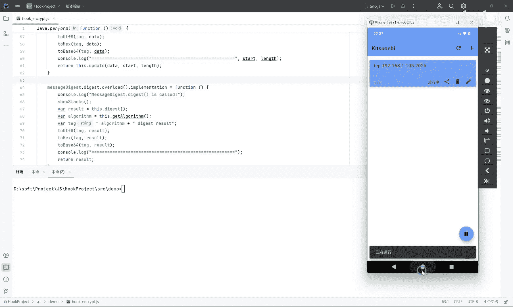
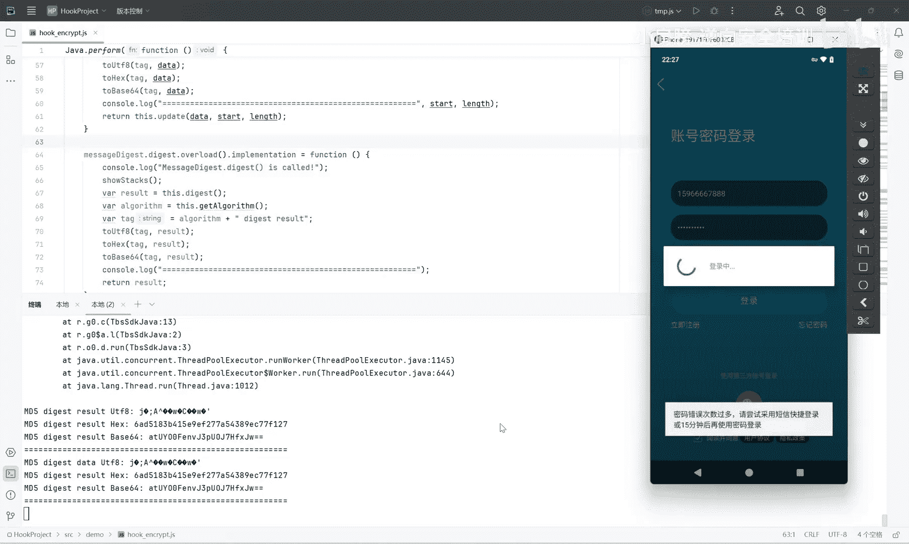
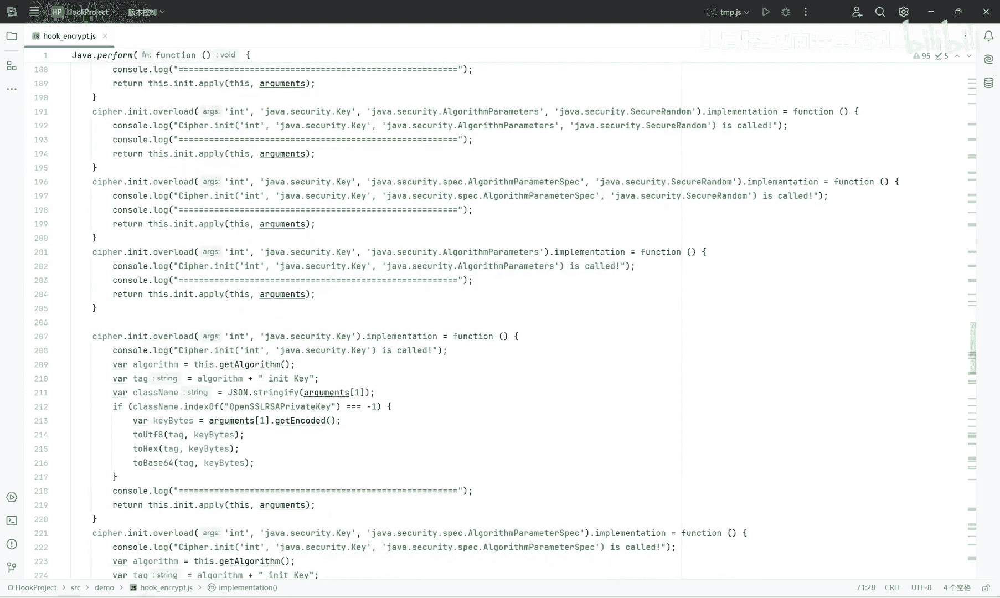

# 📱 APP算法自吐快速逆向：01：算法自吐与Hook标准算法API

在本节课中我们将要学习APP算法自吐的基本思路，案例仍然使用前面提到的这个APP。算法自吐不是去猜算法，也不是去硬还原算法，而是直接Hook Java层的标准算法系统API。这样做的目的很直接：当APP调用标准算法时，我们就能看到它传入了什么明文、最终得到了什么密文。本节会先说明核心概念，再演示注入脚本、抓包、查看密文和函数栈，最后说明算法自吐的适用范围。内容不复杂，但它是后面快速定位算法和判断适用范围的基础。

## 🔎 APP算法自吐快速逆向：01-1：什么是算法自吐

上一节我们明确了本节的主题，本节中我们来看看算法自吐到底在做什么。所谓算法自吐，就是去Hook Java层的标准算法系统API。比较典型的是Hook `MessageDigest` 里面的 `update` 和 `digest` 这两个方法。只要Hook住这两个方法，就可以覆盖MD5算法、SHA算法等常见标准算法。这里可以先建立一个直观模型，如下所示。

```java
MessageDigest md = MessageDigest.getInstance("MD5");
md.update(明文);
byte[] 密文 = md.digest();
```

之所以Hook这两个函数就能搞定MD5、SHA等算法，是因为这些算法在Java层通常会走标准API的 `update` 和 `digest` 流程。`update`负责把明文加入算法计算过程，`digest`负责产出最终结果。至于Java层还有哪些标准算法的系统API，需要等后面学习密码学Java之后才能完全明白，到那时也就知道为什么要Hook这两个函数。这里先记住结论即可：Hook标准API，就能看到标准算法的输入和输出。



## 🧪 APP算法自吐快速逆向：01-2：演示Hook与抓包


上一节我们介绍了算法自吐的核心概念，本节中我们来看看实际操作。演示时先开启Frida Server，然后注入脚本进行Hook，同时把抓包工具开起来。这样做的目的是把APP运行时的算法调用和网络数据包放在一起观察。以下是演示中的基本操作步骤。

- 开启Frida Server。
- 注入Hook脚本。
- 同时开启抓包工具。
- 点击登录按钮。



完成上述操作后，去看一下需要的密文是什么，并在工具中的相应位置搜索。可以看到，这个地方就是MD5的加密结果。到这里，算法自吐已经帮助我们看到了标准算法产出的结果，接下来要借助函数栈继续往上追，找到关键代码和数据来源。

## 🧱 APP算法自吐快速逆向：01-3：利用函数栈定位关键代码

上一节我们看到了MD5加密结果，本节中我们来看看如何利用函数栈定位关键代码。在结果上方，是执行当前 `digest` 方法时的函数栈。函数栈会一层一层记录调用关系，当前是在这个地方，它的上一层是这个地方，再上一层是这个地方，再上一层是这个地方，再上一层还是这个地方。以下是函数栈中需要观察的层次。

- 当前层：执行 `digest` 方法的位置。
- 上一层：调用 `digest` 的上一层方法。
- 再上一层：继续向上的调用位置。
- 再上一层：继续向上的调用位置。
- 再上一层：继续向上的调用位置。

这些层次可以帮助我们做关键代码定位。你可以顺着函数栈到APP里面去找相应的类、相应的方法去查看。函数栈的价值在于，它把“密文从哪里来、经过了哪些方法”串成了一条线，初学者顺着这条线看，就能少走很多弯路。

## 📦 APP算法自吐快速逆向：01-4：查看明文与数据来源

上一节我们通过函数栈定位了调用关系，本节中我们来看看明文和数据来源。再往上就是MD5算法的明文。可以看到，它是把一串明文给 `update` 了，也就是把这串明文加入到算法里面去进行加密。这个流程在前面介绍算法推理的时候是见过的。明文的加入过程可以用下面的公式表示。

```text
明文 --update()--> 算法计算上下文 --digest()--> 密文
```

在这段数据中，中间有一段是固定的，其他部分都来源于数据包。以下是原文中提到的数据来源示例。

- NOC：对应数据包中的这一串。
- 时间：对应后面的这一串。
- 提交的数据：对应前面的这一串。

看到这里，算法自吐不仅给出了密文，还把明文和来源一起暴露出来。接下来需要说明它的适用范围，因为并不是所有APP、所有算法场景都适合用这个脚本。

## ✅ APP算法自吐快速逆向：01-5：适用范围与使用建议

上一节我们查看了明文和数据来源，本节中我们来看看算法自吐的适用范围。这个脚本只适用于APP里面使用了Java层的标准算法，并且用的是系统的API的情况。它的适用范围比之前介绍的算法推理要小很多。可以用下面的公式概括。

```text
算法自吐适用 = 原生APP ∧ Java层 ∧ 标准算法系统API
```

作为对比，算法推理的条件更宽。只要内存中存在明文数据、存在Key、存在IV，并且用的是标准算法，然后在加密前以及加密后没有对明文和结果做处理，基本上都是可以推理出来的。以下是算法推理的主要适用条件。

- 内存中存在明文数据。
- 内存中存在Key和IV。
- 使用的是标准算法。
- 加密前和加密后没有对明文和结果做额外处理。
- 不需要管当前APP是原生APP、H5的APP还是Flutter的APP等。
- 不管算法在Java层还是在SO层，都可以尝试搞定。

但是算法自吐脚本只适用于原生APP、算法在Java层、使用的是系统API的情况。可以用下面的公式概括。



```text
算法自吐脚本适用 = 原生APP ∧ Java层算法 ∧ 系统API
```

有这种脚本显然是有好处的。你在逆向之前可以先跑一下。比如这个APP本身是有加固的，如果要去手动逆向，还需要脱壳、分析和Hook。如果跑一下算法自吐或者算法推理就可以搞定，那就会轻松很多。使用建议很直接：先跑自吐和推理，能快速拿到结果就优先使用，不能覆盖时再进入更重的手动分析流程。

## 🏁 APP算法自吐快速逆向：01-6：本节总结

本节课中我们一起学习了APP算法自吐的基本概念和演示流程。我们知道了算法自吐就是Hook Java层标准算法系统API中的 `update` 和 `digest`，从而覆盖MD5、SHA等标准算法；也看到了开启Frida Server、注入脚本、同时抓包、点击登录、搜索密文、查看函数栈、定位关键代码和查看明文来源的完整过程。最后我们对比了算法自吐与算法推理的适用范围：算法自吐更偏向原生APP、Java层、系统API，而算法推理覆盖范围更广，但也要满足标准算法和内存中有明文、Key、IV等条件。把这些流程串起来，就形成了本节快速逆向的基本套路。

