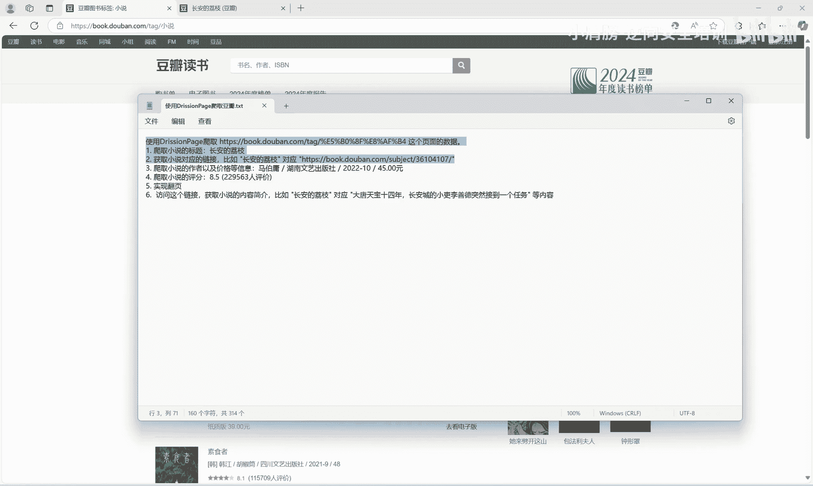
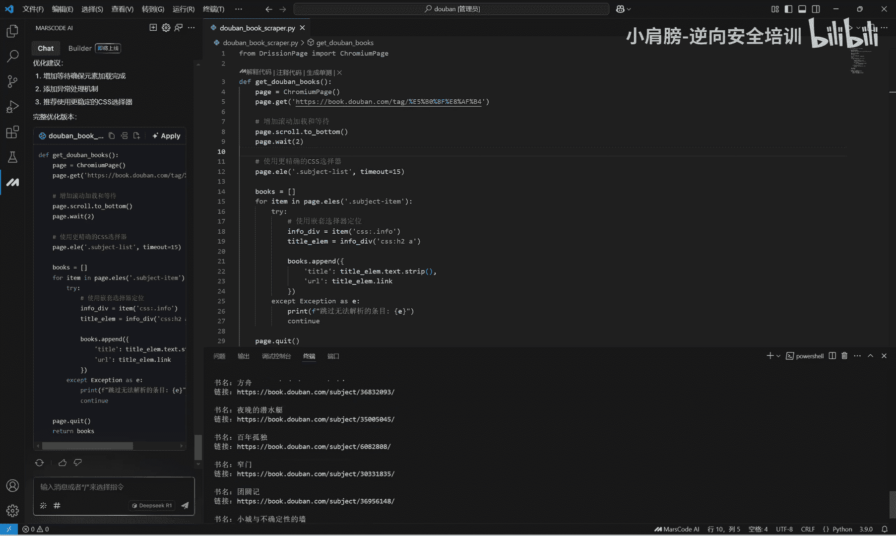
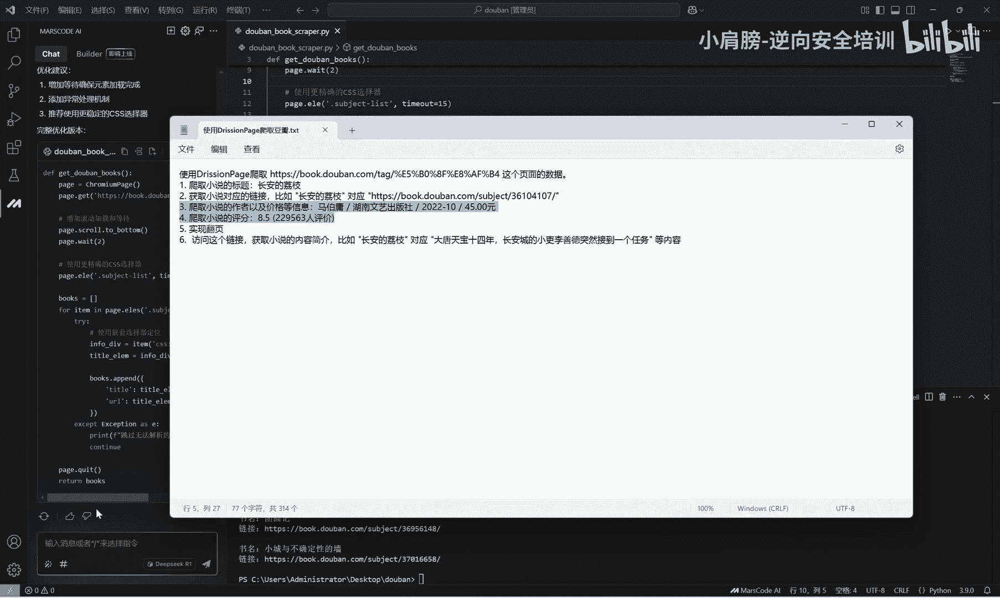
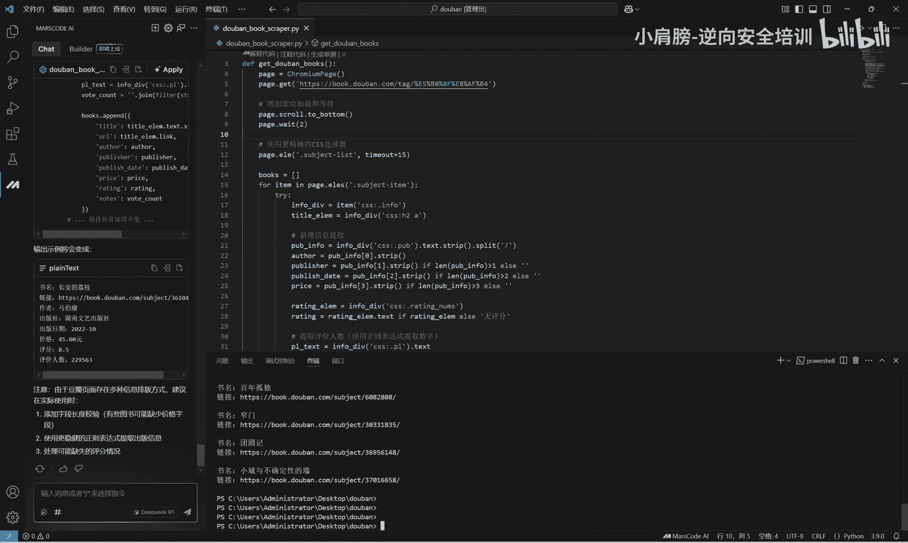
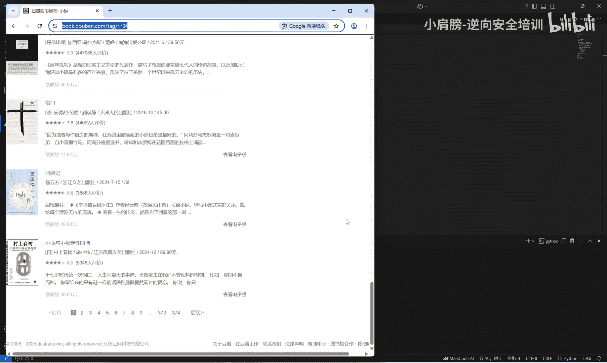
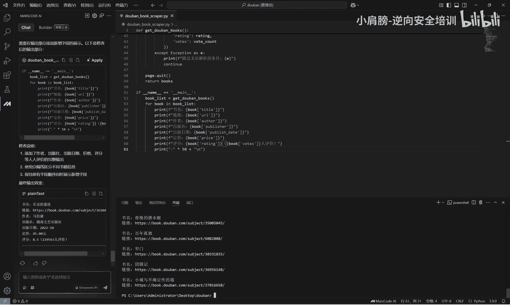
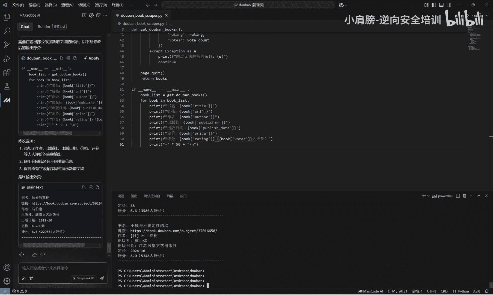

## 📚 DeepSeek爬取豆瓣读书：01：需求分析与目标拆解


在本节课中我们将要学习使用 DeepSeek 协助爬取豆瓣读书的小说数据，内容对应视频 BV1e1qPBZEPn。整体目标很直白：先打开豆瓣读书网站，再点击“小说”分类，采集这个列表里的小说标题、作者、评分和链接；随后打开每个链接，采集详情页里的内容简介；最后实现翻页，让后续页面的数据也能采集。详情页里的简介比较全，列表或展示位置可能带有省略号，因此需要进入详情页获取完整内容。我们需要把这些需求描述给 AI，再让 AI 去完成代码和调试。


这里还要把字段需求说清楚：使用 JSON 配置爬取页面数据，采集小说标题、小说对应链接、作者、价格信息、评分、时间，并实现翻译；最后访问链接获取小说内容。功能比较多的时候，最好把功能分开，让 AI 先做几个小功能，再逐步增加功能。原始记录提到“代码在这个地方”，所以本教程会在后续小节用代码块表示配置和采集骨架。建议先把能采集的全部尝试采集，能跑通就继续；下面两个步骤只在需要时处理：如果没有安装依赖，就安装依赖；如果遇到反爬，就增加等待时间。完成目标拆解后，下一节我们来看看如何用 JSON 把需求写清楚。


## 🧩 DeepSeek爬取豆瓣读书：02：用JSON描述采集需求


上一节我们拆解了采集目标，本节中我们来看看如何把需求写成 JSON 交给 AI。JSON 可以理解为一张“任务清单”，把要打开的页面、要采集的字段和要执行的动作写明白，AI 就更容易按清单生成代码。建议在描述需求时把列表页字段和详情页字段分开写，这样后面扩展功能时不会乱。


以下是建议在 JSON 中写清楚的字段和动作。


```json
{
  "target": "豆瓣读书小说列表及详情页",
  "list_fields": ["title", "link", "author", "price", "rating", "time"],
  "detail_fields": ["content_intro"],
  "actions": ["打开豆瓣读书", "点击小说分类", "采集整个列表", "打开详情链接", "翻页"],
  "translation": true
}
```


写清 JSON 后，还要记住一个组织原则：功能多的时候不要一次性全塞给 AI。




> 功能多的时候，最好把功能分开：先让 AI 做几个小功能，再让它逐步增加功能。


这个原则可以降低调试难度，因为初学者能先看到标题和链接是否采集成功，再继续加作者、评分、价格、时间、翻译和详情内容。需求写清后，下一节先实现最小功能，也就是标题和链接采集。


## 🛠️ DeepSeek爬取豆瓣读书：03：先实现标题和链接采集


上一节写好了 JSON 需求，本节先让 AI 完成两个小功能，也就是标题和链接采集。原始记录说“我们先让他完成这两个，代码在这个地方”，因此本节把示例代码放在下面的代码块中。建议先把能采的全部尝试采集，能采到就保留；下面两个步骤按需执行，不要一开始就强制处理。这样安排可以让初学者先跑通主流程，再处理环境问题和反爬问题。


以下是两个按需步骤，只有遇到对应情况才做。


- 如果没有安装依赖，先安装程序运行需要的库和包。
- 如果遇到反爬，就增加等待时间，让程序不要请求得太快。


上面的依赖可以理解为程序运行前需要准备的工具；反爬可以理解为网站不希望被自动程序频繁访问。完成最小功能后，下一节处理调试中遇到的报错、滚动和等待问题。


## 🐞 DeepSeek爬取豆瓣读书：04：调试报错与滚动等待优化




上一节先实现了标题和链接采集，本节中我们来看看调试过程。这个错误之前是遇到过的。需要追问：为什么总喜欢用这个方法？不确定当前方法里有没有可用项。检查后发现这个方法也没有。工具又把方案改回去了。记录中的“金融金写法就是这个写法”，可以理解为当前这种写法就是该写法，于是再试一次。


试过之后出现报错，报错原因是没有获取到元素。完整的优化版本加入了滚动和等待，此时可以正常获取标题和链接。滚动的作用是让页面继续加载，等待的作用是给页面留出渲染时间。可以用一个简单公式描述等待策略：


```text
等待时间 = 固定等待 + 随机等待
```




标题和链接稳定获取后，下一节继续让 AI 增加功能，并检查输出是否完整。




## ➕ DeepSeek爬取豆瓣读书：05：继续增加功能与输出检查


上一节优化了标题和链接采集，本节继续让 AI 增加功能。继续增加功能后，表面看是没有获取到数据；进一步检查发现，不是没有获取到，而是后面没有增加输出。本来想直接帮它改掉，但不想动手写，于是继续让 AI 自己补输出。经过调整后，可以看到已经正确获取到所有数据。




这里的“没有增加输出”可以理解为程序可能已经拿到了数据，只是没有把结果打印或保存出来，所以看起来像采集失败。数据正确获取之后，接下来让 AI 实现翻译功能，并继续处理详情页内容。数据采集稳定后，下一节实现详情内容和翻译。


## 🌐 DeepSeek爬取豆瓣读书：06：详情内容与翻译功能




上一节已经正确获取列表数据，本节实现翻译并访问详情链接获取内容。详情页里的内容简介比较全，但页面展示处可能带有省略号，因此需要打开链接采集完整简介。采集时要覆盖整个列表，最后实现翻页，让后续页也能继续采集。翻译功能可以把需要翻译的字段转换成目标语言，方便后续整理和使用。


整个采集流程可以用下面的公式概括：


```text
列表页 -> 小说分类 -> 采集列表 -> 打开详情链接 -> 抽取内容简介 -> 翻页
```


到这里，列表字段、详情内容和翻译功能的主流程就串起来了。完成详情与翻译后，最后一节对整套流程做总结。




## ✅ DeepSeek爬取豆瓣读书：07：总结


前面各节完成了需求拆解、JSON 描述、最小功能实现、报错调试、滚动等待优化、功能扩展和翻译详情采集，本节做总结。本节课中我们一起学习了使用 DeepSeek 爬取豆瓣读书小说的完整思路：先打开豆瓣读书并点击小说分类，采集标题、链接、作者、评分等列表字段；再打开详情链接获取完整内容简介；最后实现翻页和翻译。核心经验是先让 AI 做小功能，再逐步增加功能；遇到依赖问题就安装依赖，遇到反爬就增加等待，遇到没有输出就检查输出环节。掌握这些步骤后，初学者可以按同样方法把需求拆小，再让 AI 协助完成更多采集任务。
