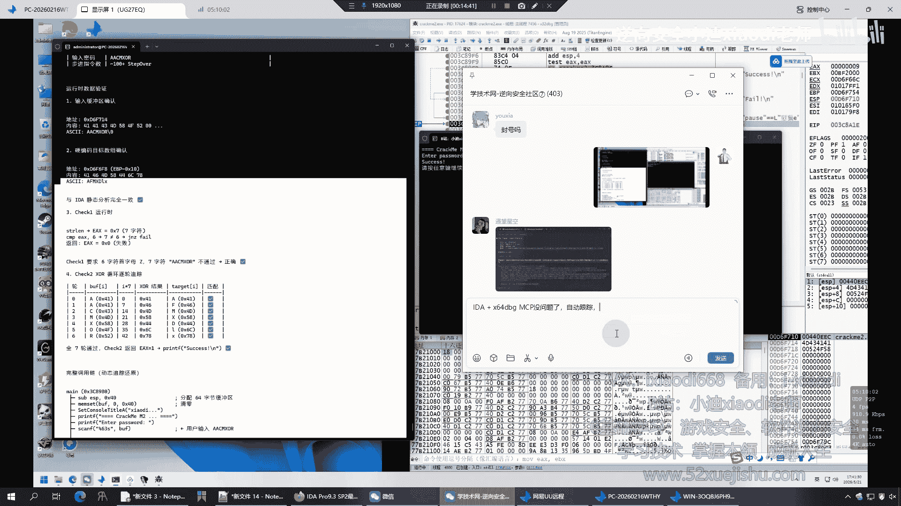

🎓 **AI逆向工程：第1章：x64dbg+MCP全自动AI软件逆向演示效果**

在本课程中，我们将学习如何把 x64dbg 调试器与 MCP（Model Context Protocol，模型上下文协议）结合起来，搭建一套全自动的 AI 软件逆向分析流程。这里要说明的是，本课程并不是直接演示某个完整工具的使用方法，而是基于一个标题为“x64dbg-+-MCP全自动AI软件逆向【演示效果】——Hermes-AI智能体，新神降临，解放双手【游戏安全，软件安全，网络安全，CTF比赛必备基础】--BV1qoLb6DEbJ-”的 B 站视频内容整理而成。我们会把标题中的每一个关键词拆解开来，用通俗易懂的大白话，解释清楚它到底想说什么，同时给出一些可以照做的思路和示例代码。如果你是一个完全零基础的初学者，也不用担心，我们会一步一步地讲明白每一个基本概念。好了，让我们开始吧。

首先，让我们来看一下标题的主体部分，也就是“x64dbg-+-MCP全自动AI软件逆向【演示效果】”。这句话是整堂课的基石，它告诉我们，要完成的任务是：用 x64dbg 这个调试工具，配合 MCP 协议，让 AI 自动完成软件逆向分析，并且是以一种“全自动”的方式运行，最后展示了实际运行的效果。这里的 x64dbg 是一个开源的 64 位调试器，常用于分析程序的汇编代码、内存数据、断点、调用堆栈等；而 MCP 则是一种让外部工具能够调用大语言模型（比如 GPT、Claude 等）的标准化接口。打个比方，x64dbg 负责“翻看”程序的内部结构，MCP 负责“让 AI 看”这些结构，并让 AI 直接给出分析结果，整个过程不需要人工一直盯着屏幕。那么，这个“全自动”到底是怎么做到的呢？我们会在后面的章节中用代码和流程来说明。

上一节我们说到了 x64dbg 和 MCP 的基本角色，现在我们来仔细看看标题中的第二个关键短语：“——Hermes-AI智能体，新神降临，解放双手”。这里的 Hermes-AI 是一个自定义的 AI 智能体名称，可以理解为“一个叫 Hermes 的 AI 助手”。所谓“新神降临”是一句夸张的说法，意思是这个 AI 智能体就像一位新的神一样，拥有强大的分析和决策能力，能够替你完成复杂的逆向工程任务。而“解放双手”则是说，以前需要人工手动跟踪每一行汇编指令，现在只需要让 AI 自动去处理，你只需要在最后检查一下结果就可以了。这里需要强调一点，AI 智能体并不是一个实际的实体，而是一套程序逻辑，通常由以下部分组成：一个大语言模型（LLM）、一组工具（Tool），以及一个调度循环。这个调度循环负责决定什么时候调用 x64dbg、什么时候读取内存、什么时候让 AI 写结论。

为了让“解放双手”这个目标落地，我们需要让 AI 智能体真正能够控制 x64dbg。MCP 在这里扮演了桥梁的作用。下面给出一个非常简化的伪代码，用来描述 AI 智能体如何通过 MCP 与 x64dbg 交互：

```python
# 伪代码：AI智能体与x64dbg的MCP交互流程
agent = create_agent("Hermes-AI")  # 创建AI智能体

while task_not_finished:
    instruction = agent.ask("下一步应该做什么？")  # AI自行决策
    if instruction == "read_register":
        reg = mcp_call("x64dbg.get_register", "RAX")  # 通过MCP读取寄存器
    elif instruction == "set_breakpoint":
        result = mcp_call("x64dbg.set_breakpoint", "0x401000")
    elif instruction == "analyze_function":
        summary = agent.analyze(mcp_call("x64dbg.disassemble", "0x401000"))
        print("AI分析结果：", summary)
    # 其他指令...
```


上面的伪代码展示了 AI 智能体自己决定调用哪些调试功能，并且把结果喂给大语言模型做分析。这个循环一直持续到任务完成，从而实现“全自动”。

现在，我们已经明白了“Hermes-AI 智能体”是怎么运作的，也知道了“解放双手”的实际含义。接下来，让我们关注一下标题后面的那个方括号：“【游戏安全，软件安全，网络安全，CTF比赛必备基础】”。这告诉我们，这个 x64dbg + MCP 全自动逆向技巧，是以下四个领域的必备基础：游戏安全、软件安全、网络安全、CTF 比赛。下面我分别用大白话说一说。

- 游戏安全：在游戏开发和运营中，需要防止外挂、修改器、内存作弊等。使用 x64dbg 可以分析游戏进程中的关键函数，并使用 AI 辅助快速定位可疑代码。
- 软件安全：商业软件通常有破解、激活、加密保护。逆向工程师用调试器分析程序算法，而 AI 可以帮助快速理解复杂的反汇编代码，提高效率。
- 网络安全：在恶意代码分析中，安全人员需要拆解木马、病毒的行为。x64dbg 动态调试结合 AI 自动分类行为，可以更快找到恶意特征。
- CTF比赛：CTF（Capture The Flag，夺旗赛）中的逆向题目常常需要分析二进制文件。使用 AI 辅助逆向，可以在比赛中节约大量时间，快速找出 flag。

可以这么说，不管你想进入哪个方向，掌握这种“AI 自动逆向”的思路，都相当于给自己装备了一套现代化工具链。上面这些领域的共同点是，都需要阅读和分析底层汇编代码，而 AI 恰好擅长把汇编代码翻译成自然语言，并给出逻辑解释。所以，这套技术确实是基本功中的基本功。


接下来，我们来看最后一个看似无关的部分：“--BV1qoLb6DEbJ-”。这实际上是 B 站视频的 BV 号。在 B 站，每个视频都有一个唯一的标识符，以 BV 开头，后面跟着字母和数字。这个标识符可以让我们找到原始的视频地址，从而观看到实际的演示效果。在本课程中，我们把这个 BV 号保留下来，方便你对照视频来理解文字教程。简单来说，BV 号就像是一个门牌号码，让你能够直接找到那个展示“Hermes-AI 智能体”具体操作过程的视频。因此，当你阅读本教程时，如果觉得文字描述不够直白，可以搜索这个 BV 号，观看视频里的真实操作。

现在，我们把标题里的所有部分都解释了一遍。但是，光解释标题还不够，因为我们还需要把这套操作流程真正变成一份可执行的教程。下面我们来更详细地看看每一步应该怎么做。这一节里，我们会重点说清楚从准备环境到运行 AI 智能体的完整流程，同时给出一些更具体的代码示例，帮助你理解。

首先，第一步是准备反向工程环境。你需要安装 x64dbg，并且启动它。x64dbg 是一个绿色软件，解压即可使用，自带 32 位和 64 位版本。打开后会看到反汇编窗口、寄存器窗口、内存窗口等。同时，你还需要一个支持 MCP 的 AI 智能体框架，例如使用 Python 编写一个最简客户端。这里我们给出一个非常简单的 Python 示例，展示如何通过 MCP 调用 AI 智能体，并让 AI 分析一段汇编指令：

```python
# 示例：使用MCP客户端让AI分析x64dbg中当前指令
from mcp_client import McpClient

x64dbg = McpClient("x64dbg")
ai = McpClient("hermes-ai")

# 读取当前EIP（指令指针）指向的指令
current_instruction = x64dbg.call("disassemble_current")
print("当前指令:", current_instruction)

# 让AI解释这条指令
answer = ai.call("explain", current_instruction)
print("AI解释:", answer)
```


这个示例非常简略，但核心思想已经传达出来：通过 MCP，我们可以把调试器的数据发送给 AI，再把 AI 的回答拿回来。在实际项目中，你需要为自己的智能体编写更多指令，比如“扫描所有字符串”、“分析调用关系”、“修改寄存器”等等。

第二步，是设计智能体的决策逻辑。也就是说，AI 到底应该先做什么，再做什么。这里我们可以用流程控制语句来构建一个自动循环。我们把前面提到的伪代码完善一下，加上更多的判断分支。例如，AI 可以根据当前断点命中的位置，决定是继续单步、输出报告还是修改内存。下面是一个用 Python 风格写的伪代码，用于描述一个最基本的自动逆向任务：

```python
def auto_reverse_main():
    with start_x64dbg_session() as dbg:
        mcp = McpClient(dbg)
        agent = create_hermes_agent(mcp)
        # 设置初始断点
        mcp.set_breakpoint("main")
        while not mcp.process_finished():
            # AI根据当前状态选择动作
            action = agent.decide_action()
            if action == "step":
                mcp.step_over()
            elif action == "analyze":
                disasm = mcp.disassemble_random_range()
                analysis = agent.analyze_assembly(disasm)
                print(f"分析结果: {analysis}")
            elif action == "patch":
                addr = mcp.get_record("patch_address")
                new_bytes = agent.suggest_patch(disasm)
                mcp.write_bytes(addr, new_bytes)
            else:
                agent.note("不知道做什么，等待用户输入")
```


这里面的 `agent.decide_action()` 就是 AI 自己思考出来的决定，可以基于大语言模型的推理能力来实现。比如你可以把当前寄存器的值、断点位置、已经发现的可疑函数列表，全部转换为文本，塞给 AI，然后让 AI 返回一个 JSON 格式的指令。

第三步，是运行和调试。当你把上述脚本跑起来后，会看到 x64dbg 里自动开始加载目标程序、自动下断点、自动分析代码。如果遇到程序崩溃，说明 AI 决策可能有问题，这时需要查看日志，调整提示词或者判断逻辑。在整个过程中，你的双手几乎不需要动，只需要最后检查 AI 的输出报告即可。这就是标题里“解放双手”的真实体验。

为了加深你对“全自动”的理解，我们再给出一个具体的“效率公式”，用来直观感受人工逆向和 AI 逆向的差距。假设一段程序的代码量是 \(N\) 条汇编指令，人工平均每小时能分析 \(R_h\) 条指令，而 AI 智能体平均每小时能分析 \(R_a\) 条指令，那么完成同样代码量的时间比值为：



\[
T_{\text{ratio}} = \frac{N / R_a}{N / R_h} = \frac{R_h}{R_a}
\]

通常情况下，\(R_a\) 远远大于 \(R_h\)，所以 \(T_{\text{ratio}}\) 会非常小，说明时间大大缩短。当然，这只是一个粗略的比喻，真正的效率提升还取决于 AI 模型的准确度和程序的复杂程度，但它至少告诉我们，自动化技术确实能带来数量级的改变。

实际上，你可能会问：AI 分析汇编代码真的靠谱吗？这里我说得直白一点，目前大语言模型对汇编指令的阅读理解能力已经相当不错，尤其是面对简单函数的逻辑还原、字符串引用、常量识别等任务，AI 完全可以胜任。但对于非常复杂的混淆代码、反调试技术、加密算法，AI 也会犯错。因此，我们并不是完全丢掉人工监督，而是把 AI 当作一名强力的助手，最终决策权还是在你手里。这正如标题中说的“Hermes-AI 智能体，新神降临”，它是一个辅助的神，而不是完全取代你的神。

总而言之，在本节课中，我们一起学习了 x64dbg 与 MCP 如何结合，以及如何构建一个名为 Hermes-AI 的自动逆向智能体。我们拆解了标题中的“全自动AI软件逆向演示效果”，明白了“新神降临”和“解放双手”的实际含义，也了解了这个技术在游戏安全、软件安全、网络安全和 CTF 比赛中的基础地位。最后，我们还提到了 B 站视频的 BV 号，作为原版演示的参考。希望这节课能让你对 AI 辅助逆向有一个整体印象，并且动手尝试编写属于自己的自动化分析脚本。之后我们会继续深入 MCP 的具体实现细节，以及更多 x64dbg 的高级调试技巧。这节课的内容就到这里，感谢你的学习。
