## 🧭 x64dbg快捷键讲解与应用：01：课程概述与学习目标

在本节课中我们将学习 x64dbg 常用快捷键，并结合实际程序操作理解这些快捷键的作用。课程目标是让初学者能够看懂视频中突然出现的弹框和操作，能够独立完成跳转地址、下断点、单步执行、执行到返回、搜索特征和修改代码等基础操作。内容比较轻松，几分钟可过一遍，但建议跟着动手练习。

> 快捷键不需要一次全部记住，先掌握高频操作，再逐步补充。

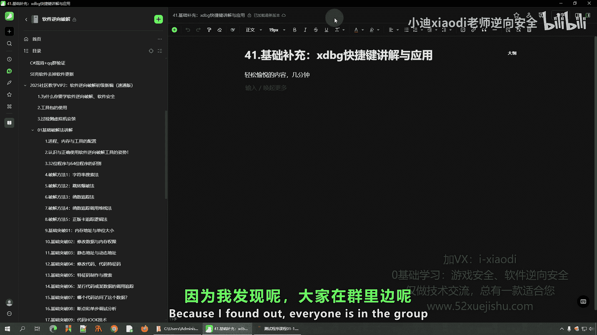

很多同学在群里反复问同一个问题：看视频时画面突然弹出某个窗口，由于讲师操作较快，不知道窗口是怎么弹出来的。实际上这些操作在视频中讲过，只是可能一带而过。例如 `Ctrl+G` 就是常用跳转快捷键，后文会记录。部分同学学习习惯是跳着看，可能跳过关键内容；讲师不责怪大家，每个人有自己的学习习惯，但讲师有责任把快捷键专题单独抽离出来讲解和补充。

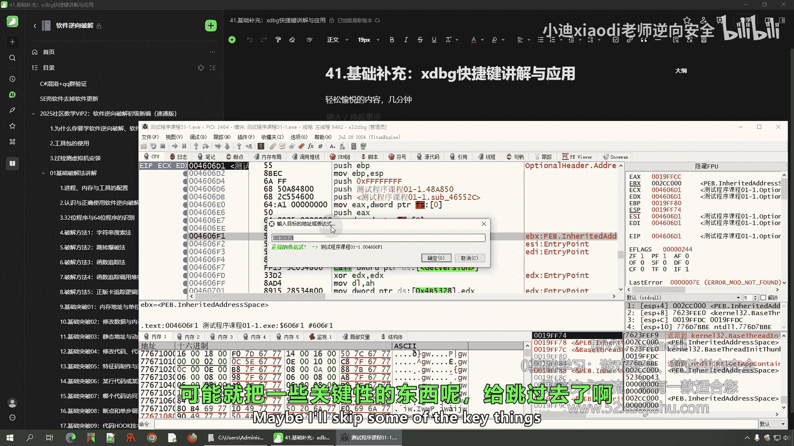

以下是本次课程会覆盖的内容方向，先建立整体印象，后续再逐项展开。

- 单步执行：`F7`、`F8`
- 运行与暂停：`F9`、`F12`
- 跳转地址或 API：`Ctrl+G`
- 搜索字符串与匹配特征：`Shift+D`、`Ctrl+B`、`Shift+Ctrl+B`
- 执行到返回：`Ctrl+F9`
- 修改汇编代码：空格键
- 断点设置与取消：`F2`

如果大家需要补充其他内容，及时在群内反馈，讲师基本都做了记录。例如网页弹窗相关操作、文件删除安装相关操作等补充内容，已经记录到第一章基础补充中。后续还需要补充的内容也会继续放到第一章，作为基础补充。下面从实际操作出发讲解快捷键。


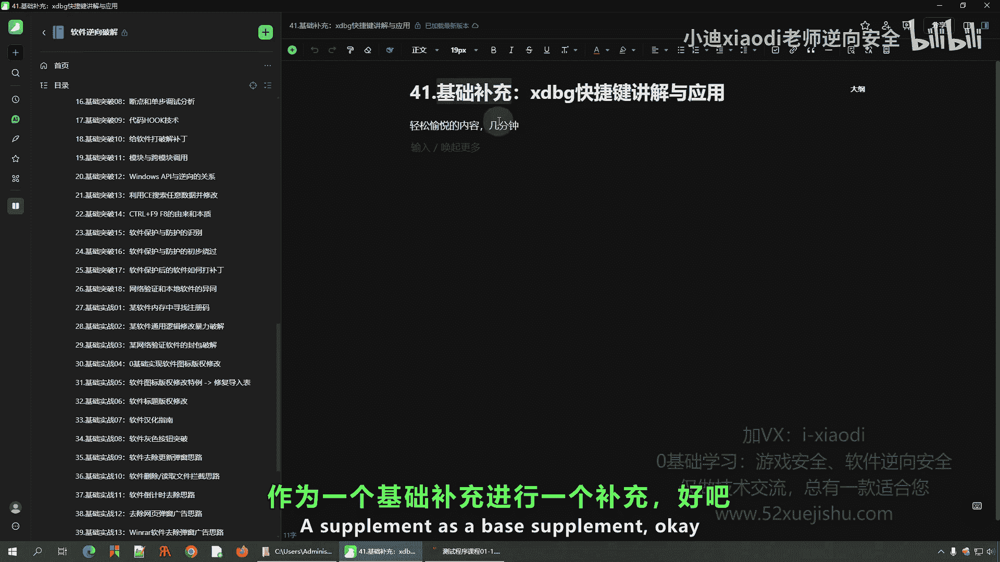

## ⌨️ x64dbg快捷键讲解与应用：02：F8与F7单步执行

上一节我们介绍了课程目标和常用快捷键范围，本节来看看最基础的单步执行。实际分析程序时，先把程序拖进 x64dbg。最简单的快捷键是 `F8` 单步，它位于调试菜单中的“步过”。`F7` 是“步进”。两者本质上都是单步执行一行代码，区别在于是否进入 `call` 内部。

可以用下面的公式理解两者关系。

```text
F8 = 单步执行一行，不进入 call 内部
F7 = 单步执行一行，进入 call 内部
call = 小盒子，内部包含很多代码
```

`call` 在第二章会讲解，`call` 就是函数。函数可以理解成一个小盒子，盒子里有很多代码。双击某个 `call` 可以进入查看，里面代码很多。再找一个盒子双击进入，也能看到盒子里代码非常多。因此 `call` 就是一个小盒子。`F7` 专门针对这个小盒子，进入盒子内部；`F8` 不进入盒子。两者都是一行代码一行代码执行，本质相同，区别只是是否进入小盒子。

以下是实际操作中的观察步骤，用来验证 `F7` 与 `F8` 的差异。

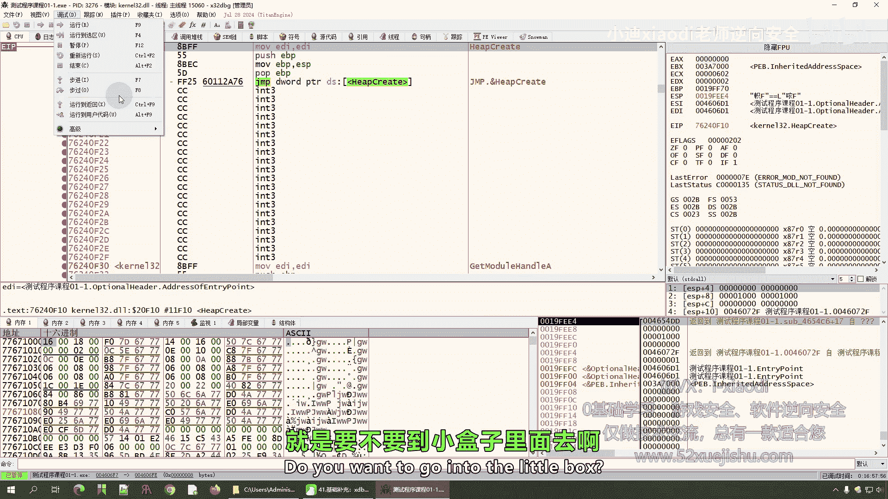

- 按 `F8` 时，程序会直接绕过 `call` 或直接执行完该行。
- 在同样位置按 `F7` 时，程序会直接进入 `call` 内部。
- 继续按 `F7` 可以继续在盒子内部执行，甚至进入更内层的小盒子。

程序像搭积木一样，`call` 就是积木，小程序由这些小盒子组成。理解 `F7`、`F8` 与 `call` 的关系，对后续逆向分析很重要。第二章会讲解函数与栈结构，感兴趣可以自行查看。


## ▶️ x64dbg快捷键讲解与应用：03：F9运行与F12暂停

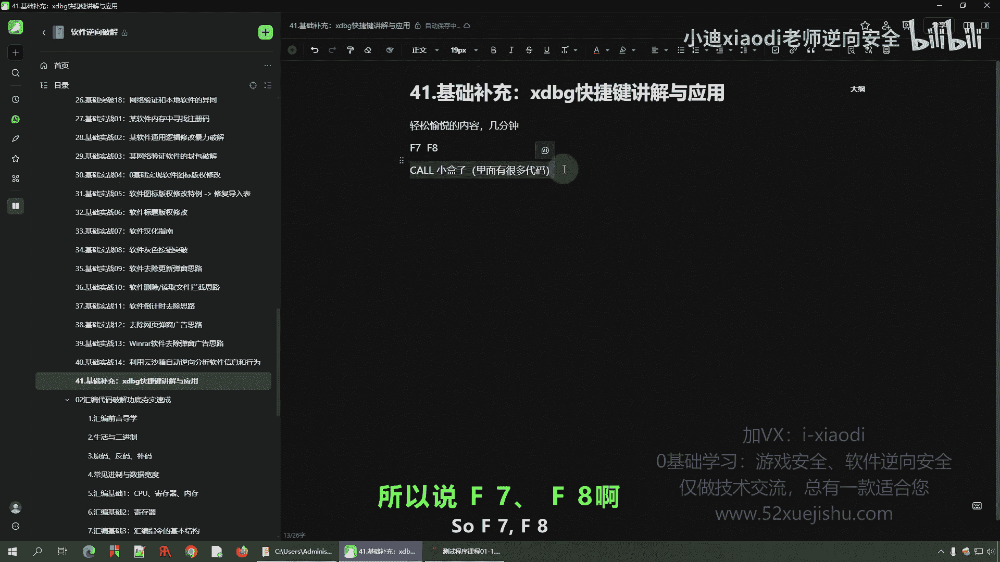

上一节我们弄清楚了 `F7` 和 `F8` 的单步差异，本节来看看程序运行控制。`F12` 是暂停，一般用得比较少。`F9` 是运行。当前左下角状态显示为已暂停，如果要让程序运行起来，按 `F9`，程序就会跑起来。

以下是运行控制相关快捷键的简单对照，先记住高频的 `F9` 即可。

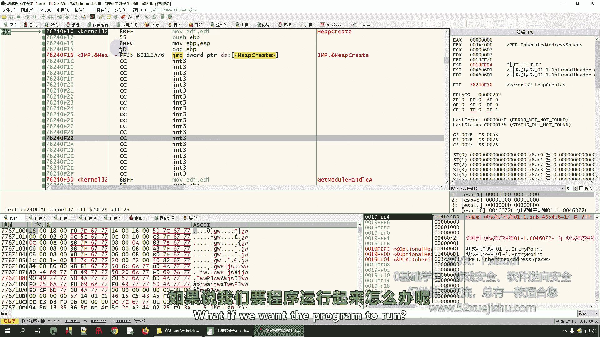

```text
F9  = 运行程序
F12 = 暂停程序
```

程序跑起来后，可以观察程序行为。例如点击登录按钮，程序提示登录失败，这个登录失败就是一个 `MessageBox` 弹窗。这个弹窗也是后续下断点和跳转操作的入口。


## 🧭 x64dbg快捷键讲解与应用：04：Ctrl+G跳转到地址或API

上一节我们观察了程序运行和弹窗行为，本节来看看如何快速跳到某个地址或 API。如果要跳转到某个地址，或者跳转到某个 API 函数，使用 `Ctrl+G`。按下 `Ctrl+G` 后会弹出跳转窗口，例如要在 `MessageBox` 上下断点，可以输入 `MessageBox`，然后点击确定。

核心操作可以记成下面这样。

```text
Ctrl+G -> 输入地址或 API 名称 -> 确定
```

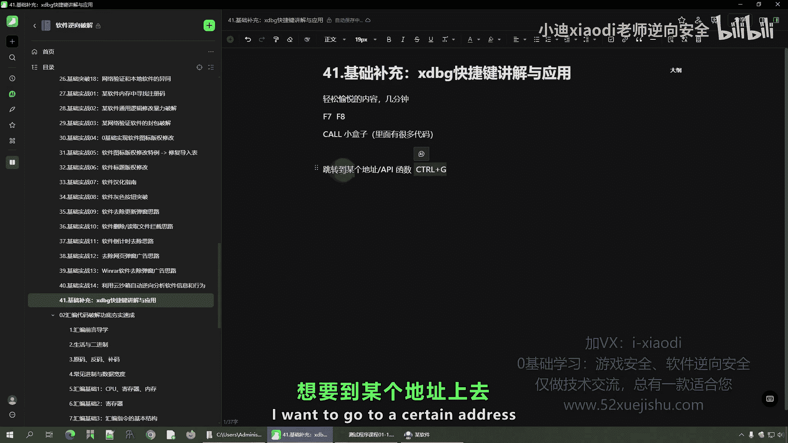

API 函数都有相对地址，因此输入 API 名称后，名称可以和地址匹配。例如 `MessageBox` 的地址是 `771A1160`。可以右键复制这个地址，然后按 `Ctrl+G` 输入地址并确定，会发现仍然跳到同一个位置。也就是说，API 名称实际上做了地址匹配。想在某个 API 函数上下断点，使用 `Ctrl+G`；想跳到某个地址，也使用 `Ctrl+G`。这个快捷键比较常用。

以下是 `Ctrl+G` 的典型用途，适合初学者先掌握。

- 跳转到指定内存地址
- 跳转到指定 API 函数
- 为 API 函数下断点


## 🔎 x64dbg快捷键讲解与应用：05：搜索字符串与匹配特征

上一节我们学习了跳转，本节来看看搜索相关快捷键。先切换到程序主模块。鼠标右键可以搜索当前模块的字符串。搜索当前模块字符串的快捷键是 `Shift+D`。这个快捷键不太常用，因为逆向分析时很多时候不仅搜索当前模块，还要搜索所有用户模块；其他动态库也可能包含有用信息。因此很少有人使用这个快捷键。

以下是搜索相关快捷键的对照，便于区分使用场景。

```text
Shift+D      = 搜索当前模块字符串
Ctrl+B       = 搜索当前区域匹配特征
Shift+Ctrl+B = 搜索当前模块匹配特征
```

搜索匹配特征还有一个快捷键 `Shift+Ctrl+B`，看起来需要按多个键，比较麻烦。实际上直接按 `Ctrl+B` 也可以。实际操作中可以先复制二进制。二进制复制会复制出十六进制字节，然后按 `Ctrl+B` 粘贴并搜索匹配特征。左上角功能就是搜索匹配特征，点击确定后可以搜到 `401004`。

也可以换一种方式：鼠标右键，搜索当前模块，仍然选择搜索匹配特征。区别在于“当前区域”和“当前模块”。当前区域是当前选中的这一片区域，从选中位置开始往下搜索；当前模块则包括整个模块。因此搜索当前区域时，`Ctrl+B` 可能搜不到选中位置之前的内容；搜索当前模块时，`Shift+Ctrl+B` 更全。

以下是两种搜索范围的差异说明，搜索时根据目标选择范围。

- 当前区域：从鼠标选中的位置开始向下搜索，使用 `Ctrl+B`。
- 当前模块：覆盖整个模块，使用 `Shift+Ctrl+B` 更全。
- `Ctrl+B` 中隐藏着“搜索匹配特征”菜单功能，很多同学不知道这一点。

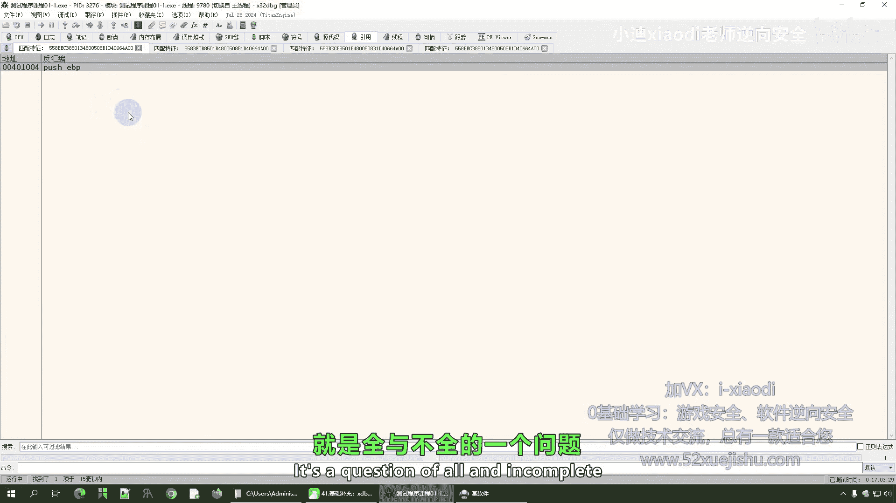

如果希望搜索比较全，优先使用 `Shift+Ctrl+B` 搜索当前模块匹配特征。


## ↩️ x64dbg快捷键讲解与应用：06：Ctrl+F9执行到返回

上一节我们介绍了搜索，本节来看看如何在函数内部快速执行到返回。`Ctrl+F9` 是在小盒子内部执行到返回。举例来说，先跳到 `MessageBox` 上下断点，按 `F2` 打上断点，然后点击登录，程序会断下来。断下来之后，如果要执行到返回，有两种方法。

第一种方法是单步执行，使用 `F7` 或 `F8` 一行一行走。第二种方法是自动执行，使用 `Ctrl+F9`，一次性运行完当前函数里的代码，直接来到返回位置。

以下是执行到返回的两种方法，实际分析时可根据需要选择。

- 单步执行：连续按 `F7` 或 `F8`，逐行观察。
- 自动执行到返回：按 `Ctrl+F9`，直接运行到返回位置。

实际试验中，按 `Ctrl+F9` 后程序会从当前位置直接跳到返回位置，然后按 `F8` 继续。再次按 `Ctrl+F9` 可以从这个小盒子出去，再按 `F8` 继续。继续按 `Ctrl+F9` 会直接执行到关键代码位置。这个快捷键比较常见。关于 `Ctrl+F9` 配合 `F8` 的本质和由来，之前有同学提及，相关内容已经补充到第一章基础补充中，可以自行查看，核心含义就是“执行到返回”。


## 🧰 x64dbg快捷键讲解与应用：07：修改代码与F2断点

上一节我们学习了执行到返回，本节补充两个非常实用的操作：修改代码和设置断点。修改代码时，很多同学有疑问，例如把 `0S0` 改成 `0S1` 应该怎么做。操作方法是按空格键。按空格键会弹出汇编窗口，可以在当前行修改汇编代码，把 `0S0` 改成 `0S1` 即可。也就是说，修改代码使用空格键。

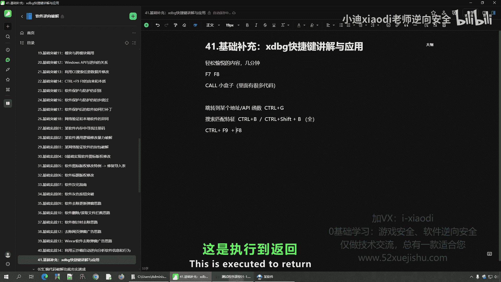

核心操作可以记成下面这样。

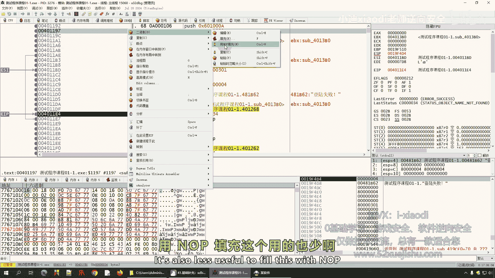

```text
空格键 = 打开当前行汇编修改窗口
F2     = 下断点 / 取消断点
```

断点使用 `F2`。按 `F2` 可以下断点，再次按 `F2` 可以取消断点，下断点和取消断点都是同一个快捷键。

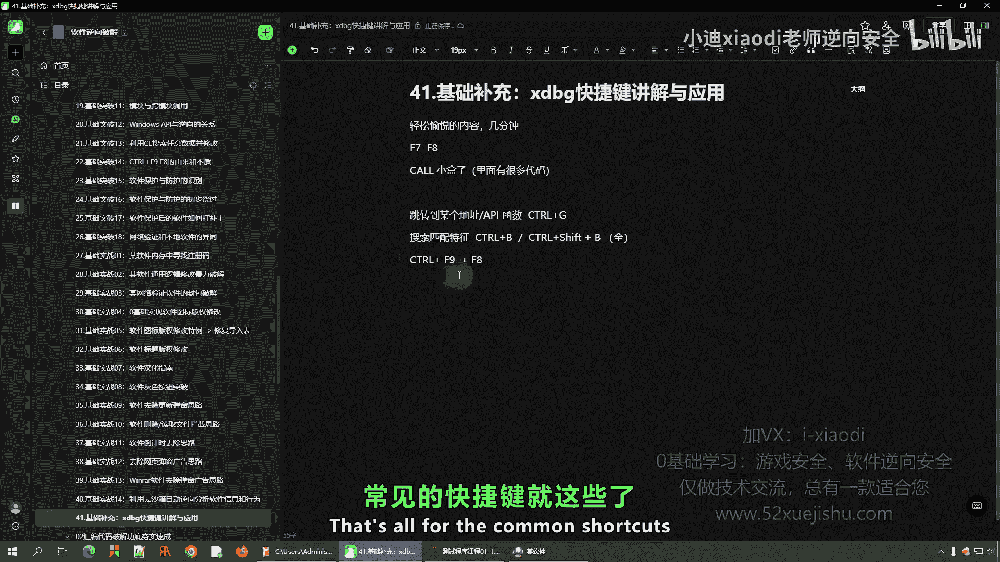

以下是本节的常用操作汇总，都是高频基础操作。

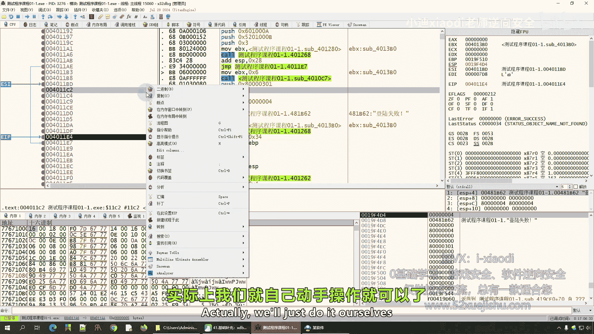

- 修改汇编代码：按空格键。
- 下断点：按 `F2`。
- 取消断点：再次按 `F2`。

其他快捷键使用频率不高，例如 `Ctrl+C` 是复制选区。实际使用时鼠标右键复制可能更简单，按快捷键反而可能更麻烦。所有快捷键在工具中都有说明，想自己探索和实践，可以直接查看说明。常见快捷键就是这些，其他不太常用，动手操作即可。


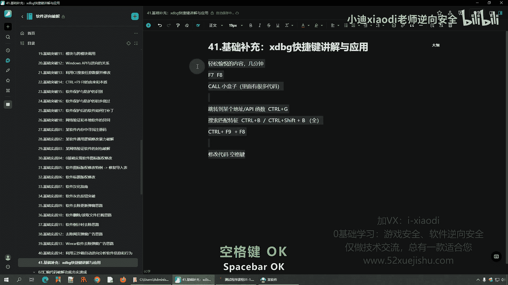

## ✅ x64dbg快捷键讲解与应用：08：课程总结与练习建议

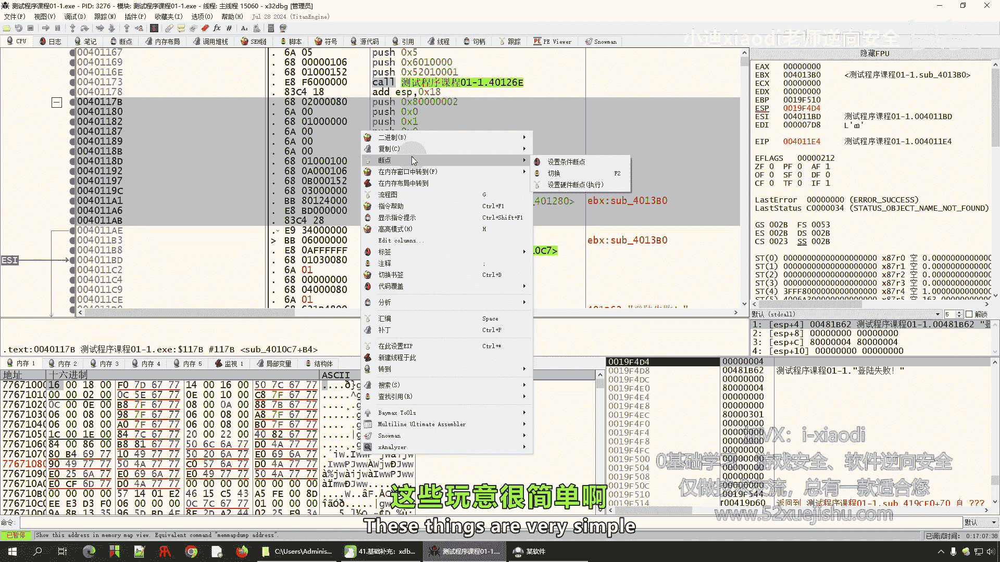

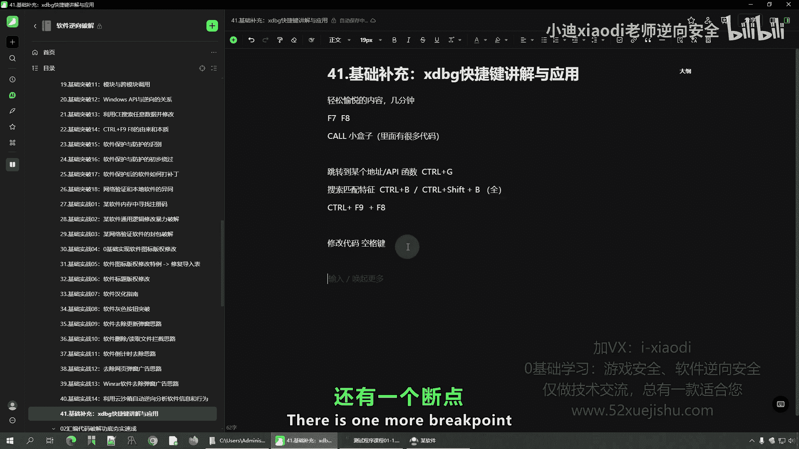

本节课中我们一起学习了 x64dbg 常用快捷键及其实际应用。内容比较轻松，因为实际使用这个工具时不需要掌握所有快捷键。快捷键用得好可以提高效率；用不好时频繁点鼠标也会比较烦。建议课后自己练一练，把本次内容作为基础补充集中理解。

以下是本节课需要重点掌握的高频快捷键，建议反复练习。

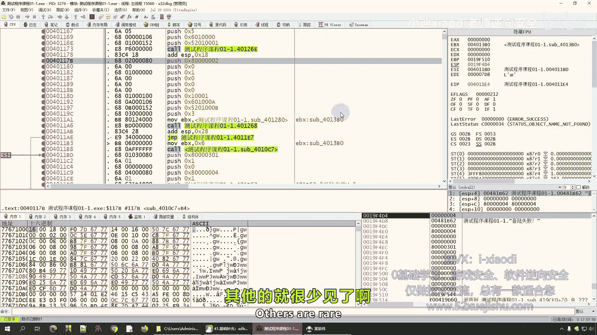

- `F8`：单步步过，不进入 `call`。
- `F7`：单步步入，进入 `call`。
- `F9`：运行程序。
- `F12`：暂停程序，使用较少。
- `Ctrl+G`：跳转到地址或 API。
- `Shift+D`：搜索当前模块字符串，使用较少。
- `Ctrl+B`：搜索当前区域匹配特征。
- `Shift+Ctrl+B`：搜索当前模块匹配特征，范围更全。
- `Ctrl+F9`：执行到返回。
- 空格键：修改汇编代码。
- `F2`：下断点或取消断点。

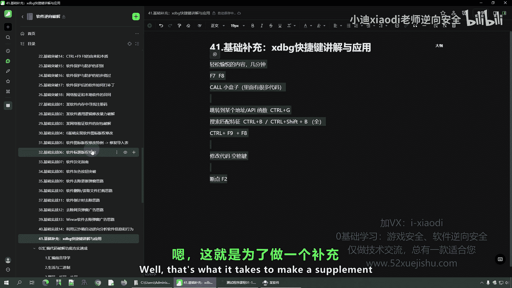

本次课程是为了对快捷键做一个补充和集中讲解，课后练习后下期再见。

