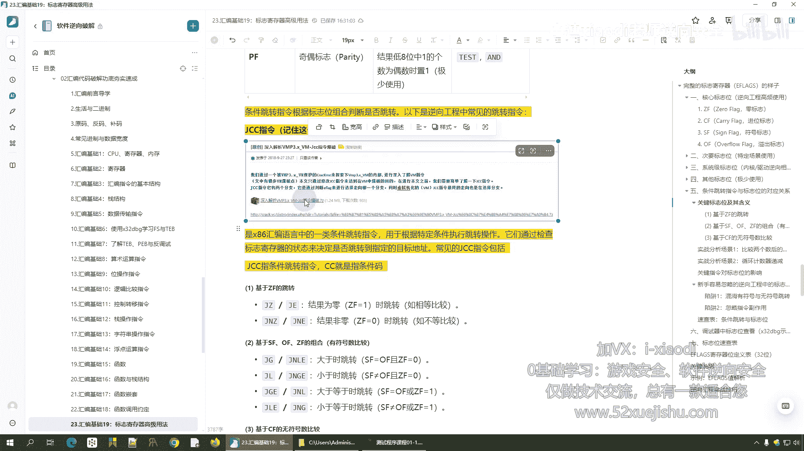
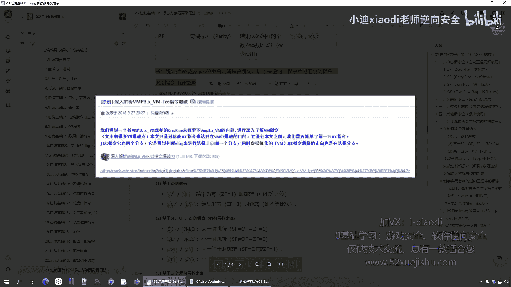
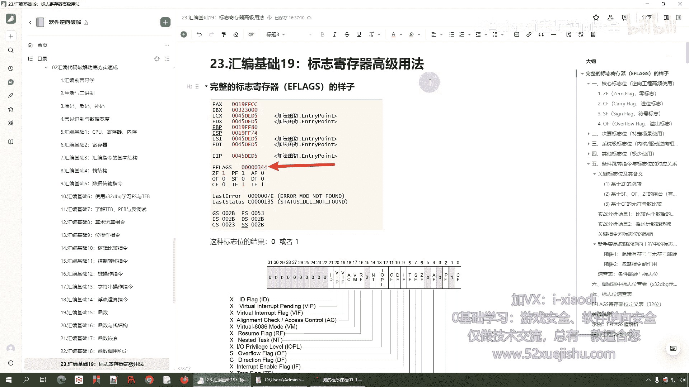

# 标志寄存器讲解与应用：00：课程概述与学习目标 🧭

在本节课中我们将要学习标志寄存器在软件逆向、游戏安全、软件安全和 CTF 比赛中的基础用法，重点理解 CPU 执行算术运算和逻辑运算后，标志位如何记录结果状态，以及条件跳转如何根据这些状态决定程序走向。课程会从 EFLAGS 的整体结构讲起，再介绍 ZF、CF、SF、OF 等核心标志位，随后说明 JE 与 JZ、JNE 与 JNZ 等条件跳转指令的关系，最后通过 x64dbg 实操演示不修改代码、只修改标志位实现软件逆向破解。


> 课程来源：BV1FxLtzPEhx

本课程适合初学者。内容会尽量用直白语言解释，核心概念会用公式或代码描述。学习目标是看懂标志位含义、理解条件跳转依据、掌握在调试器中观察和修改标志位的方法。

---

# 标志寄存器讲解与应用：01：认识 EFLAGS 与寄存器结构 🧱

上一节我们说明了课程目标，本节中我们来看看标志寄存器在 CPU 寄存器体系中的位置。之前在讲寄存器时提到过，寄存器有很多种，每种都有不同用途，例如通用寄存器、段寄存器、指令指针寄存器，以及今天要讲的标志寄存器。

标志寄存器用于存储 CPU 执行操作后的状态信息。它包含一个或多个标志位，表示算术运算和逻辑运算后的结果状态。常见用途是在条件跳转中作为判断依据。只看概念会感觉抽象，所以需要结合具体案例理解实际应用效果。

完整的标志寄存器 EFLAGS 示意图中，上方可以看到通用寄存器，EIP 是指令指针寄存器。EIP 非常重要，课程也对其做了拓展说明。再往下就是 EFLAGS，也就是标志寄存器。它看起来像一个整体，实际上由很多位组成，一共是 0 到 31，共 32 个标志位。

标志位的状态可以用公式表示为：

```text
EFLAGS[31:0] = { 标志位31, ..., 标志位1, 标志位0 }
单个标志位 ∈ {0, 1}
```

这么多标志位不需要逐个记忆。不懂或忘记时查资料即可。调试工具中也不会全部列出，只会列出常用标志位。实际逆向分析时常用的可能只有一两个或两三个，原理并不复杂。剩余笔记会放到论坛，供课后阅读。

---

# 标志寄存器讲解与应用：02：常见标志位与记忆方法 📌

上一节我们认识了 EFLAGS 的 32 位结构，本节中我们来看看实际学习中需要关注哪些标志位。调试工具中常列出 9 个常用标志位，但实际逆向时并不需要全部熟记，常用标志位数量很少。

以下是常见标志位的学习范围介绍：

- 核心标志位：高频使用，需要重点理解。
- 次要标志位：例如 PF 奇偶标志，用于判断奇偶情况，但日常逆向判断奇偶的场景并不多。
- 系统级标志位：一般不需要重点查看。
- 其他标志位：简单了解即可。

记忆方法可以用一句话概括：先理解核心标志位的触发条件，再结合条件跳转指令观察实际效果。忘记具体含义时查笔记和速查表，不需要死记硬背。

---

# 标志寄存器讲解与应用：03：核心标志位 ZF、CF、SF、OF ⚙️

上一节我们了解了标志位的记忆范围，本节中我们来看看最核心、最高频使用的标志位。第一个是 ZF，也就是 zero flag，零标志位。运算结果为零时，该标志位触发，标志位变为 1。标志位只有两种状态，要么是 0，要么是 1。

ZF 的判断逻辑可以用公式表示为：

```text
ZF = (运算结果 == 0) ? 1 : 0
```

ZF 为 1 表示成立，ZF 为 0 表示不成立。常见触发指令不需要死记，调试分析时会看到类似 `TEST EAX, EAX` 检测 EAX 是否为 0，然后用 `JZ` 跳转。`JZ` 中的 Z 与 zero 绑定，表示根据 ZF 判断是否跳转。

第二个是 CF，也就是 carry flag，进位标志。无符号数运算产生进位或借位时，CF 置 1。例如十进制中 9 加 1 等于 10，产生进位，多出一位。二进制运算同理，超过表示范围就会进一位。例如 16 进制中 F 是单个位的最大值，再加一就会溢出并进一位，此时 CF 置 1。

CF 的触发可以概括为：

```text
无符号运算产生进位或借位 -> CF = 1
```

第三个是 SF，也就是 sign flag，符号标志。它特指正负号。运算结果最高位为 1 时表示负数。之前讲过，运算结果最高位为 1 是负数。比较指令例如 `CMP EAX, 0` 后，如果结果是负数，可以用 `JS` 判断并跳转。负数会影响 SF 标志位。

SF 的判断逻辑可以用公式表示为：

```text
SF = 运算结果最高位
最高位为 1 -> 负数
```

第四个是 OF，也就是 overflow flag，溢出标志。溢出是指有符号数运算超过可表示范围。例如 7F 是正数最大值，再加一就会变成负数，此时发生溢出。若发生溢出，`JO` 会触发跳转。

OF 的触发可以概括为：

```text
有符号运算结果超出范围 -> OF = 1
```

---

# 标志寄存器讲解与应用：04：次要标志位与其他标志位 🧩

上一节我们介绍了 ZF、CF、SF、OF 四个核心标志位，本节中我们简单看看次要标志位和其他标志位。PF 是奇偶标志，用于判断结果中 1 的个数奇偶性，但日常逆向中判断奇偶的情况并不多。系统级标志位一般不需要查看。其他标志位简单了解即可。

以下是标志位学习优先级的介绍：

- 优先掌握 ZF，因为它与零值判断、相等判断关系密切。
- 结合 CF 理解无符号运算的进位和借位。
- 结合 SF 理解有符号结果的正负。
- 结合 OF 理解有符号溢出。
- PF、系统级标志位和其他标志位作为了解内容。

这一节的目标不是全部背下来，而是知道遇到时去哪里查、在调试器里如何看。只要核心标志位理解清楚，条件跳转分析就会容易很多。

---

# 标志寄存器讲解与应用：05：条件跳转指令与标志位对应关系 🔀

上一节我们认识了各类标志位，本节中我们来看看条件跳转指令与标志位的对应关系。这部分是实际逆向分析中需要重点理解的内容。条件跳转指令会根据标志位组合判断是否跳转。

先介绍 JCC 指令。JCC 是 x86 汇编语言中的一类条件跳转指令，是条件跳转指令的统称。它通过检查标志位状态来决定是否跳转到指定目标地址。JCC 中的 CC 指条件码。阅读文章时可能看到“深入解析 VMP3.x VM JCC”之类表述，这里的 JCC 也是条件跳转统称，文章里可能是自己实现的一种跳转机制。以后看到 JCC 就知道它表示条件跳转。

JCC 的概念可以用代码表示为：

```asm
JCC 目标地址
; JCC = 条件跳转指令统称
; 根据标志位状态决定是否跳转
```

以下是常见条件跳转与标志位关系的介绍：

- `JZ` 与 `JE` 相同，结果为零时跳转，受 ZF 控制。
- `JNZ` 与 `JNE` 相同，`NOT` 表示相反意思，不等于零或不相等时跳转。
- `JS` 根据 SF 判断负数时跳转。
- `JO` 根据 OF 判断溢出时跳转。
- 基于 CF 的跳转也属于条件跳转组合判断的一部分。
- SF、CF、OF、PF 相关跳转不逐个阅读，可以自行查看速查表。

常见标志位组合的优先级可以概括为：ZF 常与 `CMP` 等指令配合；SF 常与 `CMP`、`SUB` 配合；CF、OF、PF 也参与条件跳转组合判断。实际分析时先看比较或运算指令影响了哪些标志位，再看后面的条件跳转使用哪个标志位。

---

# 标志寄存器讲解与应用：06：CMP、TEST、DEC 的实际场景 🧪

上一节我们说明了条件跳转与标志位的关系，本节中我们来看几个实际场景。`CMP EAX, EBX` 用于比较两个值，原文先提到判断两个是否相等，随后说明大于时跳转，实际是利用比较结果配合条件跳转判断大小关系，例如 EAX 大于 EBX 时跳转。`CMP EAX, 5` 配合 `JLE` 表示小于等于时跳转，L 是 less，E 是 equal，也就是小于等于。

`DEC ECX` 表示 ECX 逐步减 1。不断减 1 最终会减到 0。配合 `JNZ` 表示不为 0 时继续循环跳回，为 0 时结束循环。`DEC` 指令不影响 CF，但会影响 ZF。

以下是关键指令与标志位影响的介绍：

- `CMP` 指令不保存结果，本质是左边减右边。
- `TEST` 指令不保存结果，本质是左右做与操作。
- `TEST EAX, EAX` 常用于检查 EAX 是否为 0。
- `CMP` 常与 `JE`、`JZ`、`JG`、`JLE` 等条件跳转配合。
- `DEC` 常与 `JNZ` 配合实现循环控制。



这些指令的用途非常常见。理解它们对标志位的影响后，就能看懂很多条件跳转的实际含义。



---

# 标志寄存器讲解与应用：07：x64dbg 修改标志位实现逆向破解 🛠️

上一节我们分析了比较、测试和循环指令，本节中我们通过 x64dbg 实操观察标志位与跳转方向。先运行一个程序，点击登录，出现登录失败。一般操作是点击文件、点击附加，然后搜索当前模块中的“登录成功”和“登录失败”。

搜索后可以看到“登录成功”和“登录失败”附近有条件跳转指令 `JE`。`JE` 就是 `JZ`，两者实际一样。例如看到 `0F84 89000000` 这样的条件跳转，按空格可以显示互变代码，显示为 `JZ`，本质相同。`JE` 可以理解为 equal，表示相等，设计上更人性化，但本质上仍受 ZF 控制。

以下是 x64dbg 观察和修改标志位的操作介绍：

- 在条件跳转处下断点。
- 点击登录，观察程序是否直接跳转。
- 查看 ZF 的值，ZF 为 1 表示上面的运算结果为零。
- 双击 ZF 可以改变标志位状态。
- 观察跳转方向变化，双击后跳转将要执行或不会执行。
- 直接修改标志位即可改变程序走向。

实操中可以看到，ZF 的结果直接决定跳转方向。双击 ZF 后，跳转将要执行；再次双击后，跳转不会执行。这样不需要修改代码，只修改标志位就可以实现破解成功。运行后可以看到成功结果。这就是标志位在软件逆向破解中的实际应用。

---

# 标志寄存器讲解与应用：08：速查表、调试器查看方法与总结 📚

上一节我们完成了修改标志位的破解演示，本节中我们来看看调试器中如何查看 EFLAGS，以及速查表和课后练习。在调试器中查看标志位非常简单。打开调试界面，看到一个 `EFL` 标志，双击复制，点击目标位置粘贴，就可以看到二进制形式的标志位。EFLAGS 一共 32 位。

查看方法可以用代码表示为：

```text
双击 EFL -> 复制 -> 点击目标位置 -> 粘贴 -> 查看 32 位二进制标志位
```

以下是课后学习与速查表使用介绍：

- 条件跳转与标志位配合使用速查表：用于查看常见跳转与标志位关系。
- 单独标志位速查表：遗忘某个标志位含义时查询。
- 课后练习：在调试器中修改 ZF 等标志位，观察跳转方向变化。
- 笔记阅读：课程笔记会放到论坛，课后自行阅读。
- 重点复习：ZF、CF、SF、OF 与 JZ、JE、JNZ、JNE、JS、JO 的对应关系。



本节课中我们一起学习了标志寄存器的整体结构、核心标志位含义、条件跳转与标志位对应关系、CMP、TEST、DEC 的实际场景，以及通过 x64dbg 修改 ZF 实现不修改代码的逆向破解。课后需要结合笔记和速查表练习，把标志位观察、条件跳转判断和调试器操作连起来理解。

