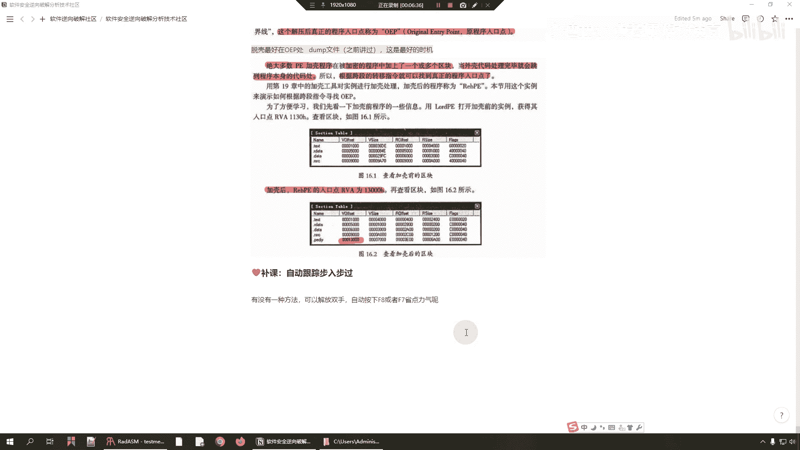

# 🛠️ x64dbg自动化分析：第六章：自动跟踪步入步过

在本节课中，我们将学习如何使用x64dbg的自动跟踪功能，通过快捷键代替手动按下F8或F7进行单步调试，从而在查找OEP（原始入口点）的过程中解放双手。这是逆向分析中非常实用的效率技巧，特别适合处理那些循环多、跳转频繁的加壳程序。


## 🔄 从手动调试到自动跟踪

上一节课中，我们学习了如何手动查找OEP。手动查找的方法需要我们不断地按F8进行单步执行代码，这个操作步骤有时候会让人感觉非常疲惫。你需要在代码的海洋中一遍遍地按下同一个按键，而且还要时刻关注寄存器和栈的变化，这对耐心和专注力都是不小的考验。那么有没有一种方法可以解放双手，自动按下F8或F7来省点力气呢？答案是肯定的，今天我们就来介绍这个实用的功能。


自动跟踪功能的核心逻辑很简单，就是让调试器模拟你手按快捷键的操作，以一定的节奏自动执行单步指令。下面我们用伪代码来描述这个自动化过程：


```
# 自动跟踪的伪代码逻辑
def auto_trace(step_type):
    while not breakpoint_hit:
        if step_type == "F7":
            debugger.step_into()
        elif step_type == "F8":
            debugger.step_over()
        if user_presses_stop:
            break
```

## 🎯 实验准备与程序加载

首先我们需要准备一个实验程序，就是上节课用到的那个实验程序，它是一个带有壳的示例程序。然后打开我们的x32dbg调试器，将这个实验程序拖入到调试器窗口中。我在这里用的是x32dbg，也就是32位版本的x64dbg，这个工具在逆向工程领域非常常用，功能强大且操作界面直观。


拖入程序之后，我们发现在入口处有一条`pushAD`指令，它在保存寄存器环境，这是壳代码的特征之一。然后我们按下F8执行这条指令，接着按F7。为什么要按F7呢？因为如果你直接按F8的话，程序就跑飞了，无法继续正常的跟踪流程。这个壳的核心代码都包含在这个位置，如果直接跳过去，后续的流程就会完全失控。

```
# 壳入口的关键指令模式
pushad          ; 保存所有通用寄存器到堆栈
...
call decompress ; 调用壳的解压函数
jmp OEP         ; 跳转到原始入口点
```

按下F7之后，我们就进入了壳的内部代码区域。后续的这些代码，我们就可以不断地按F8进行单步执行了。但是如果我们一行一行地按F8的话，操作量会非常大，而且里面会有很多跳转指令，有向上跳的循环，也有向下跳的分支，这些跳转特别多，代码结构比较复杂，手动跟下来会非常劳累。


## ⌨️ 自动跟踪操作步骤

那么按下什么快捷键才能实现自动跟踪、自动步入步过呢？方法很简单，我们来看具体操作。

我们可以按下快捷键`Ctrl+F7`或者`Ctrl+F8`，这两个快捷键的作用分别对应自动按F7和自动按F8。你可以直接点击菜单栏上的“跟踪”选项，里面会有对应的命令项，也可以直接按下键盘上的快捷键组合，两种方式都可以实现相同的效果。

具体操作步骤如下：

- 在x32dbg中打开实验程序，拖入后停在入口点处。
- 按F8执行`pushAD`，再按F7进入壳代码内部。
- 按下`Ctrl+F8`启动自动单步跟踪，或者按`Ctrl+F7`启动自动步入跟踪。
- 观察右侧注释窗口，等待程序自动执行并跑起来。

按下`Ctrl+F8`之后，就可以看到调试器在自动地帮我们按F8，自动实现单步跟踪。这个过程中不需要你进行任何操作，一切都在自动进行。当它执行到某些关键函数时，右侧的注释窗口会实时显示当前正在解析的API函数名称和地址等信息，例如`GetModuleHandleA`、`GetCommandLineA`等等。

**跟踪快捷键对应表**

| 快捷键 | 功能 |
|--------|------|
| `Ctrl+F7` | 自动步过（自动F8） |
| `Ctrl+F8` | 自动步入（自动F7） |

那什么时候让它跟踪完呢？就是让这个程序自然而然地跑起来就可以了，不需要人为干预。请记住，自动跟踪和手动跟跟踪的原理是一样的，区别只是一个是人肉按键，一个是机器自动按键，本质上没有任何区别。


## 🏁 程序跑起来与OEP识别

在自动跟踪的过程中，我们可以一边让它跑，一边观察右边这些注释。可以看到它在获取相关的一些API函数，然后把它的一些地址取出来，我们就让它自动地执行就可以了。整个跟踪过程看起来非常有科技感，就像是一个黑客在让程序自动分析一样。这个过程中可能会遇到一些循环结构，不过没关系，我们只需要耐心等待它逐步执行完成就好。


等到程序跑起来之后，我们就可以开始分析了。程序跑起来之后，我们需要观察一下代码的结构和组成。这里我们看到的库函数调用顺序如下：

```
GetModuleHandleA  ; 获取模块句柄
GetCommandLineA   ; 获取命令行参数
GetVersion        ; 获取系统版本
```

从前面几节课的内容，我们已经学习了Windows 32位汇编程序开发的相关知识。大家应该已经知道，一个正常的Windows程序在启动时，需要经过一系列初始化操作：

- 调用`GetModuleHandleA`获取当前模块的句柄。
- 调用`GetCommandLineA`获取命令行参数信息。
- 根据需要调用`GetVersion`、`GetModuleFileName`等API获取系统信息。

看到这些API函数调用，我们就可以判断出程序已经运行到了接近OEP的位置。事实上，当我们看到`GetModuleHandleA`和`GetCommandLineA`出现在代码中时，就可以确定这里实际上就是程序的入口`start`，也就是程序的原始入口点，即OEP。

这里我们可以用一个简单的公式来记忆：

```
OEP ≈ 函数头部位置
```

简单来说，当你看到`GetCommandLineA`上方有一个完整的函数头部结构，那个函数头部所在的位置就是OEP。这是一种观察OEP的有效方式和方法。这个函数的头部一般会包含标准的函数序言代码，例如`push ebp`、`mov ebp, esp`这样的指令序列，非常容易辨认。

## 📝 总结


本节课中我们一起学习了x64dbg的自动跟踪功能。通过`Ctrl+F7`和`Ctrl+F8`两个快捷键，我们可以自动进行步入和步过操作，在查找OEP时解放双手，提高分析效率。同时，我们也学习了如何通过观察`GetModuleHandleA`和`GetCommandLineA`等API函数的调用位置，快速定位程序的原始入口点，这是一种很实用的OEP判定技巧。



在具体的操作过程中，我们需要注意在有壳的程序中先手动用F8和F7进入壳的代码区域，然后再启动自动跟踪，否则程序有可能会跑飞。自动跟踪让我们不用再一直按键盘，也可以腾出精力来观察分析代码流程，让逆向分析工作变得更加轻松愉快。
