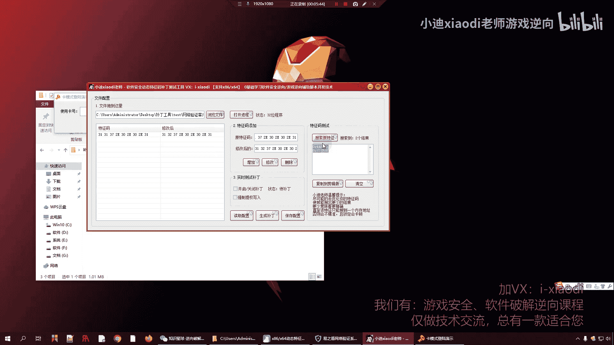
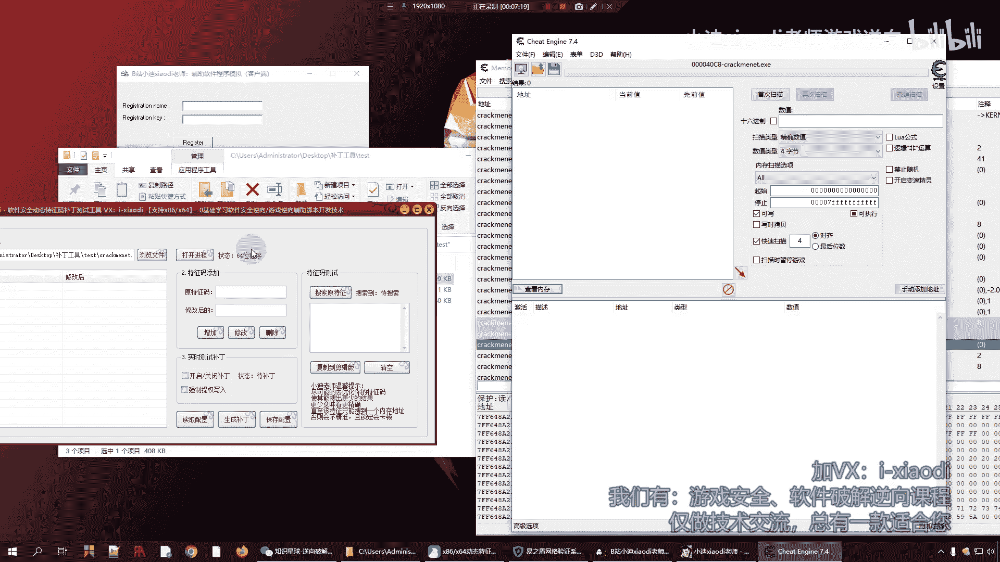

## 🧰 x86/x64特征码补丁测试工具教程：01：课程概述与工具定位

大家好，我是小李老师。最近大家在群里经常说，有一些特征码补丁工具特别不好用，问能不能写一个特征码补丁测试工具。今天这个工具来了。在本节课中，我们将要学习这个初步开发的支持32位和64位的动态特征码测试工具，它方便大家在做逆向分析、逆向工程时进行及时测试。下面先说明课程目标和工具定位。

以下是本课程要覆盖的核心内容：

- 工具运行后的界面与基本使用流程。
- 32位程序与64位程序的测试方式。
- 特征码搜索、优化、保存和读取配置。
- 修改代码与数据、处理只读内存保护、强制提权写入。
- 生成补丁功能的后续计划。

## 🖥️ x86/x64特征码补丁测试工具教程：02：工具界面与32位程序准备


上一节我们介绍了工具的定位和课程目标，本节中我们来看看工具运行后的界面，以及32位程序的准备方式。这个工具运行起来后就是这样一个界面。使用方法非常简单，界面上按1、2、3的步骤组织，比较人性化。我们先测试一个32位程序，这个程序是32位程序。先把它运行起来。也可以把程序拖进去，拖进去之后再运行起来，两种方式都可以。然后点击“打开进程”，工具会显示这是多少位的程序，并自动判断位数。接下来可以搜索程序里的特征之类的特征码。但前提是自己先分析，例如分析程序里的IP。下面列出32位测试的准备步骤。

以下是32位程序测试的准备步骤：


- 运行32位目标程序。
- 将目标程序拖入工具，或在拖入后再运行目标程序。
- 点击“打开进程”，确认工具自动判断出的程序位数。
- 准备需要分析的特征码，例如IP地址特征。

## 🔍 x86/x64特征码补丁测试工具教程：03：分析IP特征与搜索特征码

上一节我们准备了32位程序并打开了进程，本节中我们来看看如何分析IP特征并搜索特征码。可以改代码，也可以改数据，两者是一样的，因为数据和代码最终存放形式都是字节形式，都是0和1。例如程序里有`117.0.0.1`。我们可以用鼠标选择二进制复制。先看登录功能，登录实际上会连接服务器`117.0.0.1`。这个服务器可能已经跑路或倒闭，所以待会程序会提示连接出错。稍等，程序会连接不上。可以看到提示“连接服务器失败，请稍后重试”。这时可以把IP特征放到工具里。程序里有多少个这样的特征，可以点击搜索。搜索后可以看到有5个这样的特征。这里提示要尽可能优化特征码，使其搜出更少结果。也就是说，搜到的东西最好定位到一个，或者两个、三个，不要太多。结果太多会影响精确度，更少意味着更精确，否则会不精准；而且将来锁定数据时也会卡顿。可以用公式描述搜索质量：

```text
结果数量 ↓  =>  定位精度 ↑
结果数量过多 => 锁定数据时容易卡顿
```

以下是IP特征搜索的操作要点：

- 用鼠标二进制复制目标IP特征。
- 将特征放入工具的特征输入位置。
- 点击搜索，查看结果数量。
- 优先选择结果更少、定位更精确的特征码。

## ✏️ x86/x64特征码补丁测试工具教程：04：修改IP特征与保存配置

上一节我们分析了IP特征并进行了搜索，本节中我们来看看如何修改IP特征并保存配置。可以把`117.0.0.1`改成`127.0.0.1`。原文中“31是1”，这里把`31`变成`32`即可。字符`31`对应`1`，把第二个字符`1`改成`2`，也就是字节变化`0x31 -> 0x32`。在工具这里把31变成32，点击“增加”，这样特征码就放到这里。如果想下一次打开就能用，可以点击“保存配置”，然后找到工具文件夹，点击保存。可以把配置改成“网络验证”，例如“网络验证一”，然后点击保存，工具会提示保存成功。这样特征就会放到这个配置里，下一次点击“读取配置”就可以读出来，后面会再说明。以下是修改与保存配置的步骤。

以下是修改IP特征并保存配置的步骤：

- 将IP特征中的`117`改为`127`，对应把`31`改为`32`。
- 在工具中把31变成32，点击“增加”。
- 点击“保存配置”，选择工具文件夹。
- 将配置命名为“网络验证一”等名称并保存。
- 看到保存成功提示后，确认特征已写入配置。

```text
原特征： "117.0.0.1"
新特征： "127.0.0.1"
字节变化：0x31 -> 0x32
```

## 🗂️ x86/x64特征码补丁测试工具教程：05：读取配置、修改与删除特征

上一节我们保存了配置，本节中我们来看看如何读取配置，以及如何修改和删除特征。这时可以修改，开启补丁，补丁完成5个。会发现数据没有变动。为什么没有变动，因为这边存在一些内存保护。可以点击“强制提权写入”并勾选上，然后再写。可以看到这样就可以写入了。待会会给大家看权限到底是怎么一回事。提权知识方面，工具支持提权写入。现在界面上的基本东西都了解了。这边点一下可以修改特征。例如这里改成32，或者要改成33，这边不支持修改；要改的话，要在这里同步，就是特征码可以修改，但修改后的东西不要乱改，所以工具支持在这里进行修改，否则容易乱。例如改成33，点击修改，这时就变成33。这边就会变成3，进行测试，可以看到这边变成3。如果要删除，可以这样删除，可以看到就没了。这边可以点击清空，也可以复制到剪贴板，把数据复制到剪贴板。想清空就清空。以下是修改和删除功能的操作要点。

以下是读取配置、修改特征和删除特征的操作要点：


- 在同步区域修改特征码，避免直接乱改修改后的内容。
- 将特征改成33后点击修改，确认界面同步变成3。
- 使用删除操作移除不需要的特征。
- 使用清空按钮清空列表。
- 使用复制到剪贴板复制当前数据。


## 🔐 x86/x64特征码补丁测试工具教程：06：内存保护与强制提权写入

上一节我们了解了配置读取和特征修改，本节中我们来看看读取配置后的搜索，以及为什么需要强制修改和强制提权写入。接下来演示读取配置，以及强制修改这里为什么会强制修改。把程序关掉，这个程序也可以关掉，重新来一遍。运行工具，运行后把程序拖过来，再运行这个程序，然后打开进程。点击“读取配置”，选择“网络验证一”，点击打开，就是这个配置。想搜的话可以全选，或者不全选都一样。点击“搜索特征”（原文称“搜索语言特征”），可以看到两个结果，或者只搜索到一个结果。我们看看为什么写不进去。可以用CE查看。选择这个进程，CE有功能可以查看内存属性，会发现`4A8B1`这里是只读的，是只读数据。这边是可以写入的，也就是说一个可以写入，一个不可以写入。只读数据点击修改，修改不了。所以要强制提权，这就是提权的作用。强制提权后再去写入，可以看到就可以修改了。这就是强制提权写入功能，让这边的内存能够写入，也就是强制提权写入。可以用公式描述提权写入过程：

```text
只读内存 -> 强制提权 -> 可写内存 -> 写入成功
```



以下是强制提权写入的操作流程：

- 重新运行工具和目标程序，打开进程。
- 点击“读取配置”，选择“网络验证一”并打开。
- 按需全选或不全选特征，点击搜索。
- 用CE查看目标地址的内存属性，确认是否为只读。
- 勾选“强制提权写入”后再执行写入，确认数据修改成功。

> 只读内存不能直接修改，工具提示补丁完成也不代表写入一定成功；需要先处理内存权限，再进行写入。

## 🧪 x86/x64特征码补丁测试工具教程：07：64位程序测试

上一节我们处理了只读内存和提权写入，本节中我们来看看64位程序下的测试。这个工具同时支持64位，下面测试一下。这是一个64位程序，先运行起来，然后打开并把程序拖过来，拖过来之后点击“打开进程”，这时候就是一个64位程序。现在随便找一个特征去试一下。重新开启CE，打开这个程序，随便找一个特征，例如这个特征。我们可以把这个特征复制到剪贴板，选择二进制复制。然后在工具这里搜索一下，可以看到一个结果。这个地址可以跳过来，这是一个四期地址（按原文记录）。这个地址是`B808`。假如把`B808`改成`B807`，可以在这里添加修改`B807`，点击“增加”，把`B808`改成`B807`。这时直接去修改，你可能猜到了，就是改不动，因为它现在是只读状态，改不动，改不了。虽然提示补丁完成，但是改不了。怎么办，点击“强制提权写入”。这时`B807`就写进去了。工具支持32位也支持64位。所以不管改代码段，现在改的是代码，这是一个代码的地址，这边是把代码以数据形式显示的。不管改代码还是改数据，通通都可以，支持32位、支持64位，强制提权写入也可以。以下是64位测试的操作要点。

以下是64位程序测试的操作要点：



- 运行64位目标程序并拖入工具。
- 点击“打开进程”，确认工具识别为64位程序。
- 在CE中复制一个二进制特征到工具中搜索。
- 跳转到目标地址，例如`B808`。
- 尝试把`B808`改为`B807`，直接修改会因只读状态失败。
- 勾选“强制提权写入”后再写入，确认`B807`写入成功。

```text
目标地址：B808
目标修改：B808 -> B807
现象：直接写入失败（只读）
处理：强制提权写入 -> B807 写入成功
```

## 🧭 x86/x64特征码补丁测试工具教程：08：后续计划与课程总结

上一节我们完成了64位程序测试，本节中我们来看看工具后续计划并做课程总结。这就是今天的内容。至于生成补丁，等过一段时间再开发，工具可以自定义补丁标题。因为大家催得比较急，想赶快用，所以先发布一个版本。下个版本会把补丁工具生成的东西补上。以下是后续版本计划。

以下是后续版本计划：

- 增加生成补丁功能。
- 支持自定义补丁标题。
- 先发布当前测试版本，满足尽快使用的需求。
- 下个版本补齐补丁生成相关功能。

本节课中，我们一起学习了x86/x64特征码补丁测试工具的初步使用，包括工具界面、32位和64位程序测试、特征码搜索与优化、配置保存与读取、特征修改与删除、只读内存保护以及强制提权写入。工具当前的定位是方便逆向分析和逆向工程中的及时测试，后续还会继续开发补丁生成能力。下期再见。

