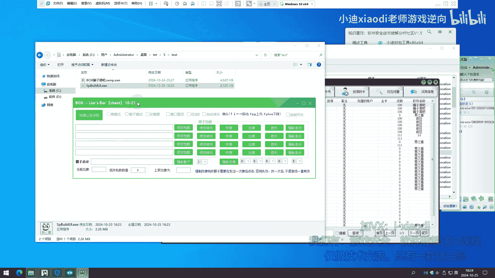

# 软件逆向破解入门：1：课程概述 🎯

大家好，我是小迪老师。很多朋友可能都会纳闷：你一直在讲逆向，我们这么多人听你讲逆向，到底能用它来干什么？这个问题确实需要先想清楚。逆向技术并不是只会出现在电影里的东西，它是软件安全、游戏安全、网络安全、CTF 比赛这些领域非常常见的基础能力。掌握了逆向技术之后，你可以对一个软件做完整的分析，搞清楚它内部到底是怎么运作的，然后按照自己的意愿去调整它的行为。这样一来，很多原本看似封闭的程序，在你面前就会变得透明起来。

举个例子，最近有一款非常火的游戏叫做《骗子酒馆》。这款游戏本身就是一个打牌游戏，并没有多么强烈的竞技性，但就是这样的游戏，居然也出现了外挂。这个外挂的功能相当离谱，比如炸盘、强制击杀、必胜等等。不用说也知道，这些东西会对游戏平衡造成很大的破坏。更让人哭笑不得的是，这个外挂居然还收费。收费本身倒还好，真正让人觉得无语的是，它居然还有一个叫做“反挂逼”的功能。你仔细想一想：你自己本来就是一个开挂的人，你开着挂在玩游戏，然后你又要去“反挂逼”，这难道不是非常矛盾的事情吗？不过，笑归笑，这种现象也正好说明了逆向技术的实用价值。如果我们掌握了相关的技术，就可以针对这种外挂软件进行分析，进一步实现我们想要的功能，比如把它的付费限制直接突破掉。今天这节课，我们就来实际演示一下这个完整的过程。

这个案例其实是社区里的同学提供给我们的。大家加入学习社区之后，跟着课程认真学习，学完之后再有导师指导一下，就可以把这个外挂彻底“弄开”。弄开之后到底有没有效果？当然有效，这个辅助是可以正常使用的。所以今天的内容，本质上就是一个“复习加实战”的演示。接下来，我们先来看一看这个外挂的背景情况，以及破解之前需要做哪些准备工作。

# 软件逆向破解入门：2：外挂背景与破解思路 🎮

我们来看一下这个外挂长什么样。它被命名为“boxs”，界面上好像还写着“骗子酒吧”之类的字样。说白了，这就是一个专门针对《骗子酒馆》的辅助程序。因为原游戏本身只是打牌，外挂作者才会往里面塞进炸盘、强制击杀、必胜这些破坏平衡的功能。这种程序不可能直接拿来分析，想要破解它，第一步不是急着找关键跳转，而是要先检查它到底有没有加壳。

这里先给大家补充一个基础概念：壳是什么？壳就是包裹在程序外面的一层保护代码，它会把原始的程程序压缩或者加密起来，让逆向分析工具无法直接看到程序本来的内容。所以说，判断一个程序有没有加壳，是逆向破解时非常靠前的一步。如果发现有壳，那就需要先脱壳；如果没有壳，就可以直接去看代码逻辑。这个步骤虽然简单，但绝对不能省略。

回到这个外挂上。经过检查，这个程序确实是有一个壳的。根据经验来判断，这个壳很可能是一个网络验证平台自带的一键壳。也就是说，作者使用了某种商业验证工具，把外挂程序和网络验证码绑定在一起，然后打包成现在这个样子。这种一键壳最大的特点就是“标准化”，所以脱起来并不困难。我们使用 ESEinPE 这款查壳工具来看一下它的具体结构。把程序拖进工具之后，可以看到它里面确实带着一些附加性的数据。把这个程序再运行起来看一眼，你会发现它的运行方式和咱们社区视频里面讲过的很多案例都非常像，可以说是相当眼熟了。如果你还没有接触过这块内容，可以加入学习社区，视频课程里面都有非常详细的介绍。

那为什么我们要这么关注这个壳？因为壳里面藏着一套完整的网络验证。外挂作者不希望有人直接拿来就用，于是他把程序设计成了必须先连接服务器验证卡密，验证通过之后才能启动辅助功能。这个逻辑如果写成伪代码，大概就是下面这个样子：

```
if 用户输入卡密:
    发送卡密到服务器
    if 服务器返回“验证通过”:
        启动辅助功能
    else:
        提示卡密错误并退出
else:
    提示用户输入卡密
```

看到这段逻辑之后，我们其实就明白了：破解的关键，就是想办法让程序认为输入的卡密是有效的。这部分内容看起来简单，但它是后面所有操作的理论基础。下一节，我们就把查壳结果和核心原理再往深处梳理一下。

# 软件逆向破解入门：3：查壳结果与核心原理 🔍

上一节我们认识了外挂的壳，并且知道它带有一套网络验证。那么这一节，我们把核心原理单独拿出来讲一讲。这个原理不光适用于这个外挂，很多同类软件其实也都是同一个套路。

首先来看查壳工具给出的结果。用 ESEinPE 把程序拖进去之后，可以看到程序有壳，并且带有附加数据。这个现象可以提炼成一个非常直观的公式：

```
带壳程序 = 原始程序 + 壳代码 + 附加数据
```

这个公式虽然只有一行，但非常重要。因为我们平时用静态分析工具看到的并不是原始程序，而是壳代码；壳代码只有到程序运行的时候，才会把真正的原始内容还原出来。所以，“先识别壳，再脱壳”就成了逆向分析必经的标准路线。

假设我们已经把这个网络验证的壳脱掉了，或者说暂时绕过了壳的干扰，那么摆在面前的核心就是验证逻辑。这段验证逻辑本身并不复杂。客户端的行为，其实可以概括成下面这段伪代码：

```
function login(card_number):
    response = sendToServer(card_number)
    if response == "valid":
        run_cheat()
    else:
        exit()
```

也就是说，真正决定你能不能使用辅助功能的东西，是服务器返回的那个结果。如果我们能够控制一台服务器，让它返回“valid”，客户端就会老老实实地进入辅助功能。这也就是“本地服务器替换”的核心思路。原本程序连接的是外挂作者的远程服务器，我们把它改成连接本地运行的一台服务器，然后让本地服务器返回“验证通过”的数据。这样一来，我们就不需要去购买真正的卡密了。

思路说起来很直白，但实际中会有一个问题：程序怎么知道要连接哪台服务器？这就涉及到网络分析。我们通过分析发现，这个外挂使用了一个固定端口来进行验证通信。具体的操作方式，就是把外挂的验证端口改成 9003，然后在本地架设一台服务器，再启动流量转向功能，把原本要发往远程服务器的数据全部转给本地服务器。本地服务器会模拟验证服务器的应答，让外挂相信卡密有效。这里必须强调一下：9003 这个端口并不是乱猜的，它是经过大量逆向分析之后才找到的结果。这个外挂我们已经完整地做过分析，所以这条方法是完全可行的。其他软件也可以参考类似的思路去尝试，但前提是必须自己先做足够多的技术研究和分析，搞清楚通信端口、验证协议和程序结构，不能指望一套方法打遍天下。

原理梳理清楚之后，下一步就是实际操作。接下来，我们就进入实战环节，看看每一步具体要怎么点击、怎么配置。

# 软件逆向破解入门：4：实战破解步骤 🛠️

前面我们把壳和网络验证的原理都已经说清楚了，这一节就按照刚才的思路，一步一步把外挂给搞定。整个过程可以概括成下面的流程，其中每一个环节都对应着前面讲过的原理：

```
破解流程：
1. 使用分析工具打开外挂程序；
2. 找到骗子酒馆的游戏进程；
3. 将验证端口修改为 9003；
4. 启动转向功能，让流量发送到本地服务器；
5. 在本地生成卡密；
6. 复制卡号并点击登录；
7. 点击确定，等待程序启动；
8. 直接使用辅助本体。
```


下面我们把每一步展开，看一看实际操作时你到底会看到什么东西。首先，打开我们提前准备好的分析工具，然后把外挂程序加载进来。这个软件我们之前已经分析过了，所以工具打开之后可以很清楚地找到目标。接下来，我们要找到骗子酒馆这个游戏的进程。只要游戏已经启动，它的进程就会出现在工具列表里面，我们直接选中它就行。这个选择过程不复杂，而且进程的版本信息不会对后续操作造成什么影响，不用太纠结。


找到进程之后，接下来要做的就是把验证端口改成 9003。同时，我们需要在本地运行一台服务器，这台服务器可以理解成我们自己的“假验证服务器”。然后，在工具里点击“启动转向”按钮，让外挂原本发往远程服务器的验证流量，全部转到这台本地服务器上。这样一来，外挂就会以为自己在跟官方验证服务器通信，但实际跟它对话的是我们自己的程序。这一步是整个破解过程中最核心的地方，因为只有完成了转向，后面的卡密生成和登录才能生效。

完成了转向之后，下一步就是生成卡密。这个卡密系统我们已经设置好了，操作上很简单。我们先选择一个“老版号”，然后点击生成一张卡。生成成功之后，再点击“所有卡号”，这时候就能看到刚才生成出来的那一张卡。把卡号复制下来，粘贴到外挂的登录界面里，然后点击登录。登录成功之后，再点击确定。稍等一两秒钟，程序就会运行起来。到这个时候，外挂功能已经可以直接使用了。

这里还有一个很有意思的细节。等我们把这些步骤全部操作完，你会发现辅助本体是可以隐藏起来的。为什么它会隐藏呢？因为这个外挂的真实程序自带了一个隐藏属性。一开始运行的那个文件，其实并不是真正干活的辅助本体，而是一个释放器。释放器会把辅助本体释放出来，然后自己隐藏起来。这个设计确实挺有趣的，作者应该也是挺有想法的人。当然，我这里说“有趣”并不是在攻击作者，只是一种调侃。操作完成之后，你甚至可以把最开始那个释放器窗口直接关掉，因为后面根本就用不到它了。直接运行释放出来的那个程序，就是完整的辅助本体。这样一来，外挂就可以摆脱原来那套网络验证，独立运行。

最后再补充一句：这种“本地服务器代替远程验证”的方法，不止能用在当前这一个外挂上。其他软件也可以用类似的思路去尝试，但前提是必须做充分的逆向分析。如果只是随便改一个端口就希望程序能被破解，那几乎是不可能的。整个过程能够跑通，背后靠的是对通信协议、验证逻辑和程序结构的反复研究。

# 软件逆向破解入门：5：总结与注意事项 📌

到这里，整个实战过程已经结束了，我们最后来回顾一下今天究竟学了什么。本节课中，我们一起学习了《骗子酒馆》外挂辅助的逆向破解流程，其实也就是一套完整的“查壳、分析网络验证、本地化验证、生成卡密、登录使用”的流程。我们先从外挂的背景讲起，知道它是一个带有网络验证的加壳程序。然后，我们用 ESEinPE 查看了程序，确认它带有一键壳和附加数据。接着，我们把网络验证的判定逻辑转换成了伪代码，理解了客户端和服务器之间的通信关系。最后，我们通过本地服务器替换的方案，完成了端口修改、流量转向、卡密生成和登录操作，成功把辅助本体运行了起来。

为了让大家方便记忆，可以把整个破解流程浓缩成一个公式：

```
外挂可运行 = 绕过壳 + 远程服务器替换为本地服务器 + 正确的卡密响应
```



这个公式看起来很简单，但它的适用范围其实是比较广的。以后如果再遇到同类网络验证软件，你完全可以沿着这个思路去分析、去尝试。当然，每个软件使用的壳不一样，验证服务器的通信协议也可能完全不同，所以不能保证所有情况都一定能破解成功。但至少，方法论是通用的，剩下的部分就需要靠更多的实践去积累了。

最后再提醒大家一点：掌握逆向破解技术之后，一定要保持低调。不要拿着破解后的辅助去到处炫耀，也不要用它来破坏游戏环境，更不要影响其他玩家的正常体验。自己学会之后，自己玩一玩、用一用就可以了。如果你对这方面的技术感兴趣，可以继续深入学习，社区里还有更多更具体的案例等着你去研究。今天的内容到这里就结束了，我们下期再见。

