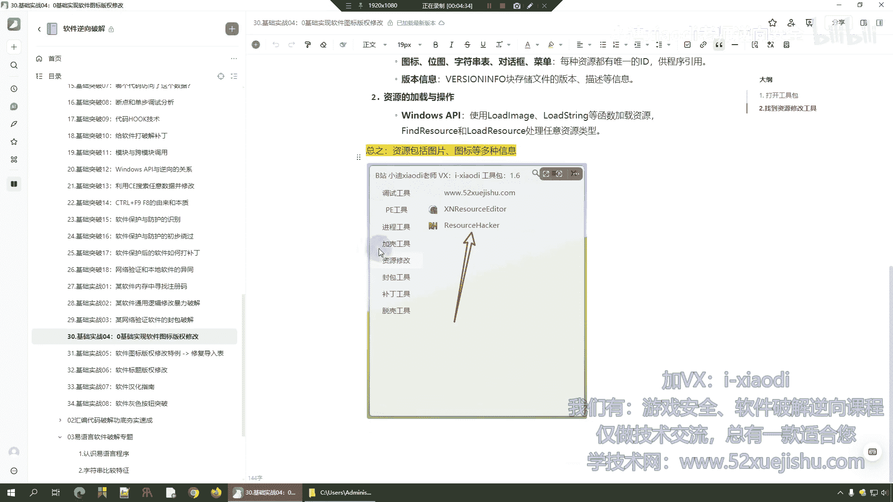
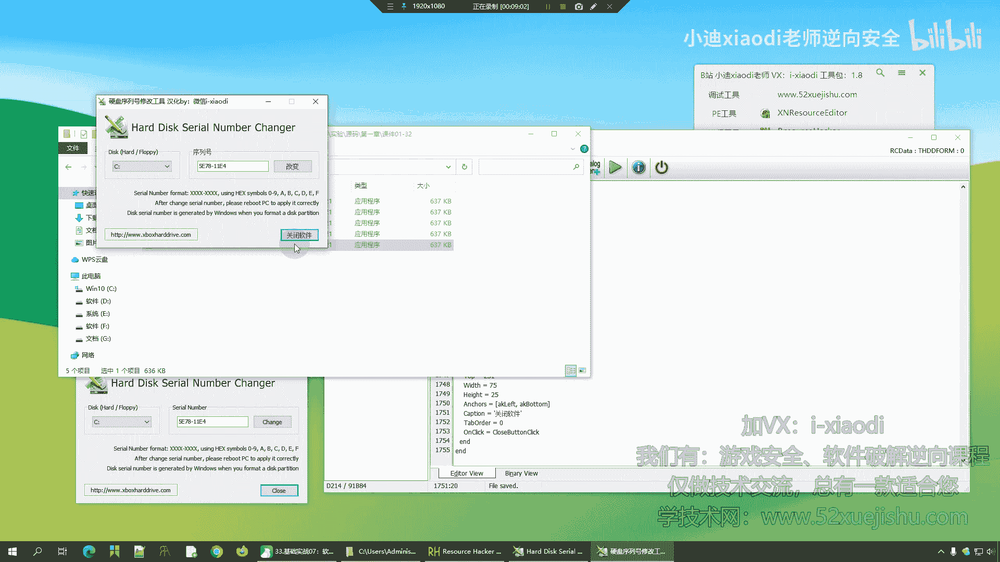
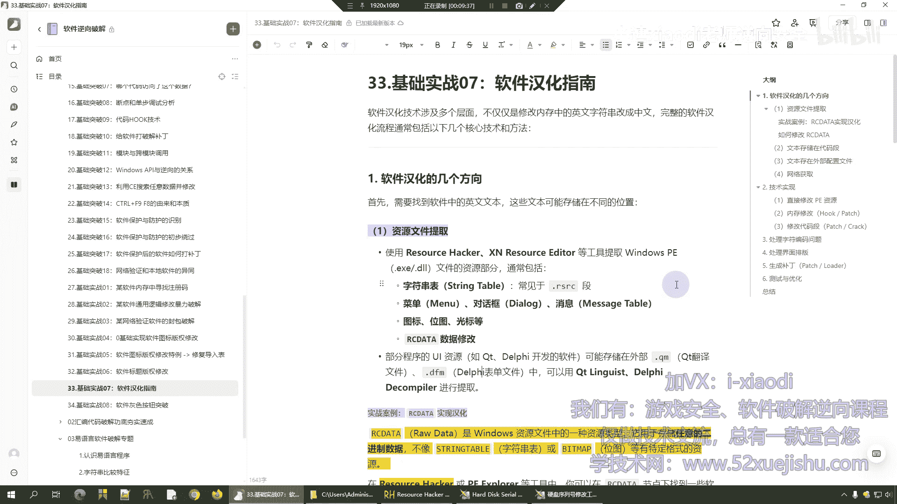

# 软件汉化逆向基础：第1章：软件汉化技术概述

大家好，我是小李老师。今天我们来讲解软件汉化指南。不少同学纳闷：你讲软件逆向，怎么那么多人听？软件逆向能干什么？第一，它可以尝试破解一些软件，把收费的、付费的甚至跑路的软件复活或突破限制。第二，有一些英文软件，你可以尝试进行汉化。汉化之后，你还可以分享给朋友。软件汉化技术涉及多个层面，不仅仅是修改内存中的英文字符串改成中文这么简单。

我们之前讲过软件标题的修改，实际上就是修改软件标题的文本。文本存放在内存中，你需要在内存里搜索这个文本特征，然后进行替换。之前我们还布置了一个作业，做完作业后再看这个，应该就不难理解了。

不过事情并不像表面这么简单。你想一个情况：英文单词可能只有4个长度，翻译成中文后如果变成了8个长度，即 `L_zh(8) > L_en(4)`，长度不一致会发生什么？有可能导致后面的文本内容被覆盖，程序乱码、崩溃、运行不稳定等。所以软件汉化并没有那么简单。

## 汉化的几种主流方法

那么软件汉化通常包括哪些方法？下面是四个主要方向，每一个单独拿出来都能讲好几集，技术实现也各不相同。

1. **资源文件提取**：从资源文件中提取并修改内容。资源文件包括图片、图标、字符串表、对话框、菜单等。如果修改图片图标，可以用对应工具；字符串表与汉化直接相关；对话框是界面，想改界面样式就改它；有菜单也可以改。

2. **代码段文本**：一些文本可能存放在代码段中，这种情况简单了解一下即可。

3. **外部配置文件**：文本可能放在外部的配置文件里，比如Chm、Json、ini、txt等文件。如果你的英文软件文件夹里存在这些后缀的文件，可以重点留意一下。

4. **网络获取**：部分新软件会从服务器动态获取语言包，需要借助抓包工具，查看返回的Json或Chm等结构。这种情况比较少见，知道有它存在就行。

列表中已经给出了汉化的几个方向。每种方向单独拿出来都可以讲上几集，并不是一集就能讲完的，有的甚至要录十多个视频。所以后续我们在内部课程中会专门开一个章节来详细讲解这些技术实现。

## 实战：通过资源文件提取实现汉化

要了解这种技术，得先认识一个东西——RCDATA。RCDATA是英文词组`raw data`的缩写，它是Windows资源中的一种资源类型，用于存储任意的二进制数据。它不像字符串表（String Table）或位图（Bitmap）那样有特定格式，是一种通用的资源容器。如果软件中存在RCDATA资源，就可以直接从这个方向切入进行汉化。

那么怎么看软件中有没有RCDATA？用到的工具是**Resource Hacker**。这个工具我们在之前讲解图标版权修改时就已经用过了，今天再来用它实现软件汉化。

来看一个实战案例，这是我特地从国外下载的一款软件。运行起来之后，界面显示“Hard Disk Number Changer”，翻译一下就是“硬盘序列号更改器”，可以更改硬盘的序列号。上面有很多英文提示，中国朋友可能看不懂，这时候就需要我们技术人员进行汉化。

操作非常简单：先关闭软件，打开Resource Hacker，然后把软件直接拖进窗口。往下看，可以找到一个RCDATA资源。点击第一个，里面是一些十六进制数据，看不出来什么；第二个也看不出来；第三个稍微能看出一些英文；再看最后一个，注意程序运行起来后，能看到类似`Caption`这样的英文关键词。常见的英文词汇大家都该了解，`caption`意思是字幕、标题。既然`Caption`等于某个值，那我们把这里的值改掉，软件标题是不是就变了？

来试一下。把这个值改成“硬盘序列号修改工具”，然后点击向右的小三角按钮，这个动作叫**编译**（Compile），意思就是把修改后的资源写回文件。编译成功后提示`Compile Succeeded`，然后点“另存为”，比如保存成“硬盘序列号修改工具.exe”。运行一下，果然标题变成了“硬盘序列号修改工具”。

你还可以加上汉化者信息，比如“汉化By：微信AI-小李”。保存后再运行，这就成了你汉化的软件。

接下来还需要汉化其他内容，比如`Changer`按钮以及一些介绍文字。我们先改`Changer`，它是个按钮（Button）。`Change`的意思是改变。在资源里往下找，找到`Changer`，改成“改变”；旁边还有“序列号”之类的提示，也一并改成中文。注意这里有一个按钮叫`Close`，很多人不知道什么意思，也改成“关闭软件”。这样就更人性化，更符合中国宝宝体质。

全部改完之后再编译，另存为新文件，运行看效果：标题、按钮、提示都变成了中文。看起来好像还没有英文顺眼？有时候就是这样，大家根据实际情况来就好。

## 总结

以上就是本次实战案例的完整操作过程。大家课后可以自己动手练习，也可以自己阅读笔记。如果还想深入学习软件安全逆向相关技术，可以联系视频右下角的老师加入内部教学——这些都是我们公开课的内容。下节课再见。
