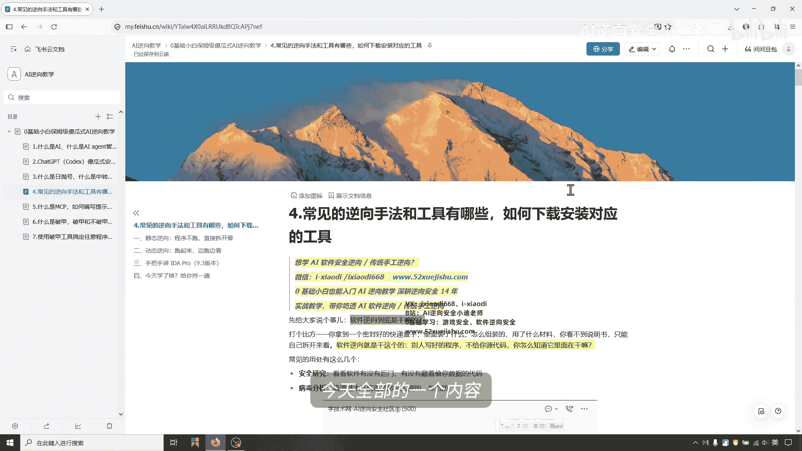

# 🧭 零基础AI逆向教程：第四讲：常见逆向手法、工具与IDA Pro环境部署

> 原视频信息：AI逆向0基础，主题涉及二进制安全逆向、软件安全、网络安全，以及Codex、Codex破甲、GPT破甲等标签；视频编号为BV1R4HP6dE7G-。

大家好，我是小李老师，欢迎来到零基础小白保姆级傻瓜式AI逆向教学的第四讲。本节课要学习的内容是常见逆向手法和工具有哪些，以及如何下载安装对应的工具。大家看这个视频，是来学习软件逆向的。后文讲师也以“小迪老师”自称。在本节课中，我们将先弄清楚软件逆向是什么，再了解它的应用场景、静态分析与动态分析的区别、常用工具，最后手把手完成IDA Pro 9.3的安装，并说明微步云沙箱的使用习惯和Frida的后续安排。

## 🎯 零基础AI逆向教程：第四讲-1：软件逆向是什么

在开始学习工具之前，我们需要先弄明白软件逆向到底是做什么的。打个比方，我们拿到一个密封好的快递盒子，里面装了什么、怎么组装、用了什么材料，你看不到说明书，只能自己拆开来看。软件逆向就是干这个的。别人写好的程序不给你源代码，你怎么知道它里面在干什么，这就是软件逆向要解决的问题。理解这个概念很重要，因为后面的静态分析、动态分析和工具安装，都是围绕“拆开程序看逻辑”这件事展开的。

```text
软件逆向 = 在没有源代码的情况下，分析程序的结构、行为与逻辑
```

软件逆向常见的用处有好几个。以下是软件逆向在安全研究和病毒分析方面的常见用途。

- 安全研究：看看软件有没有后门，有没有藏着偷你数据的代码。


- 病毒分析：搞清楚木马病毒是怎么入侵的，怎么去防御。

关于病毒分析，原文举了一个群木马例子。这段时间群里有恶意传播木马的情况，这个木马也是AI发现的。AI通过分析发现，某个群员分享的工具里带有远程控制木马，而且这个木马此刻还在连接某个IP。这个IP原文没有打码，总之它是一个破坏者的IP。AI产出的报告显示，某个群成员发现自己的电脑不对劲，然后通过查杀和溯源才发现了问题，群里面已经有好几个受害者。今后如果遇到类似情况，比如某个群员在论坛上传某个程序，你一查发现有木马，要及时向讲师汇报。如果你不确定这个程序有没有木马，可以先上传到微步云沙箱进行查杀。微步云沙箱是微步旗下的文件威胁分析平台，把文件直接拖进来，它会自动化逆向分析这个程序。分析完成之后，它会自动化提供一份完整的情报分析报告，报告里包含程序的各种恶意行为，比如远程控制、盗取文件。推荐大家看完这节课后打开微步云沙箱网站，直接丢一份程序进去，看一下报告是什么样。这个操作应该成为一种习惯：见到陌生程序不要着急运行，先丢到微步云沙箱；如果软件是安全的，再在自己的物理机上运行。理解这些安全用途后，下面继续看软件逆向的更多应用场景。

## 🛡️ 零基础AI逆向教程：第四讲-2：软件逆向的应用场景

上一节我们介绍了软件逆向的基本概念和安全研究、病毒分析用途，本节来看看漏洞挖掘、CTF比赛、学习研究和卡密验证分析等场景。以下是软件逆向在后几类场景中的常见用途。

- 漏洞挖掘：最近爆发了好几个漏洞，小迪老师的网站也受到了影响，于是连夜起来修复漏洞。漏洞的发现和修补，其实都需要依赖软件逆向技术。


- CTF比赛：CTF也叫信息安全竞赛，也叫网络安全大赛。比赛中有一种题目叫RE，RE就是reverse的缩写，翻译过来就是逆向。比赛里的逆向题目，就是练软件逆向技术或手艺的。小迪老师年轻时也参加过很多信息安全竞赛，身边的很多朋友都是比赛中的佼佼者，现在很多人也已经在对应的安全公司工作。如果屏幕前你是大学生，并且想从事相关网络安全工作，可以来找小迪老师交流，小迪老师这边的资源比较多。国内的网络安全比赛在国际上通常叫CTF竞赛。CTF就是capture the flag，可以理解成黑客夺旗赛，是一种模拟真实网络安全场景的实战性竞赛。如果屏幕前你是大学生，推荐去了解并参加这个比赛，拿到相关奖项、奖状、奖牌，对今后的工作非常有利。

- 学习研究：看看别人的程序是怎么写的，学习思路。最近复刻别人的软件比较火，复刻的第一步就是用软件逆向技术拆解软件的框架，以及相关写法、代码、算法之类的内容。拆解得差不多之后，就可以复刻一份几乎一模一样的程序出来，这也是一个应用场景。

- 逆向破解分析：分析软件卡密验证机制、网络验证、机器码绑定、一机一码等内容，并研究突破和绕过。这里仅做技术交流，不要用作其他违法用途。

以上场景说明，软件逆向不只是“拆程序”，还和安全研究、比赛训练、学习复刻、验证机制分析等工作有关。讲完应用场景后，下面进入逆向方法的分类。

## 🧰 零基础AI逆向教程：第四讲-3：静态分析与动态分析

上一节我们介绍了软件逆向能做什么，本节来看看逆向的招数。逆向主要分为两大类，就像医生看病，一种是不取样、看片子，叫静态分析；一种是让病人跑两步、看状态，叫动态分析。以下是静态分析和动态分析的核心区别。

```text
静态分析 = 不运行程序，直接检查代码、结构和调用关系
动态分析 = 运行程序，观察行为、参数、调用和状态变化
```

静态逆向分析就是程序不运行，直接把它拆开看。打个比方，你拿到一辆车，先不发动它，先打开发动机盖，看看管子有没有问题、线有没有问题，搞清楚整个线路和油路是怎么走的。看完之后，这辆车的车况基本就心里有数了。对于软件逆向来说，静态分析常用工具有好几个，比如免费工具、美国国家安全局开源的Ghidra等，原文口语中还提到“低”和“ary”等工具。但行业里最牛、最推荐的还是IDA Pro。IDA Pro可以记住它的样子：有一个神秘的女神头像，看起来像蒙娜丽莎。为什么选它？好处有很多。第一，它特别强大。第二，它已经是行业标准。安全公司、病毒分析团队几乎人手一份，教程多、资料多，碰到问题好查。一句话，学逆向选IDA Pro，它是绕不开的瑞士军刀。理解静态分析后，下面看动态分析。

动态逆向就是跑起来边跑边看，一边运行，一边盯着它看。还是拿车打比方，比如你要看这辆车到底有没有坏，这次直接坐到车里面，发动车子，一边开一边看仪表盘、听发动机声音，哪里不对马上刹车检查。你会发现，它是在整个运转过程中发现问题，这和静态分析是两种截然不同的分析模式。对于软件逆向来说，动态调试的常见工具如下。以下是两个重点动态调试工具和一句工具选择结论。

- x64dbg：它是Windows平台上最火的免费调试器，界面友好，新手入门首选，就像一个单步执行器，程序走一步你看一步。而且它是开源的，开源就是开放源代码。

- Frida：它更厉害，是一个注入式工具。可以写脚本插到正在运行的程序里，你让目标程序干什么，它就干什么。如果要配合AI做自动化逆向分析，Frida更好用，因为它不用你点鼠标，也不用你看图形界面，直接写代码就能控制。而且代码不需要人来写，全部由AI去写。AI自动写脚本、自动测试，整个过程特别顺，效率比较高。

除了这两个动态分析工具，还有一些常见的其他工具，可以简单了解。一句话结论：如果你做的是用户层面的AI自动化分析，比如监控程序调用了哪些接口、改一下参数跟踪行为轨迹，Frida绝对是首选。理解静态和动态两类方法后，下面进入工具安装环节。

## 🛠️ 零基础AI逆向教程：第四讲-4：手把手安装IDA Pro 9.3

上一节我们介绍了静态分析和动态分析以及常用工具，本节来手把手安装IDA Pro，以9.3版本为例。安装的核心流程可以先记成下面这段代码。

```text
IDA Pro 9.3 安装流程：
1. 安装主程序
2. 复制激活文件
3. 替换 DLL 文件
4. 运行 IDA.exe 并同意协议
```

以下是IDA Pro 9.3的详细安装步骤。

- 第一步，先下载安装包。你会看到两个文件，一个是文件夹，一个是安装包。安装包下载下来后，双击运行它，点击下一步，点击“I accept”表示我接受，再点击下一步。

- 第二步，选择安装到哪个文件夹。默认是C盘。如果想装到D盘，就把C改成D，后面的路径不推荐改动。然后继续点击下一步、下一步、下一步，最后开始安装。

- 第三步，等待安装。安装过程中可能会蹦出一个错误弹窗，不要慌，这是正常现象，点击确定就可以，然后再点击下一步，继续等待安装完成。装好之后点击“Finish”，完成安装包安装。但是还没完，还有最后几步激活操作。

- 第四步，处理激活文件。刚才下载的内容里还有一个叫“KG-pa”的文件夹，里面有两个文件，把这两个文件直接拖到IDA的安装目录。然后再找到原文所称的“问文件夹”，里面有两个DLL文件，也直接拖过来。原本目录下实际上存在这两个文件，只不过我们下载的这两个文件和原版有一点区别，我们提供的是破解版。把破解版拖放到IDA安装目录时，会出现替换弹窗，点击“替换目标中的文件”即可。

- 第五步，运行IDA。找到IDA安装目录里的“IDA.exe”，双击运行。第一次打开会弹出一个协议窗口，点击“agree”。如果能够正常打开界面，就说明安装成功了。

- 第六步，关于Frida。Frida今天先不安装，后面下一节课会专门讲。


以上步骤完成后，IDA Pro 9.3的安装和激活流程就结束了。理解安装流程后，下面做本节课总结。

## 📌 零基础AI逆向教程：第四讲-5：课程总结

上一节我们完成了IDA Pro 9.3的安装，本节对整节课做总结。以下是本节课需要掌握的核心内容。

- 软件逆向是什么，以及软件逆向的应用场景。

- 逆向分为两种，一种是静态分析，一种是动态分析。


- 静态分析首推IDA Pro；动态调试常用x64dbg和Frida；做AI自动化逆向分析首选Frida。


- IDA Pro 9.3安装分三步：先装主程序，然后复制激活文件，再去替换DLL文件。



本节课中我们一起学习了软件逆向的基本概念、常见应用场景、静态分析与动态分析的区别、常用工具，以及IDA Pro 9.3的安装和激活流程。本期内容由小迪老师讲解，下期再见。

