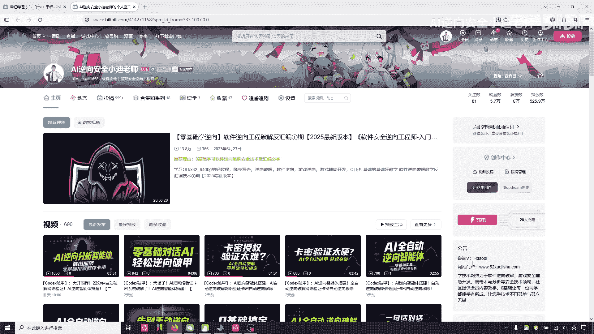

# 🛠️ Codex破甲AI自动化逆向智能体：01：课程概述

在本节课中我们将要学习小迪老师在2026年10月4日整理并展示的AI自动化逆向智能体。当时国庆节已经过了好几天，原文展示的是最新搭建的AI自动化逆向智能体。本教程由小迪老师讲解，内容围绕AI逆向智能体搭建、二进制安全逆向、软件安全、网络安全、Codex、Codex破甲和GPT破甲等关键词展开。原视频标题强调“AI太危险”，并提到“一句话自动破解网络验证”和“AI逆向智能体搭建”，视频编号为BV1fkHj6PEH7。对初学者来说，可以把智能体理解为一个按自然语言指令执行分析并整理结果的AI助手，它根据用户描述的目标推进分析过程。本教程会先说明这个智能体能做哪些事，再说明提问与执行流程，然后展示原文中的演示和学员案例，最后给出同款获取与联系方式。上一节内容不存在，本节先建立整体认识，下一节我们来看看该智能体的能力范围。

# 🛠️ Codex破甲AI自动化逆向智能体：02：智能体能力范围

在概述中我们明确了教程范围，本节中我们来看看这个智能体具体能做什么。原文说明该智能体可以处理逆向破解卡密基图相关场景，也可以处理电脑程序、手机程序，定位卡密与验证逻辑，并进行静态分析和动态分析，还可以直接生成处理后的程序。原文还提到可以向智能体询问软件到期时间等信息，也提到外挂软件破解场景，并强调弘扬正义。智能体回答可以处理，并能通过截图证明账号登录、充值卡和剩余时间的显示。以下是该智能体覆盖的能力方向：

- 逆向破解卡密基图相关场景
- 处理电脑程序
- 处理手机程序
- 定位卡密与验证逻辑
- 进行静态分析
- 进行动态分析
- 直接生成处理后的程序

上述列表概括了原文中的能力描述，这些能力对初学者来说可以先理解为“分析目标软件并给出处理结果”的不同方向。用公式概括核心概念如下：

```text
目标 = 逆向分析(电脑程序/手机程序/外挂软件) + 定位卡密与验证逻辑 + 静态分析 + 动态分析

输出 = 补丁程序 或 本地验证绕过方案
```

这些公式只是对原文能力描述的概括，不展开具体实现细节。原文还说明智能体可以回答软件到期时间等问题，并能截图展示账号登录、充值卡和剩余时间信息。上一节介绍了整体范围，本节说明了能力方向，下一节我们来看看原文中的提问与执行流程如何组织。

# 🛠️ Codex破甲AI自动化逆向智能体：03：提问与执行流程

上一节我们介绍了智能体的能力范围，本节中我们来看看原文展示的提问与执行流程。原文中用户先给出软件信息和到期时间，再说明目标是去除网络验证、改成本地任意密码登录，并给出完整路径。以下是原文中展示的目标描述：

> 目标是去除网络验证，改成本地任意密码登录，完整路径在案例中给出。

在这段目标描述之后，原文说明智能体思考39分钟完成补丁，程序可以直接使用，并改为本地跳过网络接口，任意账号密码可进入。以下是案例中展示的执行流程概括：

- 输入目标软件和到期时间等信息
- 明确目标为去除网络验证并改成本地任意密码登录
- AI进行自动化逆向分析并生成补丁
- 验证本地账号密码可进入

上述列表把原文流程整理为四个概括步骤，方便初学者理解整体顺序。用伪代码描述核心流程如下：

```text
输入：目标程序 + 到期时间 + 验证方式 + 修改目标
处理：AI自动化逆向分析 + 定位网络验证 + 生成补丁
输出：本地验证可用的程序
```

需要说明的是，这里只保留原文对流程的概括描述，不展开具体操作细节。上一节说明了能力范围，本节说明了流程结构，下一节我们来看看原文中的演示与学员案例。

# 🛠️ Codex破甲AI自动化逆向智能体：04：演示与学员案例

前面说明了提问与执行流程，本节中我们来看看原文展示的真实效果和学员案例。原文说明如果希望查看同款效果，已经提供演示，可以查看案例，群内也有效果展示。原文还展示了学员让AI进行自动化逆向分析并查看截图的过程。以下是原文中提到的演示与学员案例信息：

- 已提供真实效果演示，可查看该案例
- 群内展示学员案例
- 学员让AI进行自动化逆向分析并查看截图
- 截图显示运行13分钟完成
- 前面也做了一些工作，整体可能不到一小时，几十分钟搞定
- 完成后程序点击即可运行，显示破解成功
- 小迪老师评价学员学有所成，希望对外宣传


上述列表保留了原文对演示和学员案例的描述，其中时间信息按原文表达为“13分钟”和“可能不到一小时”。这些案例对初学者来说主要用于理解智能体的使用效果，不代表具体操作步骤。上一节介绍了流程，本节展示了案例，下一节我们来看看同款获取与联系方式。


# 🛠️ Codex破甲AI自动化逆向智能体：05：同款获取与联系方式


案例展示之后，本节中我们来看看原文给出的同款获取和联系方式。原文说明如果希望拥有同款AI自动化逆向智能体，可以联系小李老师。以下是原文给出的同款获取与联系方式：

- 联系小李老师获取同款智能体
- 通过哔哩哔哩主页“AI逆向安全小迪老师”下方签名联系
- 也可通过该处联系到小迪老师

上述列表概括了原文中的联系渠道，方便需要进一步了解的人按原文说明找到对应入口。原文还说明视频不再展开无关内容，本期结束，下期再见。上一节展示了案例，本节说明了联系渠道，下一节对整节课程做总结。



# 🛠️ Codex破甲AI自动化逆向智能体：06：课程总结

本节课中我们一起学习了小迪老师在2026年10月4日展示的AI自动化逆向智能体。我们首先了解了原视频标题、关键词和教程范围，然后学习了智能体的能力方向，包括逆向破解卡密基图相关场景、电脑程序、手机程序、卡密与验证逻辑定位、静态分析、动态分析以及生成处理后的程序。接着我们整理了提问与执行流程，包括输入目标软件和到期时间、明确去除网络验证并改成本地任意密码登录、AI分析并生成补丁、验证本地账号密码可进入。随后我们查看了原文中的演示和学员案例，包括运行13分钟完成、整体可能不到一小时、程序点击可运行并显示破解成功。最后我们记录了同款获取方式，可以联系小李老师，也可以通过哔哩哔哩主页“AI逆向安全小迪老师”下方签名联系。本节课程围绕原文含义完成整理，本期内容结束，下期再见。

