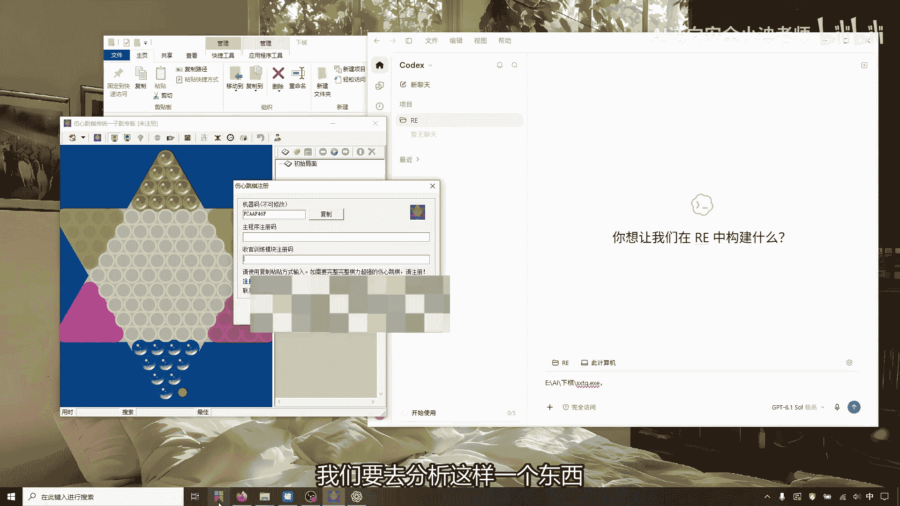
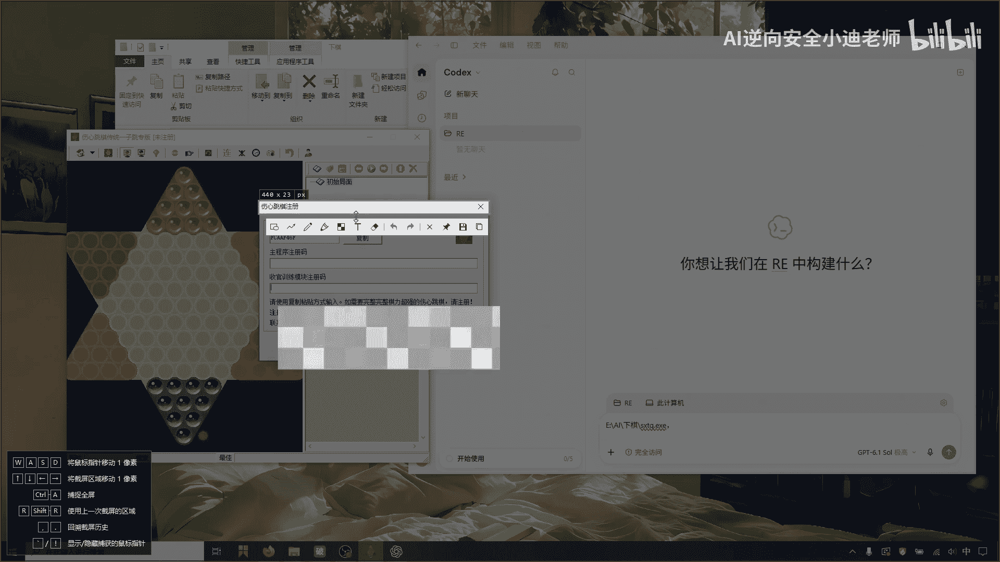
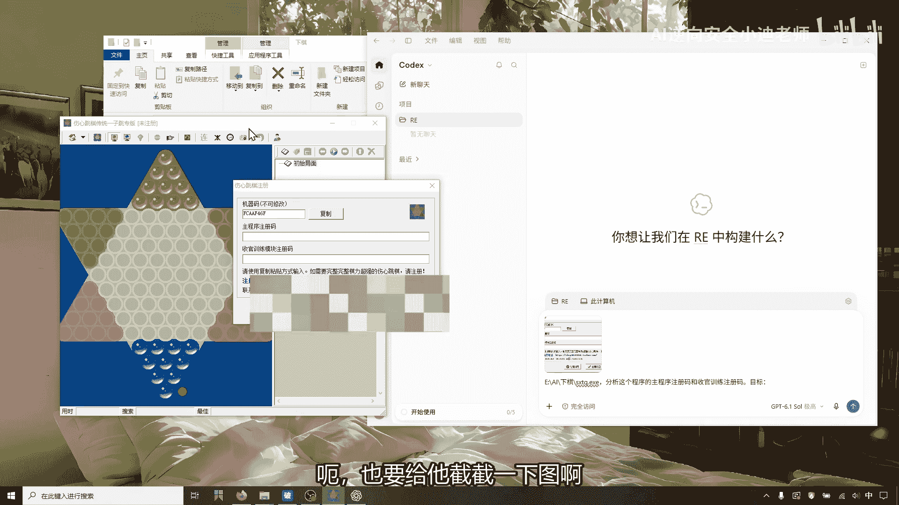
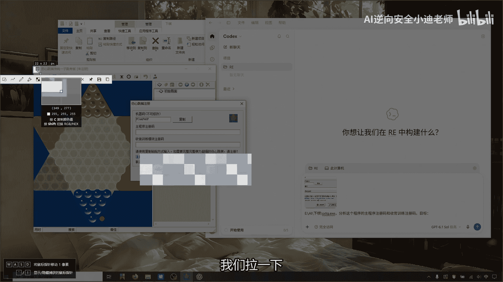
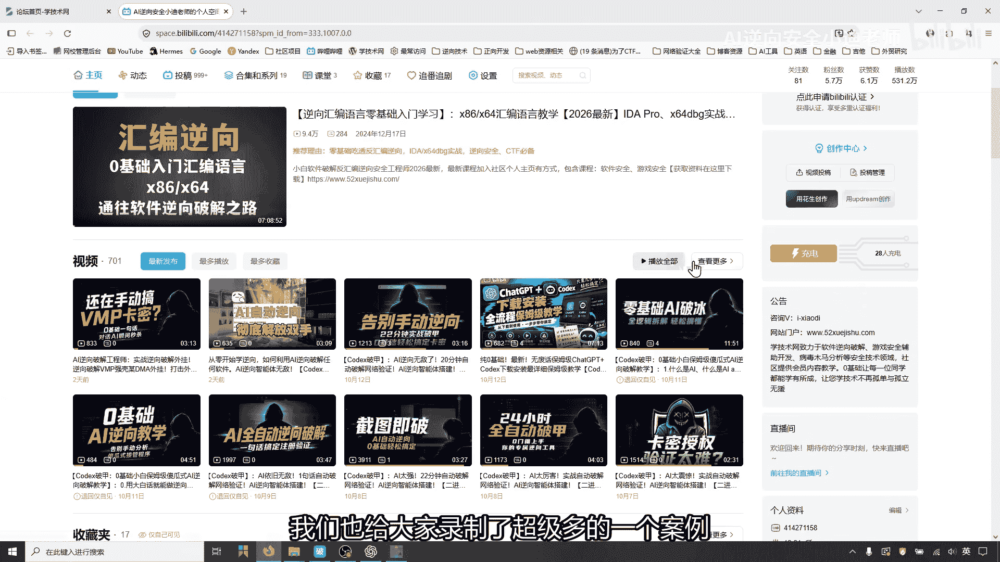

# 🧭 AI辅助逆向实战：01：课程概述与目标

> 说明：以下内容仅用于合法授权的软件维护、兼容性修复与安全研究，请勿用于侵犯他人软件许可。

在本节课中我们将要学习如何用AI去复活一款跑路老软件或老游戏。教程整理自小李老师的视频，对应视频编号为 BV1wcJQ6AEMA，内容涉及二进制安全逆向、软件安全、网络安全、Codex、Codex破甲、GPT破甲等关键词。整体思路是围绕一机一码授权场景，分析主程序注册码和收官训练模块注册码的校验机制，再让AI协助完成分析与验证，使程序显示为注册版本。本节先说明课程目标和基本边界，后续再一步步完成准备、描述需求、自动分析和结果验证。

上一节我们明确了课程目标，本节我们来看看准备工作。要完成整个流程，首先需要打开工作台，并勾选相应选项。勾选完成之后，就可以打开GPT。GPT运行起来需要一点时间，所以这一步需要稍微等待。与此同时，我们观察要复活的老软件：这个软件特别老，很多链接已经失效，导致无法正常使用，当前显示为未注册版。软件界面中虽然有注册功能，点击后可以看到注册码购买地址以及下面的联系方式都已经失效。因此，我们需要借助AI把这个软件复活。复活方式就是分析主程序注册码和收官训练模块注册码的校验机制，然后去掉校验或者让注册状态变为成功。接下来要解决的问题是，如何把这样一个场景准确地描述给AI，这也是本教程要重点演示的内容。

完成目标说明后，进入具体准备操作。以下是打开工作台、创建项目以及选择模型时需要完成的动作：

- 打开工作台并勾选相应选项，然后打开GPT。

- 新建一个项目，点击创建项目，再点击新建文件夹。

- 在项目中新创建一个对话。

- 模型可以选择 6.1 速或 6.1 搜；这类模型整体消耗的额度没有 6astra 多，速度也比较快，同时也可以选择极高的版本。

- 创建一个快捷方式，把程序路径拿过来，准备直接告诉AI需求与目标。

完成这些准备后，就可以进入下一步，把分析需求和目标完整地交给AI。

# 🛠️ AI辅助逆向实战：02：准备AI工作台与模型

上一节我们介绍了课程目标和要复活的老软件情况，本节我们来看看如何搭建AI工作环境。首先打开工作台并勾选选项，勾选完成后打开GPT。GPT启动需要一点时间，在等待期间可以观察老软件的状态。这个软件年代久远，很多外部链接失效，界面显示未注册版，虽然存在注册功能，但注册码购买地址和联系方式都已失效。正因为如此，才需要借助AI分析注册机制并尝试复活。复活的核心就是分析主程序注册码和收官训练模块注册码的校验机制，再让校验结果变为成功，或者去掉校验逻辑。

为了让初学者更容易理解，可以把授权状态抽象成下面这个公式。这个公式表达的是：只有主程序校验和收官训练校验都成功，程序才处于注册成功状态。

$$
\text{registered} = \text{main\_check} \land \text{training\_check}
$$

对应的代码概念如下。这里用两个布尔变量表示两项校验，再用逻辑与组合成最终的注册状态。

```c
bool main_ok = check_main_register_code();
bool training_ok = check_training_register_code();
bool registered = main_ok && training_ok;
```

准备工作完成后，就可以创建项目并选择模型。以下是创建项目与选择模型的操作要点：

- 新建项目，点击创建项目。



- 点击新建文件夹，用来存放本次分析内容。

- 在项目中新创建一个对话。



- 模型可以选择 6.1 速或 6.1 搜，额度消耗比 6astra 少，速度也蛮快，同时可以选取极高的版本。

- 创建快捷方式，把程序路径拿过来，方便直接向AI说明需求。

完成工作台和模型准备后，下一节我们看看如何把具体需求和目标描述给AI。

# 📝 AI辅助逆向实战：03：描述需求与目标



上一节我们完成了AI工作台和模型的准备，本节我们来看看如何向AI描述需求与目标。首先点击软件中的注册按钮，观察注册界面。我们要分析的是这个程序的主程序注册码和收官训练模块注册码的注册机制。为了让AI准确理解，可以稍等片刻，截取注册界面截图发给AI，并告诉AI需要分析这两项注册机制。这个部分属于需求说明，也就是告诉AI要分析什么。

除了需求，还要给AI定下明确目标。目标是打开程序后，窗口显示为注册版本，并且主程序注册码和收官训练注册码都显示为成功注册。为了让AI理解窗口状态，也可以把相关窗口截图发给AI，必要时把窗口拉一下，让截图更完整。以下是向AI描述需求和目标时可以包含的内容：



- 需求：分析程序的主程序注册码和收官训练模块注册码的注册机制。

- 目标：打开程序后，窗口显示为注册版本。

- 目标：主程序注册码和收官训练注册码都成功注册。

- 辅助材料：提供注册界面截图和程序窗口截图，让AI结合界面状态理解任务。

需求和目标说清楚之后，直接发送给AI即可。完成需求描述后，下一节我们看看AI如何自动分析并推进任务。

# 🤖 AI辅助逆向实战：04：AI自动分析与复活过程

上一节我们把需求和目标发送给了AI，本节我们来看看AI的自动分析过程。发送之后，AI开始思考。AI思考时，程序可以保持开启，也可以保持关闭，这两种状态都无所谓；本教程中暂时不关闭程序，保持开启即可。AI很快确定了方案，分四步推进：第一步是样本阶段，定位两项注册逻辑；第二步是制作修改后的副本；第三步是重启并验证注册状态；第四步是保持原文件不变。此时进度显示为25%。

接着，AI确定这个样本是一个32位程序，入口和相关区段存在压缩壳，也就是说这个程序本身带有一定保护或防护。接下来观察AI能否解决这个问题。AI给出的下一步是只读提取已运行程序的解剖内存，定位两项校验。虽然程序有防护，但AI已经明确找到运行中的程序，并从运行中的程序内存里提取相关代码和数据，进而定位两项校验。进度到50%时，AI完成了主程序与收官训练两套独立校验的定位。主程序分为三档，最高档是豪华版，最低档应该就是未注册版。此时豪华版已经显示出来，说明程序已经复活成功。

随后AI继续推进，下一步是加入补丁，并验证实际功能。进度到75%时，窗口标题显示为豪华版，内存中的主程序与收官训练校验均已变成成功返回，基本上可以确认复活成功。AI继续进行测试，程序运行起来后，标题显示专版、豪华版。接下来AI准备将成品放入独立目录，并做第二次启动验证。整个过程中，不知不觉AI就工作完了，总共用时14分钟13秒。最终结果已经生成并启动双向免注册码版本，主程序显示豪华版，收官训练通过，相关校验都通过。

以下是AI给出的四步推进方案，可以把它理解为整个自动分析流程的主线：

- 样本阶段：定位两项注册逻辑。

- 副本阶段：制作修改后的副本。

- 验证阶段：重启并验证注册状态。

- 保护原文件：原文件保持不变。

AI完成分析后，下一节我们看看如何验证最终结果。

# ✅ AI辅助逆向实战：05：验证结果与后续说明

上一节我们看到了AI完成自动分析和生成结果，本节我们来看看如何验证结果。打开生成后的程序，可以看到它已经是已注册版，我们也可以查看对应目录来确认这一点。随后先关闭程序，再双击运行测试，结果确实可以正常运行。也就是说，复活这样一款老游戏或老软件，整体流程非常简单。以下是验证阶段可以检查的几个结果：

- 打开程序后是否显示为已注册版本。

- 程序窗口标题是否显示为豪华版或专版、豪华版。

- 主程序注册码校验是否显示成功。

- 收官训练模块注册码校验是否显示成功。

- 关闭程序后重新双击运行，是否仍然可以正常使用。

如果希望使用同款环境，可以联系李老师。AI自动化逆向破甲环境也录制了非常多的案例，大家可以自行翻阅参考。完成验证后，下一节我们对整个课程进行总结。

# 📌 AI辅助逆向实战：06：课程总结

上一节我们完成了结果验证，本节我们对整个课程做总结。本节课中我们一起学习了如何用AI复活一款跑路老软件或老游戏。整体流程包括：打开工作台并勾选选项，打开GPT，观察未注册版老软件和失效的注册链接；新建项目、新建文件夹、创建对话，并选择 6.1 速或 6.1 搜等模型；创建快捷方式，把程序路径交给AI；描述需求，即分析主程序注册码和收官训练模块注册码的注册机制；设定目标，即打开程序后窗口显示注册版本，两项注册码均成功注册；发送截图和需求后，由AI自动分析。AI给出四步方案，包括样本阶段定位两项注册逻辑、制作修改副本、重启验证注册状态、保持原文件不变，并在25%、50%、75%的进度中逐步完成校验定位、豪华版显示和补丁验证，最终用时14分钟13秒生成并启动双向免注册码版本。最后我们打开程序确认已注册版，查看目录，关闭后再次双击运行，验证确实可用。以下是本课程要点回顾：

- 用自然语言把需求和目标描述给AI，是流程的关键起点。

- 主程序与收官训练模块存在两套独立校验，可以抽象为逻辑与关系。

- AI会先定位样本和注册逻辑，再制作副本并验证注册状态。


- 验证时要同时检查窗口标题、两项校验结果和重新启动后的状态。



- 如需同款环境可以联系李老师，相关AI自动化逆向破甲案例也可以翻阅参考。

本期课程到此结束，下期再见。

