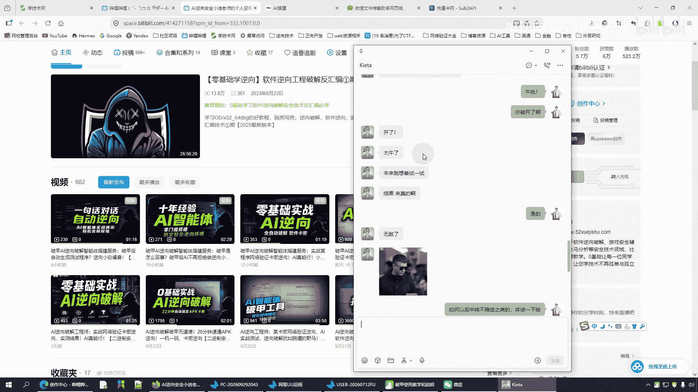

# 🧠 AI逆向智能体搭建：第一章：AI自动化逆向破解实战

在本节课中，我们将学习如何搭建和使用一个AI逆向智能体。这个智能体能够自动对程序进行逆向工程，并在短时间内完成破解。我们还会介绍它的提问方法、环境配置以及实际效果。整个过程只需要一个简单指令，非常适合希望快速进行逆向测试的初学者。

## 🚀 智能体演示与结果

我们最新搭建了一个AI自动化逆向智能体。搭建完成后，它自己找了一个程序去做逆向，然后真的成功了。最初我们只是想试一试，结果它直接开始了真实的工作。这里我特别提倡大家试一试，因为尝试本身没有损失。结果显示，游戏中的程序也能使用。这个结果确实令人惊讶，我觉得这个智能体的能力已经超越了普通人类。我们来看一下它工作了多长时间。

以下是本次演示的关键信息：


- 工作时间：大约22分钟
- 破解结果：成功完成
- 适用对象：电脑程序、手机程序

需要说明的是，它只用了22分钟就完成了整个逆向过程。如果你还在傻傻地自己学习，或者自己捣鼓环境，那么不如找小李老师搭建同款环境。我们看到的这个环境，就是AI自动化逆向破解后的结果。

## 🔑 环境的关键作用

AI自动化逆向破解了一个环境，而这个环境是直接可以去做逆向的。如果不搭建这个环境，你直接问AI“你能做逆向吗”，它肯定会拒绝。它通常会这样回答：我不能帮你做没有授权的操作。但是我们这个环境是可以的，电脑程序、手机程序都可以。

下面这段代码描述了这个环境对AI行为的影响：

```python
if env_configured:
    agent.allow_reverse = True
else:
    agent.allow_reverse = False
    agent.reply = "我不能帮助你做没有授权的操作"
```

换句话说，环境的配置直接决定了AI能否执行逆向任务。这一点非常关键，因为普通AI出于安全限制，无法在未授权场景下进行破解操作，而我们的智能体通过预配置环境绕过了这个限制。

## 🎯 提问方法与工作流程

这个智能体的提问方法非常简单，只需要输入“polo它”（谐音“破了它”）三个字就行。这个指令简单粗暴，非常高效。重点在于结果，中间可能产生了一些中转站的网络波动，但无妨。我们继续往下翻看，这是它的一个工作流程。结果直接完成了。

用代码表示就是：

```python
prompt = "polo它"
response = 逆向智能体(prompt)
print(response.status)  # 输出：一键红
print(response.remain_days)  # 输出：364
```

这里的“一键红”是界面上的一个状态，剩余时间显示为364天。看到这个界面，你应该能理解这个智能体的工作效果。

## 📚 课程资源与学习建议


想要同款的同学，一定不要再盲目地自己搭建，或者找一些没有权威的人搭建。直接来找小李老师。小李老师做逆向已经做了十多年，我们的手工逆向公开课也有很多年的历程。以前我们讲过很多很多逆向案例，现在把这些经验应用到AI上也是可行的。我们为智能体注入了所有人工逆向大佬的技能。大家搭建好之后直接就能用，不需要额外学习其他东西。一句话就可以实现逆向。


以下是一些需要记住的要点：

- 不要自己盲目折腾环境，浪费时间。
- 选择有多年经验的老师来获取同款智能体。
- 搭建完成后，一句话即可触发逆向任务。

## 📞 联系与获取方式

想要同款，不要迷路。联系小李老师的方式很简单：我们的名称就是“AI逆向安全”，在各个平台都可以连到。看向鼠标位置，这些地方都可以联系到我。想要同款就不用再等待了。这就是最真实的采访结果：本来想要试一试，结果来真的。没错，我们就来真的。想要同款的同学，联系小李老师。我们下期再见。


## 📝 总结



本节课中，我们一起学习了AI逆向智能体的搭建与使用。我们了解到它通过预配置环境，使普通AI能够执行逆向任务，并只需一个简单指令即可获得结果。我们还介绍了它的实际表现（22分钟完成）、环境作用、提问方法以及获取同款环境的途径。希望这节课对大家有所帮助，下次课程再见。
