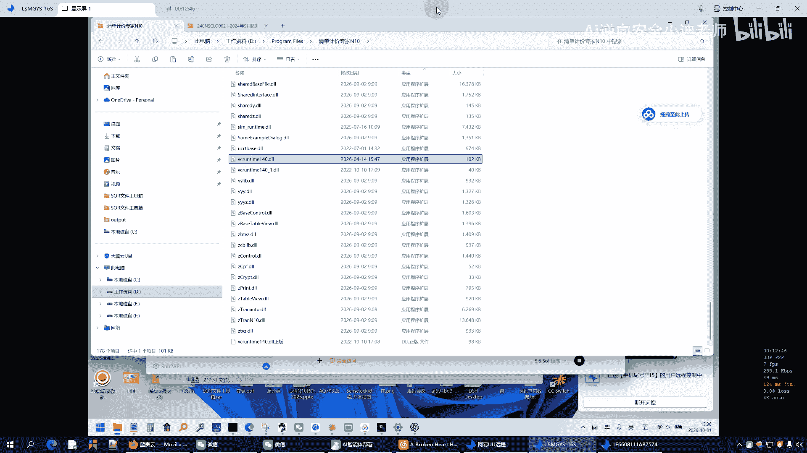
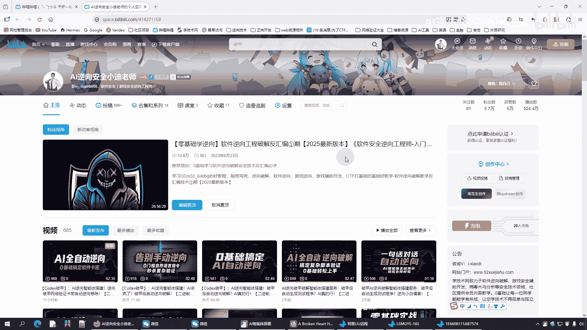
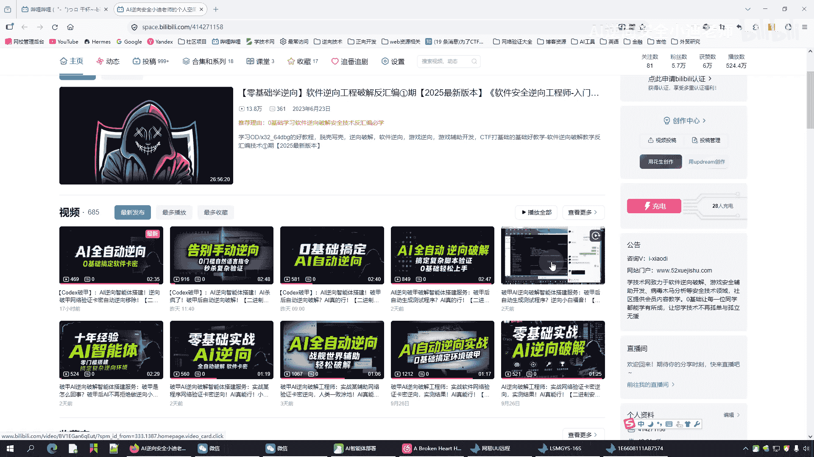
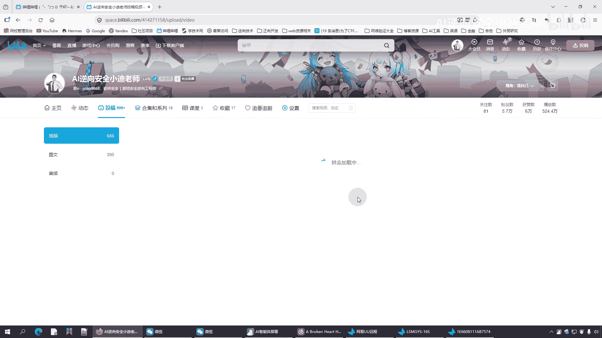

# 🧩 AI自动化逆向智能体搭建教程：1：课程概述与学习目标

在本节课中我们将要学习AI自动化逆向智能体的搭建思路、能力范围、合法授权边界、基本工作流程和案例演示方式。课程由小李老师讲解，原文提到继续查看已经搭建好的AI自动化逆向智能体，很多同学会疑问AI到底能干什么，因此课程需要说明AI可以自动化地辅助逆向分析。课程范围只讲逆向，因为小李老师本身是软件安全逆向工程师出身，拥有十多年技术经验，并把相关技术技能技巧贯穿到AI中。原文标题中的“Codex破甲”和“GPT破甲”属于宣传用语，本教程只讨论合法授权范围内的软件安全与逆向分析，不讨论绕过模型安全限制的方法。

核心概念可以用下面的伪代码表示，它帮助初学者先建立整体印象：

```text
AI自动化逆向智能体 = 静态分析 + 动态分析 + 授权测试 + 运行时观察 + 报告生成
```

以下是本课程的学习目标清单，每一项都对应原文中的核心含义：

- 理解AI在逆向分析中的定位：AI是辅助工具，不是替代授权和法律的工具。

- 明确课程范围：只讲逆向分析相关内容，不扩展到无关领域。

- 了解能力边界：静态分析、动态分析、二进制修改概念、运行时方案和在线授权分析都需要合法授权。

- 掌握基本流程：从接收程序到侦查确认，再到分析验证和形成结论。

- 认识案例演示：通过实际环境展示效果，但不提供具体破解步骤。

这些目标为后续能力介绍打下基础。

# 🧭 AI自动化逆向智能体搭建教程：2：AI能做什么与能力边界

上一节我们介绍了课程目标和合法授权前提，本节中我们来看看AI在逆向分析中具体能做什么。原文提到“你能做逆向”“卡密校验去除吗”，并对敏感字不展开，可以协助静态分析。原文还强调，可以查看卡密校验授权逻辑和加密签名流程，想分析就直接开展；动态分析可以关注断点、API校验、内存和网络请求、网络验证；二进制修改包括修改文件、生成可直接使用的程序、移除本地校验等表述；运行时方案包括Hook注入、Frida等；在线授权和网络验证可以分析请求、token、订阅、权限、会员等信息；只需要把程序发过来即可。这里需要再次说明，原文中的“移除本地校验”等表述仅能放在授权测试语境中讨论，本教程不展开具体绕过方法。

以下是AI自动化逆向智能体在合法授权测试中的主要能力清单，初学者可以把它当作能力地图：

- 静态分析能力：在授权范围内查看程序文件、授权校验逻辑、加密签名流程，帮助判断风险点。

- 动态分析能力：在授权环境中观察断点、API校验、内存数据和网络请求，理解程序运行时的行为。

- 二进制修改概念：原文提到修改文件和生成可用程序，本教程只把它作为授权测试中的风险验证概念，不提供具体补丁或移除校验的步骤。

- 运行时方案概念：Hook注入、Frida等属于运行时观察与测试概念，必须在明确授权的环境中使用。

- 在线授权分析：分析网络验证请求、token、订阅、权限和会员信息流，用于安全评估和逻辑梳理。

- 输入方式：在获得授权的前提下，将待测程序作为分析对象提交给智能体。

能力矩阵可以用下面的代码描述：

```text
能力矩阵 = {
  静态分析: [文件结构, 授权逻辑, 签名流程],
  动态分析: [断点, API校验, 内存, 网络请求],
  运行时观察: [Hook注入概念, Frida概念],
  在线授权: [token, 订阅, 权限, 会员],
  输出: [风险点, 分析结论, 报告]
}
```

> 原文中“卡密去除”“移除本地校验”等表述，在本教程中统一改写为授权安全测试中的风险验证概念，不提供具体破解或绕过步骤。

这些能力说明为后续案例说明提供了背景。

# 🧑‍💻 AI自动化逆向智能体搭建教程：3：用户案例与提示词说明

上一节我们梳理了AI能做什么以及能力边界，本节中我们来看看原文中的用户案例和提示词说明。原文提到，用户自己整理了一个“清单计算专家”的提示词，这不是课程方提供的提示词；课程方表示，如果由课程方来讲提示词，会更加专业。原文还描述用户自己在操作电脑，具体操作内容不清楚，电脑少点东西不是环境问题，而是他自己的程序问题。课程方搭建的环境不会拒绝任务，可以直接开展分析，想分析什么就分析什么。用户又在操作，似乎想复制文件。原文提到做侦查确认工具，直接开展加密锁和授权分析。用户继续操作后面内容，文件很多，课程方不再管他。想要搭建同款环境的同学可以联系小迪老师，通过哔哩哔哩主页“AN你向安全小迪老师”下方可以联系到课程方，主页中还有其他用户案例和环境，全部是实际效果演示。原文还提到，有人担心这个东西会不会过去，课程方表示已经做了多年，视频一直在做，哪怕一个月回本也不算亏，因此不要担心，可以大胆放心开展。原文提到9月30日“脱文P”到10月1日国庆节，并祝福国庆节快乐。原文最后说今天视频到这里，想联系的可以联系，不要再等待，不要落后于别人，搭建属于自己的AI智能体，让自动化全天24小时干活，下期再见。

以下是原文案例与宣传信息的整理清单，便于初学者理解课程展示方式：

- 用户提示词案例：用户自己整理“清单计算专家”提示词，课程方强调自己讲提示词会更专业。

- 演示细节：用户自己操作电脑，出现少点东西的情况，课程方判断是用户程序问题，不是环境问题。

- 环境特点：课程方搭建的环境不会拒绝任务，在合法授权前提下可以直接开展分析。

- 侦查确认：原文提到做侦查确认工具，直接开展加密锁和授权分析。

- 文件处理：用户继续操作并想复制文件，文件很多，课程方不再干预。

- 联系与案例：通过哔哩哔哩主页“AN你向安全小迪老师”联系课程方，主页展示其他用户案例和环境实际效果。

- 稳定性宣传：课程方表示多年一直做相关视频，一个月回本不算亏，不要担心，可以大胆放心开展。

- 时间与祝福：原文保留9月30日“脱文P”到10月1日国庆节的时间节点，并祝福国庆节快乐。

- 行动号召：不要等待，不要落后，搭建自己的AI智能体，让自动化全天24小时干活，下期再见。

案例演示要素可以用下面的代码概括：

```text
案例演示 = 用户提示词 + 操作过程 + 侦查确认 + 环境展示 + 实际效果演示
```

> 原文中“一个月回本不算亏”属于课程宣传语，本教程保留其含义，但读者应把重点放在合法授权和技术学习上。

这些案例说明为下一节的安全边界讨论做了铺垫。

# 🛡️ AI自动化逆向智能体搭建教程：4：合法授权与安全边界

上一节我们介绍了用户案例和宣传信息，本节中我们来看看合法授权与安全边界。原文虽然提到卡密校验、移除本地校验、网络验证授权分析等内容，但本教程必须把边界讲清楚：所有分析都应当建立在明确授权的基础上，不能用于侵犯他人软件许可、网络验证或会员权限。原文中“敏感字我就不说了”也说明有些表述不适合展开，因此教程只讲概念和流程，不讲具体破解步骤。

以下是合法授权与安全边界清单，每个初学者都应当先记住这些原则：

- 合法授权：只分析自己拥有或已获得书面授权的程序和环境。

- 静态分析边界：可以查看文件结构和授权逻辑，但不能把分析结果用于非法绕过。

- 动态分析边界：断点、API校验、内存和网络请求观察应在隔离测试环境中进行。

- 二进制修改边界：原文提到修改文件和移除本地校验，本教程只讨论风险验证概念，不提供具体补丁方法。

- 运行时方案边界：Hook注入和Frida等概念只能在授权测试中使用，不能用于未授权程序。

- 在线授权分析边界：分析token、订阅、权限和会员信息流时，必须遵守授权范围和数据保护要求。

- 报告输出边界：输出风险点和分析结论，不输出可直接用于破解的操作步骤。

安全边界可以用下面的公式表达：

```text
可执行分析 = 技术能力 × 合法授权 × 隔离环境
未授权分析 = 不允许
```

> 原文中的“移除本地校验”“卡密去除”等说法，在本教程中只作为授权测试中的风险验证概念出现，不展开具体方法。

明确边界之后，下一节我们来看一个高层的工作流程。

# 🧱 AI自动化逆向智能体搭建教程：5：环境搭建与工作流程

上一节我们强调了合法授权和安全边界，本节中我们来看看环境搭建与工作流程。原文提到课程方搭建的环境不会拒绝任务，可以直接开展分析，想分析什么就分析什么；还提到做侦查确认工具、加密锁授权分析、复制文件、文件很多等演示细节。把这些内容整理成教程时，应当把它变成“先确认授权，再开展侦查确认，然后做静态和动态分析，最后形成报告”的流程，而不是直接给出破解操作。

以下是AI自动化逆向智能体的高层工作流程清单，适合初学者按顺序理解：

- 第一步，确认授权：明确待测程序、测试范围和允许使用的分析方法。

- 第二步，收集对象：在授权前提下接收程序文件和相关说明。

- 第三步，侦查确认：像原文说的“做侦查确认工具”一样，先确认程序类型、保护方式和授权相关入口。

- 第四步，静态分析：查看文件结构、授权校验逻辑和加密签名流程。

- 第五步，动态分析：在隔离环境中观察断点、API校验、内存和网络请求。

- 第六步，运行时观察：在授权环境中理解Hook注入和Frida等运行时方案的概念。

- 第七步，在线授权分析：梳理网络验证请求、token、订阅、权限和会员信息流。

- 第八步，输出报告：总结风险点、分析结论和授权测试建议，不输出具体破解步骤。

工作流程可以用下面的伪代码描述：

```text
开始
  -> 确认合法授权
  -> 接收待测程序
  -> 侦查确认
  -> 静态分析
  -> 动态分析
  -> 运行时观察
  -> 在线授权分析
  -> 生成报告
结束
```

流程清楚之后，下一节我们来看案例演示与沟通方式。

# 📊 AI自动化逆向智能体搭建教程：6：案例演示与沟通方式

上一节我们介绍了高层工作流程，本节中我们来看看案例演示与沟通方式。原文提到搭建同款环境可以联系小迪老师，通过哔哩哔哩主页“AN你向安全小迪老师”下方可以联系到课程方，主页中还有其他用户案例和环境，全部是实际效果演示。原文还提到有人担心课程或技术会不会过去，课程方表示已经做了多年，视频一直在做，哪怕一个月回本也不算亏，因此不要担心，可以大胆放心开展。原文最后提到9月30日“脱文P”到10月1日国庆节，并祝福国庆节快乐；今天视频到这里，想联系的可以联系；不要再等待，不要落后于别人，搭建属于自己的AI智能体，让自动化全天24小时干活，下期再见。

以下是案例演示与沟通方式清单，方便读者理解原文的宣传和联系信息：

- 同款环境咨询：想要搭建同款环境的同学可以联系小迪老师。

- 联系路径：通过哔哩哔哩主页“AN你向安全小迪老师”下方联系课程方。

- 案例展示：主页中可以看到其他用户案例和环境，全部是实际效果演示。

- 稳定性说明：课程方表示多年一直做相关视频，不要担心，可以大胆放心开展。



- 回本宣传：原文提到一个月回本不算亏，这属于宣传语，学习时仍应以合法授权和技术掌握为重点。

- 时间节点：原文保留9月30日“脱文P”到10月1日国庆节的时间节点，并祝福国庆节快乐。

- 结束与号召：今天视频到这里，想联系的可以联系；不要等待，不要落后，搭建自己的AI智能体，让自动化全天24小时干活，下期再见。



沟通路径可以用下面的代码概括：

```text
沟通路径 = 哔哩哔哩主页 -> AN你向安全小迪老师 -> 同款环境咨询 -> 查看实际案例演示
```

> 原文中“不要担心，可以大胆放心开展”应理解为在合法授权和技术学习前提下开展，不是鼓励未授权测试。



这些案例和沟通信息为最后的课程总结提供了收尾素材。

# ✅ AI自动化逆向智能体搭建教程：7：课程总结

上一节我们介绍了案例演示与沟通方式，本节中我们来总结整篇教程。原文从AI自动化逆向智能体的搭建讲起，说明了AI可以辅助逆向分析，介绍了静态分析、动态分析、二进制修改概念、运行时方案和在线授权分析等能力，还展示了用户案例、提示词说明、环境演示、联系方式和宣传信息。整理成教程后，核心仍然是合法授权、安全边界和清晰流程，具体破解或移除校验的操作不在本教程展开。



以下是本课程需要记住的总结清单，便于初学者复习：

- AI自动化逆向智能体是辅助工具，不是绕过授权的工具。

- 静态分析、动态分析、运行时观察和在线授权分析都必须在合法授权范围内进行。

- 原文提到的“移除本地校验”“卡密去除”等表述只作为风险验证概念讨论，不提供具体方法。

- 工作流程应当从确认授权开始，经过侦查确认、分析验证，最后形成报告。

- 案例演示和联系信息用于了解课程环境，技术学习仍要以合法合规为前提。

课程总结可以用下面的公式表示：

```text
课程核心 = 合法授权 + 清晰流程 + 技术理解 + 安全边界 + 报告输出
```

本节课中我们一起学习了AI自动化逆向智能体的课程目标、能力范围、案例说明、合法授权边界、工作流程、沟通方式和总结要点。希望读者在合法授权的前提下理解原文含义，并把重点放在技术概念和流程上，而不是具体破解操作上。下期再见。
