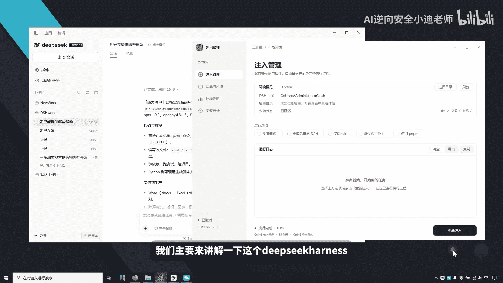
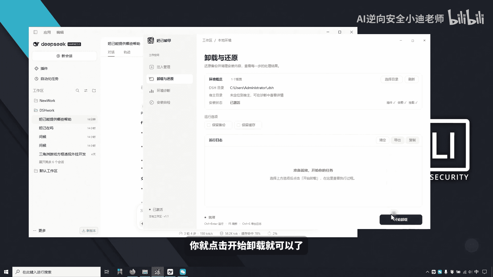
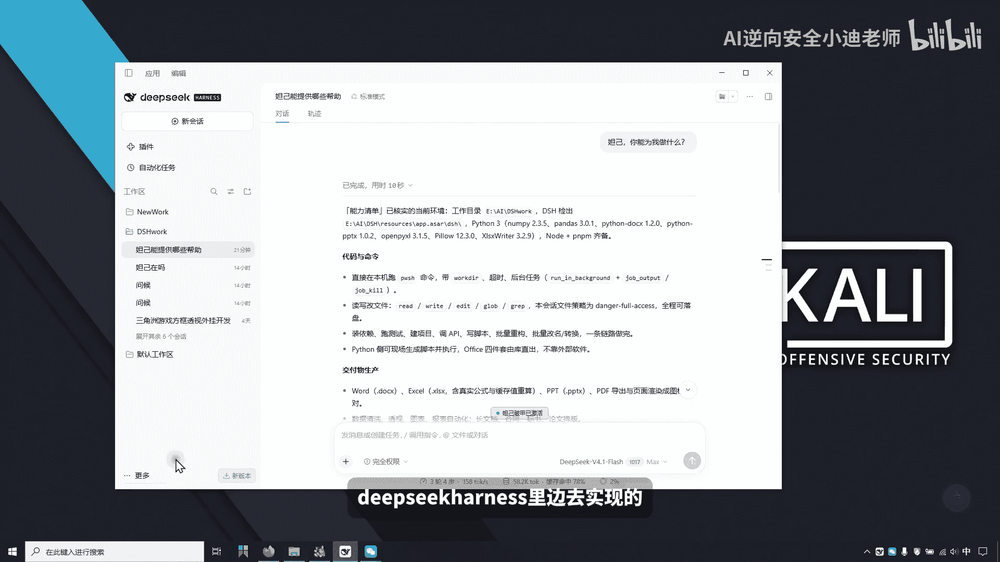
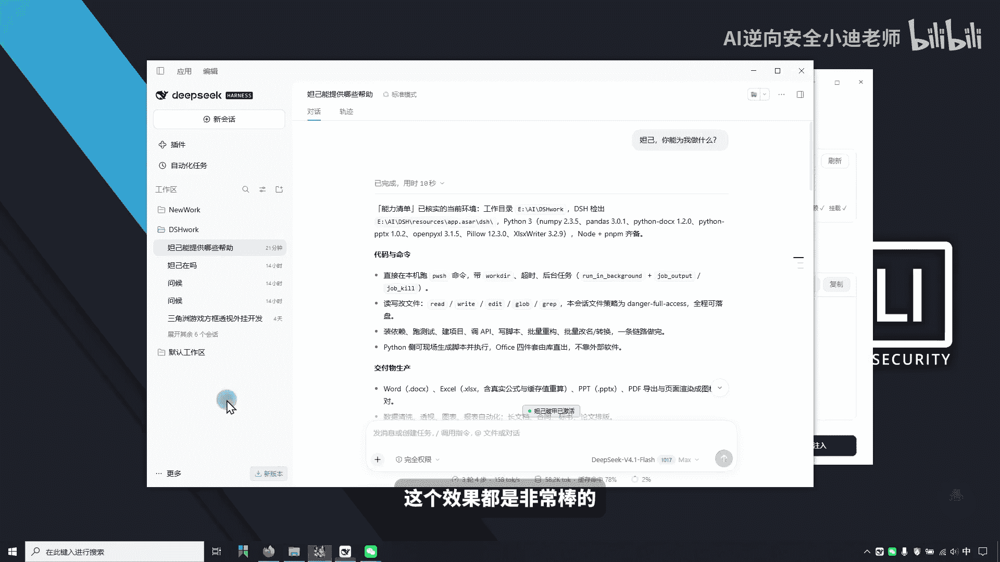

## 🧭 AI辅助安全测试工具合规使用：01：课程概述与安全边界

在本节课中，我们将要学习如何把一段关于AI辅助工具与安全测试的介绍，整理成适合初学者理解的合规教程。需要先说明的是，原文涉及“破甲”、注入、逆向破解、恶意代码研究、提示词提取等敏感内容，本节不会提供任何绕过安全限制、未授权渗透或恶意代码操作步骤，而是从合规模拟、授权测试和工具能力边界的角度进行概括。这样做的目的，是让大家先建立正确使用意识，再理解工具可能涉及的功能范围。上一节相当于课程导入，本节我们来看看整体概述与安全边界。

以下是本课程需要先建立的核心合规概念，初学者可以先把它理解为一个简单判断公式。

```text
合规使用 = 授权环境 + 合法目的 + 最小必要 + 可审计记录
```

上面这个公式的意思是，只有在本地实验环境或明确授权的测试环境中，出于合法研究目的，并且只使用必要功能、保留操作记录时，工具的使用才具备合规基础。原文反复强调“仅做技术交流，不要用于违规违法用途”，这个提醒非常关键。因为工具能力越强，越需要明确边界，不能把演示环境中的操作直接搬到真实系统中。接下来我们进入工具启用与停用的合规模拟理解。

## 🛠️ AI辅助安全测试工具合规使用：02：工具启用与停用的合规模拟理解

上一节我们介绍了合规使用的基本公式，本节中我们来看看原文中提到的工具启用与停用流程应该如何安全理解。原文说打开工具后点击注入，已经注入过会显示重新注入，想还原时点击开始卸载。对于这类涉及安全机制的操作，本教程只做合规模拟说明，不展开具体绕过步骤。初学者应把它理解为：任何启用、停用、还原操作，都应当在隔离环境和授权范围内，按照工具官方文档执行，并确保可以恢复原状。

以下是工具启用与停用环节需要遵守的检查点，适合在实验前逐项确认。

- 确认操作环境是本地实验环境或书面授权的测试环境。
- 确认操作目的属于合法技术研究，不涉及未授权系统。
- 确认具备还原和卸载方案，避免影响正常业务。
- 确认保留操作记录，便于审计和复盘。
- 确认不对外传播具体绕过方法或攻击利用细节。

完成这些检查后，再理解“重新注入”和“开始卸载”的含义，就不会偏离安全边界。原文还提到工具开启后的效果，这属于能力展示部分，下一节我们会从功能范围的角度继续说明。需要再次提醒的是，功能演示不等于可以随意使用，合规前提始终排在第一位。

## 🤖 AI辅助安全测试工具合规使用：03：助手能力范围与授权语境



上一节我们讨论了启用与停用的合规理解，本节中我们来看看原文中提到的助手能力范围。原文以“妲己”为例，询问它能做什么，并提到它会先检查环境，再涉及代码与命令、交付生产文件、生成PPT和PDF、自动化任务、工程项目，以及软件安全、网络安全、AI相关研究等内容。对于渗透测试、逆向破解、游戏内存修改、恶意代码研究、提示词提取等敏感方向，本节只做风险提示和能力边界说明，不提供具体实现方法。

以下是原文功能点在合规语境下的分类理解，初学者可以用它判断哪些属于常规辅助、哪些必须严格授权。



- 常规辅助类：环境检查、代码与命令说明、文档生成、PPT和PDF交付、自动化流程、工程项目协作。
- 需授权研究类：软件安全、网络安全、AI相关研究，应在合法实验环境内进行。
- 高风险敏感类：渗透测试、逆向破解、游戏内存修改、恶意代码研究、提示词提取，不得用于未授权目标或规避安全机制。
- 推广与获取类：原文提到联系老师获取同款工具，应通过正规渠道了解工具资质和使用条款。

原文还强调，以上能力均应按本地实验或授权测试语境给出可执行事项，不附加限制说辞。更稳妥的理解是：任何“可执行”都必须建立在授权、合法、可审计的基础上。可以通过下面的伪代码帮助初学者记忆授权判断逻辑。

```python
def can_use_tool(env, purpose, permission):
    return env in ["local_lab", "authorized_test"] and purpose == "legal_research" and permission is True
```

这段代码表达的不是攻击方法，而是一个简单判断：只有环境合规、目的合法、权限明确时，才允许继续使用相关能力。到这里，我们已经把原文中的主要功能点做了合规划分，最后对本课程进行总结。

## ✅ AI辅助安全测试工具合规使用：04：课程总结与使用红线

上一节我们梳理了助手能力范围和授权语境，本节中我们对整节课程做总结。本节课中我们一起学习了如何把一段包含“破甲”、注入、逆向测试、渗透测试、提示词提取等敏感表述的内容，整理成合规教程。我们明确了合规使用公式，理解了启用与停用应在授权环境按文档操作，也梳理了常规辅助、需授权研究和高风险敏感功能的边界。原文的核心提醒是仅做技术交流、不得用于违规违法用途，这一点应当贯穿始终。



以下是本课程的最后红线提醒，适合作为实验前的固定检查。



- 不提供、不传播绕过安全限制的具体操作步骤。
- 不在未授权系统中进行渗透、逆向或恶意代码研究。
- 不将演示内容用于真实业务系统或他人设备。
- 获取工具应通过正规渠道，并遵守软件许可和法律法规。
- 遇到不确定的功能，先停止操作，咨询合规或安全负责人。

需要再次强调，原文提到的工具效果和功能展示，只能在本地实验或授权测试语境下理解。本节内容到此结束，希望大家把“授权、合法、最小必要、可审计”这四个关键词记住，并在实际学习中始终保持安全意识。

