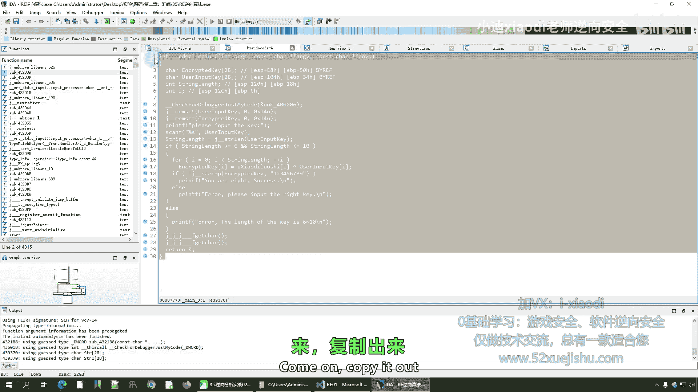
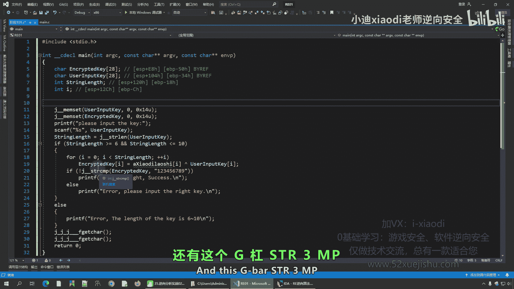
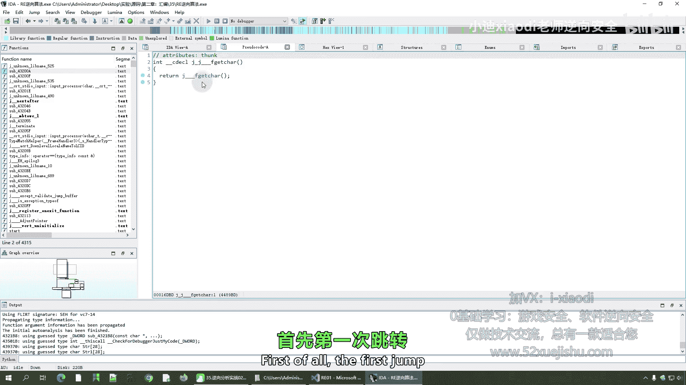
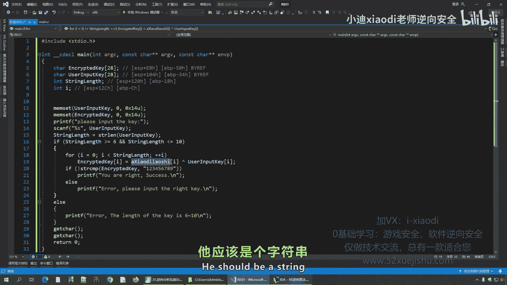
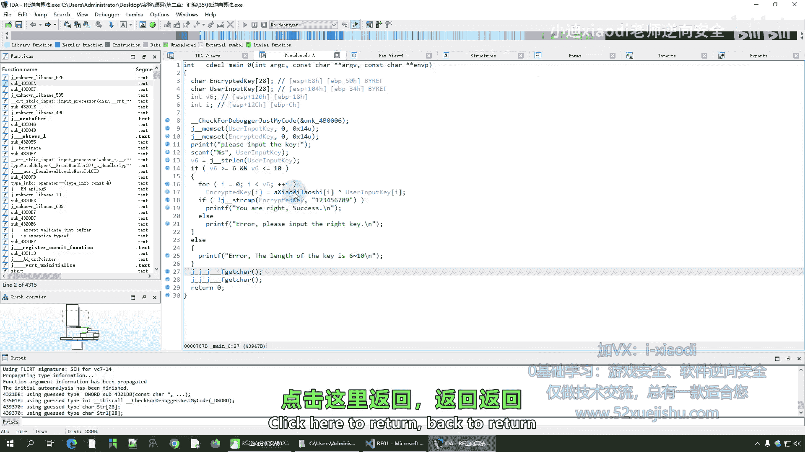
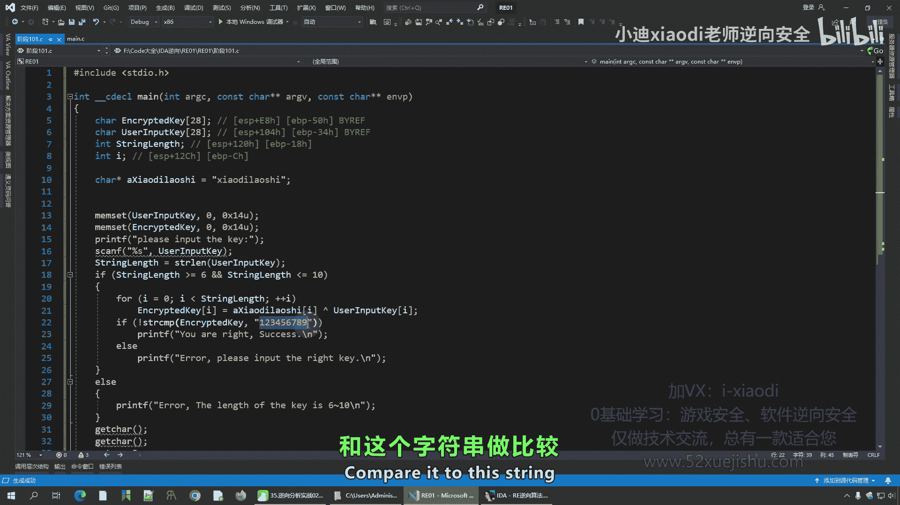
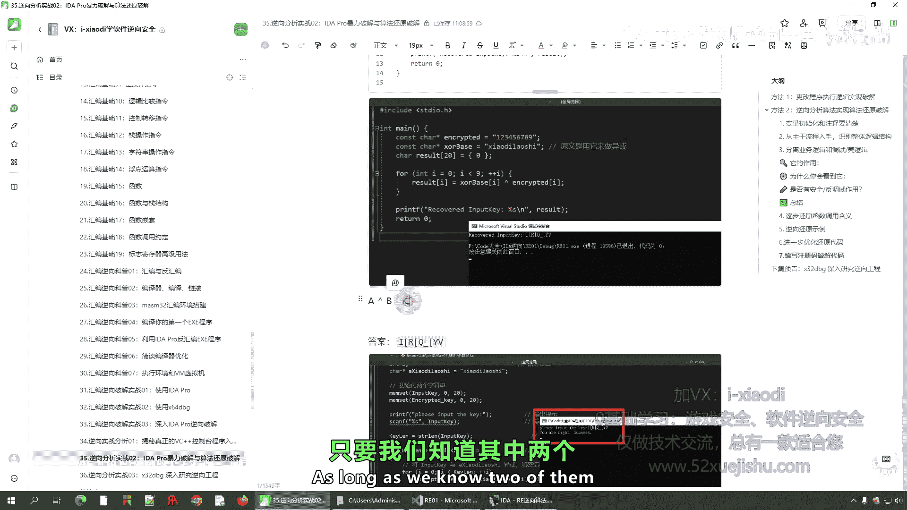
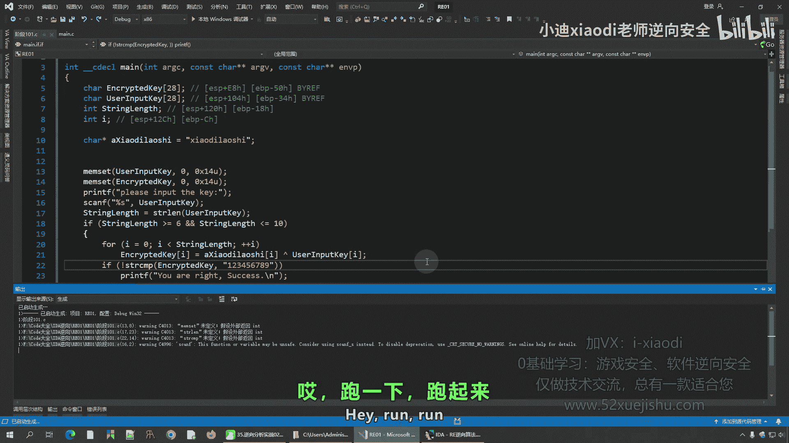
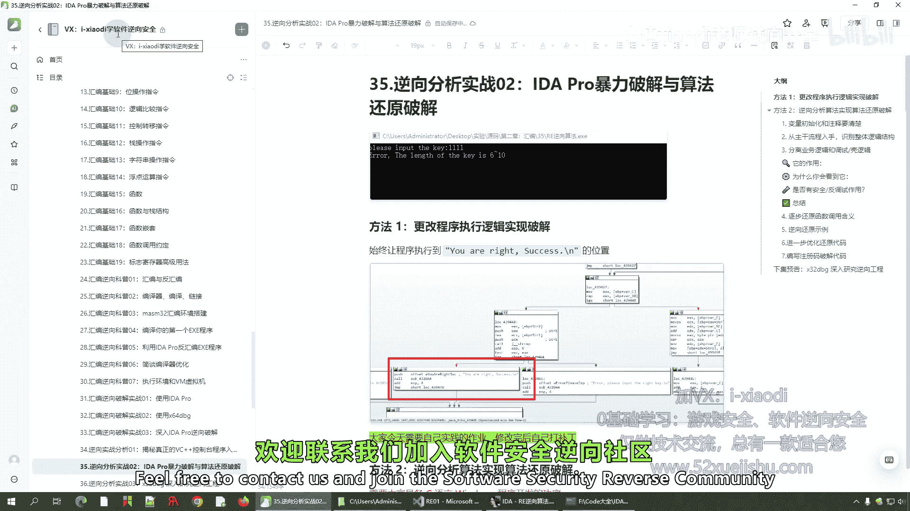

# 🧩 IDA-Pro逆向工程基础：01：暴力破解与算法还原破解

## 📌 IDA-Pro逆向工程基础：01-1：课程概述

大家好，我是小迪老师。今天讲解 IDA Pro 暴力破解与算法还原破解。本节课程会先运行实验程序，观察程序提示和分支逻辑，再分别介绍修改程序执行逻辑的暴力破解方法，以及通过逆向分析算法还原注册码的方法。课程内容会围绕分支判断、伪代码整理、关键函数识别和异或可逆性展开，目的是让初学者理解软件逆向分析的基本流程。下面先看实验程序的实际表现，从输入提示和错误信息入手，逐步定位代码逻辑。

## 🎯 IDA-Pro逆向工程基础：01-2：实验程序与分支逻辑

首先把实验程序运行起来。程序运行后会提示 `please input the key`，要求输入一串 Key。我们先简单输入 `123` 做测试，程序会提示 `the length of the key is 6 to 10`，意思是输入长度应该是 6 到 10。于是再调整输入为 `123456` 并回车，这时程序会给出另一种提示 `please input the right key`，意思是请输入正确的 Key。通过这两个提示可以判断，程序代码逻辑存在两个分支：一个分支检测输入长度是否错误，另一个分支检测输入的 Key 是否正确。是否正确这一逻辑与长度检测逻辑是分开的。当前输入长度正确，因此在长度正确的逻辑下，程序又衍生出另一个逻辑，也就是判断 Key 是否正确。

为了更直观地描述这个程序的分支，可以用下面的公式表示。

```c
if (len(key) < 6 || len(key) > 10) {
    error_length();
} else {
    if (check_key(key)) {
        success();
    } else {
        error_key();
    }
}
```

## 🛠️ IDA-Pro逆向工程基础：01-3：方法一修改程序执行逻辑实现暴力破解

破解有两个方法。第一个方法是更改程序执行逻辑，实现事先破解。这个方法操作非常简单。我们直接把程序拖进 IDA Pro，拖入后点击 OK，并继续进入调试界面。进入后首先看到的是 `main` 函数，但这个 `main` 函数并不是真正的入口函数。上节课讲过，真正的 VC 控制台程序入口需要进一步定位，真正的代码需要通过启动流程跳转过去。双击跳转后可以看到，真正的程序代码都在这里。接下来需要分析代码。往下拉可以看到一个分支，这个分支用于判断长度，旁边有 `success` 表示验证成功的位置。暴力破解的思路就是直接把这个跳转改为无条件跳转到成功位置。

修改时需要逆向往回看，因为逆向分析从正确弹窗或正确提示往回走更清晰，这才是逆向思维。往回走首先会遇到一个跳转，这个跳转会更改程序执行逻辑。按空格查看后，如果希望程序继续往下执行，也就是执行正确分支，这里应该做一个 `nop` 操作。记下此处需要 `nop`，可以打一个分号注释为“此处需要 nop”，然后点击 OK。再往上看，有一个跳转，这个跳转应该改为无条件跳到这里，可以自己加注释。再往上看，有一个 `JMP` 无条件跳转到这里，这里没有关系。再往上看，代码会跳到另一个位置，再跳到另一个位置；如果不跳，就会来到错误位置。因此这里也要改成无条件跳转 `JMP`。再往上看，这个逻辑会跳到类似 `0x439406` 的位置，这个位置不应该无条件跳，应该 `nop` 掉；`nop` 掉后就可以执行 `JMP` 和 `JLE`。再往上看就是头部代码。这样修改后，程序执行逻辑始终会走到 `you are right success` 的位置，从而实现暴力破解。

下面是补丁思路的简化表示，实际地址和指令以实验程序为准。

```asm
; 原逻辑可能类似
jne error
; 修改思路
jmp success
```

```asm
; 某些判断需要跳过
nop
```

修改完成后需要自己打补丁，这个实践作业由大家自己完成，课程不带着操作。上一节介绍了修改跳转的暴力破解思路，本节继续介绍第二个方法，也就是逆向分析算法，实现算法还原破解。这个方法需要大家具备 C 语言和 Windows 程序开发功底，可以加入高级版逆向社区，课程包括该内容。

## 🔍 IDA-Pro逆向工程基础：01-4：生成伪代码与变量重命名

分析算法时，首先在 IDA Pro 中按 F5 生成 C 代码。生成的 C 代码称为伪 C 代码，意思是它并不是真正的 C 代码，需要做很多修修补补的工作。看到伪代码后，很多初学者会困惑，一时看不懂这些内容。阅读伪代码需要遵循一定原则。第一个原则是变量初始化和注释要清楚，理解变量在栈中的布局和使用方式，并注释每个变量的含义。我们需要给变量重新命名，或者添加注释。

首先看 `STRETRE` 相关逻辑，这里先做了一次内存清空，然后好像做了一次加密或异或操作。最终加密异或完成后，这里进行了 `STRCMP` 字符串比较操作。因此这个变量是最终加密后的 Key，可以按键盘上的 N 键重命名为“加密后的 Key”。再看另一个变量，它也先做内存清空，然后在 `please input` 提示后接收输入，因此它应该是用户输入，可以重命名为 `user_input`。此时代码会比刚才更加直观。程序先让用户输入 `user_input`，然后让 `user_input` 参与运算，最终得到加密后的结果；如果加密后的结果和 `123456789` 一样，就提示 `right`，如果不一样就提示错误。还有一个变量表示字符串长度，可以重命名为 `len`。循环变量暂时不用管。此时代码基本已经还原出来。

变量重命名可以用下面的示意代码理解。

```c
char encrypted_key[100];
char user_input[100];
int len;

memset(encrypted_key, 0, sizeof(encrypted_key));
memset(user_input, 0, sizeof(user_input));
```

第一步是把相关变量做重命名或注释。第二步是从主干流程入手，识别整体逻辑结构，优先抓住输入输出。这里可以看到 `please input` 和 `you are right` 都是提示信息，因此它们应该是输出操作。如果有 C 语言编程经验，可以猜出它是 `printf` 函数，于是重命名为 `printf` 并点击 OK。这里还有一个接收用户输入的操作，可以重命名为 `scanf`。接着再看条件分支：输入 `user_input` 后会计算长度，如果长度符合标准，就执行后续操作；如果长度不符合标准，就会来到提示长度需要 6 到 10 的位置。如果长度符合，就会执行循环操作，循环结束后得到运算结果，然后把这个结果拿去比较。比较成功就提示成功，比较失败就提示失败。接下来需要分析调用的关键函数。

## 🧠 IDA-Pro逆向工程基础：01-5：识别关键函数与分离逻辑

对于这个程序，关键函数应该是会得到比较结果、并直接影响初步跳转逻辑的字符串比较函数。比较成功才会提示成功，比较失败就会提示失败。下一步是分离逻辑。在这个步骤中，要把与逆向分析无关的代码剔除掉。例如 `check for` 就是无关代码，因为这个函数不是用户写的代码，而是编译器为了调试自己添加的。这个知识点可以积累下来：只要是 Visual Studio 编译出来的 Debug 版本程序，就可能存在这样一个函数。这个函数与逆向无关，因此不需要看。

有了上面的共识后，就可以把这里的代码复制出来，放到 Visual Studio 中运行。首先 `check for debug` 是无关代码，因此删除。然后把 `main` 函数改成 `main`。由于代码用到了 `printf` 等 C 函数，因此需要包含头文件。

```c
#include <stdio.h>
```

接下来会看到类似 `j_`、`j_ST2M`、`j_JGF` 这样的符号，这些符号怎么理解。实际上它们是跳转几次后执行的函数，有几个无条件跳转或几个跳转，就有几个 `j`。例如双击进入某个 `j_` 函数，会发现它不是直接调用 `ret`，而是跳到这个函数，跳过一次再执行，因此有一个 `j`。另一个函数也是跳过一次再执行，有一个跳转，因此也有一个 `j`。再看一个有 3 个 `j` 的函数，说明它做了三次跳转：第一次跳转、第二次跳转、第三次跳转。在代码中直接把这些 `j` 删掉即可，因为它们对应的是原生 C 函数。



## 🧪 IDA-Pro逆向工程基础：01-6：代码还原与异或可逆破解

删除这些跳转符号后，还需要处理字符串。这里有一个“小迪老师”字符串，需要去看字符串定义。返回后点击相关位置，找到“小迪老师”并双击过去，原来就是这个字符串，复制一下。然后定义一个字符串变量，把它放进去。

```c
char *hint = "小迪老师";
```





这样代码就基本还原完成。运行还原后的代码，可以看到程序逻辑被还原出来。输入 `123` 会出错，输入 `123456` 后继续观察。此时已经把程序代码直接还原出来，这就是软件逆向工程的魅力。接下来可以编写注册码破解代码。关键核心加密逻辑在这里：程序把“小迪老师”这个字符串和用户输入的内容做异或加密，然后把得到的结果与目标字符串做比较。异或加密是一个可逆算法。例如 `A ⊕ B = C`，那么 `C ⊕ B = A`，并且 `A ⊕ C = B`。只要知道其中两个值，就可以拿到正确结果。最终异或结果应该是 `123456789`，因此把这个 `123456789` 放到比较位置。

异或可逆性可以用下面的公式表示。





```text
A ⊕ B = C
C ⊕ B = A
A ⊕ C = B
```

因此破解关系可以写成下面的形式。

```c
encrypted = user_input ^ "小迪老师";
if (encrypted == "123456789") {
    success();
}
```

反过来计算正确 Key 时，可以使用下面的公式。



```c
correct_key = "123456789" ^ "小迪老师";
```



现在知道目标结果，也知道参与异或的字符串，因此它和它做异或就是正确的 Key。最终代码就是让目标结果和字符串做异或，运行一下即可。运行后可以看到正确结果。再把刚才的程序跑起来，输入计算出的内容并回车，程序提示 `you are right success`。这就是今天课程的全部内容。通过本节课程可以感受到软件逆向分析的魅力。想学习相关内容，欢迎联系我们，加入软件安全逆向社区。



## ✅ IDA-Pro逆向工程基础：01-7：课程总结



本节课中我们一起学习了 IDA Pro 暴力破解与算法还原破解的基本流程。我们首先运行实验程序，观察长度错误和 Key 错误两个分支；然后介绍了通过修改跳转和 `nop` 指令实现暴力破解的思路；接着介绍了按 F5 生成伪 C 代码、重命名变量、识别输入输出、分离无关调试代码、分析关键字符串比较函数的方法；最后利用异或运算的可逆性，理解了如何从目标比较结果反推出正确 Key。整个流程体现了从程序行为到分支逻辑，再到伪代码整理和算法还原的逆向分析过程。

