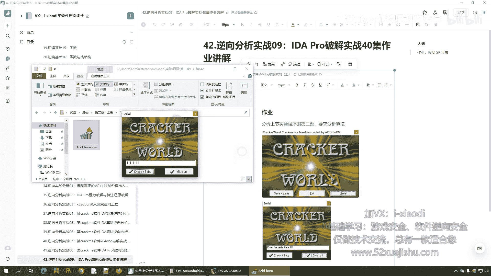
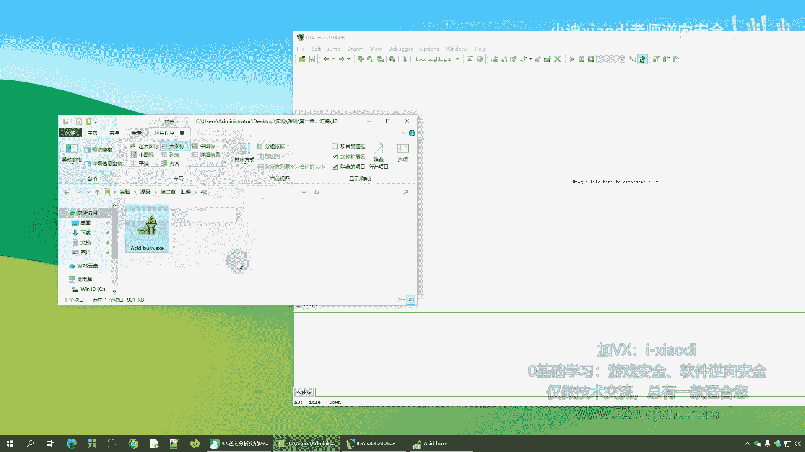
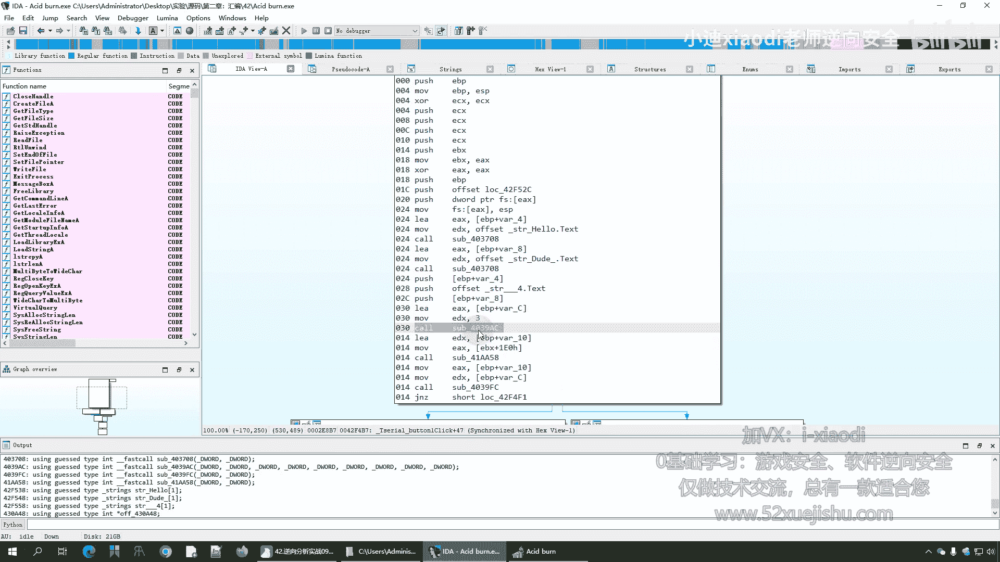
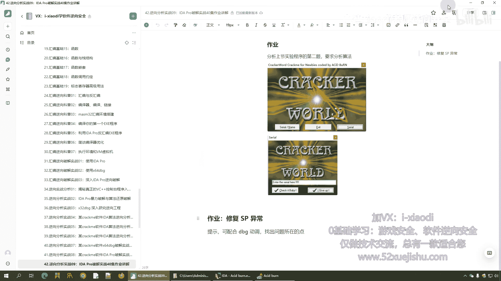
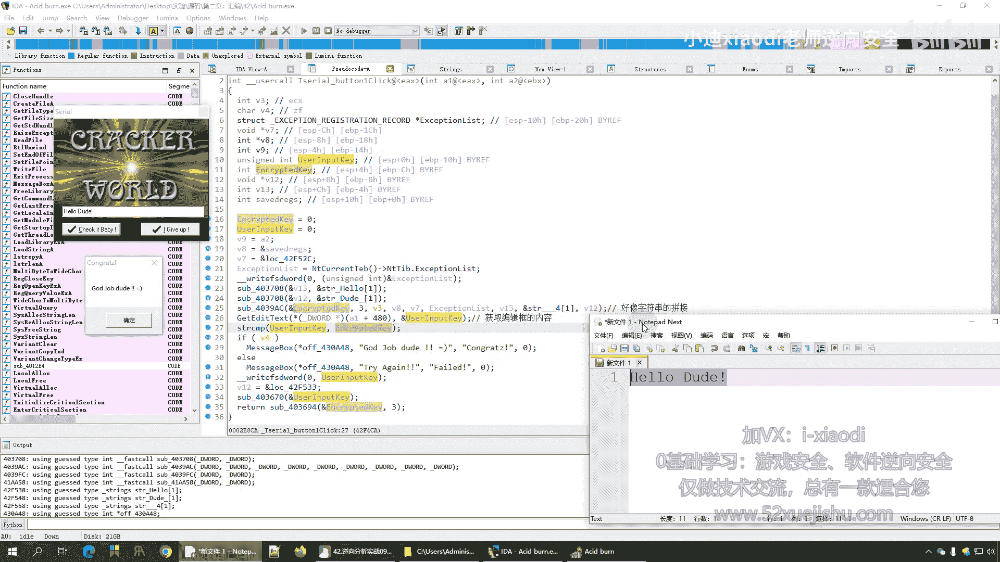

## 🧭 IDA硬核逆向破解：01：课程概述与目标

在本节课中我们将要学习如何用IDA-Pro逆向分析软件，并理解软件卡密密码的校验思路。这个内容是40级作业中的一个算法分析案例，适合游戏安全、软件安全和网络安全初学者打基础，也适合CTF比赛前做练习。课程会围绕一个很小的程序展开，从运行程序、定位提示字符串，到分析判断分支和加密串，再到验证注册成功，完整走一遍逆向分析流程。大家好，我是小迪老师，今天我们来继续看IDA怎么破解软件。

上一节内容我们还没有展开，本节先看程序的运行效果。首先运行这个程序，然后找到界面上的一个位置，点一下，程序会让我们输入一个密码。接着点击check按钮，也就是原文里的check the baby，程序会提示Try again，意思是再试一次，说明密码错误。我们可以根据这个错误提示去做逆向分析，因为提示字符串往往就是定位校验逻辑的入口。

这个程序的校验逻辑可以用一个很直白的公式表示：



```c
if (strcmp(user_input, encrypted_key) == 0) {
    success();
} else {
    fail();
}
```



上面这个公式说明，程序会把用户输入和某个加密后的密码做比较，相等就成功，不相等就失败。后续所有分析都围绕这个公式里的两个值展开。

以下是本案例的基本运行步骤，我们先有一个整体印象：

- 运行程序，找到输入位置。
- 输入密码，点击check按钮。
- 观察Try again错误提示。
- 根据提示进入IDA做逆向分析。

## 🚀 IDA硬核逆向破解：02：载入程序并定位提示字符串

上一节我们介绍了课程目标和程序运行时看到的提示，本节中我们来看看如何把程序载入IDA并定位提示字符串。把程序直接拖到IDA里即可，使用默认选项拖过来就行。等待IDA分析完成，然后把文件夹折叠一下，方便查看。接下来要搜索字符串，使用的快捷键是Shift加F12。搜索后可以直接看到失败提示和Try again这类字符串，Try again就在这个位置。

找到字符串之后，需要找哪里调用了它。使用X查看交叉引用，就能定位到使用这个字符串的代码位置。这个位置是一个逻辑分支，成功会往一边跳，失败会往另一边跳。它的上方是一个比较操作，按照我们看过的很多案例，这里很可能就是校验代码。校验完成之后会得到一个结果，程序再根据这个结果判断往哪边跳。

交叉引用的定位过程可以概括为下面这段伪代码：

```text
搜索字符串 "Try again"
        ↓
查看交叉引用 X
        ↓
到达判断分支
        ↓
上方代码进行比较和校验
```

以下是定位提示字符串时需要记住的操作点，方便初学者照着做：

- 把程序拖入IDA，使用默认设置。
- 等待分析完成，折叠文件夹。
- 按Shift加F12搜索字符串。
- 找到失败提示和Try again。
- 按X查看交叉引用。
- 观察成功分支和失败分支。

## 🧱 IDA硬核逆向破解：03：判断分支与栈异常修复作业

上一节我们定位到了失败提示和交叉引用位置，本节中我们来看看这个判断分支与校验逻辑。这个位置明显是一个逻辑分支，成功往一边跳，失败往另一边跳，上面的代码就是比较操作。按照定式思维，看了这么多案例之后应该能理解，这里就是校验代码。校验完成后得到一个结果，再根据结果决定跳转方向。

分析算法时直接按F5反编译。按下F5后会发现一个错误，这个错误留给大家当作作业，作业内容就是修复SP异常。提示说可以配合DBG动态调试，找出问题发生的点。可以点击Option，进入通用设置，勾选stack pointer相关选项，然后自己分析哪个框有问题，再把栈修补一下。修补栈使用的快捷键是Alt加K。这里会发现这些函数都是内平栈，没有外平栈那种调用方调整ESP的情况，所以需要自己研究Alt加K，配合动态调试看哪个位置有问题。

栈平衡的核心概念可以用下面的代码表示：

```asm
; 内平栈：函数内部自己调整栈
function:
    push ebp
    mov ebp, esp
    ; ...
    add esp, 0x10
    ret

; 外平栈：调用方调整栈
caller:
    push arg
    call function
    add esp, 4
```

以下是修复栈异常作业时可以采用的检查步骤，目的是让F5反编译结果正常：

- 按F5观察SP异常错误。
- 使用DBG动态调试定位问题点。
- 点击Option，在通用设置中勾选stack pointer。
- 分析哪个栈帧不平衡。
- 使用Alt加K修补栈。
- 确认函数属于内平栈还是外平栈。



## 🧩 IDA硬核逆向破解：04：业务逻辑与字符串拼接



上一节我们通过F5看到了反编译代码，并留下栈异常修复作业，本节中我们来看看业务逻辑和字符串拼接。这个软件很简单，所以业务逻辑也非常简单。它做的事情就是获取编辑框的内容，获取到之后和程序中的某个数据做比较、做校验。我们从上往下看代码，这两个操作肯定不是获取编辑框内容，不太像，它们更像字符串传递，把两个字符串分别传给前面的位置。这个操作有点像字符串拼接，一个字符串和另一个字符串拼在一起，我们可以先注释为类似字符串拼接。

继续往下看，这里应该就是获取编辑框内容，获取后点击OK。我们可以给这个函数改个名字，叫做get edit text，意思就是获取编辑框内容。这个变量可以叫做user input key，表示用户输入。给它高亮一下，方便阅读。然后可以看到user input key和V11做了一个操作，这个操作具体是什么暂时不知道，但通过这个操作会得到一个返回值。V4是一个标志位，这个标志位会影响后续判断。所以上面应该是一个比较操作，类似于strcmp。V11应该就是加密后的K，也就是encrypted key，同样高亮一下。

字符串拼接的核心逻辑可以用下面的代码描述：

```c
encrypted_key = "hello" + part1 + " ";
```

以下是阅读这段业务逻辑时可以做的变量标记，标记后代码会更容易理解：

- 将获取编辑框内容的函数改名为get edit text。
- 将用户输入变量标记为user input key。
- 将参与比较的V11理解为加密后的key。
- 将V4理解为影响分支的标志位。
- 将上方比较理解为类似strcmp的校验。

## 🔐 IDA硬核逆向破解：05：关键比较与加密串来源

上一节我们梳理了获取编辑框内容和字符串拼接，本节中我们来看看关键比较与加密串。这里的提示部分毋庸置疑是一些提示信息，可以写成message box，这部分不用管。真正重要的是两个值做比较，所以重点要看加密是怎么完成的。会发现加密是从某个函数进行操作，刚才我们猜测它像是字符串拼接。V13是一个hello字符串，我们可以记录下来。V12也是一个字符串，同样记录下来。ST2-4这个位置点过去会发现它是一个空格，有时候程序会用一个空格参与拼接。其他一些值不是字符串，程序返回时可能会报错。V8是这样一个东西，V7也是这样一个东西，它们都不属于字符串。V3是ECS，不用管。还有一个三，可以猜测它可能是字符串个数，也就是说有3个字符串，把3个字符串拼接起来得到加密K，然后和用户输入内容做比较。

加密串来源和比较关系可以用下面的伪代码表示：

```c
char *encrypted_key = concat("hello", V12, " ");
if (strcmp(user_input, encrypted_key) == 0) {
    MessageBox("success");
} else {
    MessageBox("Try again");
}
```

以下是分析加密串时需要关注的变量和步骤，先记录再验证：

- 记录V13为hello字符串。
- 记录V12为另一个字符串。
- 查看ST2-4，确认它是空格。
- 排除V8、V7等非字符串值。
- 忽略V3这类不用管的寄存器值。
- 猜测数字3表示3个字符串参与拼接。
- 将拼接结果理解为加密后的key。

## ✅ IDA硬核逆向破解：06：验证注册与逆向分析方法

上一节我们分析了加密串来源，本节中我们来看看如何验证密码并讨论逆向方法。验证时，把我们的密码拿过来，粘贴到输入框，点击check，可以看到注册成功。这说明前面的分析方向是正确的，这个作业的讲解也就完成了。这个软件很小，逻辑也非常简单，业务流程也很好猜。

我之前说过，做逆向分析时会带有一些猜测成分，也会有一些玄学成分。大家必须多练、多看，才会有感觉。验证成功的核心判断可以写成下面的公式：

```text
输入正确密码 → 点击check → 注册成功
输入错误密码 → 点击check → Try again
```

以下是本案例验证阶段要观察的现象，用来确认分析结果：

- 将推导出的密码粘贴到输入框。
- 点击check按钮。
- 观察是否出现注册成功。
- 用成功结果反推比较逻辑是否正确。

## 🎯 IDA硬核逆向破解：07：总结与练习安排

上一节我们验证了注册成功，本节中我们来做总结与练习安排。本节课中我们一起学习了如何用IDA-Pro逆向分析一个卡密校验程序，内容包括运行程序观察提示、使用Shift加F12搜索字符串、使用X查看交叉引用、识别成功与失败分支、按F5查看反编译代码、处理栈异常作业、梳理字符串拼接、定位加密K、完成密码验证。这个软件很小，逻辑简单，业务流程好猜，但逆向分析需要多练多看，才能形成感觉。

以下是课后练习建议，剩下的时间大家自己回去练一练：

- 重新运行程序并记录提示字符串。
- 独立完成Shift加F12和X交叉引用定位。
- 尝试修复F5中的SP异常。
- 标记get edit text、user input key和encrypted key。
- 复现注册成功的结果。



本节课中我们一起学习了IDA破解软件卡密校验的基本流程和分析方法。剩余时间请大家自己回去练习，我们下期再见。

