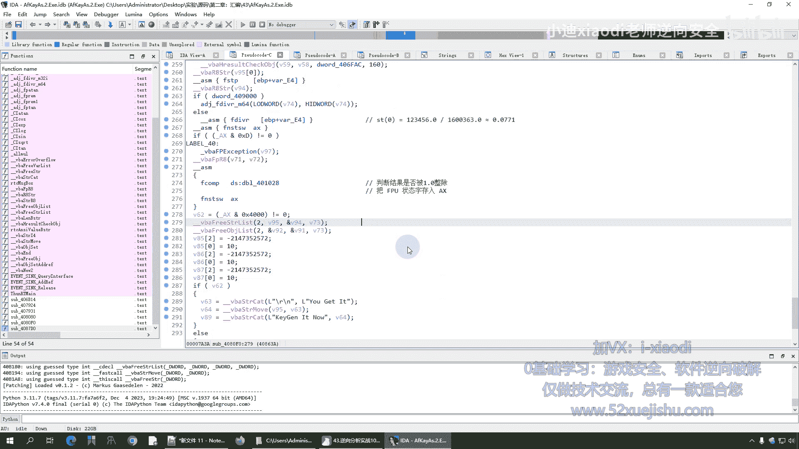

# 🧩 IDA硬核逆向破解：01：课程概述与目标说明

在本节课中我们将要学习IDA硬核逆向破解中的160个CrackMe之003的逆向破解分析，重点分析注册算法。本讲是第43讲，属于逆向分析实战第10部分，使用的工具是IDA和DBJ。这个内容分为上、中、下三集，因为内容确实比较多，所以需要拆开来讲，便于逐步消化。本集是上集，主要完成程序观察、关键逻辑定位、伪代码验证以及临时加密K公式的推导。

在正式进入逆向分析之前，先说明一个基础问题：什么是160个CrackMe。有一部分同学已经知道这个概念，也有一部分同学可能不太了解，因此这里先做一次科普，帮助初学者建立背景认识。后面的分析会反复用到这些背景，所以先把概念讲清楚，再进入具体程序。

# 📚 IDA硬核逆向破解：02：认识160个CrackMe

上一节我们说明了本讲的目标和课程安排，本节中我们来看看160个CrackMe到底是什么。160个CrackMe实际上是160个用于逆向破解实验的程序，这些程序来自世界各地的人，经过整理后集中起来，供学习者做练习。大家先知道这个背景就可以，不需要一开始就钻得太深。

这些实验程序包含多种编程语言编写的版本，例如VB、C/C++等，也包含各种各样的算法分析内容。例如第41个程序涉及数学矩阵相关内容，RSA相关程序涉及RSA算法。总之内容很多，一共160个。可以负责任地说，如果把这160个程序都能搞定，逆向破解能力就合格了。下面不再多说，直接进入正题。

# 🖥️ IDA硬核逆向破解：03：运行003号程序并观察输入输出

上一节介绍了160个CrackMe的来源和内容范围，本节中我们来看看今天要分析的003号程序。今天分析的是第三个程序，前两个程序已经在之前几集实验课件中讲过。前两个程序难度不大，比较简单的，如果大家听完前两个再来看今天的内容，能够得到很大的提升。

先把这个程序运行起来观察。运行起来之后，它有一个广告弹窗，稍等一下，等个六七秒，这个时候弹出来了。可以看到弹窗标识是井号键2，也就是说它是第二个版本，跟之前的不太一样，这一点需要注意。

程序让我们输入名字，例如输入“小迪”，然后输入密码“123456”。看一下提示，这个提示跟上一次那个错误提示差不多，但是它的算法是不一样的。因此这里要注意，不能直接套用上一节的结论。接下来先把程序拖到IDA里进行分析。


# 🔍 IDA硬核逆向破解：04：用IDA定位关键字符串与逻辑分支


上一节运行了003号程序并观察了输入输出，本节中我们来看看如何在IDA里定位关键逻辑。分析这个程序时，首先肯定是按Shift+F12，然后找一下关键字符串。关键字符串就在这里，点过来查看交叉引用，看一下引用的位置。接着看一下图表形式，这个时候逻辑分支就出来了。

继续往上翻一翻，会注意到一个问题：在这里好像找不到字符串比较的操作。上一节是通过字符串比较，比较之后再去确定到底执行哪个分支。但是这边并不能看到字符串比较的位置。因此这个时候不能死板，要细致分析。接下来就要从条件跳转入手，看看究竟是什么决定了分支走向。


# 🧠 IDA硬核逆向破解：05：分析JZ条件跳转与ESI寄存器


上一节用IDA定位到了关键字符串和逻辑分支，本节中我们来看看条件跳转背后的判断依据。先看条件跳转，条件跳转就是JZ。JZ是一个条件跳转，它有什么影响？mov指令肯定不能够影响这个条件跳转，test指令是能够影响条件跳转的。因此要看test相关指令以及SI相关寄存器。

在这个位置，谁决定了跳转的逻辑分支？答案是SI寄存器。再往上看，有一个ESI。ESI在这里表示取反操作，相当于零减去这个操作数。之前的视频讲到过，test两个相同的寄存器，一般来说是检查某个寄存器是否为0。这个位置是零减去ESI，然后再去判断SI是否为0。这里的逻辑看起来可能不是特别完整，因为如果要检查一个数据是否为0，为什么还要用零减去这个数，所以上方一定有隐藏逻辑。

继续往上翻，会发现关键指令，例如mov ESI,1，以及xor ESI,ESI。前者是把ESI赋值为1，后者是把ESI清零，这两个是截然不同的相反逻辑。这个逻辑来源于上面的一些运算。再往上基本就没有ESI相关的操作了。因此最终能够决定注册成功、破解成功或失败与否的必要条件，就是这一片位置。为了更直观地看这段逻辑，可以用下面的代码示意。

```asm
; 关键逻辑示意
mov esi, 1
xor esi, esi
; 原文提到的取反逻辑：0 - ESI
neg esi
test esi, esi
jz  failure_or_success_branch
```

# 🧩 IDA硬核逆向破解：06：总结程序业务逻辑

上一节分析了JZ条件跳转和ESI寄存器的作用，本节中我们可以先总结一下这个程序的业务逻辑。根据前面的观察，可以猜测出大致流程。以下是本程序业务逻辑的五个步骤，先把它们列出来，方便后面对照伪代码。

1. 获取编辑框1中用户名的内容。

2. 获取编辑框2中密码的内容。

3. 通过用户名计算一个K。

4. 计算出的K通过一个算法来决定ESI的赋值：如果算法成立，就把1赋值给ESI；如果算法不成立，就把ESI清零。

5. 最终通过ESI决定是否破解成功。


这个流程是根据汇编逻辑猜测出来的大概业务逻辑，到底是不是这样，还需要用F5查看伪C代码来验证。接下来就进入伪代码层面，看看这些猜测能否得到印证。


# 💻 IDA硬核逆向破解：07：F5查看伪C代码并定位用户名密码

上一节总结了程序的五步业务逻辑，本节中我们按F5查看伪C代码来验证。按F5之后，这边就是整个校验函数。从上往下看，前面部分都没有什么明显作用。继续往下翻，会发现结构非常类似。这里可以猜测它是在获取用户名，获取用户名一般保存在这个位置，但到底是不是还不确定。继续往下看，这里猜测它应该是获取密码，密码最终放到V94里面。

紧接着可以看到下面去计算密码的长度，这个V13最终应该就是密码的长度。然后密码长度又乘以15B38得到一个结果，这个结果参与了加法运算。同时参与这个运算的还有V15。简单看一下V15，它调用了这样一个函数，参数是V73。V73是V95下标为0的元素，而V95一看就是用户名。也就是说，它取出用户名里的第一个字符。例如输入“小迪”，原文示例中获取到X，然后把X放到这个函数里。

这个函数是将某个变量转换成ANSI编码形式的字符串。如果传入的是单个字符，那么返回的就是只包含这个字符的字符串，这一点没有疑问。只包含这个字符的字符串，它内部的字节肯定就是这个字符的ASCII码。如果用户名输入的是“小迪”，V95下标为0就是X，X传进去最终就是0x78，所以最终V15是0x78。接下来就可以用这个0x78继续推导临时加密K。

# 🧮 IDA硬核逆向破解：08：推导临时加密K公式

上一节通过F5伪代码定位了用户名、密码、密码长度以及V15的计算方式，本节中我们来看看临时加密K的公式如何得出。0x78要加上V14，V14就是这个东西乘以密码长度。密码是6位数，也就是6乘以0x15B38，然后再加上0x78，这个结果就是临时的加密K。由此可以得出公式，临时加密K等于密码长度乘以0x15B38，再加上用户名首个字符的ASCII码。


$$
K_{\text{临时}} = \text{密码长度} \times 0x15B38 + \text{用户名首个字符的ASCII码}
$$

也可以用代码形式表示如下。

```c
int tempK = password_len * 0x15B38 + (int)username[0];
```

通过这样的计算，得到值533448，这是一个十进制结果，同时也有对应的十六进制表示。计算出来之后，程序把这个东西转换成字符串，然后再把这个字符串放到V93，同时V19里面也有。以上就是今天要分析的内容。后续将继续带大家分析后边的算法，大家可以截图检查自己分析得对不对，下集再见。

# ✅ IDA硬核逆向破解：09：本节课总结

上一节推导了临时加密K公式并说明了结果存放位置，本节中我们对整节课做一次总结。本节课中我们一起学习了160个CrackMe之003的上集逆向分析流程，从课程背景、程序运行观察，到IDA定位关键字符串、分析JZ条件跳转与ESI寄存器，再到总结业务逻辑、用F5验证伪代码，最后推导出临时加密K公式。以下是本节课的复习要点，方便初学者快速回顾。


1. 160个CrackMe是160个逆向破解实验程序，来自世界各地，包含多种编程语言和多种算法。

2. 003号程序运行后会出现广告弹窗，标识为井号键2，说明它是第二个版本，与之前版本不同。

3. 使用Shift+F12查找关键字符串，再通过交叉引用和图表形式定位逻辑分支。

4. JZ条件跳转受test指令影响，本程序关键分支由SI/ESI相关逻辑决定。

5. 程序业务逻辑包括获取用户名、获取密码、通过用户名计算K、由K决定ESI赋值、最终由ESI决定破解是否成功。

6. F5伪代码中，密码长度参与计算，V15与用户名首个字符的ASCII码有关。


7. 临时加密K公式为：`K_临时 = 密码长度 × 0x15B38 + 用户名首个字符的ASCII码`。

8. 计算结果533448会转换为字符串并放入V93，同时V19中也有对应内容。



本节课中我们一起学习了003号程序上集的完整分析思路，重点是理解从汇编跳转、寄存器逻辑到伪代码验证，再到公式推导的过程。后续中集和下集会继续分析后面的算法，把注册算法完全串起来。

