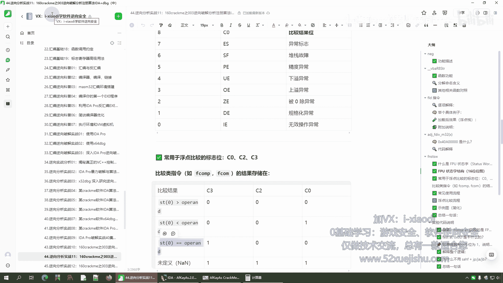

# 🔧 IDA硬核逆向破解：003：算法逆向分析全流程（下）

在本节课中，我们将继续对160crackme第3个程序进行逆向破解，完成最后的算法分析，找出正确密码。上一节我们已经通过一系列运算得到了一个中间数据533450。本节我们沿着这个数据继续追踪，看看程序接下来如何变换它，并最终推导出真正的注册码。整个过程会涉及浮点运算、字符串与浮点类型的转换、逆序除法指令以及浮点比较条件，理解这些对于软件安全分析很有帮助。

## 🔍 一、追踪数据：从533450到1600348

首先回顾一下上次的计算结果：533450。这个数据在算出之后，程序就把它所占用的临时空间释放掉了。紧接着，我们在代码中看到一个函数调用。为了知道这个函数会返回什么，我们需要查看它的内存地址，然后在这个位置下断点。该函数的地址是0x004083，我们直接去这个地址下断点，然后按F8单步执行。

执行后可以发现，这个函数把533450取了出来，放入变量V95中。V95实际上是一个字符串变量，程序随后将这个字符串转换成浮点型（double），于是我们就得到了一个double类型的数值533450.0。接下来，程序对这个浮点数做了一次乘法运算。它乘以3.0，也就是执行了：


\[
533450.0 \times 3.0 = 1600350.0
\]


乘法完成之后，程序又做了一次浮点减法，减去2.0。因此结果进一步变成：

\[
1600350.0 - 2.0 = 1600348.0
\]

这里有一个细节：程序把浮点状态字（FPO）弹出来，进行了一个比较操作，用于处理异常情况。这种比较通常与主流程无关，我们一般不需要理会它，继续往下看即可。


继续往下走，程序把当前这个浮点类型的数据转换回字符串，然后放入V94。此时V94和另一个变量V41里面都会含有这个字符串。紧接着这块临时内存就被释放了。释放完毕后，代码中又出现了另一个函数调用，地址是0x004084B7。我们定位到0x004084B7并在这里打一个断点，准备观察它做了什么。

## 📐 二、再加15：从1600348到1600363

设置好断点后，我们运行程序，让它停在0x004084B7。接着按F8单步一下，程序把1600348取出来放入V95。V95字符串再次被转换成浮点型，于是我们有了double类型的1600348.0。接下来程序又执行了一次浮点减法，但这次减去的数是-15。减去一个负数，实际上等同于加15：

\[
1600348.0 - (-15.0) = 1600348.0 + 15.0 = 1600363.0
\]


经过这一步，程序又把浮点数1600363.0转换成字符串，最终放入V94，同时变量V51也会持有这个字符串。到这里还没结束，紧接着又出现了一个函数调用，地址是0x00408579。我们继续运行到0x00408579，并使用F8单步执行。这一次程序取出字符串1600363，放入V94，然后又由V94将这个字符串转换成浮点型。请注意，这里有一个判断条件，判断的值是0，因此该条件不会成立，程序会直接跳过它，执行后面的代码。


## 🔄 三、逆序除法：用户密码与1600363的关系

接下来进入整个算法的核心部分。这里出现了一条比较独特的浮点指令，原文写作“FDRV2”，实际上它代表的是逆序除法（Reverse Divide）。也就是说，它不是常规的左边除以右边，而是右边操作数除以左边操作数。初学者在这里非常容易搞混，所以一定要看清操作数的顺序。

那么这条指令到底在除谁呢？它除的是EBP+E4这个地址里存放的数据。这个地址里的数据是什么？我们需要往前追溯，这是一个典型的逆向分析过程。继续向前跟踪代码，我们会发现有一个V95字符串被转换成浮点型，而V95的来源是更早的一个函数调用，该函数的地址是0x004085B2。为了确认V95到底是什么，我们可以去0x004085B2下一个断点，然后按F8单步执行。

断点命中后，我们发现程序获取到的居然是我们输入的密码。比如当时我们输入的密码是123456，那么程序这里拿到的就是字符串“123456”。于是，这条逆序除法的实际含义就是：

\[
\text{result} = \frac{\text{用户输入密码}}{1600363.0}
\]


如果我们输入的密码是123456，那么计算结果就是：


\[
\text{result} = \frac{123456}{1600363} \approx 0.0771
\]

这个结果显然不是1.0。接着程序对这个浮点结果与1.0进行比较，看看它们是否相等。比较完之后，程序会弹出浮点状态字，并与0x400做一次与运算。0x400转换成二进制是一长串位数据。我们知道与运算的规则是：只有两个位同时为1时结果才为1；只要有一个位是0，结果就是0。因此，这次与运算的结果要想不等于零，就必须要求浮点状态字中对应的那个位也为1。结合位置来看，这个比较结果位在第15位（从0开始编号是第14位），它表示ST0是否等于操作数。

那么什么情况下除法结果会等于1.0呢？也就是说，谁除以1600363.0会得到1.0？答案很明显，只有被除数本身也是1600363.0时，结果才是1.0。因此，真正的密码就是：

\[
1600363
\]

如果你输入的是其他任意数字，除法结果都不会等于1.0，比较结果位就会是0，与0x400运算后得到0，条件不成立，程序就不会弹出正确的提示框。反过来，只有当你输入的密码恰好是1600363时，比较结果位变成1，条件成立，程序内部变量V62也会被置为1，从而弹出正确弹窗。为了验证这个结论，我们用代码来概括整个验证逻辑：


```cpp
double user_input = atof("123456");      // 用户输入的密码
double target = 1600363.0;
double result = user_input / target;     // 逆序除法语义：右操作数 / 左操作数
if (result == 1.0) {
    // 弹出正确提示
}
```

## ✅ 四、验证

根据上面的分析，我们尝试输入1600363。点击OK，可以看到成功提示框弹出，说明我们已经成功破解了这个程序。整个破解过程的核心推导可以总结为以下几步：

1. 取出上一步得到的533450，执行乘3减2，得到1600348。
2. 执行加15（即减-15），得到1600363。
3. 用用户输入的密码除以1600363，要求结果等于1.0，因此密码必须是1600363。


## 📝 总结




本节课中，我们一起沿着上节得到的533450，依次进行了乘3减2的运算，得到1600348；又通过减去-15（相当于加15）得到了1600363。程序随后将用户输入的密码与1600363进行逆序除法，并将结果与1.0比较。为了满足比较条件，密码必须等于1600363。整个过程的关键在于识别逆序除法的真正含义，以及理解浮点比较标志位的工作方式。掌握这些分析方法，对于日后处理类似的软件逆向题目会很有帮助。希望大家自己动手重新走一遍流程，加深印象。如果遇到问题，欢迎联系我们一起学习。
