# IDA硬核逆向破解：160crackme之003软件破解实战：00：🧭 课程概述

在本节课中我们将要学习160crackme之003软件破解实战的算法逆向分析全流程。上一次内容讲到，程序先获取用户名，再获取密码，并通过一系列计算得到一个加密K，这个K最终通过字符串相关函数被赋值给V93。紧接着下面出现字符串释放函数，分析到此处暂时中断。本次继续向下分析一个看不出作用的函数调用，通过下断点、单步执行、观察浮点栈和寄存器，确认它把加密K转换成浮点数，执行除法和加法，最后再转换回字符串。整个流程的核心可以用下面的公式概括，方便初学者先建立整体印象。

> `加密K = 533448`

> `10.0 / 5.0 = 2.0`

> `533448 + 2.0 = 533450.0`

> `533450.0 -> 字符串 "533450"`

## IDA硬核逆向破解：160crackme之003软件破解实战：01：🔍 回顾与断点定位

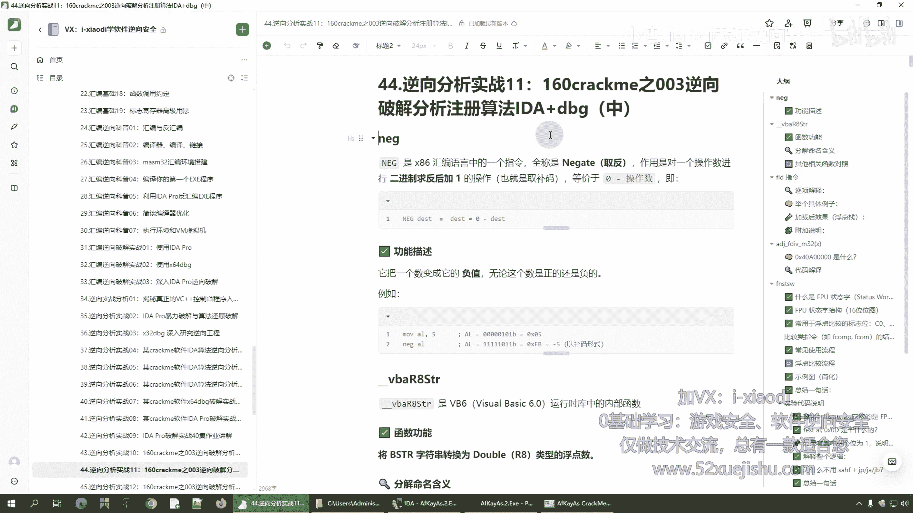

上一节我们介绍了用户名、密码和加密K的计算背景，本节中我们来看看程序在字符串释放函数之后调用了什么函数，并通过断点确认参数来源。为了看清楚这个函数的作用，先不急着猜结论，而是采用下断点后单步执行的方式观察。以下是本节需要关注的定位步骤：

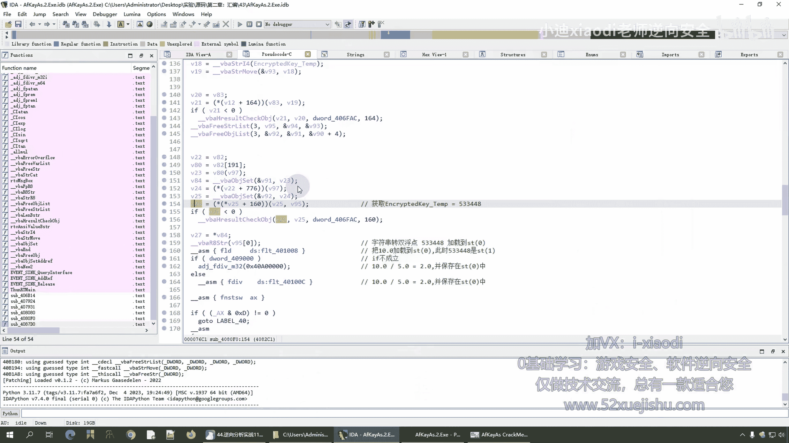

- 继续向下分析时，发现一个函数调用，直接看不能看出作用，因此给它下断点观察。

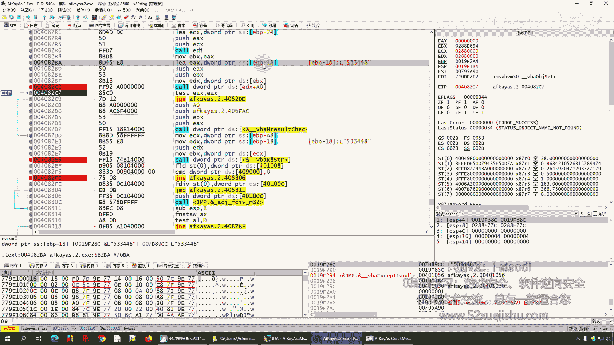

- 查看内存地址，切换过来是4082C1，随后去408241下断点。

- 程序已经中断在断点处，按F8单步执行。

- 执行后可以发现，函数获取的是533448这个加密K；获取之后，这个值放在第二个参数位置，前面的位置是第一个参数。

- EXX这个地址来源于EBP减18，EBP减18里边就是533448。

- 因此这条函数执行完后，V95里边就是533448这个加密K。

这一节的重点是确认参数和地址的关系，先建立“加密K来自EBP减18，执行后进入V95”的认识。对初学者来说，断点加单步是最直接的观察方法，先把数据流向看清楚，再回头理解代码意图，会轻松很多。

> 核心定位关系：`[EBP - 18] = 533448`，函数执行后 `V95 = 533448`

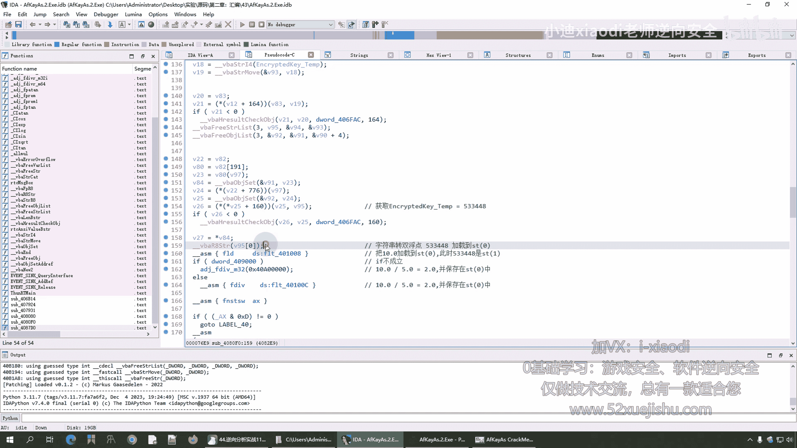

## IDA硬核逆向破解：160crackme之003软件破解实战：02：🧮 字符串转浮点数

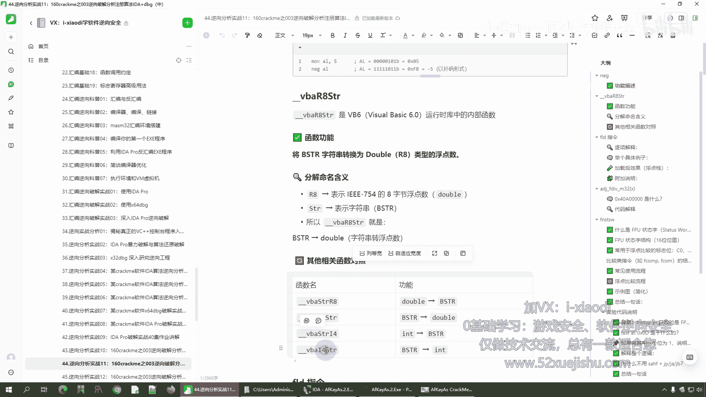

上一节我们确认了加密K被传入函数并进入V95，本节中我们来看看紧接着调用的函数到底做了什么。这个函数是VB6运行时库中的一个内部函数，功能是把字符串转换成双浮点数。它的执行逻辑从右到左判断：ST2在右边时，把ST2字符串转换成双浮点；28在右边时，把浮点数转换成字符串；I4整数在右边时，把整数转换成字符串；同样的道理，ST2在右边时，把ST2字符串转换成整数型。以下是观察这条代码含义的步骤：

- 这条代码的含义是把字符串转换成双浮点533448，并加载到ST0。

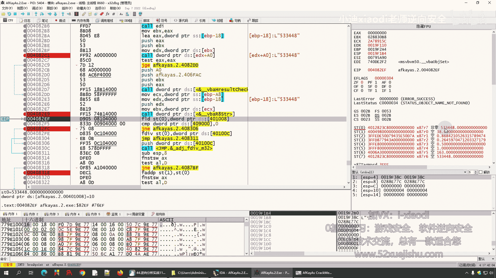

- 可以在DBG中观察，现在这条代码将要执行。

- 观察ST0这个浮点栈，执行完这行代码之后，533448会被加载到ST0。

- 紧接着是一条FLD指令，FLD指令的作用是加载一个浮点数到浮点栈里面。

- 双击查看这个浮点数，可以看到里面是10.0，因此它把10.0加载到ST0里面。

- 单步一下看效果，现在里面是10，ST0里的533448由于被压下去，放在ST1里面。

这一节把“字符串变浮点数”和“浮点栈加载”两个动作串起来了。理解浮点栈时，可以把它想成一摞盘子：新压入的数据在ST0，旧数据被压到ST1，这样后面做除法和加法时，数据位置才不会乱。

> 核心转换：`"533448" -> 533448.0`，并加载到 `ST0`

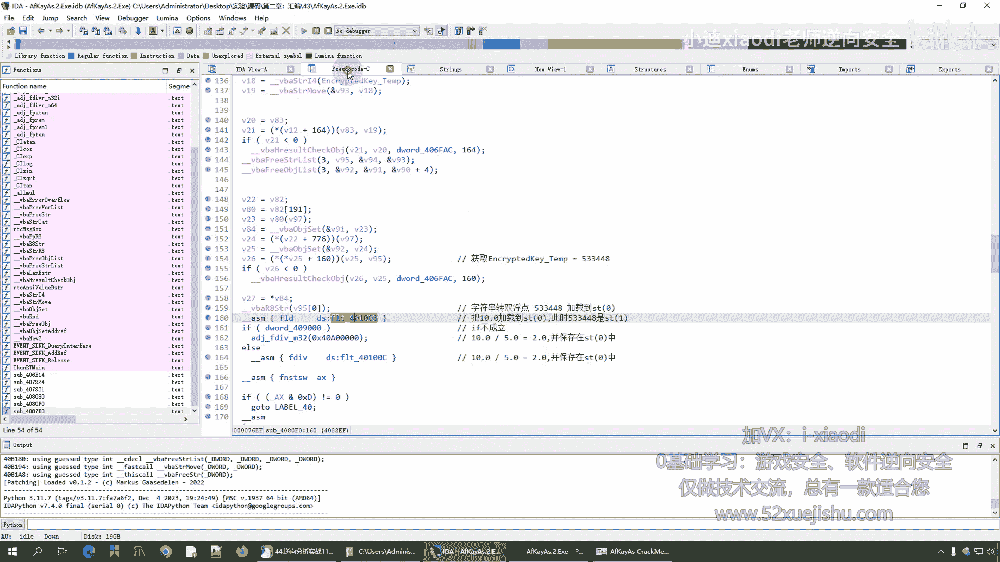

> 浮点栈状态：`ST0 = 10.0`，`ST1 = 533448.0`

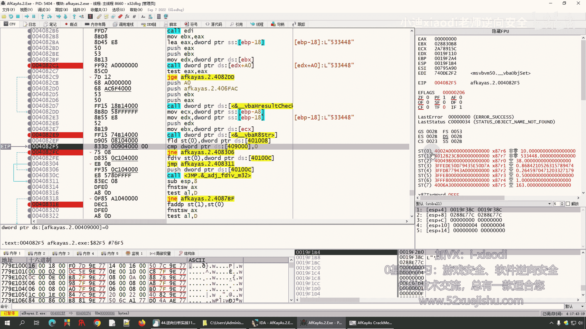

## IDA硬核逆向破解：160crackme之003软件破解实战：03：⚙️ 浮点除法与状态寄存器

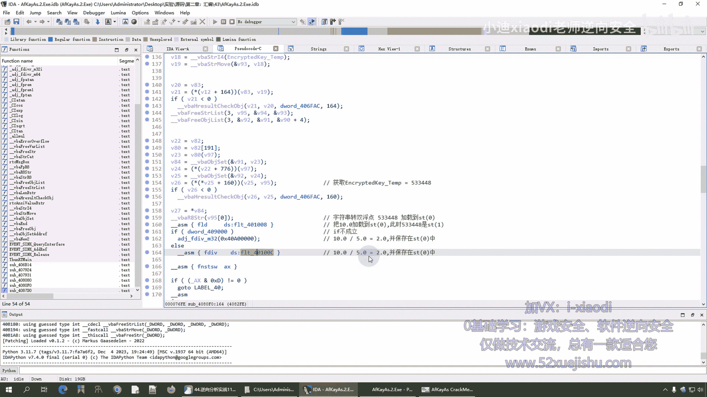

上一节我们观察到ST0被加载为10.0，ST1为533448.0，本节中我们来看看后面的条件判断、浮点除法和FPU状态寄存器检查。这里有一个F判断，判断的数据是409000，双击可以发现里面的数据是0，所以这个F语句不成立，这条语句不会执行，程序会直接执行后面的语句。以下是这一段的执行细节：

- 直接执行的语句是FR除法，查看40100C，发现里面是5.0。

- 也就是说，它会用ST0里边的10.0除以5.0，结果等于2.0，并且最终还是保存在ST0里面。

- 虽然那个函数没有执行，也可以看它的作用：它也是做除法，汇编或伪代码表示调用点除法辅助函数，实际功能还是除法。

- 这里可以把这条调用当做一个除法来理解。

- 40A0000转换成浮点数还是5.0，只不过这个5.0以16进制显示。

- 不管这个if成立或者不成立，最终都是10.0除以5.0，结果是2.0，并且保存在ST0。

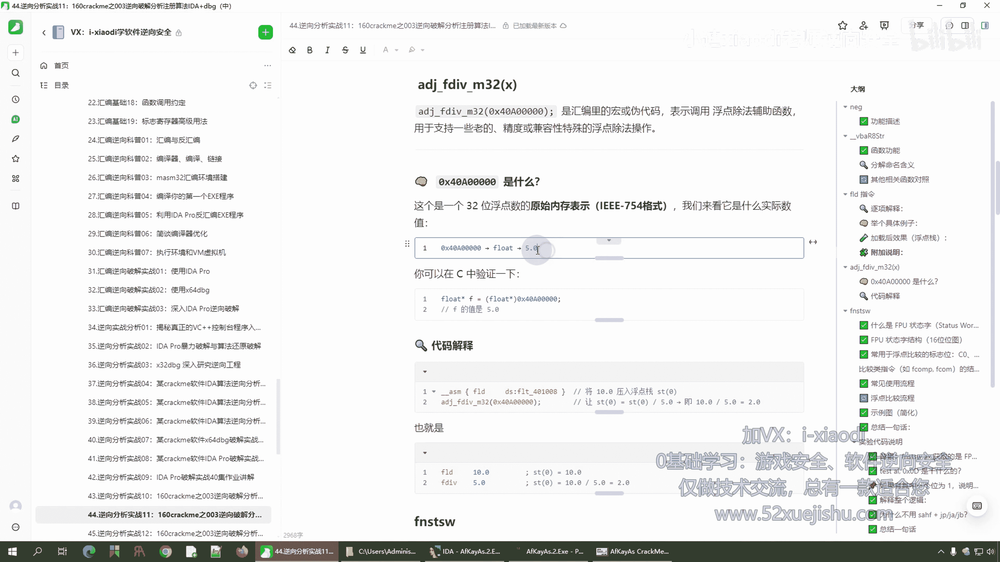

- 紧接着的指令把FPU寄存器弹出，弹出给后面的寄存器，也就是把FPU状态弹给后面的寄存器。

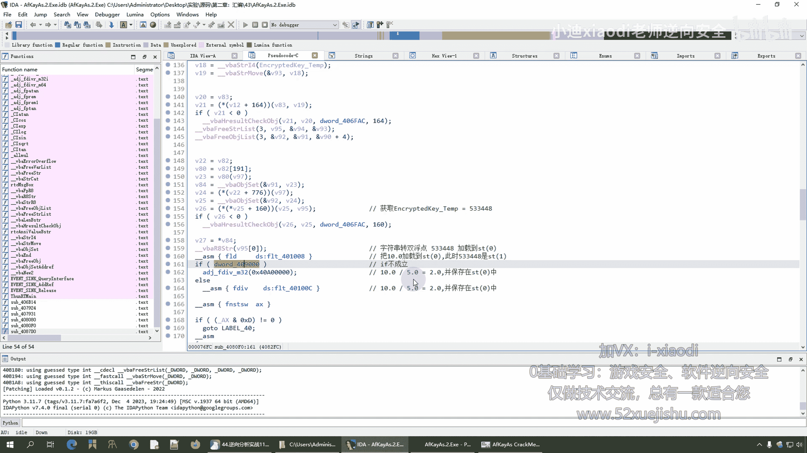

- F状态是一个16位寄存器，用于存储FPU当前状态，它类似于CPU状态寄存器；在右边寄存器窗口往下拉可以看到F状态，里面是3100，也就是16进制的0x3100。

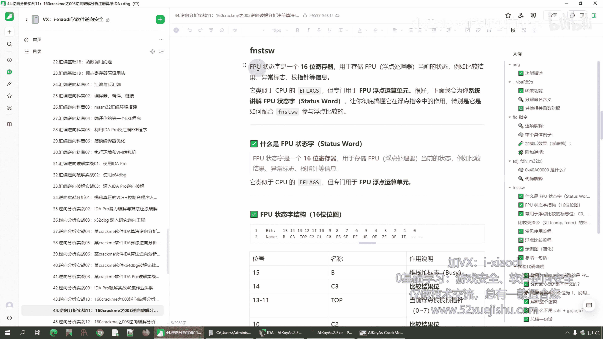

- 单步往下执行，观察操作结果；执行完之后会把3100给AS，现在AS里面是3100。

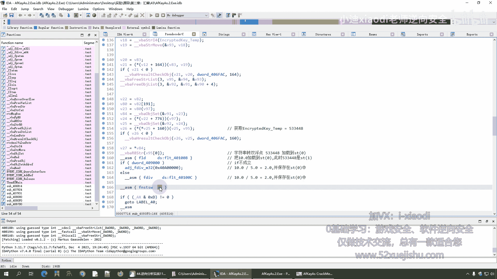

- 然后AS和SD做与运算；这个与运算一般翻译成test指令，确认是test指令，原文写作tax指令。

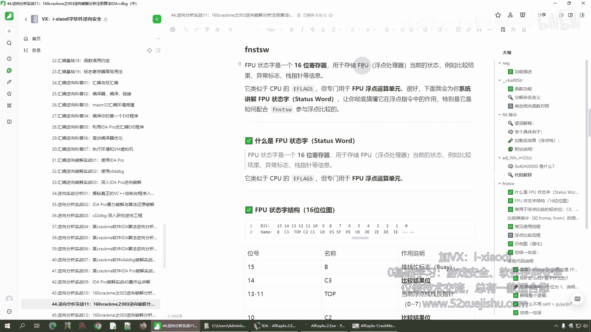

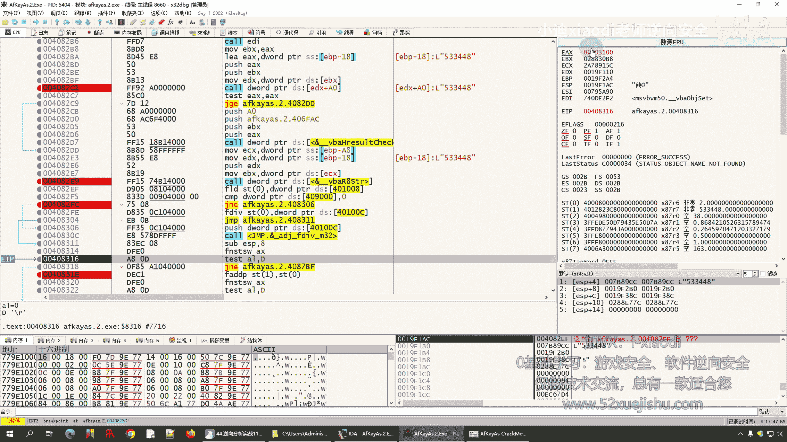

- ALD这个FPU状态字一共有16位，从0到7这8位基本描述算术异常。

- D转换成二进制是1101，因此它实际检查的是AL的D0、D2、D3位（原文写作D023位），检查浮点比较的结果是否出现问题。

- 基本就是检查是否有非法操作、除零或者上溢之类的问题。

- 一般来说这个除法都是正常的，因此这里无需担心；而且可以看到这边的跳转明显不成立，跳转不会执行。

- 因此这片代码不需要继续查看，可以继续往下看。

这一节既包含除法结果，也包含状态检查。对初学者来说，可以先记住除法结果：`10.0 / 5.0 = 2.0`。状态寄存器检查可以暂时理解为“程序在确认刚才的浮点运算有没有异常”，本案例中运算正常，所以相关跳转不成立。

> 核心除法：`10.0 / 5.0 = 2.0`，结果保存在 `ST0`

> 状态检查：`FPU状态字 = 0x3100`，检查位为 `D0、D2、D3`，本案例跳转不成立

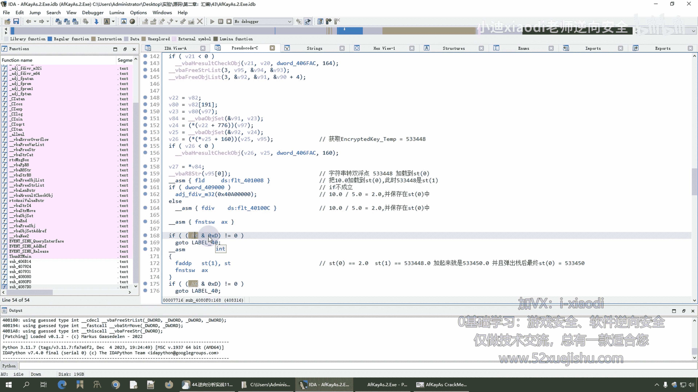

## IDA硬核逆向破解：160crackme之003软件破解实战：04：➕ 浮点加法与结果转字符串

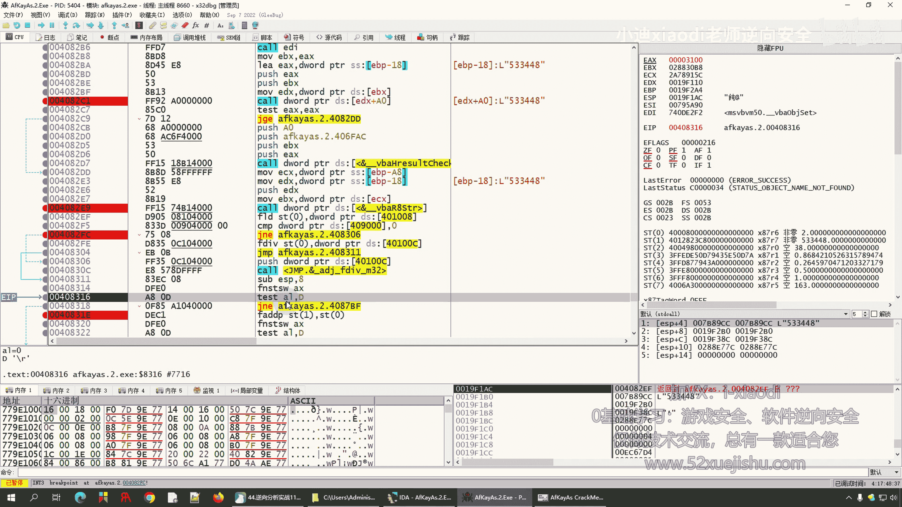

上一节我们完成了除法和状态检查，本节中我们来看看浮点加法、出栈以及把结果转换回字符串的过程。这里的F指令后面带逗号，实际上就是ST和ST0做加法；后面的P是出栈的意思，做完加法之后还要再弹出来。以下是加法与转换过程的观察步骤：

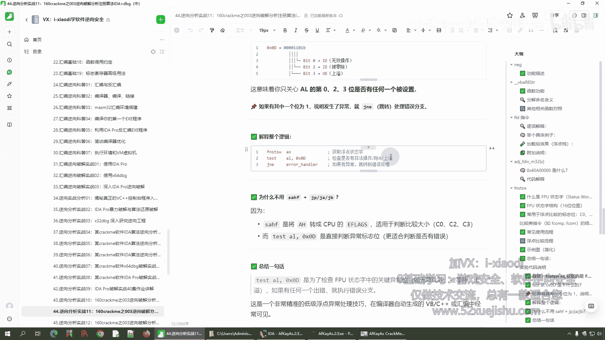

- 在DBG中观察，现在ST0是2，ST1是533448。

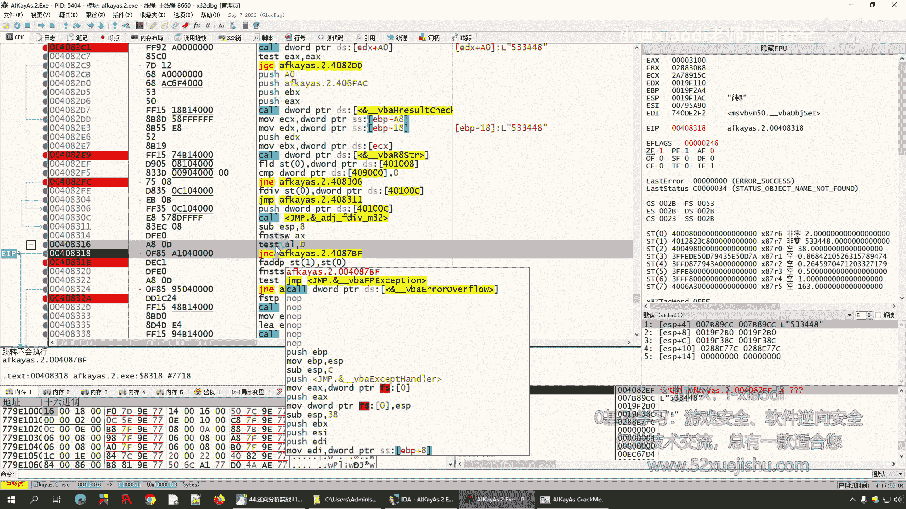

- 执行加法后，可以看到ST0里边现在是最终结果，其他数据都被弹出去。

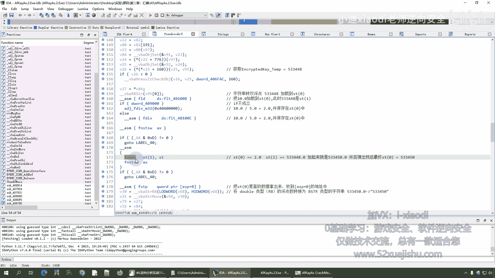

- 紧接着继续检查这个除法有没有出现异常，这里不需要再看。

- 接着是FSTP，FSTP就是pop的意思，把ST0里边的数据弹出来，弹给后面的成员；这里成员是ESP加，实际上就是放到ESP里面。

- 这时可以观察，现在ESP是F1AC，执行完这条语句之后，可以看到里面已经有数据。

- 有同学会问为什么看到这里是零，因为这个数据是八字节；需要在内存窗口中转到，然后鼠标右键点击浮点数，点击ou，这样就可以看到了。

- 因为它是八字节，所以要从1B开始看。

- 紧接着程序会把这个浮点型转换成字符串，此时这个浮点数不再是一个浮点数，533450将会变成一个字符串。

- 观察可以看到字符串已经出来，然后程序再把这个字符串放到V94里面。

- 紧接着V94这个字符串也被清空，所以分析再次中断。

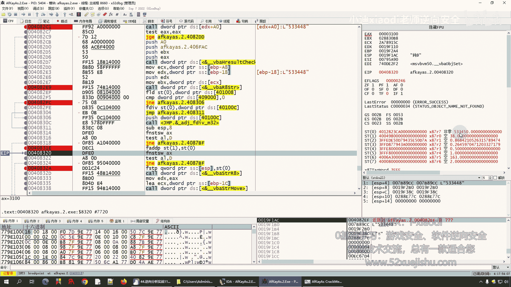

这一节把结果从浮点栈取出并转成字符串。对初学者来说，重点不是记住每个寄存器名字，而是理解数据形态变化：先是浮点数相加，然后出栈保存，最后通过字符串转换函数变成可读字符串。

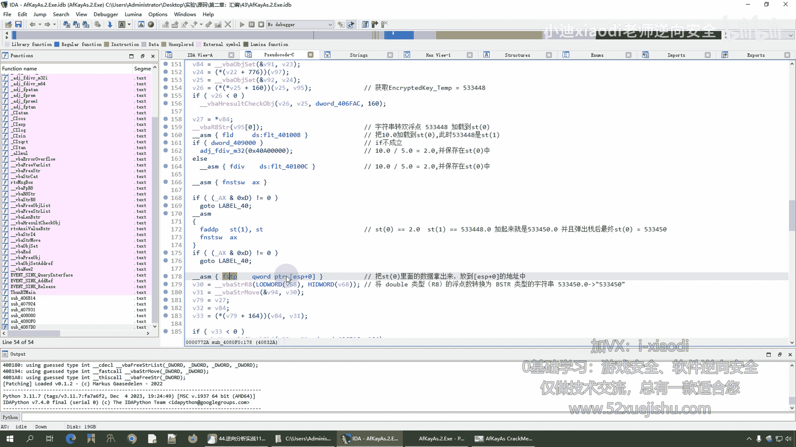

> 核心加法：`533448.0 + 2.0 = 533450.0`

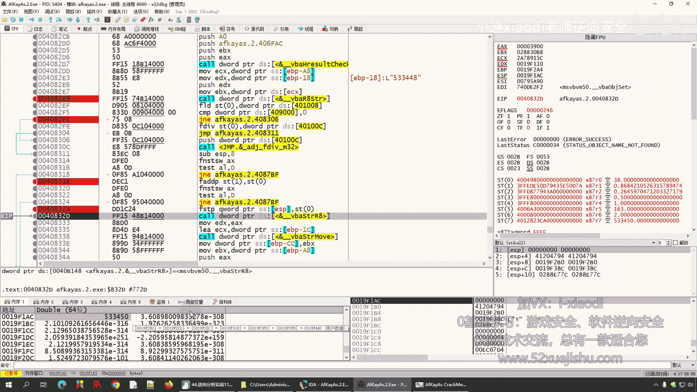

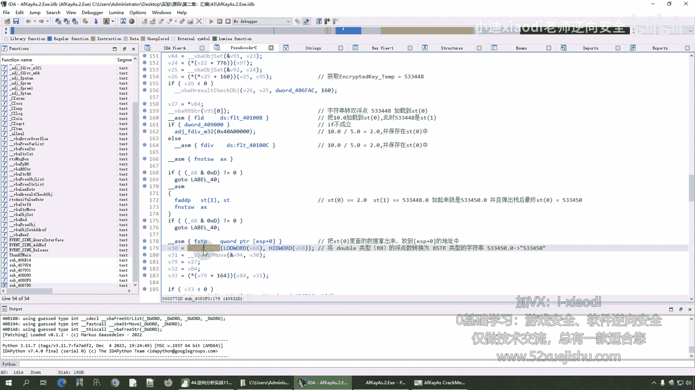

> 结果转换：`533450.0 -> "533450"`，最终放入 `V94`

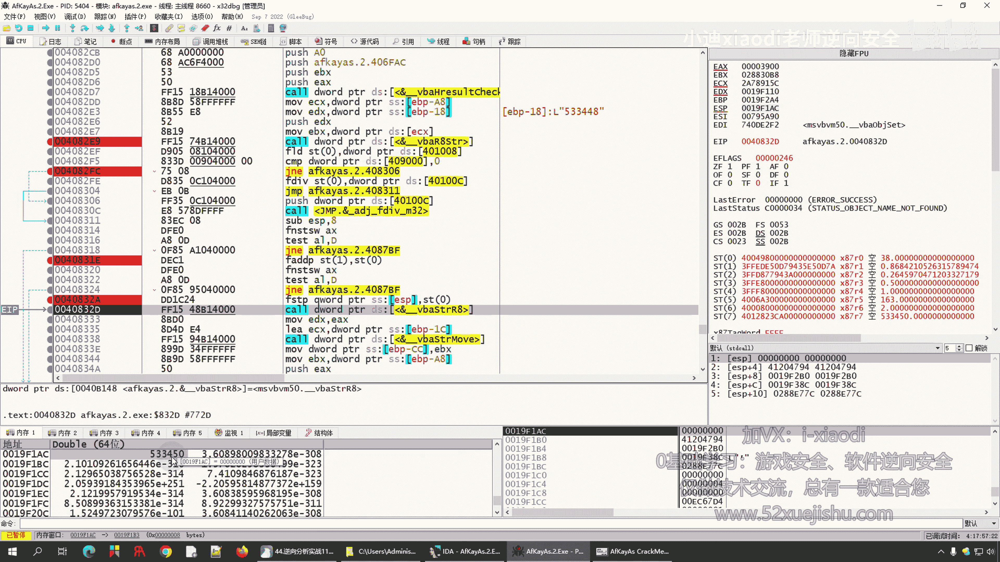

## IDA硬核逆向破解：160crackme之003软件破解实战：05：📝 课程总结

上一节我们完成了第二段核心逻辑的观察，本节中我们对整段分析做总结。整个一大段的作用可以总结为：先把加密K转换成浮点数，然后加上一个固定的2.0；因为10除以5等于2，所以加起来会得到533450的结果，此时它仍然是浮点数；最终再通过字符串转换函数把浮点数转换成字符串533450，这就是第二段的核心作用。以下是本节需要带走的要点：

- 加密K先由字符串转换成浮点数：`533448 -> 533448.0`。

- 固定除法得到2.0：`10.0 / 5.0 = 2.0`。

- 浮点加法得到结果：`533448.0 + 2.0 = 533450.0`。

- 最终结果转换成字符串：`533450.0 -> "533450"`。

- 字符串结果被放入V94，随后V94被清空，当前分析流程到这里中断。

- 今天的内容需要回去后消化，并且亲手操作一遍，这样会有更多收获。

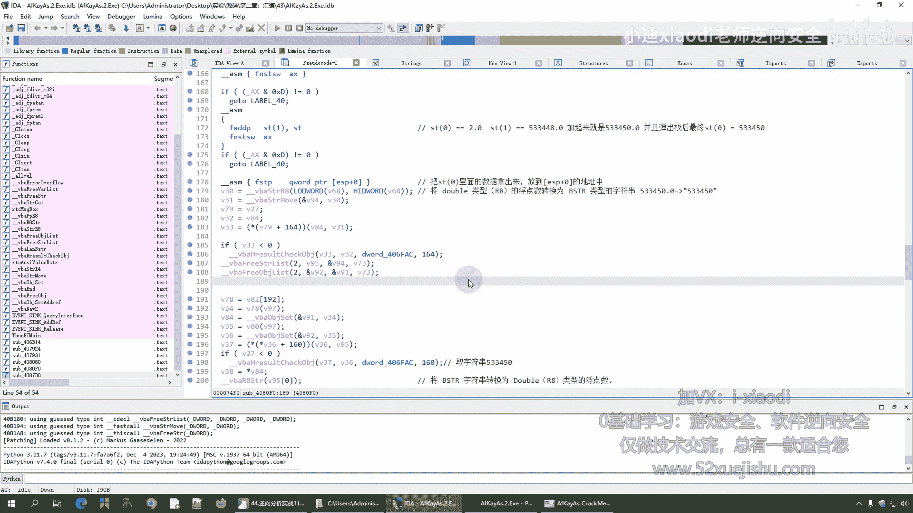

- 如果希望学习软件安全，可以联系我们，下期再见。

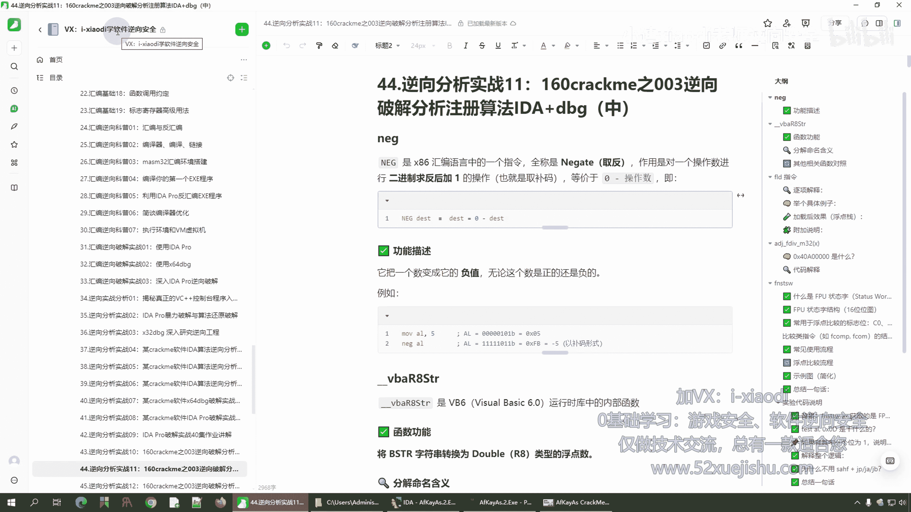

本节课中我们一起学习了160crackme之003的第二段算法逆向分析流程：通过断点定位函数调用，确认加密K的传递位置，观察字符串到双浮点数的转换，理解浮点除法、FPU状态检查、浮点加法和出栈，最后看到浮点数被转换成字符串533450并放入V94。对初学者来说，先抓住数据流和数据类型变化，再逐步理解汇编指令，是学习软件安全和逆向分析比较稳妥的路径。

