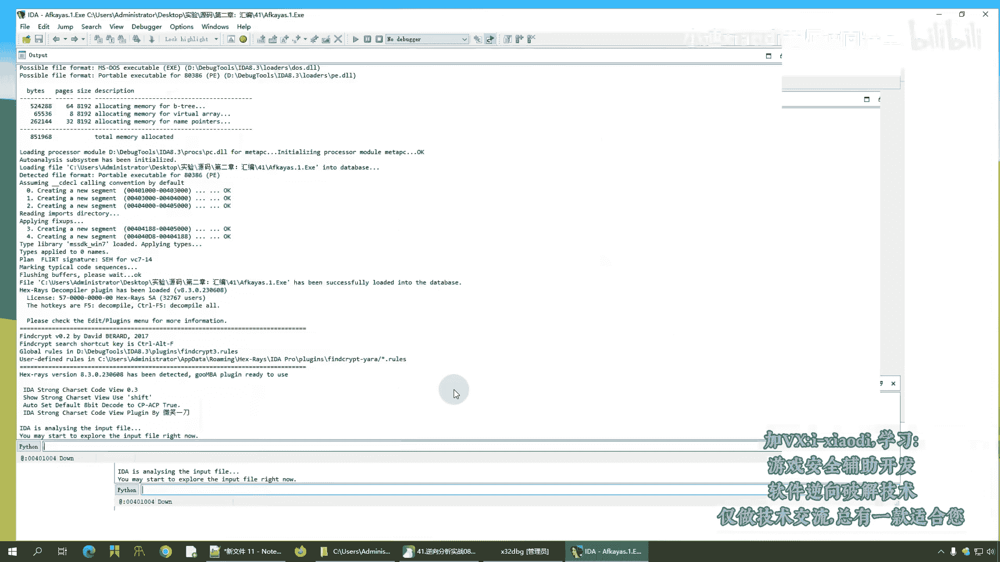
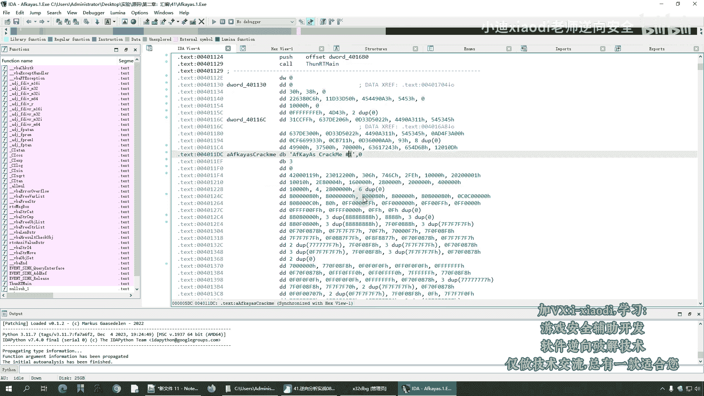
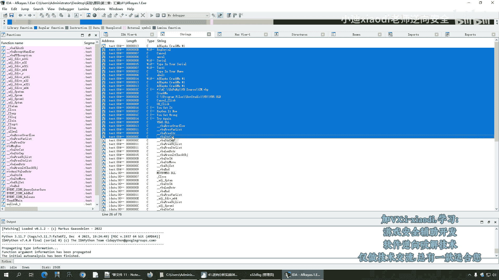
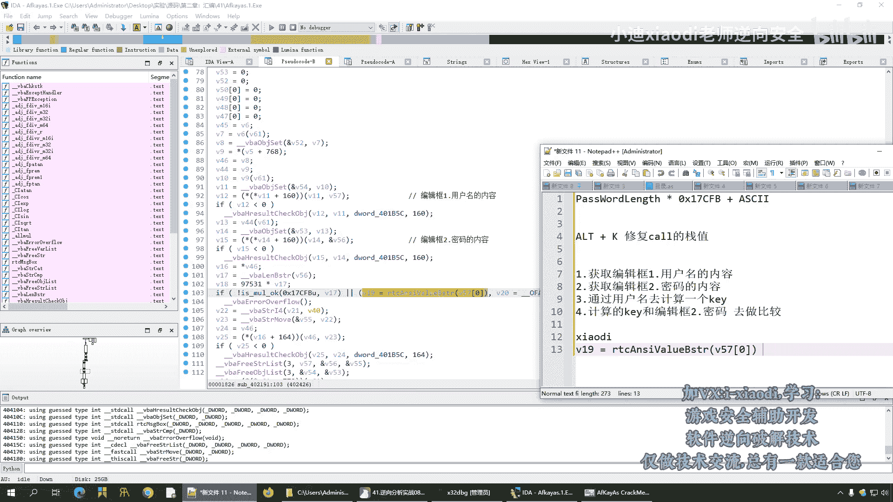
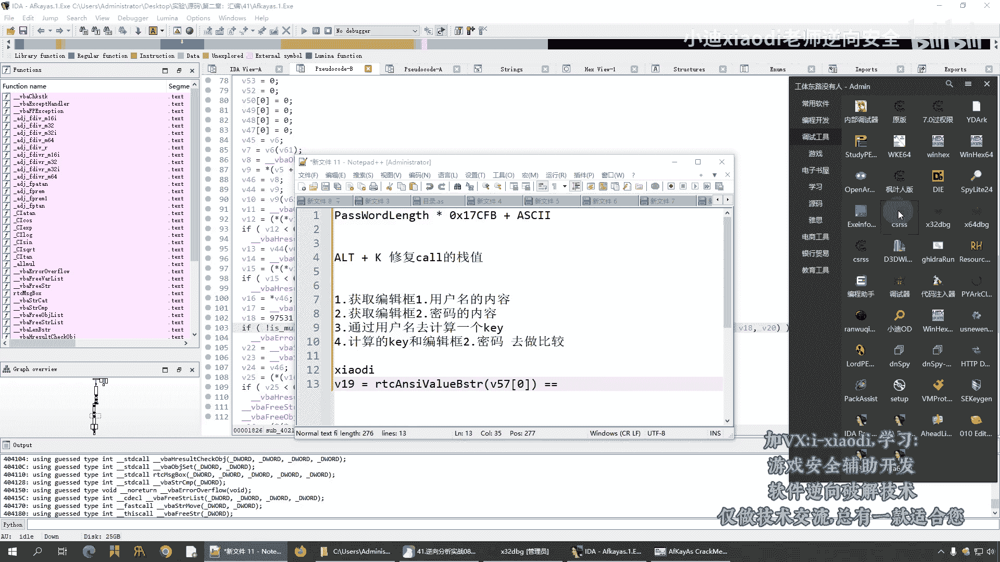
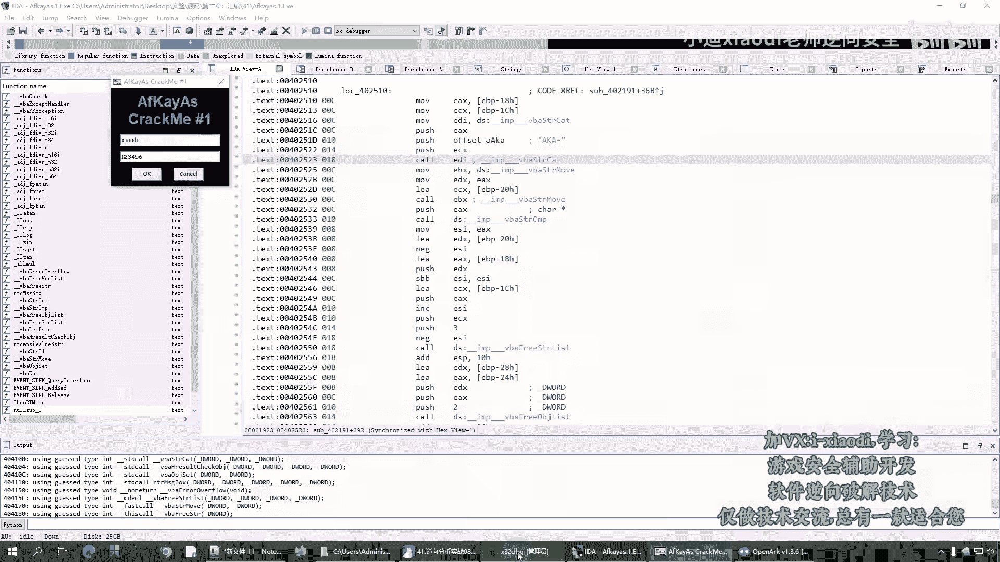
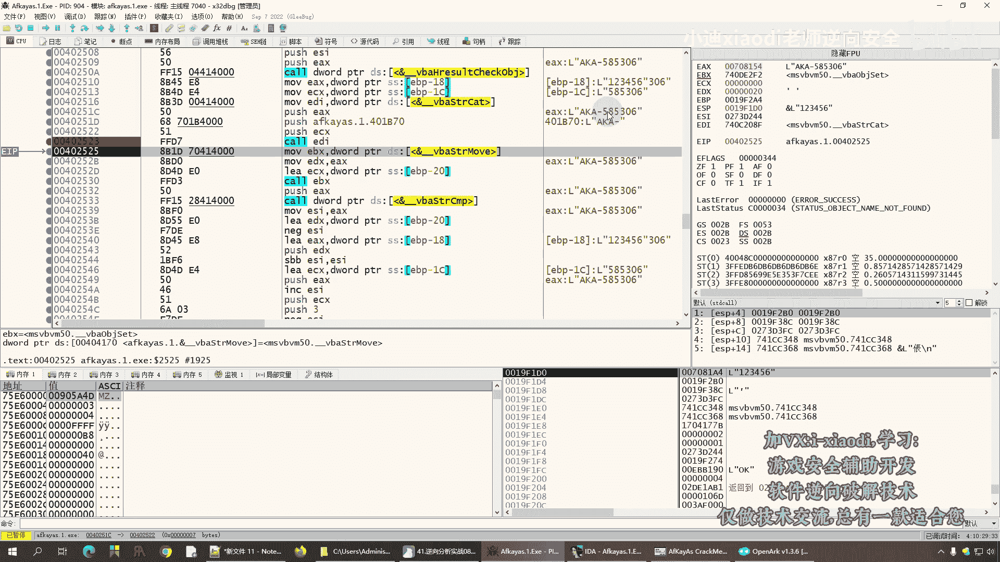
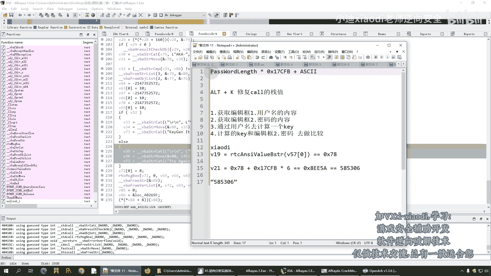
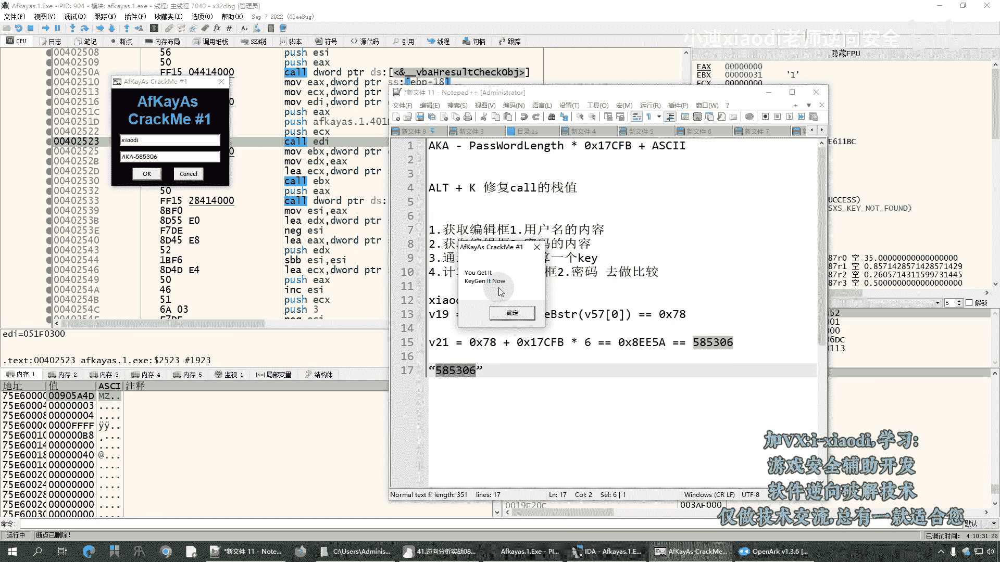
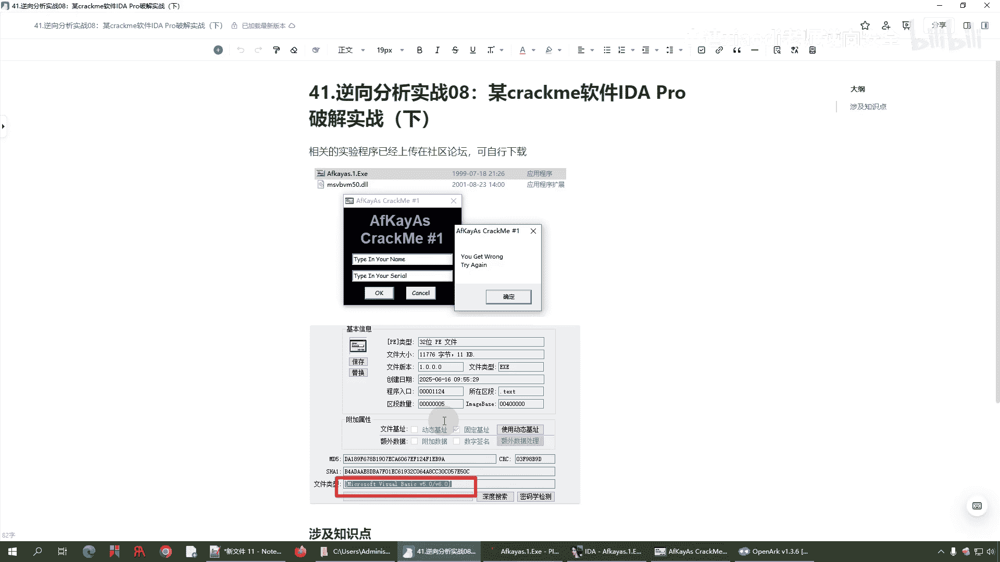

# 🔧 IDA硬核逆向破解：第41讲：不修改代码破解软件密码的算法逆向分析全流程

## 📖 本节概述

在本节课中，我们将要学习如何利用 IDA 和 DBG 这两款强大的逆向分析工具，在不修改任何程序代码的前提下，深入剖析一个软件的密码验证算法，并最终成功破解它的密码。整个过程会涵盖从启动 IDA、定位关键代码位置、修复反编译错误、分析核心算法逻辑，到结合动态调试验证推断结论的完整流程。即使你是一名初学者，只要跟着一步一步操作，也能亲眼见证一个软件的加密逻辑是如何被层层揭开面纱的。

首先需要说明的是，本节课程所使用的实验程序已经上传到了社区论坛，大家在学习的过程中可以自行去下载并跟着操作。今天的知识点比较多，大家要注意听讲，注意积累经验，这些经验在后续的实战中会非常有用。

## 🔍 场景回顾：验证程序的基本逻辑

在我们正式开始分析之前，先来回顾一下这个软件的基本运行逻辑。这样我们才能知道程序内部大致的执行流程，为接下来的分析做好准备。这个软件的行为其实非常典型，它的验证逻辑是这样的：





当你运行这个程序时，它首先会要求你输入一个名字（用户名），然后让你输入一个密码。如果我们输入 `123456` 作为密码并点击 OK 按钮，程序会弹出一个错误提示框，上面写着 "you got around try again"，告诉你说密码不对，请再试一次。相反，如果你输入了正确的密码，程序会弹出一个提示成功的对话框，上面写着 "you get it"，告诉你已经成功通过验证了。



这两个结果对应着两条完全不同的逻辑分支。在本例中，它们的走向是相反的，这意味着我们可以通过这两个字符串（`you get it` 和 `you got around try again`）去定位程序中与验证相关的关键代码位置。如果我们选择用暴力破解的思路，也就是说不去管算法到底是什么样子的，那会相对简单一些。暴力破解的方法是这样的：你找到这两个字符串其中一个，然后在 IDA 中交叉引用找到该字符串被引用的代码位置，再找到那个控制成功与失败分支的关键跳转指令，把它改成相反的跳转（或者直接 NOP 掉）就能强行让程序走成功分支。但是，如果要进行算法分析，情况就完全不同了，我们需要分析更多的代码。

在正式开始动手之前，还有一件事需要理解：在这个软件里，字符串 `you get it` 和 `you got around try again` 的出现是最终比较之后的结果。它的完整流程是先对输入的数据是进行一系列运算（也就是算法），最终得到计算结果后才去和某个值做比较，比较完之后，再根据比较结果去弹出对应的提示框。这个流程大家能理解吧？也就是说，在引用这个字符串的代码上方，一定存在一个算法运算的核心逻辑区域。做算法逆向分析，分析的核心区域就是这里。

## 🛠️ 使用 IDA 加载目标程序

理解了程序的验证逻辑和我们的分析目标之后，现在我们正式开始进行实战操作。将目标程序直接拖入 IDA 软件中，松开鼠标后，IDA 会弹出加载对话框，我们直接点击 OK 按钮开始分析。

加载完成后，大家会发现在 IDA 的主界面中显示了一些看起来比较杂乱无章的汇编代码。这些东西看不懂怎么办？不用管它，这一部分不是我们要关注的重点。这就好比你在路边遇到一只狗，只要不去招惹它，它就不会主动咬你；但如果你非要去招惹它，那它肯定就要咬你几口了。这个道理大家应该能明白，对于 IDA 在加载过程中自动生成的一些无关框架代码，我们采取的策略也是相同的：跳过即可。

为了快速找到与我们目标相关的字符串，我们需要使用一个非常高效的快捷键：`Shift + F12`。按下这个组合键后，IDA 会打开一个字符串列表窗口，展示出该程序里所有被识别到的字符串常量。

在打开的字符串列表中，我们往下看，就能非常容易地找到那两个关键的字符串了。在这里，我们看到 `you get it` 这条字符串，直接双击它。双击之后，IDA 会跳转到该字符串在数据段中的位置。接下来，我们要找到是谁引用了这个字符串，这里就可以在字符串上按下键盘上的 `X` 键（交叉引用），IDA 会弹出一个引用列表窗口，我们直接点击 OK 按钮确认。

现在，我们成功到达了引用 `you get it` 字符串的代码位置。这里就是验证逻辑分支的核心之处了，我们可以清晰地看到整个流程的分岔口。大家可以看到，这里有成功分支（`you get it`）和失败分支（`you got around try again`）两种情况分别在等待着不同的跳转结果。在这个分支跳转的上方，我们可以看到一条 `str2cmp` 这样的指令，它表示进行字符串比较的操作。我们可以沿着这个比较指令继续往上看，就能发现算法运算的核心区域了。往上拉代码，可以看到有一个以 `AK-` 开头的字符串常量被引用，这大概率就是参与算法运算的比较基线或者前缀数据。我们可以合理地推断，这个位置上方的一系列指令就是算法计算的核心逻辑区了。

## 🧩 修复 IDA 反编译错误

有了前面的铺垫，我们现在已经定位到了关键代码区域。接下来，我们要让 IDA 的 `F5` 反编译功能大显身手了。在这个关键代码区域，我们直接按下 `F5` 键，IDA 会尝试将汇编代码转换成等价的 C 语言伪代码，这样读起来会直观得多。

按下 F5 后，这个程序弹出了一个错误提示。这个提示并不是说 IDA 不能分析，而是说它发现自己在反编译某个地址的函数时遇到了问题。错误信息明确指出，在 `402563` 这个位置，一个 `call` 指令的参数分析出错了，导致函数分析错误。所以我们需要亲自去 `402563` 这个地址看看情况。那怎么进行地址跳转呢？在 IDA 中，按下键盘上的 `G` 键，会弹出跳转地址输入框，我们输入 `402563` 并回车确认。

跳到这个地址后，我们会发现光看汇编代码也看不出什么东西来，对不对？我们可以按一下空格键，在列表视图和图表视图间切换，这样能看得更清楚一些。但即使切换了视图，这个 `402563` 位置的指令依然看不太明白。那刚才那个错误提示到底是什么意思呢？我们需要再仔细推敲一下。它说在这个函数分析出错了。根据经验，这样的报错一般来说就是函数调用的参数个数搞错了。什么意思呢？你看这里的汇编代码，在执行这个 call 之前，有三次 push 操作，将三个参数压入栈中，对吧？而且这里是 4 个参数，然后后面有一个 call 指令。这说明什么？说明 IDA 在识别这个被调用函数的声明时，把参数个数搞错了。它将一个只有三个参数的函数，错误地声明成了接受四个参数。那么，怎么解决这个问题呢？方法很简单，我们按下键盘上的 `Y` 键，这个快捷键可以修改函数签名。

按下 Y 键后，IDA 会打开一个对话框，我们能看到它对这个函数的定义。我们会发现 IDA 在解析时给这个函数定义了四个参数，但实际根据前面 push 数目的分析，应该是三个参数，那多出来的那一个，我们直接删掉一个就可以了。在函数签名对话框中，将参数列表里的其中一个删除，点击 OK 确认。这些都是实战中积累出来的宝贵经验，遇到这种报错，几乎可以断定就是函数参数个数不匹配导致的。

修改完成后，我们再次按下 F5 键重新进行反编译，点击 OK 确认。现在就能看到反编译结果了，没有报错，可以了。我们往上看一看之前报错区域的反编译代码，大体上已经没什么问题了，但请注意，在上方依然有一个错误提示。它指向一条指令，说这个东西对你的栈（esp 值）的操作是错误的，因此反编译出来的汇编代码有可能是错的。那我们就需要手动修复这个栈操作错误。

修复栈操作错误的方法之前讲过，我们现在再来操作一遍。我们需要先切换到汇编视图（列表视图）。然后，为了检查起来更方便，我们可以切换到图表视图，这样视觉效果更好一些。接着，在菜单栏中点击“选项”再点击“通用”设置，在弹出的对话框中，将 `Stack pointer`（堆栈指针）这个选项勾选上，然后点击 OK。这样，在汇编代码中，IDA 会实时显示每个指令执行前后的栈顶偏移值，这对于检查栈是否平衡是至关重要的。

现在，我们要开始检查每一处的函数调用前后，堆栈偏移量是否一致。这一步完全靠经验来判断，以及看我们自身的汇编功底是否扎实。从头开始看，这边基本上没什么问题。例如这里的 `esp` 偏移是 0，说明它不影响栈的平衡。在 x86 汇编中，影响栈平衡的操作要么是 `push`，要么是 `call`。尤其常见的情况发生在 `call` 指令上。所以我们要重点盯住 `call` 指令。请注意看这里，在某个 `call` 指令执行前，堆栈偏移值是 `D4`，在执行完这个 call 之后，显示为 `D8`。栈顶从 D4 变成了 D8，差值就是 4。如果按照正常逻辑，这个 call 指令执行完后，堆栈应该保持平衡，如果它是一个外平栈（调用者负责清理参数），那么它的下一个指令位置 esp 应该还能保持为 `D4`。但是根据之前讲过的知识，`call` 指令之后通常会跟着 `add esp, xxx` 这样的指令来恢复栈顶。但是这里并没有这样的指令，因此可以判断这是一个内平栈（被调用者负责清理参数）。如果是内平栈，那这个 `D8` 和 `D4` 之间差了的 4 就说明函数参数占用 4 字节，IDA 解析时搞错了被调函数的参数个数。那怎么修复呢？方法非常简单。

我们回到这个 `call` 指令的位置，在它上面点击一下，然后按下键盘上的 `Alt + K` 键。`Alt + K` 这个快捷键就是专门用来手动修改栈偏移的。按下之后，IDA 会弹出一个对话框，让我们输入这个 call 的参数对应的栈字节大小。因为 `D8` 和 `D4` 相差 4，所以这里输入 `4`。输入 4 后，我们会看到这个 call 指令下面一行的栈偏移就显示为 `D4` 了，这样它就正确地对上了栈偏移，看起来就正常了。

修复完这一处之后，我们再继续往下检查。看看下一个 `call`，这里是一个 `call`，这里看起来没什么问题。再看这里，栈偏移从 `D4` 到 `D8`，又到 `DC`，然后执行完后到 `D4`，这也没什么问题。好的，继续往下看。这里是 `D4`、`D8`、`D4`，没有问题，对吧？继续看，`D4`、`D8`、`DC`、`D4` 也是没有问题的。好，我继续往下看。看看这边有没有 `call` 指令，这边没有，是吧？那再看看这里。这里是 `D4`、`D8`、`DC`、`10`、`14`，然后到 `D4`，这也没问题，看不出有什么毛病。然后，这边又是 `D4`，这里到 `D4` 也没问题，同样看不出什么异常。好，继续往下检查，这里有一个 `call`，还有一个 `call`。好，这里出问题了。看到没有，这条 `call` 指令执行前栈偏移是 `D4`，然后再看下面这条 `call` 执行完，栈偏移是 `D8`、`DC`。按照它这个 `call` 的规则，它执行完之后，应该是一个内平栈，对吧？那正常情况下，执行完栈偏移应该回到 `D4`。但是这里显示的栈顶却和 `D4` 差了 8。那说明这个 `call` 的参数解析也出了问题，它应该是一个需要清理 8 字节参数的内平栈。所以，我们需要在这里也进行修复。在这个 `call` 指令上，按下 `Alt + K` 键，在弹出的对话框中输入 `8`，点击确认，就能把这里的栈偏移修复好。看到没有？这样修改完之后，这个 `call` 执行前后的栈偏移就都是 `D4` 了，这表示栈是平衡的。到这里为止，基本上修复完成了，下面的代码我也都检查过了，没有新的错误提示了。大家在自己练习的时候，也可以按照这个思路，把整个函数的栈偏移都检查一遍。

修复完成之后，我们再次按下 `F5` 键刷新一下反编译代码。看下函数头部，现在已经非常干净整洁了，没有任何红的错误提示了。请大家记住这个 `Alt + K` 修复对战的经验，在后续的逆向分析中会经常用到。

## ⚙️ 反编译代码的初步逻辑分析

修复完反编译错误之后，我们现在终于可以静下心来分析这个反编译出来的代码了。接下来，我们来剖析一下这个程序的业务逻辑。这个程序的业务逻辑其实非常简单，我们可以先猜一个大概的结构：

首先，程序第一步肯定要获取软件界面上编辑框1中的内容，也就是用户输入的用户名。比如通过 `GetWindowTextA` 之类的 Windows API 来获取编辑框内的文本信息。然后，它会获取编辑框2中的内容，这个编辑框用来接收用户输入的密码。

获取完这两个输入之后，这个程序一般来说可能会通过某种方式，比如用用户名去计算一个关键数据（K）。根据逆向分析中积累的经验，程序往往会用用户名去做一些数学运算，主要是为了生成一个基于用户名的注册码或者序列号。我们按照这个套路去分析。然后，程序会拿计算出来的这个 K 和用户输入的密码做比较。也就是说，它会把我们经过一系列运算得到的结果与第二个编辑框也就是密码框中的内容进行比较。这大概就是程序验证的核心逻辑了。

有了这个逻辑上的预判，我们在看代码的时候，思路就会清晰很多。我们可以看到反编译代码中，在下方是之前看到的比较代码，我们先不用管它。我们要从代码顶部从上往下看。

从上往下的过程中，大家会发现这上面有些东西看起来很乱，有很多类似 `STT` 之类的无意义变量名，还有各种类型转换的写法。看起来很乱该怎么办呢？很简单，在 IDA 的反编译窗口中点击鼠标右键，选择“隐藏强制转换”之类的选项，把一些无关紧要的显示干扰项隐藏掉就好了。这样一来，核心的调用逻辑看起来就清爽多了。

隐藏了干扰项后，我们就能看到这里有一个函数调用，这个调用的返回值被赋给了一个变量。这个函数调用像是去获取某个东西的值。我们通过阅读后面的代码，可以大胆猜测这里就是在获取编辑框1的内容，也就是用户名。这个基本都是靠经验去猜的。先给它注释上“获取用户名”再说。因为后面的格式和它一样的调用，肯定是去获取编辑框2的密码内容了。继续往下看，果然，这里有一个和上面格式完全一致的调用，这就是在获取密码框的内容了。它获取完用户编辑框1的用户名内容之后，紧接着就是获取密码框的内容，这里面的逻辑是非常连贯的。如果后续分析发现不对，到时候再根据情况调整，但目前这个猜测是合理的。

再看这里，代码里使用了一个变量来代表某个控件，我们可以看到一个是 57，一个是 56，我们可以依次查看之前调用 `GetWindowTextA` 时传入的参数，果然 57 在这里被用到了，它是在获取编辑框2的内容，而 56 则是用来获取编辑框1的内容。



接下来，程序要拿我们输入的用户名来做文章了。比如我们现在要输入一个什么东西呢？我们输入 `小迪` 作为用户名，然后在密码框中输入 `123456` 作为密码来做调试分析。



经过一系列运算，代码把用户名的第一个字符取了出来，然后用到了一个叫 `V19` 的变量上。可以看到，`V19` 就等于用户名的第一个字符的 ASCII 码。这个 ASCII 码可以通过 `Python` 或者 Windows 自带的计算器来算一下。我们将 `小` 输入到计算器的十六进制表示中，就能得到它的 ASCII 码，得到的结果是 `0x78`。把它记录下来，`V19` 现在拿到了，是一个 ASCII 码值。我们可以在 IDA 中就可以给它重新命名为 `Ascii_X`（小迪首字符 X 的 ASCII 码），然后可以给它设置一个高亮颜色，方便在代码中区分。

## 🧮 核心加密算法的推导与拆解

现在，核心变量已经确定了，接下来就是见证算法如何一步步展开的时刻。在继续之前，我们先把核心实现逐步拆解。在代码中，这个 `Ascii_X` 紧接着参与了下一次的运算。它和另一个变量 `V18` 进行了一次乘法运算，然后再和 `Ascii_X` 做了一次加法运算。这个 `V18` 本身又是通过一个看起来比较复杂的表达式计算得来的。我们需要一步一步拆开来看。

先看 `V18`，这个 `V18` 的值，是由一个数字乘以另一个变量的长整型数值得到的。这个被乘数的数字，我们可以通过 IDA 将它从十进制切换成十六进制显示，得到 `0x174FB17`。这个 `V17` 变量又是在之前通过一个函数调用得到的，这很有可能就是 `lstrlenA` 或其他获取字符串长度的函数。

在汇编层面，通过看 `V17` 的来源，可以看到它调用了 `len` 函数。这个 `len` 是 VB（Visual Basic）里封装的函数，根据经验，`len` 函数基本上就是计算一个字符串的长度。那么计算的是谁的长度呢？通过观察这个 `len` 函数调用的参数，我们看到了之前获取的编辑框2的内容，而这个是我们输入的密码。也就是说，这个 `len` 是用来计算密码的长度的。当我们输入的密码是 `123456` 时，它的长度就是 `6`。所以，`V18` 的最终值就是 `6 × 0x174FB17`。

现在，我们可以把整个运算过程完整地用公式表达出来了。我们把整个算法用公式总结一下：

`V21 = Ascii(用户名首字符) + (密码长度 × 0x174FB17)`

也就是说，如果用户名为 `小迪`（首字符 ASCII 码为 `0x78`），密码长度是 `6`，那么核心加密值 `V21` 的计算过程就是：

- `V18 = 6 × 0x174FB17`
- `V21 = 0x78 + V18`

我们可以用计算器来验证一下这个运算结果。把 `6` 乘以 `0x174FB17`，结果是十六进制的 `0x8ED12`。然后再加上 `0x78`，得到最终的十六进制结果 `0x8ED8A`。它就是我们要找的核心加密值。

现在，这个核心加密值已经算出来了，它接下来是怎么被再利用的呢？我们继续看 `V21` 的流向。这里有一个操作，把这个十六进制的数值 `V21` 转换成一个字符串。那它怎么转换呢？可以看到这里调用了某个转换函数，将十六进制数字按十进制进行格式化，转换成以十进制形式表现的文本字符串。这种转换在 VB 中很常见，大家可以把它理解成 `CStr` 或 `Str` 函数。

转换完成后，这个字符串（内容是 `585306`）会被存放在返回值里，也就是变量 `V2` 中。此时 `V2` 里面存的就是十进制字符串 `"585306"` 。然后，代码又把这个字符串复制到了另一个缓冲区中，比如 `V55` 和 `V23` 这两个变量中。在这里又调用了一个函数，虽然这个函数在目前的静态分析中看不出具体作用，但我们可以推断，这个函数的输入和输出都是字符串，大概率是内部做了进一步的结构化封装，但它最终输出的核心内容仍然是这个 `"585306"` 字符串。

再往下看，要注意看这里的操作。这里调用了一个 `FreeStr` 函数，这个函数的功能就是销毁字符串。也就是说，之前的那个 `V55` 字符串缓冲区被销毁和清空了。这导致下面所有代码中再也无法直接读取 `V55` 的内容了，这里的逻辑出现了断流。不仅 `V55` 被清空了，后续的 `V53`、`V54` 等等与字符串相关的变量也都被释放掉了。分析到这里，整个从自上而下的代码流程，似乎已经中断了。

既然代码逻辑主动在这里断掉了，那我们就暂时不往下深究了。我们用反推的思路，也就是从下往上看。看到这里，这里就是 `you get it`，也就是判断成功的关键代码位置。我们可以看到，这里有一个 `str2cmp` 函数调用，这肯定就是字符串比较函数。两个字符串做比较，必然有两个参数。现在它只显示了其中一个参数，那怎么办？我们可以按下 `Y` 键来修改这个函数的签名。从现在的 `void *` 参数改为 `char *` 类型的两个参数。点击 OK 确认，这个程序会重新整理一下代码，然后这个调用就比较清晰了。它实际上是比较两个字符串，一个是 `V32`，另一个是 `V85`。现在，对于这里的 `V85` 是什么，我们都还不知道。再往上看，`V85` 来自于 `V89`，而 `V89` 在这里经过了某种获取操作，被赋了值，但仅凭静态分析看不太出来它的具体来源，但我们推测它应该就是用户输入的密码，因为除了用户的输入，没有别的数据能拿来做比较用了。因此，`V85` 大概率就是密码框里读取到的密码字符串，也就是我们在测试时输入的 `123456`。

## 🔗 动态调试 DBG 验证与成果展示

那好，我们最终比较的字符串是什么呢？一个是密码，另一个 `V32` 是怎么来的呢？这个 `V32` 是通过一个字符串拷贝函数得到的。而 `V31` 则是由一个字符串拼接函数拼接起来的。我们看到 `V31` 是由三个部分组成：第一部分是 `V80`，第二部分是 `AK-` 这个常量，第三部分是一个 `V81`。这正好与我们在汇编代码中看到的那个 `AK-` 常量对应。但有趣的是，这个 `V81` 从静态代码上看，它应该是已经被清空了。那它为什么又出现了呢？这里就让我们感到非常困惑了。

面对这种静态分析遇到的困境，不要慌张。解决的办法非常简单，就是把静态分析和动态调试结合起来分析。我们可以用 DBG（动态调试工具）来结合着分析，看看程序在真实运行的时候，那几个参数到时是怎么传的。有了思路，我们就直接来进行动态调试。在 IDA 的反编译代码窗口中找到那个关键的拼接函数调用处，在它上面按下 `G` 键，然后输入它对应的地址 `402523`，并按回车。此时我们可以点击菜单栏中的“文件”并选择“附加”选项，切换到这个调试会话中。在 `402523` 这个地址上打一个断点。这样，程序运行到这个位置时，就会暂停下来，让我们看清各个寄存器和栈里的数据。

我们回到软件中，点击 OK 按钮触发验证逻辑。程序会立刻在断点处暂停。现在，我们就可以仔细查看栈上的信息了。在调试界面的栈窗口中，我们可以清晰地看到当前函数的三个参数。这三个参数非常明了：第一个参数是一个字符串，内容正是我们之前计算出的加密 K 值 `585306`；第二个参数就是字符串常量 `AK-`；第三个参数就是 `123456`，即我们输入的密码。这就验证了我们的推断。执行完这个拼接函数后，拼接结果会放到返回寄存器（在 x86 中是 `EAX`）中。毫无疑问，最终拼接出来的结果就是 `"AK-585306"`。

这也意味着，这个拼接结果通过一系列字符串函数传递最终赋给了 `V30` 和 `V31`，然后 `V31` 与我们在密码框中输入的内容 `V85` 做了比较。如果比较成功，就执行成功的分支，弹出 `you get it` 的提示框；如果比较失败，就执行失败的分支，弹出 `you got around try again` 的提示框。

至此，这个程序的密码算法我们已经完全摸透了。将整个过程的逻辑用公式和代码清晰地表述如下：

```
最终密码 = 字符串拼接("AK-", 十进制字符串(用户名首字符ASCII码 + 密码长度 * 0x174FB17))
```

换句话说，验证密码需要满足如下等式：



```
输入的密码 == "AK-" + (输入的用户名首字符ASCII码 + 6 * 0x174FB17) 转换成的十进制字符串
```

有了最终的算法公式，我们验证一下破解结果。现在可以取消断点，然后去实际测试一下这个软件。我们按照公式计算出了正确的密码应该是 `AK-585306`。我们现在就复制这个密码，把它粘贴到软件的密码输入框中，然后点击 OK 按钮试试看。

看到没有？程序弹出了 `you get it` 成功提示框！这证明我们破解成功了。整个软件被我们完全搞定。我们只通过算法逆推，在不修改任何代码的前提下得到了正确密码并成功登录了软件，这一点对于很多场景比如软件安全测试或者 CTF 比赛来说意义重大。

## 💡 本节课总结



本节课中，我们一起完整地学习了如何对一款软件进行深入的逆向分析，并最终成功破解它的密码。整个过程中涵盖了非常多的关键知识点和实战技能。我们来回顾一下这节课的几个核心要点：



首先，我们学会了如何利用 `Shift + F12` 快速定位字符串，并能通过 `X` 键交叉引用找到引用该字符串的关键代码位置。其次，我们学会了如何处理 IDA 在函数分析中遇到的报错，包括通过修改函数签名（`Y` 键）来纠正参数个数错误，以及通过 `Alt + K` 键修复内平栈导致的栈偏移不匹配问题。这一点在以后的分析中会经常遇到。

接着，我们学会了如何从业务逻辑出发，推测程序可能的行为，并在 IDA 反编译代码中加以验证。我们掌握了如何将一个复杂的表达式一步步拆解开，提取出核心算法部分，并用公式将其表示出来。

最后，也是极其重要的一点，我们体验了 **静态分析与动态调试相结合** 的逆向分析方法。当静态分析遇到障碍（即变量被跟踪丢失）时，我们使用 DBG 动态调试，在关键点设置断点，直接查看内存中的数据流向，最终确认了字符串拼接的全部内容，完整破解了该算法。





大家会发现一个问题：如果只凭借 IDA 进行纯静态分析，实际上会出现很多的错误和阻碍。一些关键的地方，其实还是需要 DBG 动态调试去结合着分析的。有的时候只要一结合，它那个算法一下子就能被你摸透了。这整个分析和破解的过程，其中其实是带有一些 **玄学** 成分的，很多时候要靠猜，边猜边分析，边分析边猜。这也是很多逆向高手的经验之谈。看完这个视频，你可以自己动手实验一下，顺便猜一猜自己有没有学会呢？我们下集再见。
