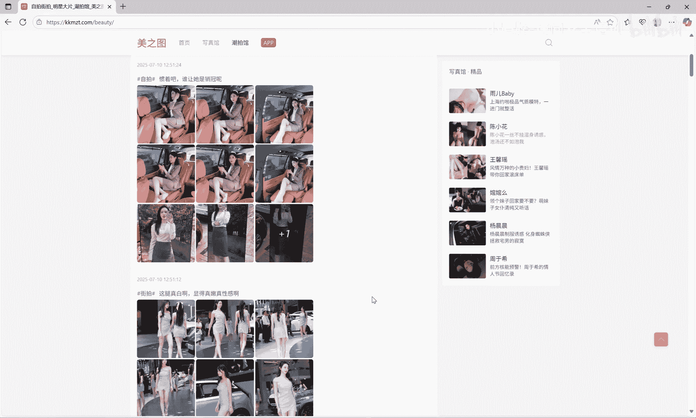
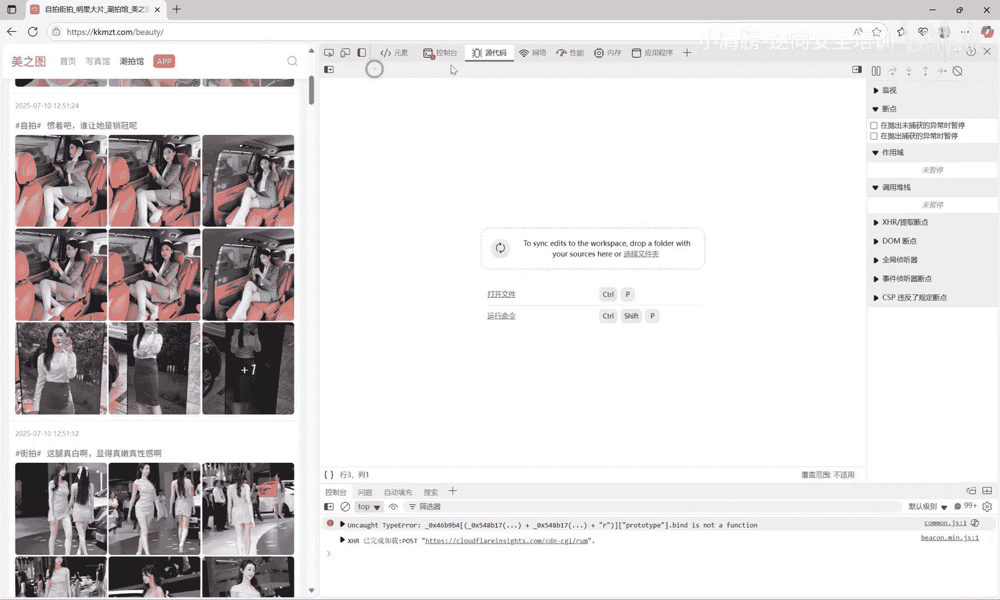
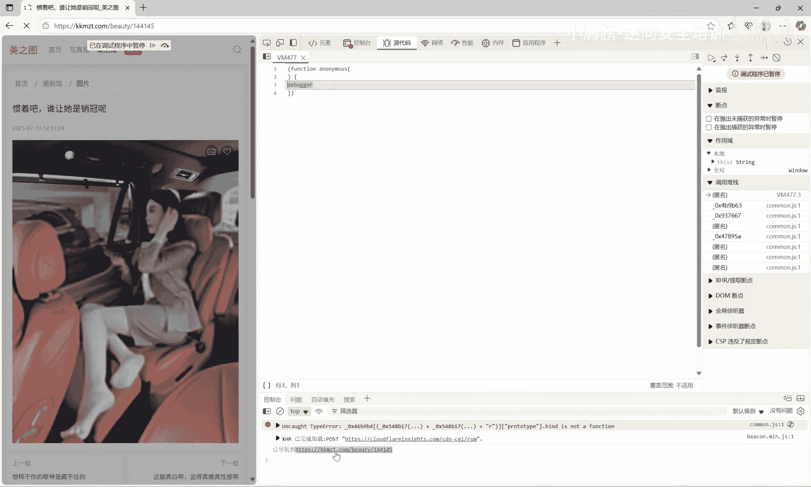

# 🔄 JS逆向：03：AI自动反混淆

在本节课中，我们将学习AI反混淆的基本思路。通过一个实际案例来理解：当网站中的图片文件名被加密时，我们该如何借助AI工具来逆向分析算法，从而获取真正需要的资源。这个案例来自某视频教程的BV号BV1ay41zPELa-，内容围绕爬取图片展开。

---

## 🧩 案例背景：加密的文件名

在之前的课程中，我们已经接触过这个网站案例。假设我们要爬取网页中的图片，会发现图片的文件名并不是普通的名称，而是一串看似乱码的字符串。这个文件名是经过加密处理的，不能直接拿来构造图片地址。

如果我们直接请求这个加密文件名对应的URL，往往无法获取到原图。因为服务器会校验文件名的合法性。只有搞清楚加密算法，才能根据已知信息生成正确的文件名，进而完成爬取。

这里给出文件名加密的通用抽象表示：

```python
encrypted_name = encrypt(original_name, secret_key)
```



其中，`original_name` 是图片真实名称，`secret_key` 是加密时使用的密钥，`encrypt` 是具体算法。我们的目标，就是反推出 `encrypt` 和 `secret_key` 的过程。

---

## 🛠️ 开发者工具与JS反调试

打开浏览器的开发者工具（F12），你会注意到一个现象：页面脚本中包含了JS反调试代码。这种代码会检测你是否打开了开发者工具，一旦检测到，就会暂停脚本执行、干扰调试甚至清空控制台，给逆向工作制造障碍。

为了绕开这个障碍，我们可以使用一个名为“just talk”的工具或插件来过掉反调试。这个工具的具体用法在之前的课程中已经详细介绍过，这里我们只做简单回顾：

- 使用“just talk”可以拦截或修改反调试相关的函数调用。
- 操作步骤通常是：加载工具，开启绕过模式，然后刷新页面。

以下是反调试代码的典型特征片段：

```javascript
// 常见的反调试逻辑：检测窗口大小或定时执行debugger
function debuggerDetect() {
    if (window.outerWidth - window.innerWidth > 200) {
        debugger;
    }
}
setInterval(debuggerDetect, 1000);
```

“just talk”这类工具的作用，就是让上述检测失效，从而使我们能够正常在开发者工具中查看网络请求、脚本执行等关键信息。



---

## 🖼️ 获取图片与小图大图的区别

刷新页面，然后观察开发者工具中的网络请求，你可以看到页面请求到了若干图片。这些图片是网页中直接展示的缩略图或者小图，尺寸较小，清晰度有限。

但我们真正想要爬取的，往往是图片对应的高清大图。在网页上，小图和大图通常由不同的URL地址提供，二者之间的映射关系隐藏在JavaScript代码中。这个映射关系同样依赖加密算法来生成。

下面是一个示意性的请求流程：

```text
小图URL → 页面解析 → 提取加密文件名 → 调用解密函数 → 得到大图URL
```



因此，在拿到小图之后，不能直接保存，而需要进一步分析JS中处理文件名转换的函数，将加密文件名还原后，拼接出大图地址。

---

## ✅ 总结

本节课中，我们一起学习了AI反混淆在JS逆向中的应用场景。我们复习了之前的图片加密案例，认识到图片文件名加密是爬取大图的主要障碍；同时回顾了JS反调试的存在以及使用“just talk”绕过它的方法；最终我们明确了小图与大图之间的区别，以及如何通过分析加密算法从加密文件名推导出大图URL。

在实际操作中，AI工具可以帮助我们快速理解加密函数的逻辑，甚至自动生成对应的解密代码。掌握AI反混淆的核心，就是理解加密与解密之间的对应关系，并将其转化为可在爬虫中直接使用的代码。
