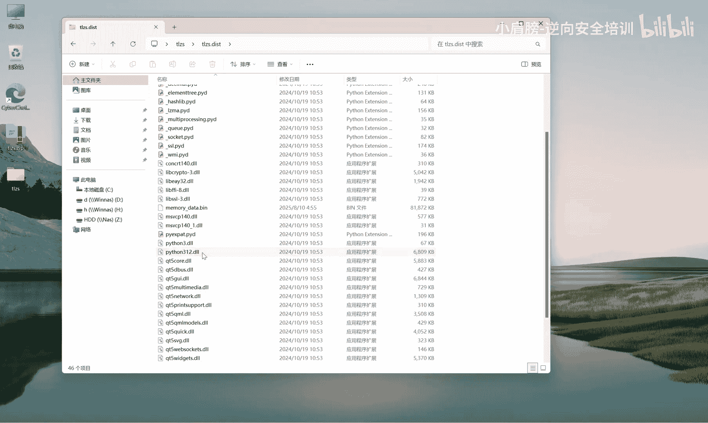

# ✅ JS逆向：04：JS算法推理 🧩

在本节课中，我们将学习JS算法推理的基本概念和操作流程。JS算法推理，简单来说，就是通过现成的工具，对网页中经过混淆或加密的JavaScript算法进行自动分析和还原，从而快速找到加密逻辑的核心参数或实现方式。本节课使用的工具来源于GitHub上的一个开源项目，我们将介绍如何获取、解压以及启动这个工具，并展示它的界面结构。

  

## 🔧 工具来源与获取方式

  

我们先来看看这个工具从哪里来。这个工具是GitHub上面开源的，项目地址你可以自己去搜索，关键词可以参考视频标题或常见的JS逆向工具库。如果你有兴趣，可以自行去搜索一下这个项目，看看它的更新历史、使用文档以及社区讨论。这个工具是去年下载的，不知道有没有更新新版本。由于开源项目迭代较快，建议你在使用前检查一下是否有更新的版本，以便获得更好的兼容性和更多功能。如果你下载的是最新版本，那么后续的操作界面可能会略有不同，但核心功能应该保持一致。

  

## 📂 解压后的目录结构

  

下载完成之后，我们会得到一个压缩包。解压之后呢，是这个样子的。这里我来描述一下目录结构：首先你会看到一个文件夹，里面包含若干个文件。其中有一个关键的子文件夹或入口文件，它的名字与“ES”有关。在这个里面有1个ES打开。这个“ES”可能是指EcmaScript的缩写，也可能是某个模块的名称，具体取决于项目作者的命名习惯。我们需要找到这个ES入口，并启动它。

  

如下图所示（示意）：

  

```
解压后的目录/
├── ES/
│   ├── index.html
│   └── main.js
├── README.md
└── ...
```

  

## 🚀 启动ES推理助手

  

找到ES入口之后，我们打开它。就是这么一个推理助手。这个推理助手本质上是一个本地运行的Web应用，它通过加载你提供的JavaScript代码，自动分析其中的算法逻辑，并给出可能的还原结果。使用它的步骤通常包括：将目标JS代码粘贴到输入框中，点击分析按钮，然后在输出区域查看推理结果。推理助手的界面一般分为左右两个区域，左边是代码输入，右边是结果输出，中间可能还有若干配置选项。

  

## 📁 附带的其他文件夹

  



在这个工具解压后的目录中，这边还有一个文件夹。这个文件夹通常存放着依赖库、示例代码或者文档资料。你可以打开它查看里面的说明文件，以了解工具的更多细节。例如，里面可能包含自定义规则文件，允许你扩展推理助手的识别能力。如果你想要修改推理逻辑，或者增加新的特征匹配规则，就可以在这个文件夹中进行配置。

  

## 🧠 核心概念与工作流程

  

为了帮助你更好地理解这个工具的作用，我们用一个简单的公式来表示JS算法推理的目标：

  

```
已知： 混淆后的JS代码 C
目标： 还原出核心算法 A，使得 C = Encrypt(A)
推理过程： 分析C中的调用栈、字符串、运算逻辑，逐步映射到常见算法模板
```

  

在推理助手中，这一过程被自动化了。你输入代码，它先进行词法分析，然后匹配已知的加密算法特征（比如MD5、AES、RSA的常量表或运算模式），最后输出可能的算法名称、密钥、向量等参数。这就是所谓的“1秒逆向”——在理想情况下，你只需要粘贴代码，点击按钮，就能得到结果。

  

## ✨ 总结

  

本节课中我们一起学习了JS算法推理的基础入门知识。我们了解到这个工具来自GitHub开源项目，我们需要自行搜索和下载；解压后我们看到目录结构，重点找到了ES入口；打开ES之后，我们看到了一个推理助手界面；然后我们注意到旁边还有一个文件夹，它可能包含依赖或配置。最后，我们梳理了JS算法推理的核心概念：输入混淆代码，输出算法参数，整个过程可以自动化。在下一节课中，我们将实际演示如何使用这个工具分析一个具体的JS加密示例，敬请期待。

