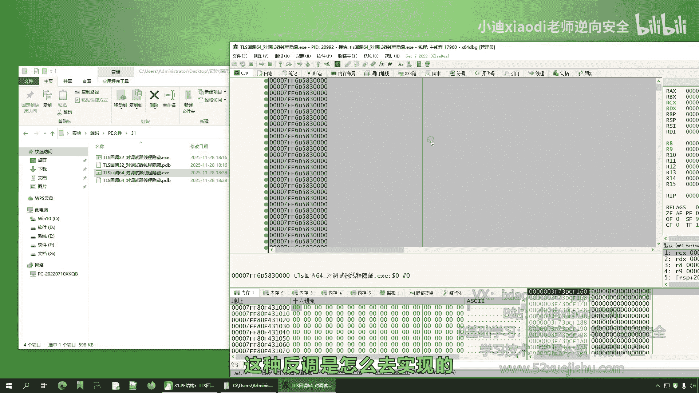

# 🛡️ PE结构：第31讲：TLS回调之使线程对调试器隐藏


大家好，我是小迪老师。本节课是第31讲，主题是PE结构中的TLS回调之使线程对调试器隐藏实验。在本节课中我们将要学习一个很实用的反调试现象：程序被拖入调试器后代码一闪而过，随后很多窗口变成空白。我们还会学习`NtSetInformationThread`函数、`ThreadHideFromDebugger`枚举值、内核层面的处理逻辑，以及一个最小代码实现。下面先从实验现象开始。


## 🔍 PE结构：第31讲：实验现象复现


上一节我们给出了本课概述，本节中我们来看看实验现象。先打开x64dbg，把实验程序直接拖进去，这时可以看到代码一闪而过，随后界面变成空白。同时左边的地址也变得不对劲，点击内存布局后里面是空的，查看其他窗口时SEH链也是空的。下面列出实验中可以直接看到的异常现象。

以下是实验中可以直接看到的异常现象：

- 代码一闪而过后变成空白，左边地址显示不正常。

- 内存布局窗口为空。

- SEH链窗口为空。

- 符号窗口里好像还有数据，但双击查看时没有查看权限，怎么双击都查看不了。

- 双击主模块后仍然显示老样子。

- 句柄窗口为空。

- 关闭调试器时不好关闭，需要关好几次，提示“正在停止调试对象”，过好大一会儿才关掉。

- 换成64位程序拖进来也是老样子，相关窗口都是空的。


这些现象说明程序在运行后主动对调试器做了隐藏处理。很多人碰到过这种情况：句柄和符号里能看到一些内容，但内存布局是空的，代码也是空的。上一节我们看了现象，本节结束时可以明确，今天要讲解的就是这种反调试是怎么实现的。下面进入关键函数。


## 🧰 PE结构：第31讲：关键函数与参数




上一节我们复现了调试器窗口变空的现象，本节中我们来看看实现这种效果的关键函数。首先介绍`NtSetInformationThread`函数，这个函数在微软官方文档中可以查到，它一共有四个参数。以下是这个函数的四个参数说明。

以下是这个函数的四个参数说明：

1. 第一个参数是线程对象的句柄。

2. 第二个参数是一个枚举类型，后面会展开说明。

3. 第三个参数指向指定要设置信息的变量的指针，这个参数不太重要。

4. 第四个参数是`ThreadInformationLength`，说明`ThreadInformation`的大小。


如果想查阅资料，可以直接去看微软文档，但微软文档不是特别详细，也可以看第三方文档。第三方文档里主要看第二个参数，因为第二个参数决定了如何对调试器隐藏。上一节我们介绍了函数参数，本节中我们继续看第二个参数对应的枚举类型。下面进入枚举值。


## 🧮 PE结构：第31讲：枚举值与ThreadHideFromDebugger


上一节我们介绍了`NtSetInformationThread`的四个参数，本节中我们重点看第二个参数。在第三方文档界面点击`ThreadInfoClass`就能看到里面的枚举类型。枚举是一种用户定义的数据类型，用于给整数值赋予有意义的名称，使代码更易读、更易维护。它的默认值从0开始自动递增，例如枚举星期几时，Monday就是0，Tuesday就是1。用公式表示如下。

\[
Monday=0,\ Tuesday=1,\ Thursday=3,\ Sunday=6
\]

所以看到Monday就是0，看到Thursday就是3，看到Sunday就是6。刚才说的线程枚举也是这样，从0开始，1、2、3、4、5、6、7一直到第17个。我们需要用到的是`ThreadHideFromDebugger`，它的值是17，转换成16进制就是`0x11`。字面意思是从调试器里隐藏线程，连起来就是从调试器隐藏线程。核心概念可以用下面这个公式表示。

> 核心公式：`ThreadHideFromDebugger = 17 = 0x11`。  
> 大白话：调试器靠调试端口接收线程事件，这个值会让线程从调试端口断开。


这个值就是今天的主角。它是Windows为保护系统线程设计的一个超级硬核反调试开关，并不是普通的反调试技巧。因为一旦把任意线程的属性修改为这个值，就会触发内核的一系列行为。上一节我们确定了枚举值，本节中我们来看看设置后内核会做什么。


## ⚙️ PE结构：第31讲：设置后的内核行为


上一节我们介绍了`ThreadHideFromDebugger`的值和含义，本节中我们来看看设置这个属性后内核会触发的行为。以下是设置该属性后内核会触发的四个行为。

以下是设置该属性后内核会触发的四个行为：

1. 内核会从调试器结构中移除此线程。调试器依赖`EPROCESS`里的`DebugPort`，这个位置要重点关注，下节课还会讲到；除了依赖它，调试器还依赖关联调试线程。也就是说，当把程序拖到x32dbg或x64dbg中时，调试器依赖这两个东西去关联调试线程。这个属性会让内核把线程从调试端口断开。本来调试器用调试端口把线程连上了，如果检测到调试行为，就用这个属性把连接断开。断开之后，调试器就无法再接收该线程的事件。这就是本课的本质：使线程对调试器隐藏，也就是把调试端口这条连接断开。

2. 内核会对调试事件进行吞掉或忽略。调试器通常通过`DebugPort`获得信息，但设置该属性后，内核就不会再把这些事件上报给调试器。可以把调试器想象成一个中间商，这个中间商在内核态和用户程序之间赚差价。放到计算机上，这个差价相当于获得单步中断、断点异常、int3异常信息、TLS回调中断等信息。有了这些信息，调试器就可以调试程序。设置`hide`后就没有这个中间商了，中间商看不到你，就像此线程不属于调试进程一样。

3. 即便被设置了断点，该线程也不会再触发调试事件。因为线程已经被隐藏，结果是调试器完全丧失对线程的控制权。

4. 调试器甚至不会收到`ThreadStart`或`Exit`通知。刚才关闭调试器时，会发现它比以往关闭得慢一些，因为它实际上不知道到底要关闭谁。


这个属性这么强，它的由来是Windows内部给系统线程准备的，用于禁止调试器干扰关键线程的运行，原本不会开放给普通开发者使用。但这个东西确实一直都存在，微软自己用它来保护一些东西，例如保证桌面绘画不被调试导致蓝屏，防止用户态调试冻结系统登录，防止恶意程序暂停扫描线程。这里简单了解即可。上一节我们看了内核行为，本节中我们来看看为什么x64dbg会直接失去调试权限。


## 🧩 PE结构：第31讲：x64dbg为何失去调试权限


上一节我们介绍了内核层面的隐藏行为，本节中我们来看看x32dbg或x64dbg为什么直接失去调试权限。原因是x32dbg或x64dbg使用Windows原生调试机制，这个机制简称为调试端口。以下是x32dbg或x64dbg失去调试权限的三个主要原因。

以下是x32dbg或x64dbg失去调试权限的三个主要原因：

1. 如果线程被隐藏，线程将不再向调试端口发送调试事件。也就是说，这个中间商根本不知道自己客户是谁，调试器就看不到任何东西，无法暂停、跟踪、设置硬件断点。

2. 调试器常通过修改SEH链来拦截异常事件。隐藏线程后，内核不再允许调试器影响该线程的SEH行为，这个线程不再受调试器接管，所以连异常也看不到。

3. 软件断点完全失效，因为根本没有异常。前面讲过软件断点的实现原理就是异常，异常接收不到，断点就相当于没有。


上一节我们解释了调试权限丢失的原因，本节中我们来看看代码实现。下面进入最小实现。


## 💻 PE结构：第31讲：最小代码实现


上一节我们分析了x64dbg失效的原因，本节中我们来看看代码怎么写。实现方法非常简单。首先定义函数原型，原型在MSDN中可以查到；然后获取PEB，这里就是回调函数；在回调函数里检测调试行为，如果检测到调试，就从`ntdll.dll`里取出这个函数的地址，取出来之后就可以调用。核心调用可以用下面代码表示。

```c
typedef NTSTATUS (NTAPI *pNtSetInformationThread)(
    HANDLE ThreadHandle,
    ULONG ThreadInformationClass,
    PVOID ThreadInformation,
    ULONG ThreadInformationLength
);

pNtSetInformationThread NtSetInformationThread;

NtSetInformationThread(
    GetCurrentThread(),
    ThreadHideFromDebugger,
    0,
    0
);
```

核心公式也可以写成下面这样。

\[
\text{NtSetInformationThread}(\text{GetCurrentThread}(), 0x11, 0, 0)
\]

第一个参数是要设置的线程，可以用`GetCurrentThread`取出当前线程。第二个参数是要设置的属性，它是枚举类型，要设置的是`ThreadHideFromDebugger`，值是17，转换成16进制就是`0x11`，后两个参数都填0即可。这个函数一旦执行，就可以使线程对调试器进行隐藏。其他代码跟之前一样，回调函数里面没有乱七八糟的内容。上一节我们看了代码框架，本节中我们来总结本课内容。


## ✅ PE结构：第31讲：总结


本节课中我们一起学习了TLS回调之使线程对调试器隐藏。我们先复现了程序拖入x64dbg后代码一闪而过、内存布局为空、SEH链为空、句柄为空、关闭调试器变慢等现象；然后介绍了`NtSetInformationThread`的四个参数，重点看了第二个参数`ThreadInfoClass`；接着理解了枚举值从0开始递增，以及`ThreadHideFromDebugger`的值为17，也就是`0x11`；随后分析了内核会移除线程、吞掉调试事件、让断点不触发、不发送线程开始或退出通知；再解释了x64dbg因为依赖调试端口而失去调试权限，软件断点也因为收不到异常而失效；最后给出了最小代码实现。大家回去之后可以自己动手写代码试一下。我们下期再见。
