# x64dbg逆向工程实战：01：程序密码破解与算法还原 🧭

大家好，我是小迪老师。在本节课中我们将要学习如何借助x32dbg做程序密码破解、算法还原和逆向工程的基础分析。上一节我们讲了如何用ID做暴力破解与程序代码还原；今天借助x32dbg深入研究逆向工程。逆向就是做实验研究，需要借助不同工具、不同环境；它让我们从不同角度认识一个事物，加深对事物的理解。

正如诗句所说：

> 横看成岭侧成峰，  
> 远近高低各不同。  
> 不识庐山真面目，  
> 只缘身在此山中。

这句话放在逆向里，就是同一个程序从不同工具和不同视角去看，会得到不同认识。下面先演示如何做初步粗略的动态分析。


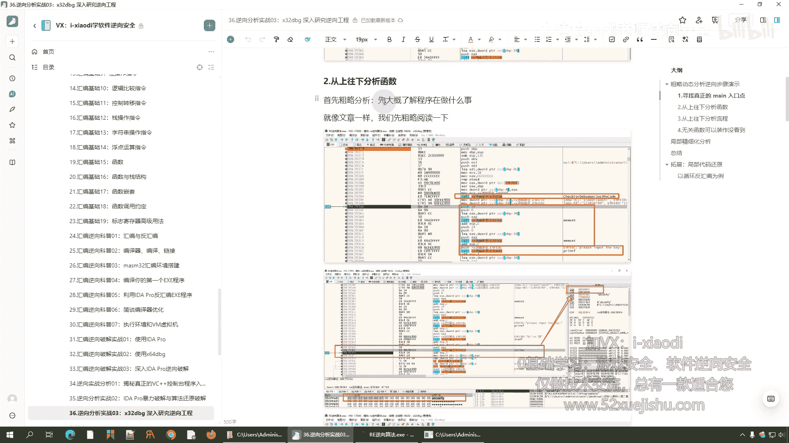

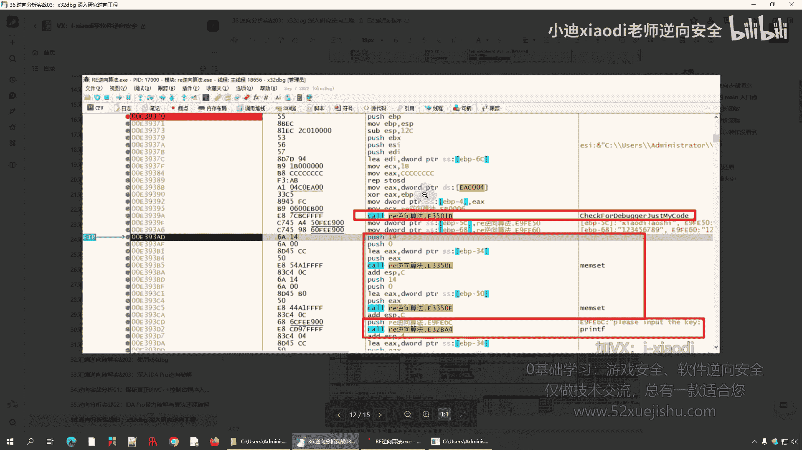

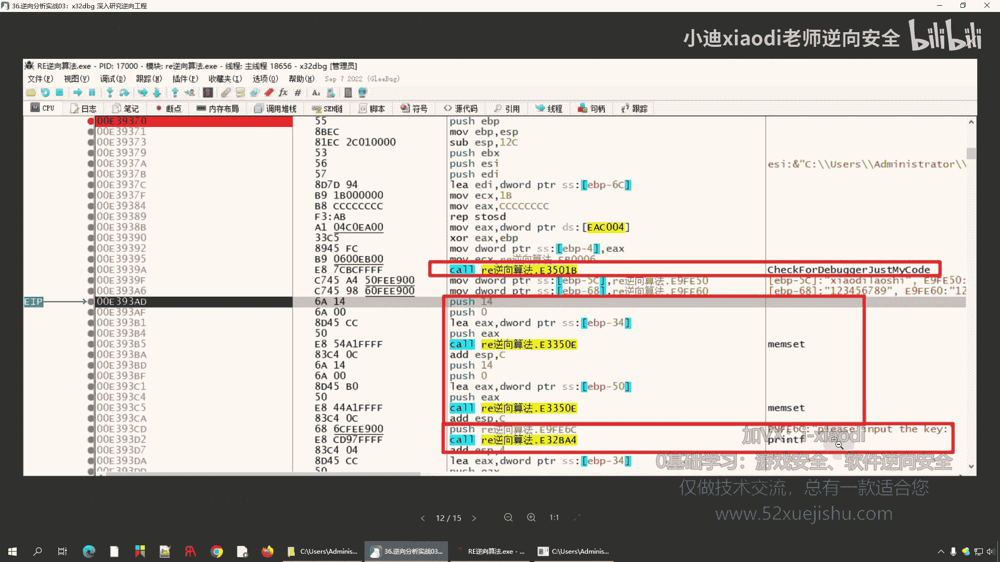

# x64dbg逆向工程实战：02：寻找程序入口点 🔍

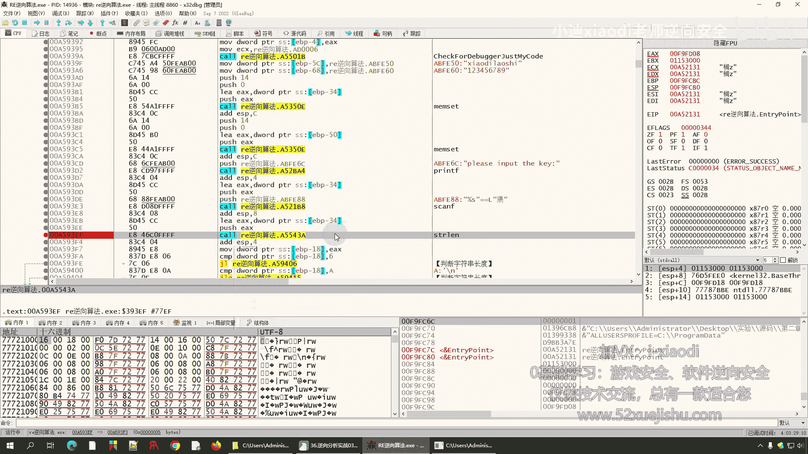

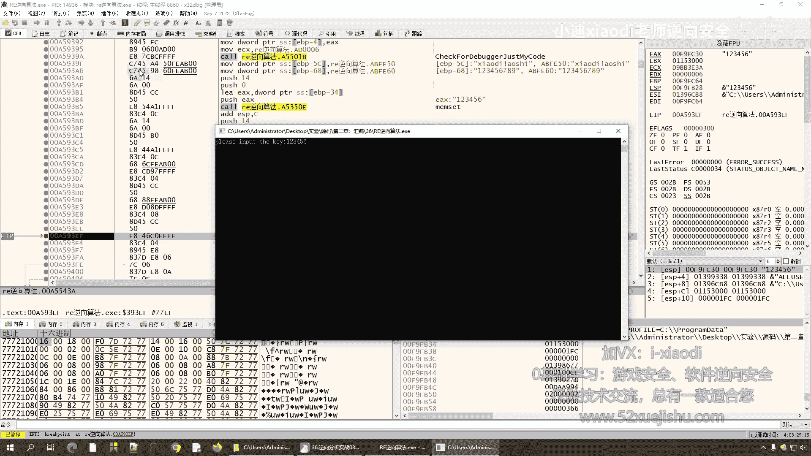

上一节我们交代了逆向思路，本节中我们来看看如何找到程序入口点。对于这个程序来说，肯定要先找到它的入口点，因为程序所有核心代码都在这个位置，找到入口才方便后续分析。怎么去找？方法非常简单，我会再演示一遍。

以下是寻找入口点的操作步骤，按顺序做即可。

- 把程序拖进x32dbg。
- 第一个GMP双击过来。
- 第二个GMP双击过来。
- 在这个函数里找到函数尾部，找到一个带三个参数的函数，双击进去并跟过去。
- 看到真正函数入口点后，就可以开始分析，因为所有核心代码都在这里。

找到入口后，我们要从上往下分析函数，先做粗略分析，先大概了解程序在做什么事。就像读文章一样，先粗略阅读一遍。接下来阅读函数，映入眼帘的是一个借助ID已经知道由编译器自动加上的函数，上节课我们记下了它的名字叫check for my code。紧接着是两个相同函数的调用，通过回顾上一节的情况，可以推断它们就是mem set函数；这个函数进行了两次调用，每一次都对不同的局部变量进行赋值。这个函数能够猜出来是print函数，因为它有一个参数，这个参数就是提示字符串，所以它是提示函数。紧接着这边有一个分号，可以推断它是一个函数。这个时候我们在这个函数上打一个断点，然后输入123456并回车。


# x64dbg逆向工程实战：03：识别核心函数与程序流程 🧩

上一节我们找到了入口并粗略阅读了函数，本节中我们来看看断点之后如何识别核心函数，以及如何从上往下理清程序流程。断下来之后，观察这个函数的返回值，按F8一下，看到它的返回值是66，就可以推断这个函数应该是STRLEN函数，也就是计算字符串长度的函数。这里是一个SM函数，是字符串比较函数；然后这里又是一个字符串比较函数。分析完比较核心的函数之后，就可以从上往下分析流程了。我们来看比较重要的流程出现在哪里，它们出现在跳转处。

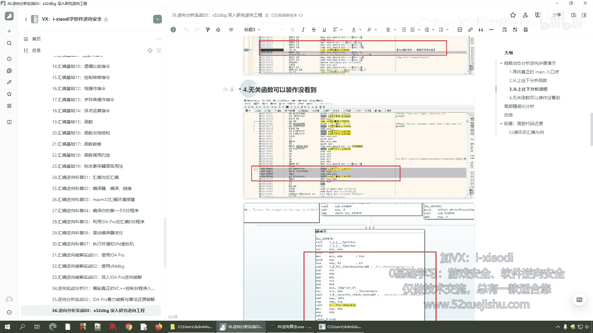

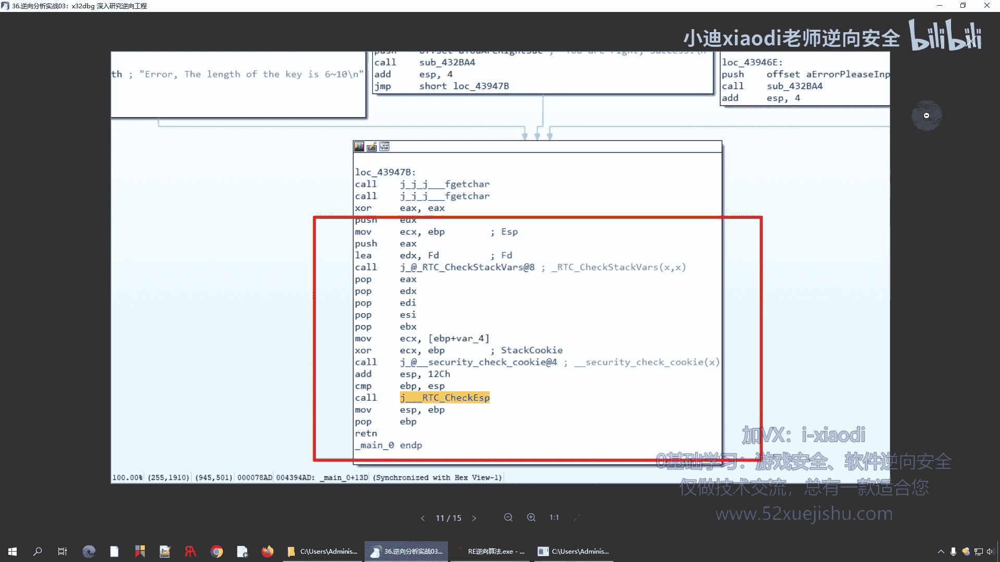

以下是对关键判断和循环流程的整理，方便先建立整体轮廓。

- 条件跳转上面有一个CMP和6做比较，另一个条件跳转上面有一个CMP和A做比较。
- 由此可以得出结论：这里应该是判断字符串长度大于6且小于10，16进制的A转成十进制就是10。
- 整体逻辑就是判断字符串长度；如果长度满足，跳转就会执行。
- 执行到跳转之后又会执行这个GMP，所以从这里开始才是判断字符串长度的逻辑，执行完之后才刚开始执行后面的代码，上面几行并不是。
- 走一下流程，走到这里之后又回来，然后把类似ESI/EX的值给EBP-C，EBP-C又给到ESI/EX，再和某个值做比较，于是形成一种循环判断条件。
- 当一定条件触发之后，程序就循环起来；条件不满足就跳出来，往下执行，执行STP之类的操作。
- 紧接着判断密码是否正确；如果正确就提示are right并往正确分支执行；如果不正确就直接跳到失败位置。

这样从上往下大概分析出一个流程，脑子里就有轮廓。在这个过程中，无关函数可以装作没有看到；这几行代码下边有没有必要分析？函数最后可以看到都是栈检查相关的操作，并不是用户编写的代码，而是编译器自动添加的，所以这里不需要再看。我们要把握主次关系，分析主干结构。粗略分析完之后，就可以进行局部的精细化分析。


# x64dbg逆向工程实战：04：给局部变量和函数打标签 🏷️

上一节我们建立了程序流程轮廓，本节中我们来看看局部精细化分析里一个非常重要的知识点：给局部变量打标签并重新分析。比如这个位置12345678，它是最终用来做比较的，它被复制给了EBP-68，所以可以转到这个地址，鼠标右键在内存中直接到EBP-68的位置，然后给当前地址写标签，命名可以叫`RESULT_K`。再比如这个位置是小迪老师这样一个字符串，它给EBP-5C做了赋值，那么就可以给EBP-5C打一个标签，方便后续分析：先点击这一行代码，点击鼠标右键在内存中转到，点击EBP-5C，再右键给当前地址写标签，回车即可。EBP-34和EBP-50也是两个非常重要的局部变量，它们分别被两个number函数初始化为0。并且可以发现EBP-34被sc函数接收，所以EBP-34应该是user。这个时候继续打标签：到EBP-34处右键给当前地址写标签，确认后打上标签，马上就能看到使用user input的地方，这就是打标签的重要性。这里还有一个EBP-50局部变量，在这段代码里不能体现它的作用；往下翻一翻，发现在这里用到了它。这个函数是STM，也就是字符串比较函数，它和re做比较，这个re就是12345678；因此可以推断EBP-50就是加密过后的K，给它起名`encrypted`，然后点击确定。标签不是装饰，它是在给大脑减负，让我们在后面的流程里一眼看出哪个变量是输入、哪个变量是结果、哪个变量是长度。

接下来可以进一步给这些函数打标签。以下是给常见函数打标签和识别的过程，目的是让后续阅读更直观。

- 回车跟进来，在这里右键给当前地址写标签，例如`function_memset`，回车后就能看到这里是一个复制操作。
- 地址A52BA4是print函数，右键打标签`function_print`，回车后所有调用print的地方都会展现出来。
- 这个函数是sk函数，回车进来后右键打标签`function_scan`。
- 这个函数是RLEN，回车进来后右键给当前地址写标签`function_strlen`。
- 这个函数调用完之后会得到字符串长度，长度又给到EBP-18，所以EBP-18里存放的是字符串长度，可以给这个地址写标签，起名`length`，字符串长度就复制过来了。


# x64dbg逆向工程实战：05：字符串核心逻辑与异或运算 🔐

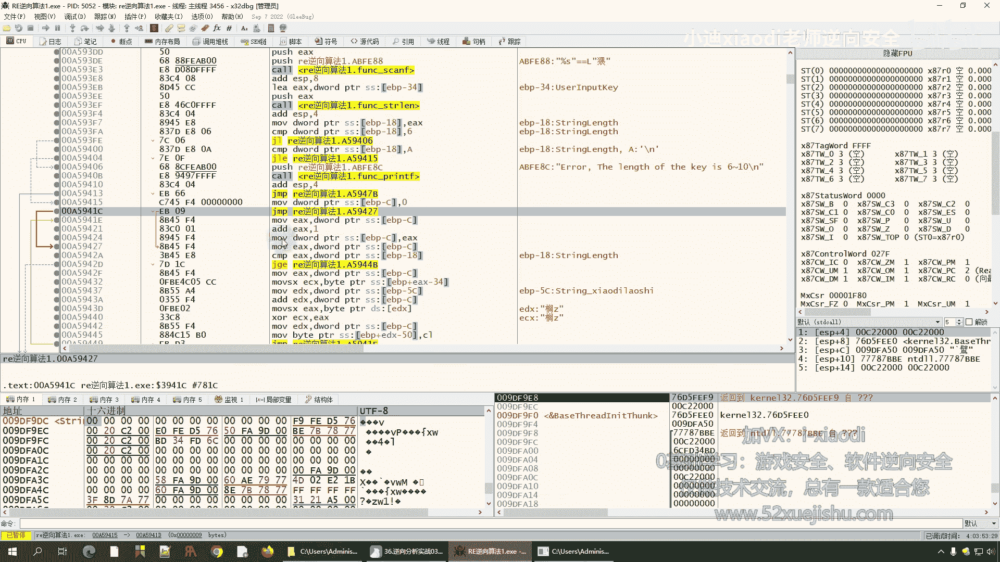

上一节我们给变量和函数打好了标签，本节中我们来看看字符串的核心逻辑。继续往下看，核心逻辑执行完之后会跳到某处，然后从那里开始执行。首先在这里打一个断点，然后输入BDF6个字符串并回车，观察流程。此时EBP-C是什么？可以看一下，EBP-C此时是0，然后和谁比较？和EBP-18比较，EBP-18刚才有印象是字符串长度。但是这时它并没有显示出来，说明在运行调试过程中地址改变了，所以要重新给最新地址打标签。地址变化导致旧标签失效，这是调试中的正常现象，关键是学会查看标签并更新。

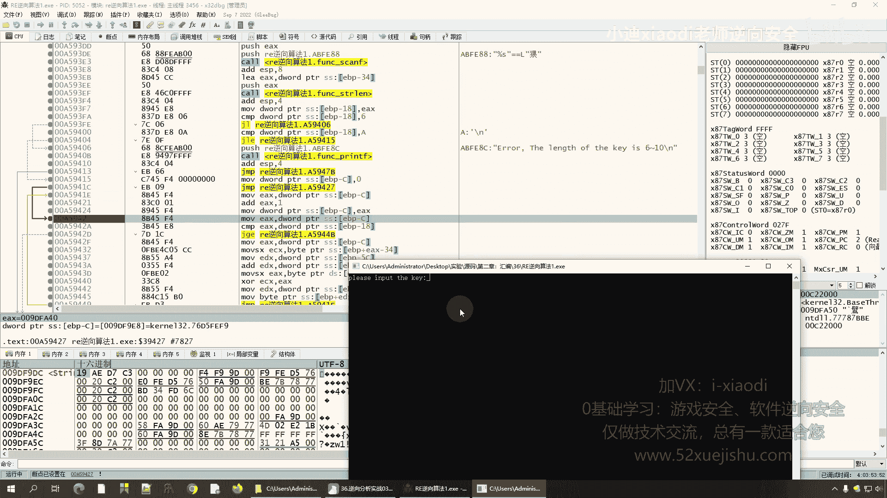

以下是重新给最新地址打标签并继续分析核心循环的步骤。

- 点击视图，点击标签，查看之前打过的标签。
- 可以看到`strlen`标签已经失效，直接删除；双击切换到最新地址，鼠标右键给当前地址写标签并给名字，最新标签就打上了。
- 此时知道代码含义：它和长度做比较，如果长度不够就继续往下执行。
- 接下来把EBP-S这个值设为0；把EBP-34加上E，此时是EBP-3这样一个地址里的数据拿出一个字节，注意操作大小是一个字节，拿出一个字节给EBP-34。
- 我们知道它实际上是user input加上E，还是user input，然后拿出一个字节；这里可以看到拿出的数据是A。
- 再把EBP-5C里的数据给EDX，EBP-5C就是小迪老师。
- 再把EBP-5C里的数据给E，注意EBP-5C存放的是9DF940，EBP-5C里边存放的数据是指向字符串地址的地址。
- 再把EBP-C和E这个地址相加，E是0，所以加上还是E5，还是小迪老师这个地址，最终这个地址会存放到E里。
- 再把E里的数据拿出一个字节，实际上就是小迪老师字符串的地址，从这个地址里取出一个字节给E，此时就是X。
- 小迪老师的这个X和谁运算？和刚才E里从user input拿出的一个字符做异或运算。
- 运算完之后，把CL里的一个字节给到前面那个地址；CL就是刚才异或加密的结果，可以做注释“加密运算得到结果”。
- 左边EBP-50实际上就是最终的加密结果，因为这一行代码是向地址里写入加密数据，此时还看不出更多作用。

继续往下执行，又回到上面，ESI要自加一，这个时候ESI变成1；然后把E给到EBP-减增加的位置，再和字符长度做比较，看左边是否大于等于右边的字符串长度。如果不大于等于，就执行这里的操作，user继续往后推一个字节，所以E实际上相当于推进了一个下标。这里蓝色ESI和蓝色EDS都起到下标作用。整个后边代码的作用就是取出小迪老师里的每个字节以及user input里的每个字节，做异或操作，结果放到地址里，最终得到的结果和我们的123456做比较。这个比较函数也可以打标签：右键给当前地址写标签，例如`function_compare`。如果比较结果成立，就执行相应操作；如果比较结果不成立，就给出提示。

用公式表示这段核心循环，可以写成下面的形式。

```c
cipher[i] = "小迪老师"[i] ^ user_input[i];
if (cipher == "12345678") {
    // 正确分支
} else {
    // 失败提示
}
```


# x64dbg逆向工程实战：06：算法还原与课程总结 📝

上一节我们分析了异或加密和比较逻辑，本节中我们来做总结并说明算法还原的练习方向。如果我们要分析算法，当然可以直接还原代码，也可以直接翻阅代码，但x32dbg仍然可以胜任，并且能从中锻炼强大的反汇编能力。大家也可以拓展局部代码还原，后期更方便理解代码逻辑；尝试对局部代码进行还原，能够在日后的逆向工作中用到。比如刚才这个循环，我们发现循环依赖下标，它就相当于C语言中的for循环。相信大家能够通过它的汇编代码写出大概的C语言代码。比较重要的汇编代码都给大家做了相关注释。

以下是本节课程的核心结论，便于复习和继续练习。

- 先找入口点，再粗略从上往下阅读，建立程序流程轮廓。
- 通过返回值、参数和调用位置识别STRLEN、字符串比较、print、scan等函数。
- 用标签把`RESULT_K`、`encrypted`、`length`、`user`等关键变量和函数标注清楚。
- 核心算法可以概括为逐字节异或：`cipher[i] = key[i] ^ input[i]`。
- 最后把加密结果与目标字符串比较，从而判断密码是否正确。

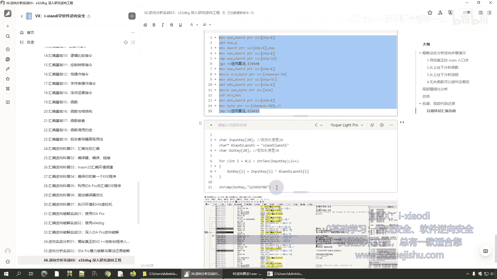

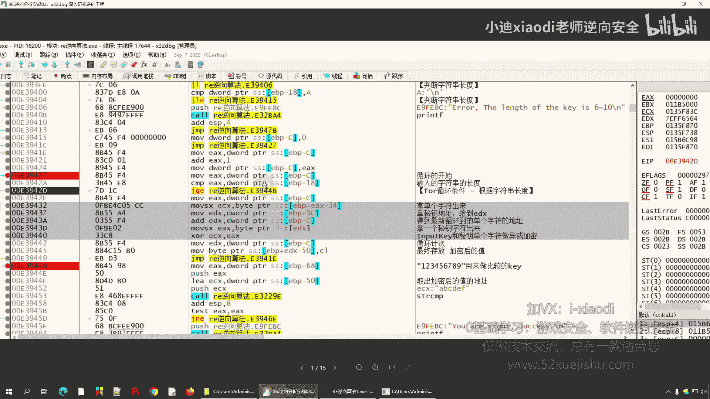

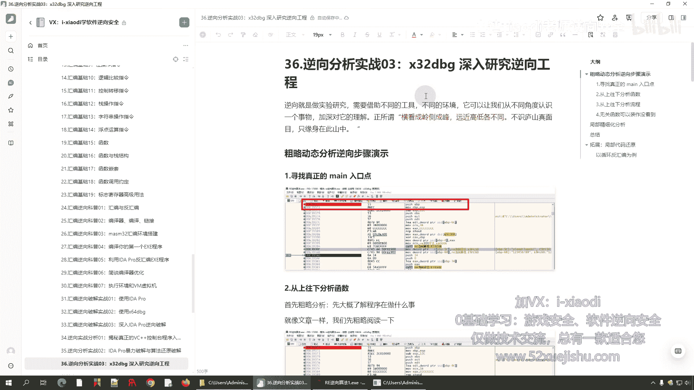

本节课中我们一起学习了如何用x32dbg寻找程序入口点、识别核心函数、给局部变量和函数打标签、分析字符串长度判断与循环、理解逐字节异或加密，并把核心逻辑还原成接近C语言的伪代码。以上就是今天全部内容，下期再见。

