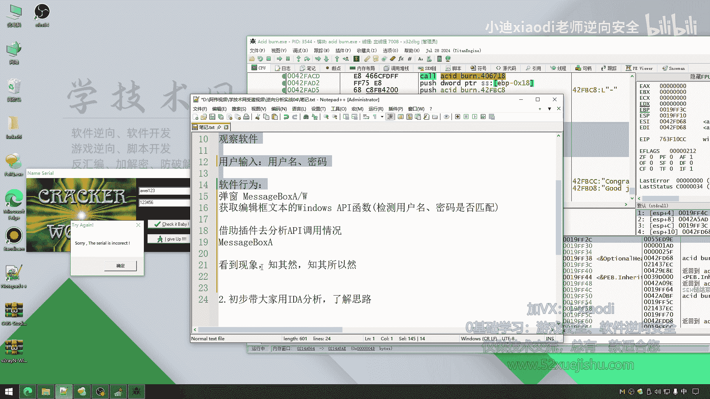

# 🧰 x64dbg逆向分析实战：04：软件ID算法逆向分析与破解实战（上）


大家好，我是阿伟老师。今天是逆向分析实战第04课，主题是某软件ID算法逆向分析与破解实战的上篇。在本节课中我们将要学习如何用DBG分析软件逻辑与切入点，如何观察软件行为，如何验证弹窗和编辑框文本获取行为，如何回溯关键跳转，以及如何定位真假注册码并完成注册。视频安排是先带大家回顾如何用DBG分析软件逻辑与切入点，因为我的讲解方法思路和小迪老师或许不同，所以我决定还是要进行讲解，然后再初步带大家用IDA分析。说得直白一点，本节的重点不是一上来就改代码，而是先看懂程序在做什么，再找到可以下手的分析点。


## 🧭 x64dbg逆向分析实战：04：课程概述与学习目标


上一节说明了课程主题，本节中我们来看看整体学习目标和分析路线。本节会先从软件表面行为入手，观察用户名、密码、按钮和弹窗之间的关系，再借助DBG验证这些行为背后调用了哪些函数。接着会分析程序使用的开发语言和框架，理解为什么某些常规API断点可能无效。最后会回到弹窗调用路径，寻找成功逻辑与失败逻辑之间的分水岭，并尝试通过修改跳转或直接提取真注册码完成注册。整个过程中，初学者需要记住一个核心思路：先观察现象，再验证行为，然后回溯调用，最后定位关键判断。


## 🔍 x64dbg逆向分析实战：04：观察软件行为与确定分析切入点


上一节我们明确了学习路线，本节中我们来看看软件本身的行为，并确定分析切入点。首先观察这个软件，这个软件大家应该已经非常熟悉了。我们点击这里，它提示让我们去输入一个用户名，那我们输入阿伟123，然后输入密码，密码随便输入，再点击按钮，程序提示错误。这个软件需要输入用户名和密码，点击按钮时会产生一些行为，例如弹出一个提示窗口。说得直白一点，按钮背后一定发生了某些判断，判断结果不同，弹窗内容就不同。弹窗一般是通过调用Windows API函数`MessageBoxA`或`MessageBoxW`实现的。第二个行为是获取编辑框文本，因为程序需要这些文本去检测用户名和密码是否匹配，在这个过程中会有相关的编辑框文本获取函数被调用。这个时候就可以基于这些行为尝试分析，先分析弹窗行为。下面先用一个流程公式描述表面逻辑：


\[
按钮点击 \rightarrow 获取用户名和密码 \rightarrow 校验注册码 \rightarrow 成功或失败弹窗
\]


以下是本节需要重点观察的行为类型：


- 点击按钮后是否出现弹窗。
- 弹窗可能来自`MessageBoxA`或`MessageBoxW`。
- 程序是否会读取用户名和密码编辑框中的文本。
- 读取文本是为了检测用户名和密码是否匹配。


这些行为就是后续下断点和回溯调用的依据，观察得越清楚，后面的分析越容易展开。


## 🧰 x64dbg逆向分析实战：04：用DBG验证弹窗行为


上一节我们观察了按钮点击后的表面行为，本节中我们来看看如何用DBG验证弹窗行为。我们打开DBG，点击文件，点击附加，先按过来点击符号。这个时候可以借助插件，点击对话框，在对话框里设置断点。当我们点击按钮的时候，会发现程序在`MessageBox`处断下来了，这说明程序确实调用了`MessageBox`，没有问题。以下是使用DBG验证弹窗行为的基本步骤：


1. 打开DBG。
2. 点击“文件”再点击“附加”。
3. 点击“符号”。
4. 借助插件点击“对话框”，并在对话框中设置断点。
5. 点击软件按钮，观察是否在`MessageBox`处断下。


可以看到程序确实调用了`MessageBox`，第一个行为得到印证。接着取消这个函数断点并运行起来，为验证第二个行为做准备。这里需要强调，断点不是为了立刻修改程序，而是为了确认猜测是否成立。只有确认程序调用了什么函数，后续回溯调用路径才有明确方向。


## 🧩 x64dbg逆向分析实战：04：验证编辑框文本获取行为


上一节验证了弹窗行为，本节中我们来看看编辑框文本获取行为是否同样成立。我们再次点击插件，还是找到对话框里的取控件文本相关选项，把相关的全部勾选上，然后点击按钮。大家会发现程序并没有中断，说明这些函数没有被调用。这里就出现一个比较奇怪的现象：明明存在获取编辑框文本的行为，但是这些函数并没有被调用。以下是验证编辑框文本获取行为时使用的步骤：


1. 点击插件。
2. 找到对话框里的取控件文本相关选项。
3. 将相关选项全部勾选。
4. 点击按钮，观察程序是否中断。
5. 根据中断结果判断相关函数是否被调用。


程序没有中断，说明这些函数没有被调用。看到一种现象时，一定要知其然，知其所以然，需要去了解这种行为发生的本质。怎么办，这就需要积累经验，从今天开始积累，因为这个程序比较特殊。说得直白一点，表面上有读取文本的行为，不代表底层一定直接调用我们熟悉的Windows API。下一步需要查看这个程序是用什么编程语言开发的，从而解释这个现象。


## 🧠 x64dbg逆向分析实战：04：Delphi程序特性与API封装


上一节发现常规取文本函数没有被调用，本节中我们来看看程序使用的开发语言和框架特性。我们点击DIE，然后把程序拖过来，会发现它是用Delphi开发的，原文中简称为dy。Delphi比较特殊，我给它找了一个资料。资料说明，Delphi利用Object Pascal和可视控件库VCL对底层Windows API进行了完美的封装，所以很少需要使用基础Pascal语言来建立Window应用程序，也无需直接利用Windows API函数。可以用下面的关系描述这种封装：


```text
Delphi VCL -> 封装 -> Windows API
取编辑框文本行为 -> 可能不直接调用 GetWindowText 等 Windows API
```


以下是理解Delphi封装特性时需要抓住的几个点：


- 程序用Delphi开发。
- Delphi通过VCL封装底层Windows API。
- 开发者不一定直接调用Windows API函数。
- 因此取编辑框文本行为可能没有走常规Windows API。


这种情形寓意着，获取编辑框文本这种行为并没有走所谓的Windows API函数，并没有走这个API入口，所以这条路针对这个程序就行不通。针对这个程序，我们只能走第一种行为，也就是弹窗行为，基于弹窗去分析。这里不是放弃分析，而是换一个更可靠的切入点。下一节会再次回到`MessageBox`断点，沿着调用路径向上回溯。


## 🪜 x64dbg逆向分析实战：04：回到弹窗断点追踪关键跳转


上一节确定了基于弹窗行为分析，本节中我们来看看如何从`MessageBox`断点回溯到关键判断。我们再次在`MessageBox`处打一个断点，然后点击按钮。断下来之后，就可以继续跟踪，并通过单步执行和返回路径向上回溯。以下是从弹窗断点回溯关键跳转时需要注意的步骤：


1. 在`MessageBox`处下断点。
2. 点击按钮，让程序断下。
3. 断下后继续单步跟踪。
4. 按返回路径逐层向上回溯。
5. 观察每一层是否存在关键跳转。


这是我们返回的第一层，这一层没有什么关键的跳转，大家会发现没有关键跳转，就继续往回走。来到某一层的时候，大家就会发现一个条件跳转，存在一个分水岭，一侧是正确逻辑，另一侧是错误逻辑。逆向分析中百分之八九十的情况都是这样，所以要尽可能找到这种形如条件跳转的反汇编代码，只可意会不可言传。可以用下面的伪代码理解这个分水岭：


```c
if (用户输入注册码 == 真注册码) {
    执行成功逻辑;
} else {
    执行失败逻辑;
}
```


这里是成功的逻辑，那里是失败的逻辑。找到这个分水岭之后，就可以考虑修改跳转，或者直接观察比较位置中的真假注册码。下一节会具体看常见的修改方式和真假码定位方法。


## 🛠️ x64dbg逆向分析实战：04：定位真假注册码与修改思路


上一节找到了成功逻辑和失败逻辑之间的分水岭，本节中我们来看看常见的修改思路以及如何定位真假注册码。第一种修改方式是把这里NOP掉，这样代码从上往下执行，就可以执行到正确的代码，这是毋庸置疑的。第二种方法是可以看到123456在这里已经是假注册码，真注册码已经显示出来，就可以在这里直接拿出来。以下是两种常见处理思路：


1. 将条件跳转NOP掉，让程序顺着正确路径执行。
2. 在比较位置直接观察真注册码和假注册码，提取真注册码。


很多软件都是这样，它的假码和真码是放在一块儿进行比较的，也就是在算法最后的逻辑上会有一个比较。程序暂停的时候处于中断状态，在中断状态下，我们可以在堆栈里面查看数据。右下角是堆栈窗口，可以在堆栈窗口看到相关数据，因为这个工具也会显示堆栈的数据，所以一般来说大家都在这里看。可以用下面的代码形式描述修改思路：


```asm
; 原逻辑可能是条件跳转
jcc 失败分支

; 一种修改思路是把条件跳转改成NOP
nop
nop
```


然后运行程序，先把断点放开，把这个注册码填进去，程序注册成功。这个软件比较小，它的密码、真码和假码可能是挨着存放的，甚至和用户名是挨着存放的。因此下一节可以做一个内存搜索实验，验证这些数据在内存中的位置关系。这里需要提醒，修改跳转只是手段，理解真假码比较逻辑才是根本。


## 🗺️ x64dbg逆向分析实战：04：内存搜索验证数据存放关系


上一节通过真假码比较完成了注册，本节中我们来看看如何用内存搜索验证数据存放关系。我们可以做一个实验，点击内存布局，去搜索匹配字符串，输入阿伟123。搜索一个东西的时候，一定要注意勾选“整块”，这样搜索出来的结果才足够精确。点击搜索，看一下第一个结果，没有需要的内容，点击引用，看一下第二个结果，回到结果后可以看到用户名、真注册码、假注册码都在这里。以下是内存搜索验证数据关系的步骤：


1. 点击“内存布局”。
2. 搜索匹配字符串，输入`阿伟123`。
3. 勾选“整块”，保证搜索结果足够精确。
4. 点击搜索，查看结果列表。
5. 第一个结果没有需要的内容时，点击引用查看第二个结果。
6. 回到结果后检查用户名、真注册码和假注册码是否都在附近。


```text
搜索内容：阿伟123
搜索选项：勾选“整块”
后续操作：查看引用 -> 定位用户名、真注册码、假注册码
```


> 注意：搜索字符串时勾选“整块”非常关键，否则结果可能不够精确，容易漏掉真正相关的内存位置。


软件比较小，密码、真码、假码可能挨着存放，甚至和用户名挨着存放。通过这个实验可以看到，用户名、真注册码和假注册码都在这附近，这也说明前面的判断有内存数据支撑。到这里，今天的主要内容就完成了。


## ✅ x64dbg逆向分析实战：04：总结




本节课中我们一起学习了如何从软件表面行为出发分析一个Delphi程序。我们首先观察了用户名、密码、按钮和弹窗之间的关系，确定弹窗和编辑框文本获取是两个重要行为。然后用DBG验证了`MessageBox`确实被调用，而常规取控件文本函数没有被调用。接着通过DIE确认程序使用Delphi开发，理解VCL对Windows API的封装会导致某些常规API断点失效。随后回到`MessageBox`断点，沿调用路径回溯到成功逻辑和失败逻辑之间的分水岭，并讨论了NOP跳转和直接提取真注册码两种思路。最后通过内存搜索验证了用户名、真注册码和假注册码的存放关系，并完成注册。今天全部的内容就是这些，希望大家在学习时看到现象，知其然知其所以然。我们下期再见。


