# 二进制黑客：软件破解逆向实战：第2课：破解密码验证程序

## 🧭 课程概述

在本节课中，我们将学习如何对一个软件进行逆向破解。具体来说，我们的目标是绕过软件的密码验证逻辑，让程序直接判定为验证成功。我们会使用一个实验程序来演示整个分析过程，该程序运行后会要求输入用户名和密码。实验程序已经上传到社区论坛，大家可以直接下载使用。通过本节课的学习，你将会掌握两种常用的破解思路：一种是在关键API函数上下断点，另一种是通过搜索字符串引用定位关键代码。此外，我们还会讨论在破解过程中可能遇到的意外情况，以及如何通过逻辑梳理来推导软件的执行流程，最终彻底理解这个程序的验证机制。这个过程听起来可能有些复杂，但放心，我们会用最直白的方式一步步拆解，即便是初学者也能跟得上。

## 🚀 程序运行与初步观察

我们先把实验程序运行起来，看看它到底是什么样的一个表现。程序启动之后，界面上会显示一个提示，内容是“Input your name”，这是让我们去输入用户名的意思。与此同时，程序还会要求我们输入密码，这两个输入框是并列存在的。我们不妨先随便尝试输入一组数据，比如用户名输入“小迪”，密码输入“123456”，然后点击一下OK按钮。点击之后，程序会立刻弹出一个提示框，里面写着“You got wrong, try again”。看到这个错误提示，我们就可以开始正式梳理逆向分析的思路了，因为我们已经找到了一个非常明确的切入点——这个提示框本身就是程序验证失败时给出的反馈。

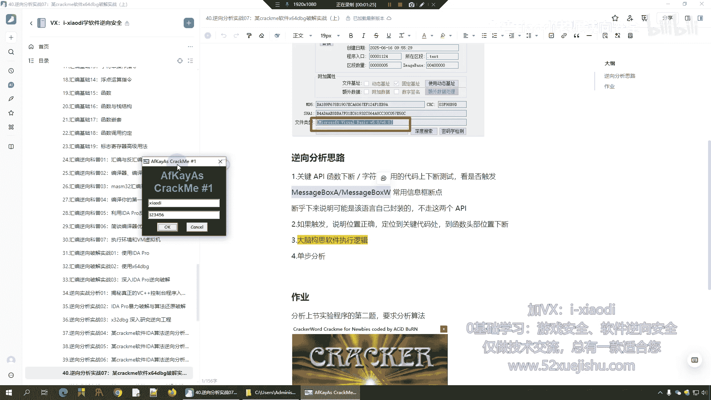

## 🎯 逆向分析思路概览

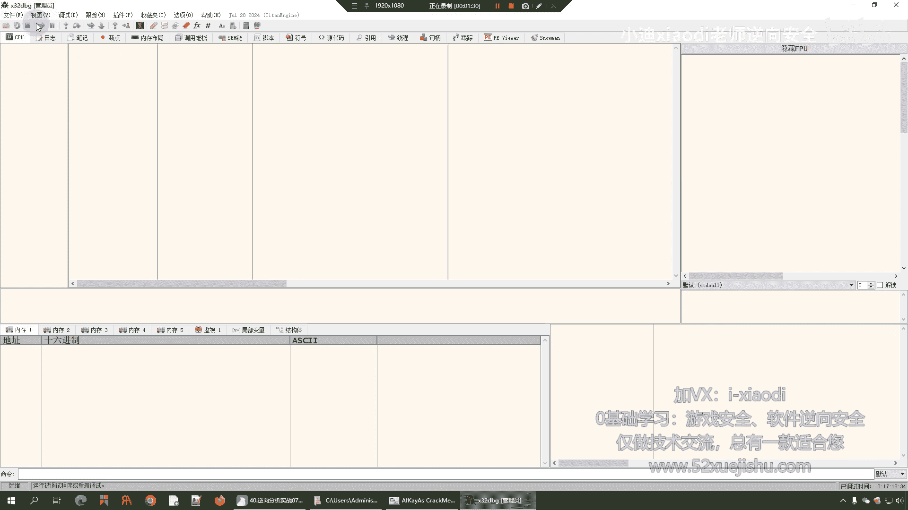

接下来，我们来看看逆向分析可以从哪几个方向入手。面对这样一个有弹窗提示的程序，我们的思路不应该是一团乱麻，而是有章可循的。下面是我们常用的两种方法，它们分别从不同的角度去尝试打断程序的执行流程。

- **关键API函数上下断**：因为这个程序存在一个弹框提示，所以我们可以考虑在常见的信息框函数上下断点。常见的两个函数是`MessageBoxA`和`MessageBoxW`，它们分别对应ASCII和Unicode版本的弹窗API。我们可以在这些函数上下断点，观察程序调用它们时是否会被拦截下来。
- **字符串引用追踪**：由于程序界面上有明显的字符串提示，比如"You got wrong, try again"，我们还可以通过搜索字符串引用的方式，直接定位到这些字符串在代码中的位置。然后在这个位置上下断点，测试程序是否会在这里断下来。

以上两种方法是相辅相成的。如果说断下来了，那就太好了，我们可以顺着断下来的位置继续往上回溯，找到关键代码，然后进行分析。如果说断不下来，那说明这个程序可能使用了语言自己封装的信息框调用，不走这两个API。也就是说，程序并不会直接调用`MessageBoxA`，也不会调用`MessageBoxW`，在这种情况下，在这两个函数上下断点是没有任何效果的。这个问题在上一节课中，阿威老师应该已经给大家讲过了，这里算是再次复习一下。

## ⚙️ 实际操作：尝试API下断

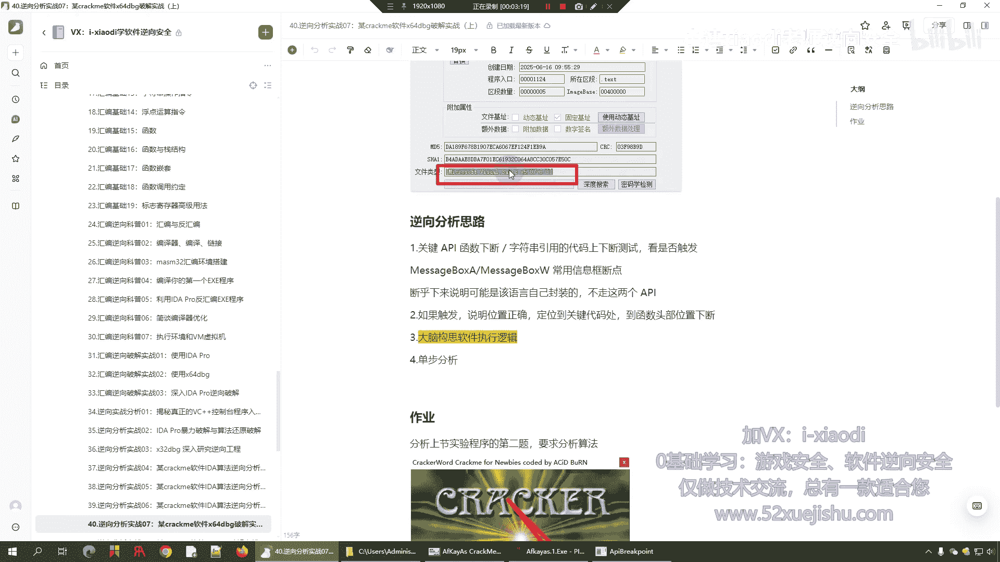

理论讲完了，我们来实际操作一下，看看会出现什么情况。现在程序先保持打开状态，然后我们打开自己的工具包，找到32位调试器（OllyDbg）。打开调试器后，点击文件菜单，选择附加，把调试器附加到目标进程上。附加成功后，我们切换到符号窗口，找到程序的主模块。有的朋友看到调试器里那些杂乱无章的乱码可能会感到恐惧，这里要告诉大家，完全不必恐惧，这些东西跟我们的分析没有任何关系。我们分析要奔着一个目标去，奔着一个方向去，现在我们就是要分析弹框或者字符串，那么这边的其他代码跟你没有关系。打个比方，它们就是路边的一条狗，你惹它干什么，对不对？所以直接忽略掉那些无关的内容，专注于我们需要的功能即可。

好，现在咱们先去尝试在`MessageBoxA`或者`MessageBoxW`上下断点。操作方式很简单，如果你觉得手动输入地址再按回车下断点比较麻烦，可以点击插件菜单，找到断点管理工具，直接勾选对应的选项。这里我们直接打个勾，看到没有？这两个断点就自动下上了。我们再去确认一下`MessageBoxA`下上了没有，看一下`MessageBoxW`有没有也下上，确实都下上了。勾选完成之后，我们回到目标程序，点击OK按钮。这时候大家会发现一个问题：我们在这两个函数上下断点，程序并没有中断下来。这说明这个程序的弹框是它自己封装的，并没有走标准的系统API。

那么，这个程序到底是什么语言编写的呢？我们可以在调试器的模块信息中看到，它显示的是`Microsoft Visual Basic`，也就是说这是一个VB程序。这里大家要记住一个规律：除了`C++`等程序经常自己封装消息框之外，还有一个就是VB（Visual Basic）程序，它也经常自己封装一些东西。所以，你常用的这些API函数在VB程序面前往往是断不下来的。既然API断点这条路走不通，那我们就只能使用字符串引用的方法了。

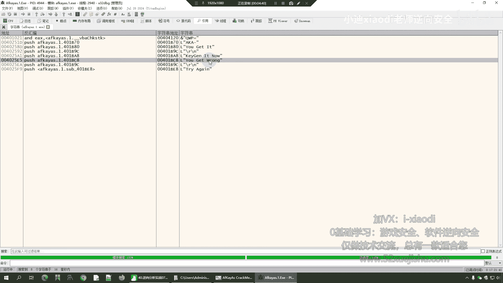

## 🔍 字符串引用：定位关键代码

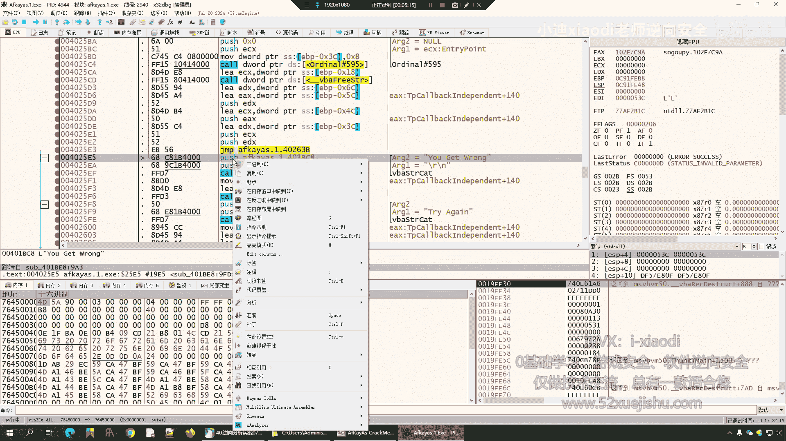

既然API下断的尝试失败了，我们转换策略，采用字符串引用追踪法。在动手之前，先将刚才下上的两个断点取消掉，打个叉即可。接下来，我们要切换到程序的主模块。大家需要记住一个关键操作：如果要搜索字符串，你必须在当前模块中搜索。因为程序可能加载了多个模块，字符串是存储在模块内部的，所以一定要先切换到这个程序自己的模块上，才能搜到当前模块的字符串。切换好模块之后，我们点击右键，选择查找所有引用文本字符串。搜索出来的结果并不算多，就那么几个字符串，然后我们可以在其中看到"You got wrong, try again"，对不对？这个问题很好，找到了它，就等于找到了一个关键节点。

于是我们就直接在"You got wrong"这个字符串的引用位置上下一个断点。不过，除了"You got wrong"之外，大家可能还会发现另一个字符串，那就是"You got it"。这个字符串的意思是"你成功了"，也就是说，如果你的密码输入正确，程序就会显示这个字符串。那我们的做法就更简单了，我们可以直接定位到"You got it"这个字符串所对应的地址，这里是成功分支的位置。找到了这个成功的位置，接下来要做的就是查看它是怎么走的。你会注意到，在这个成功分支的位置前面，存在一个条件跳转指令`JE`。那么，怎么去破解它呢？方法非常直接：鼠标右键点击这条跳转指令，选择二进制，然后选择用`NOP`填充。`NOP`是一个空操作指令，它什么都不做，把条件跳转替换成`NOP`之后，程序就不会再跳走了，会顺势直接执行到成功分支。填充完之后，我们再去点击OK按钮，看到没有？程序直接弹出了"You got it"的提示，此时已经成功破解了验证。

## 🛠️ 方法二：从错误提示反推正确逻辑

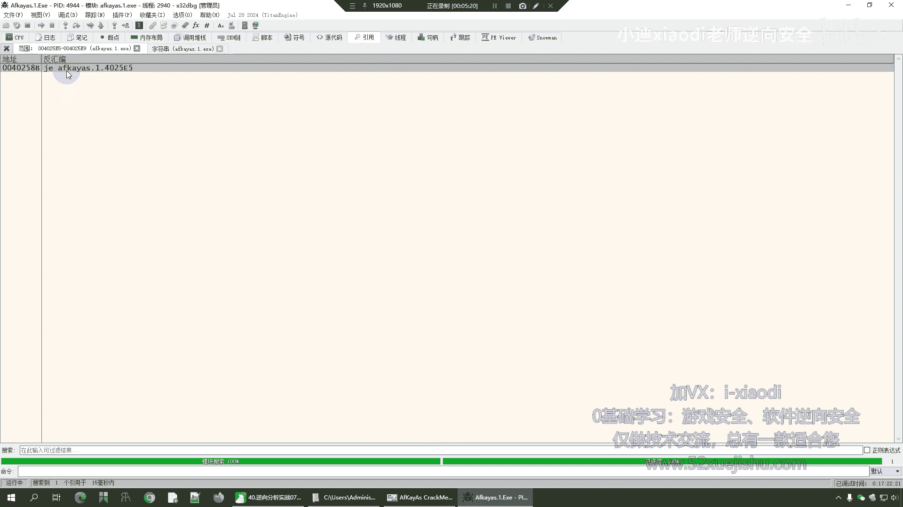

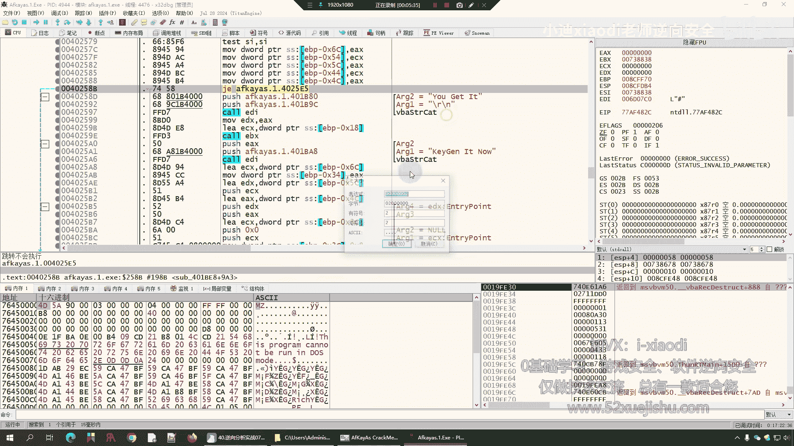

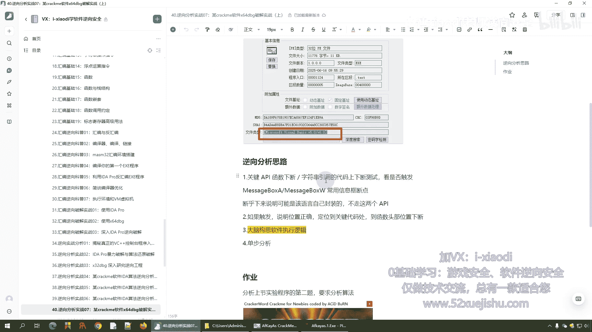

除了直接修改成功分支的条件跳转之外，还有没有其他的破解方法呢？当然还有，我们不妨换一个思路，从错误提示入手，反向推导出正确的逻辑。我们看一下这里有一个"You got wrong"的字符串地址，怎么通过它去找到那个正确的逻辑呢？操作很简单：双击这一行，跳到对应的代码位置。跳到那里之后，我们会发现，这个错误分支的位置上面有一条红色的线，这条红线是从上面某个地址跳下来的。这说明了什么？这说明上边肯定存在一个条件跳转指令，正是这个跳转把程序引导到了错误提示的位置。那么，怎么才能找到这个跳转呢？非常简单，我们在这个位置点击鼠标右键，选择查找引用，再选择选定地址。这个时候，工具会列出一个引用结果，我们看到结果就是一个`JE`指令。也就是说，程序是通过这样一个条件跳转的判断，才能够跳到错误分支的位置。

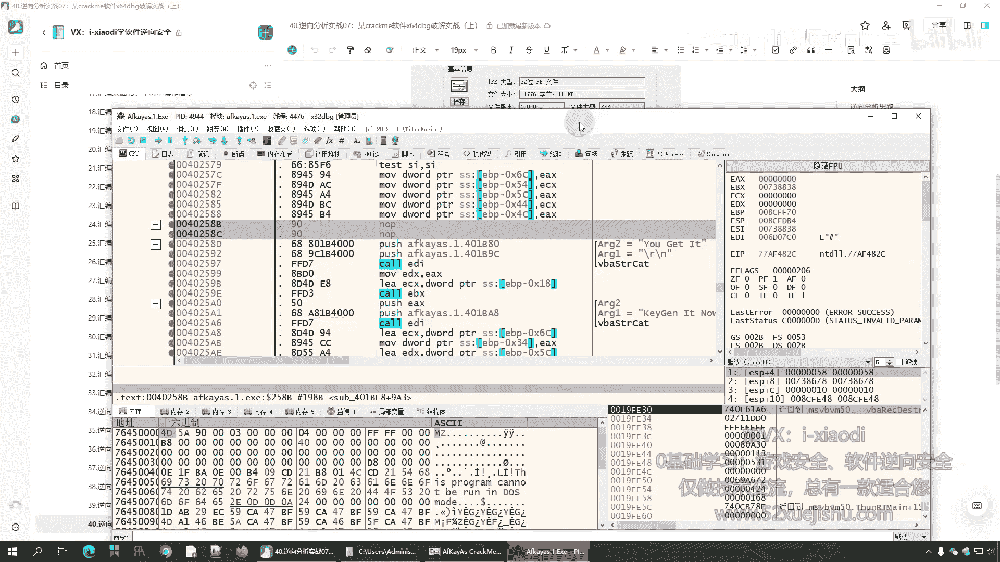

我们再仔细观察一下，会发现这个错误分支的跳转来源，刚好就是正确分支跳转到上面的那个跳转指令，看到没有？也就是说，只要修改这一个跳转，程序就会从正确分支走，而不会进入错误分支。所以，操作方法还是同一个位置：鼠标右键，选择二进制，选择用`NOP`填充。填充完毕后，再点击OK按钮，程序同样会直接显示"You got it"，破解成功。这个方法的核心在于从错误分支逆推到它上面的条件跳转，思路不同，但是效果一样。

## ⚠️ 分析意外情况与排查思路

在逆向分析的过程中，有可能会出现一些意外的状况，我们有必要提前了解一下，免得真遇到了手足无措。什么意外情况呢？比如说，我们明明从理论上分析——注意我的措辞——理论上来说，我们在这里给它`NOP`填充掉是可以破解成功的。但是当我们实际上去点击、去应用、去测试的时候呢，却发现并没有破解成功。这时候你就要思考两个问题。

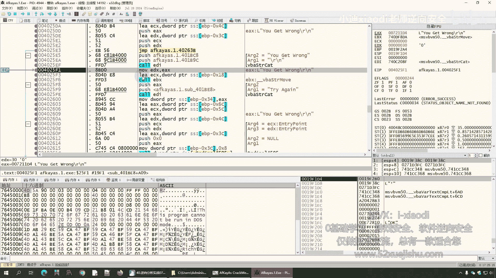

- **代码到底有没有执行**：第一个问题是，这边的代码到底有没有执行。那你怎么才能知道呢？你可以按`F2`打一个断点，在这一行代码处设置一个断点。如果说程序中断下来了，那就说明这里的代码确实执行了，既然执行了，那问题就不在代码是否到达这里，而是后续的逻辑。
- **如果执行了，是怎么执行的**：第二个问题，如果代码确实执行了，那它是怎么执行的？我们就可以利用中断下来的状态，进行单步跟踪调试。按`F8`单步执行，一步一步观察程序的走向。你可能会发现，单步了几步之后，直接就来到了"You got wrong"的分支，这样我们就能亲眼看到程序是如何把流程引导到错误提示上的。

如果大家在逆向分析过程中遇到一些逻辑上思考困难的问题，这里推荐一个非常好的习惯：先在大脑中构思一下软件的执行逻辑，而不是一头扎进代码的汪洋大海里。比如说我们来构思一下这个软件。这个软件首先应该做什么？很显然是获取用户名和密码。在Windows编程中，用户名和密码通常就是两个编辑框控件，所以程序的第一步就是获取编辑框里面的内容，这是它的第一个步骤，对吧？获取到内容之后呢，它应该是做一个计算。这时候我们就要把内容分开了，这个内容分为`A`和`B`两个部分，`A`就是用户名，`B`就是密码。获取到之后，它一般来说，根据我们以往的经验，会通过用户名——也就是我们输入的那串字符——通过某种算法去计算得到一个结果，然后拿到这个结果之后，再和密码去做比较。整个逻辑可以用下面的公式清晰地表示出来：

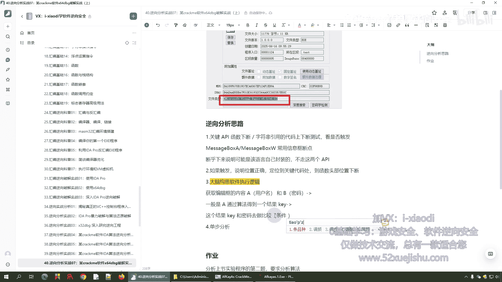

```text
A = 用户名
B = 密码
K = f(A)  // 对用户名运行某种哈希或变换算法
比较结果 = (K == B) ? 正确 : 错误
```

这个逻辑梳理出来之后，我们就清楚了：这个结果`K`一般来说会出现在哪里呢？肯定是做比较的那一行，对吧！那这个比较指令是什么东西呢？这个比较一般来说就是条件跳转的位置。所以我们就去尝试一下，这里就是一个条件跳转的位置。我们可以在比较指令旁边的跳转位置打一个断点，然后去点击OK按钮。这时候大家会发现，程序并没有在跳转处停下来，而且我们也看不到密码，为什么呢？实际上这个程序做了一步字符串清空的操作，看到没有？这里面有一个`free`之类的调用，它在比较之前先把存放密码的内存空间释放掉了，所以我们在这个位置下断点是看不到密码的。既然看不到，我们就得再往上找一点，再往上找，你会看到这里有一个`strcmp`指令。看`strcmp`这个名字你就明白了，它就是字符串比较函数，专门用来比较两段字符串是否相同的。好，那我们就在这个`strcmp`函数上下一个断点，这一次我们重新运行程序。然后点击OK按钮，看到没有？这一次，密码就清晰地显示在内存窗口里了，内容是一串类似`AKA-`开头的字符。我们把这串字符抄下来，取消断点，重新运行程序，在密码框中填入这串字符，点击OK，程序就成功弹出了"You got it"的窗口。

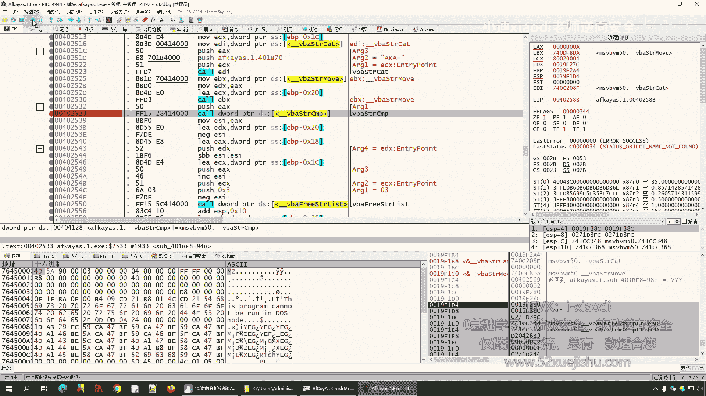

## 📝 课后作业与总结

本节课的内容到这里就接近尾声了，最后给大家布置一个作业。作业内容是：分析上一节课实验程序中的第二道题目。这个第二题也在实验程序里，要求是分析出它的验证算法，而不是使用暴力破解的方法。暴力破解太没有技术含量了，我们这一次的目标是彻底弄懂它的算法逻辑。请大家结合今天讲过的字符串比较和逻辑梳理方法，去尝试推导出正确的密码生成规则。

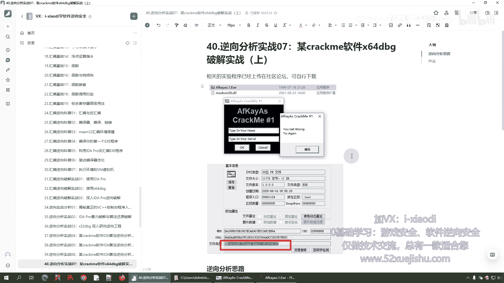

好的，最后我们来总结一下。本节课中，我们一起学习了如何对一个VB编写的密码验证程序进行逆向破解。我们从程序运行后的弹窗提示入手，梳理出了两条分析思路：关键API下断和字符串引用追踪。在实践中，我们发现了VB程序自封装消息框的特性，导致API断点失效，于是转而使用字符串引用成功定位了关键代码。接着，我们通过修改条件跳转指令（`NOP`填充）实现了破解，并且从错误提示反推出正确逻辑的第二条破解路径也得到了验证。我们还讨论了破解失败的排查思路，包括检查代码是否执行和单步跟踪执行过程。最后，通过逻辑梳理，我们将程序的验证过程抽象为一个公式——用户名经过算法生成结果，再与密码比较——并通过在`strcmp`函数上下断，成功获取了正确的密码。希望这节课的内容能帮助大家建立起逆向分析的基本思路，我们下节课再见。
