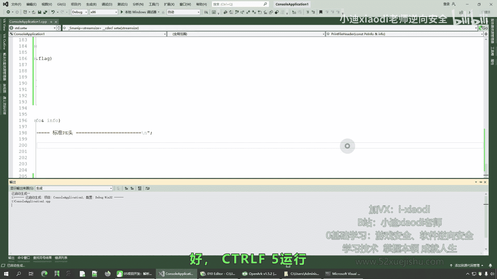
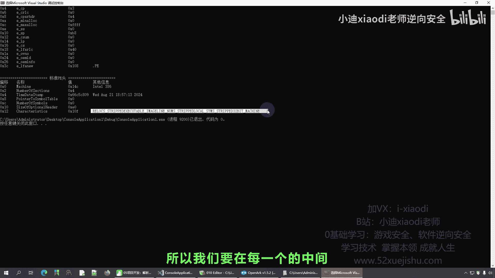
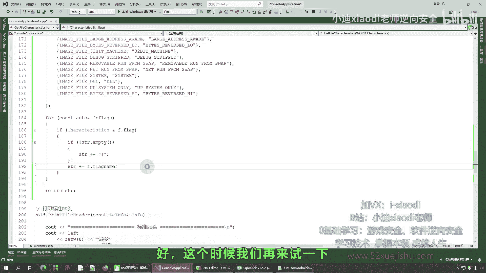
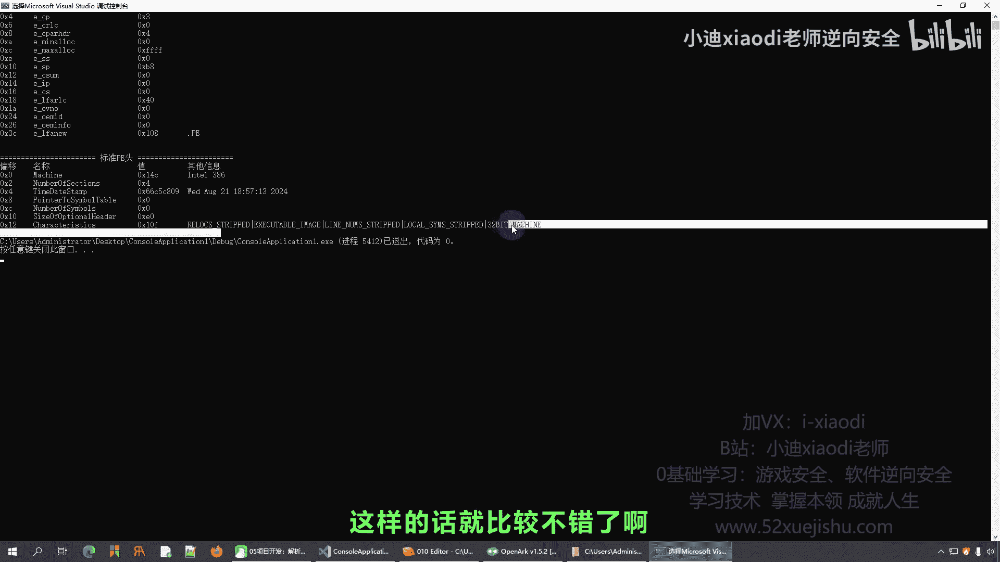
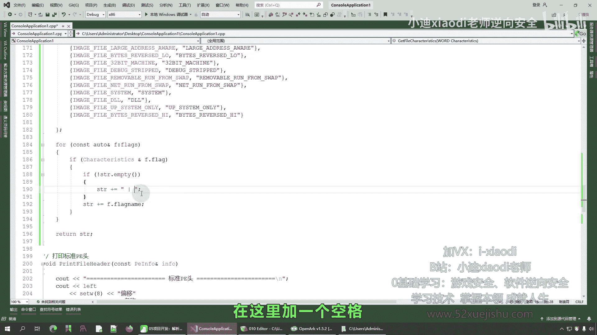
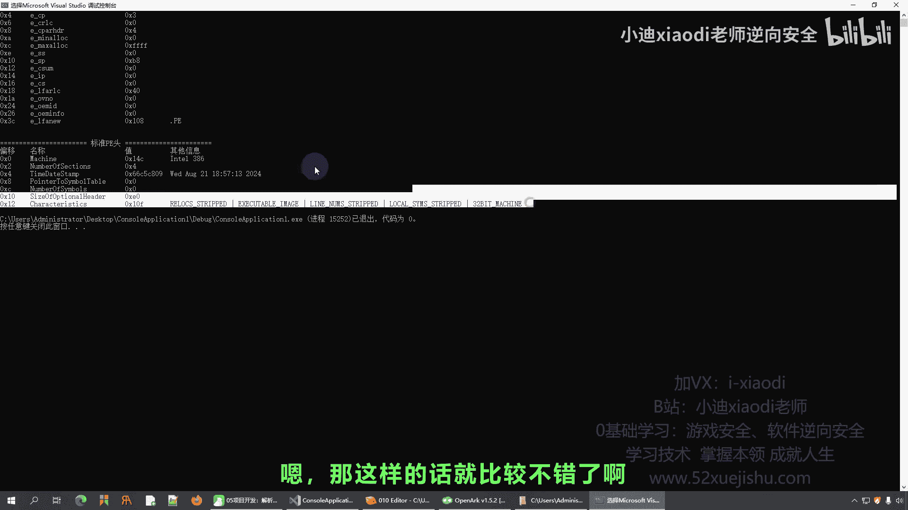
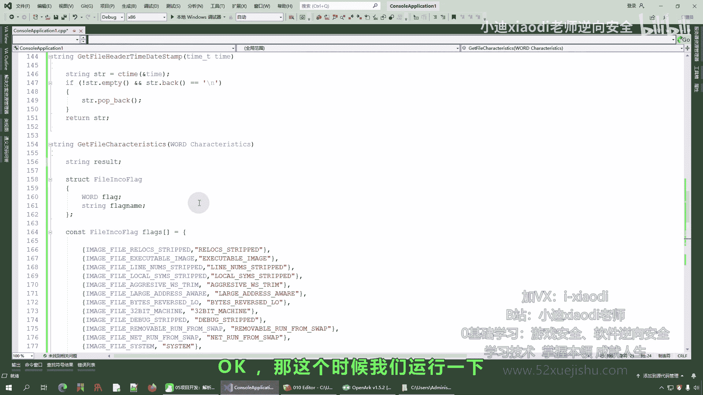
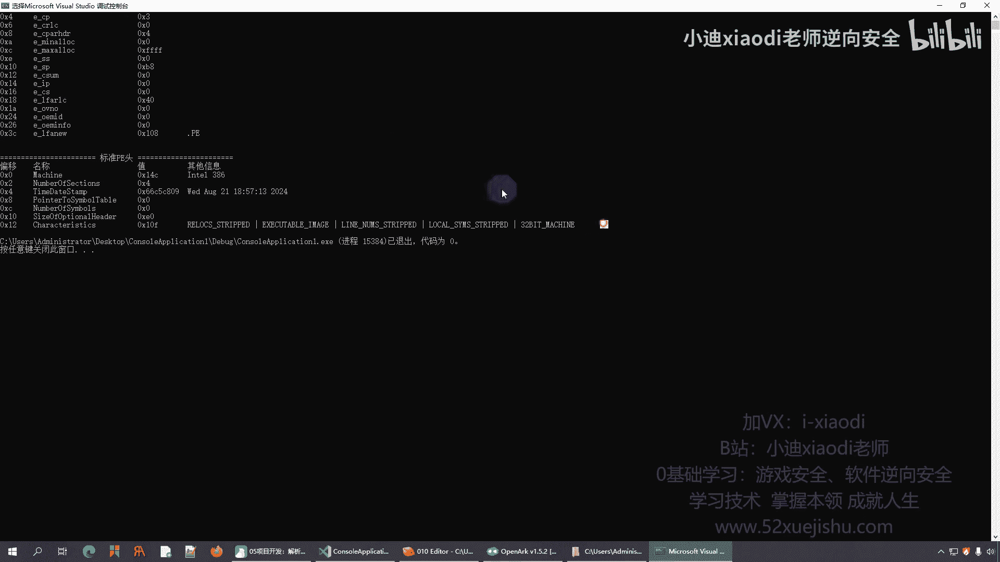
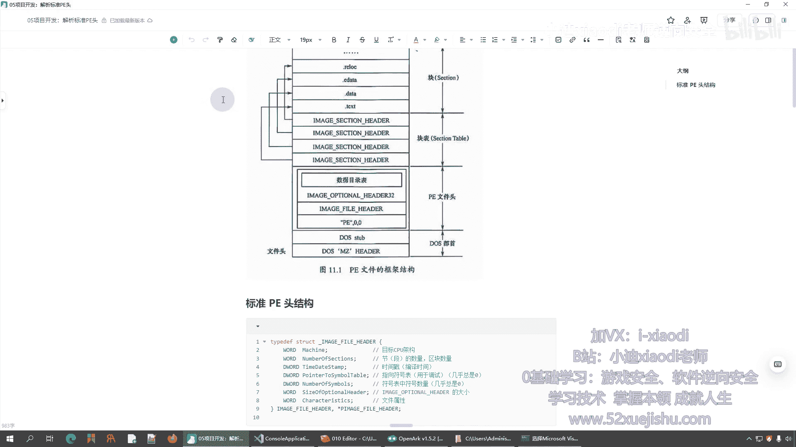

# 💻 C/C++项目开发：05：解析标准PE头

本节课我们将学习如何解析标准 PE 头（IMAGE_FILE_HEADER）。上节课中已经实现了解析并打印 DOS 头，本节课需要继续沿着 PE 文件结构往下走，把 PE 标记后面的标准 PE 头逐字段解析出来，并输出成容易阅读的信息。整个过程中会涉及 `offsetof` 宏的使用、常用字段的十六进制值、时间戳的转换，以及利用按位与运算解析特征值。对于初学者来说，这些内容看起来很多，但实际上每一步都很机械，只要按照流程操作，就能得到和常用 PE 工具一致的结果。

## 📁 回顾 DOS 头解析

在开始今天的内容之前，先回顾一下上节课完成的工作。上节课讲解了如何去解析并打印 DOS 头。运行项目时，按下 Ctrl+F5，可以看到程序输出的 DOS 头信息，整体排列是非常美观的。DOS 头解析完成之后，下一步自然就是处理紧随其后的标准 PE 头。这样的递进关系很容易理解，因为 PE 文件本身就是按顺序排列的。

## 🔍 标准 PE 头在哪里

标准 PE 头位于 PE 标记的后面，也就是说，DOS 头之后会有四字节的 PE 签名，签名之后紧接着的就是标准 PE 头。这个结构体的名称叫做 `IMAGE_FILE_HEADER`。本节的目标就是把这个结构体中的每个成员都解析出来，并打印到屏幕上。

解析的第一步仍然是调用打印输出函数。这个函数需要传入几个参数，其中第一个参数是偏移量。获取偏移量可以直接使用 `offsetof` 宏，具体的写法是 `offsetof(IMAGE_FILE_HEADER, 成员名)`。如果记不清结构体里有哪些成员，可以在代码编辑器中点击鼠标右键，然后选择“转到定义”，或者使用“快速定义”功能查看。

下面是调用打印函数并获取 `Machine` 字段偏移量的示意代码：

```cpp
forPrint(offsetof(IMAGE_FILE_HEADER, Machine), "Machine", nFileHeader.Machine);
```

这里的 `nFileHeader` 是通过 `NtHeader.FileHeader` 得到的标准 PE 头结构体。运行后可以看到输出的值为 `0x14C`，这个值与 openK 工具里输出的数据是一致的。

## 🔢 逐个解析标准 PE 头成员

接下来需要把 `IMAGE_FILE_HEADER` 结构体中的每一个成员都解析出来。下面是需要处理的成员列表：

- `Machine`：目标 CPU 架构
- `NumberOfSections`：节区数量
- `TimeDateStamp`：时间戳
- `PointerToSymbolTable`：符号表指针
- `NumberOfSymbols`：符号数量
- `SizeOfOptionalHeader`：可选头大小
- `Characteristics`：文件特征值

下面分成几个小节来操作。每个字段的处理方式都不一样，有的只需要直接打印，有的需要额外转换，有的需要按位与运算，所以我们要一个一个来看。

### 🖥️ 解析 Machine 字段

`Machine` 字段表示目标 CPU 的架构。查看这个字段时，输出结果虽然已经有了十六进制值，但除此之外它还可以显示更多的其他信息。为了知道不同数值代表什么含义，可以在代码中右键点击 `Machine` 成员，然后转到定义，会看到下面列出了大量 `Machine` 的定义。常用的定义有 `0x14C`，它对应英特尔 386 架构，还有 `0x8664`，它对应 AMD64 架构。当然，如果想把所有机器类型都写进去也是可以的，不过这里只需要写几个常见的作为示例。

为了把数值转换成可读的架构名称，可以单独写一个函数。函数名叫 `GetMachineTypeName`，参数类型要和 `Machine` 的数据类型一致。`Machine` 的类型是 `WORD`，所以参数也要填 `WORD`，参数名可以叫 `machine`。函数内部使用 `switch` 语句判断 `machine` 的值。第一个常见情况是 `0x14C`，返回字符串 `Intel 386`；第二个常见情况是 `0x8664`，返回字符串 `AMD64`。其他情况统一返回 `N/A`。对应的代码如下：

```cpp
string GetMachineTypeName(WORD machine)
{
    switch (machine)
    {
    case 0x14C:
        return "Intel 386";
    case 0x8664:
        return "AMD64";
    default:
        return "N/A";
    }
}
```

写好之后，在打印 `Machine` 字段时调用这个函数，把 `Machine` 的值传进去。再次运行 Ctrl+F5，就可以看到 `0x14C` 对应的信息是 `Intel 386`，和这个工具里面显示的内容是一样的。为了让代码更清晰，可以在函数上方加一行注释，例如“获取目标 CPU 架构”。

### 🧩 解析 NumberOfSections 字段

接下来的成员是 `NumberOfSections`，表示节区的数量。这个字段本身比较简单，不需要额外转换。只需要在打印函数的参数中把成员名称替换成 `NumberOfSections`，再复制出相应的偏移量和值即可。用 Ctrl+F5 运行程序，看到输出结果与工具中的数值一致。这里没有太多需要解释的地方，按照标准流程做就可以。

### 🕒 解析 TimeDateStamp 字段

再接下来是 `TimeDateStamp`，这个字段是时间戳。直接把成员打印出来时，输出结果是一个十六进制值，例如 `0x66C5C809`，这个值和工具中显示的对得上。但为了让程序更加强大，可以对这个时间戳做进一步处理。之前已经讲过，`TimeDateStamp` 是可以进行时间转换的，使用的是 C 标准库中的 `ctime` 函数。这种转换在实际开发中非常有用，因为原始时间戳本身并不适合人类阅读。

因此，可以再写一个函数，因为它是标准 PE 头里的内容，所以命名为 `GetFileTimeDateStamp`。需要接收的参数类型和 `TimeDateStamp` 的类型一致，`TimeDateStamp` 的类型是 `DWORD`，所以参数类型写 `DWORD`，参数名可以叫 `time`。函数内部先调用 `ctime` 函数，给它传入一个指针，也就是需要取参数的地址。不过编译时可能会提示类型与 `time_t` 的形参不兼容，这时把参数类型改成 `time_t` 即可。示例代码如下：

```cpp
string GetFileTimeDateStamp(time_t time)
{
    return ctime(&time);
}
```

调用这个函数，再把 `TimeDateStamp` 传进去，然后运行 Ctrl+F5，可以看到时间转换功能已经生效。但这时会发现一个问题，输出结果后面多了一个空行，这是因为 `ctime` 函数返回的字符串本身就带有一个换行符。为了解决这个问题，需要借助 `string` 类型来处理。

处理的方法是：先用 `string` 把 `ctime` 的结果保存起来，然后判断这个字符串是否为空。如果字符串不为空，并且字符串的结尾是换行符，就执行 `pop_back` 操作，把末尾的换行符弹出去。最后再把处理过的字符串返回出去。代码可以这样写：

```cpp
string GetFileTimeDateStamp(time_t time)
{
    string str = ctime(&time);
    if (!str.empty() && str.back() == '\n')
    {
        str.pop_back();
    }
    return str;
}
```

这样运行之后，之前的空行就被处理掉了。整个输出看起来自然多了，也不会有奇怪的多余空行。

### 📄 解析 PointerToSymbolTable 和 NumberOfSymbols

下一个需要解析的成员是 `PointerToSymbolTable`。这个字段指向符号表的起始位置，解析方式和前面类似，只需要把打印函数的参数换成 `PointerToSymbolTable` 即可。复制粘贴代码之后，删除多余的参数，运行程序，可以看到输出结果没有问题。

再下一个成员是 `NumberOfSymbols`，表示符号的数量。这个字段更简单，之前就解析过类似的内容，直接把相关代码粘贴过来，替换成 `NumberOfSymbols`，运行一下，输出结果没有任何问题。这两个字段处理起来都比较直接，不需要太多的逻辑判断。

### ⚙️ 解析 SizeOfOptionalHeader 字段

然后要解析的是 `SizeOfOptionalHeader`，表示可选头的大小。这个字段也比较简单，照着原样写一份就可以了。运行程序后可以看到输出结果，和工具中的值一致，没有出现任何问题。不过要注意的是，这个字段的值会影响到后续解析可选头时的偏移量，所以对它保持清楚的认识是很有必要的。

### 🏷️ 解析 Characteristics 字段

接下来是 `Characteristics` 字段，这个字段稍微复杂一点。直接输出这个字段后，再运行程序，可以看到输出结果本身没有什么问题。但为了更好地阅读，需要给这个字段添加一些描述信息。常见的 PE 工具里会显示这个文件是一个可执行程序，并且是 32 位架构。这类判断依赖于微软在头文件中定义的一组宏，我们只需要对这些宏进行按位与运算，就能得到关键信息。

因此，这里需要编写一个函数，命名为 `GetFileCharacteristics`。函数参数的类型和 `Characteristics` 一致，`Characteristics` 的类型是 `WORD`，所以参数类型写 `WORD`，参数名可以叫 `characteristics`。函数最后要返回一个字符串，因此先定义一个字符串对象，然后等待处理。

`Characteristics` 可能的值有哪些呢？在代码中右键点击 `Characteristics` 成员，转到定义，可以看到很多宏定义，例如重定位、可执行文件、系统文件等。这些属性刚好是一个值对应一个名称，所以用 `switch` 处理不太方便，更好的方式是用一个简单的结构体数组来保存这些对应关系。结构体可以这样设计：



```cpp
struct FileInfoFlag
{
    WORD flag;
    string flagName;
};
```



然后创建一个结构体数组，把每个特征值对应的名称都填进去。为了方便编写，可以先把宏定义复制到注释里，然后再逐个填入数组中。下面是一个简化的示例：

```cpp
FileInfoFlag flags[] =
{
    { IMAGE_FILE_RELOCS_STRIPPED, "RELOCS_STRIPPED" },
    { IMAGE_FILE_EXECUTABLE_IMAGE, "EXECUTABLE_IMAGE" },
    { IMAGE_FILE_32BIT_MACHINE, "32BIT_MACHINE" },
    // 其他特征值依次添加
};
```



数据准备好之后，就需要做运算了。这里要遍历数组里的每一个元素，将 `characteristics` 和当前元素的 `flag` 做按位与运算。如果运算结果为真，就说明该特征存在，这时把对应的 `flagName` 追加到返回字符串中。如果结果为假，则继续判断下一个。最终返回拼接好的字符串。



为了让输出看起来清晰，不同特征之间需要用下划线或空格分隔。在最开始的地方不能有下划线，所以在追加字符串之前要先判断当前字符串是否为空。如果字符串不为空，就先追加一个下划线，再追加特征名。追加完成后，还要在最后加一个空格，避免所有名称挤在一起。如果最终字符串为空，说明没有匹配到任何特征，此时可以返回 `N/A`。



对应的代码如下：



```cpp
string GetFileCharacteristics(WORD characteristics)
{
    string result;
    for (int i = 0; i < sizeof(flags) / sizeof(flags[0]); i++)
    {
        if (characteristics & flags[i].flag)
        {
            if (!result.empty())
            {
                result += "_";
            }
            result += flags[i].flagName;
        }
    }
    if (result.empty())
    {
        return "N/A";
    }
    return result + " ";
}
```

调用这个函数，把 `Characteristics` 传进去，然后按下 Ctrl+F5 运行。可以看到输出变成了可读的特征名称，例如 `RELOCS_STRIPPED EXECUTABLE_IMAGE 32BIT_MACHINE`，每个名称之间用下划线和空格分开，看起来清晰很多。最后还可以对函数进行一点优化，把原来的 `str` 变量改名为 `result`，这样语义更明确。例如判断 `result` 是否为空，以及把 `result` 返回出去。这样的变量名读起来更自然，也方便以后维护。





## 🧠 总结



本节课中我们一起学习了如何解析标准 PE 头。首先回顾了 DOS 头的解析结果，然后使用 `offsetof` 宏定位 `IMAGE_FILE_HEADER` 结构体中的各个成员。接着逐个解析了 `Machine`、`NumberOfSections`、`TimeDateStamp`、`PointerToSymbolTable`、`NumberOfSymbols`、`SizeOfOptionalHeader` 和 `Characteristics` 字段。其中 `Machine` 通过 `GetMachineTypeName` 函数转换为 CPU 架构名称，`TimeDateStamp` 通过 `ctime` 函数转换为可读的时间字符串，并处理了多余的换行符，`Characteristics` 则通过结构体数组和按位与运算转化为特征描述。对于初学者来说，掌握这些步骤后，就能独立完成标准 PE 头的解析输出，也为后续解析可选头打下了基础。

