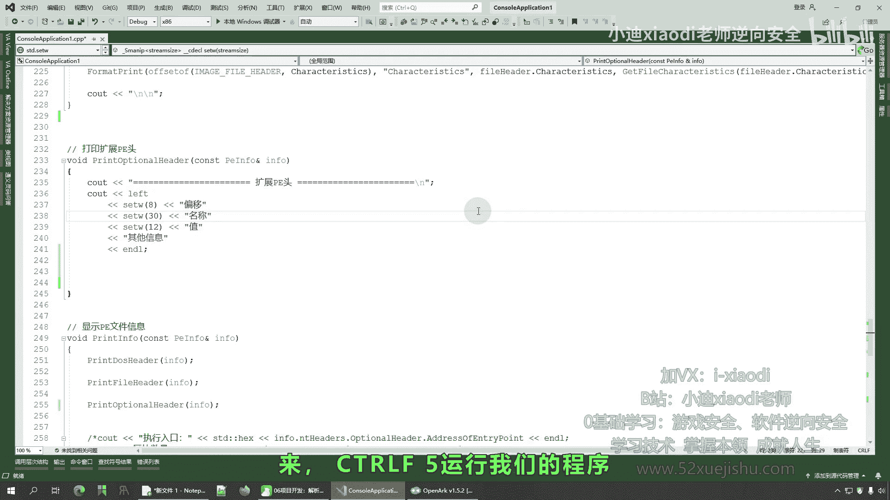
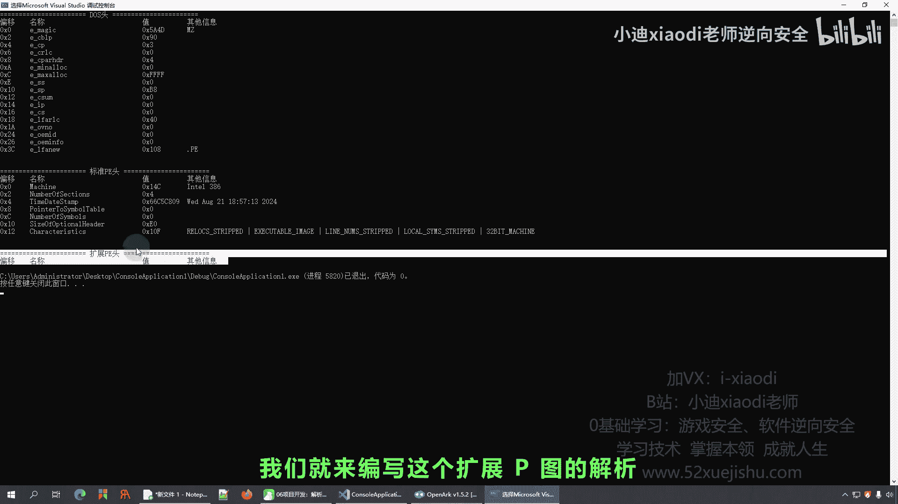
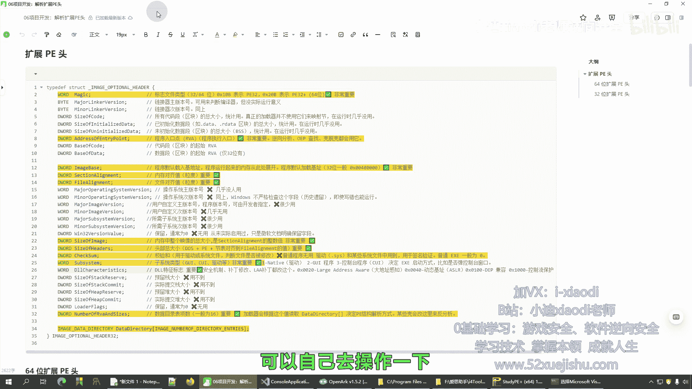

# 🧩 保姆级PE文件结构：C/C++项目开发06：解析扩展PE头

## 📘 课程概述

本节课将学习如何解析PE文件中的扩展PE头，也就是 `IMAGE_OPTIONAL_HEADER` 结构。

上一节课已经完成了标准PE头的解析。本节课将在此基础上继续编写代码，读取扩展PE头中的各项信息，包括：

- `Magic`：判断PE文件是32位还是64位；
- `Subsystem`：判断程序属于驱动程序、GUI程序还是控制台程序；
- 扩展PE头中的其他字段；
- 数据目录表和入口点字段的后续解析安排。

PE文件结构内容较多，因此本节课先完成扩展PE头的基础解析，数据目录表和区段信息将在后续课程中单独讲解。


## 🧱 一、回顾PE文件的整体结构

上一节课已经完成了标准PE头的解析，并且可以通过 `Ctrl + F5` 运行程序，查看当前的解析效果。

本节课继续解析扩展PE头。PE文件的整体结构可以简单理解为以下顺序：

```text
DOS头
  ↓
PE标志
  ↓
标准PE头
  ↓
扩展PE头
  ↓
数据目录表
  ↓
区段表
  ↓
各个区段的数据
```

其中，扩展PE头位于标准PE头之后。扩展PE头中还包含数据目录表，但数据目录表的具体解析内容较多，因此后续会单独安排一节课进行讲解。

上一节我们已经完成了标准PE头的读取，本节就从扩展PE头的结构开始。


## 🧩 二、认识扩展PE头结构

扩展PE头对应的结构体名称通常为：

```cpp
IMAGE_OPTIONAL_HEADER
```

需要注意的是，32位PE文件和64位PE文件的扩展PE头并不完全相同，但整体结构差异不大。

两者主要区别如下：

- 32位PE文件使用 `IMAGE_OPTIONAL_HEADER32`；
- 64位PE文件使用 `IMAGE_OPTIONAL_HEADER64`；
- 32位结构中包含 `BaseOfData` 字段；
- 64位结构中没有 `BaseOfData` 字段；
- 其他大部分字段的用途和排列方式基本一致。

可以用下面的关系表示：

```text
IMAGE_OPTIONAL_HEADER32
    = 32位扩展PE头
    + BaseOfData

IMAGE_OPTIONAL_HEADER64
    = 64位扩展PE头
    - BaseOfData
```

虽然32位和64位结构之间存在差异，但本节课不需要手动编写所有结构成员。因为当前要解析的字段并不涉及这个差异字段，所以可以参考工具的实现方式，只读取实际需要的内容。

一些官方或常用PE查看工具在显示32位扩展PE头时，也不会专门处理这个字段。因此，代码实现可以遵循以下原则：

> 工具中显示和解析了哪些内容，代码中就先实现哪些内容；当前不需要的字段暂时不编写。


## 🛠️ 三、调用扩展PE头解析函数

在主程序中，可以直接调用已经编写好的扩展PE头解析函数。

示例代码如下：

```cpp
ParseOptionalHeader();
```

如果项目中使用了类，也可以写成：

```cpp
peParser.ParseOptionalHeader();
```

扩展PE头的解析函数可以单独定义，函数名称可以根据项目实际情况命名，例如：

```cpp
void ParseOptionalHeader()
{
    // 解析扩展PE头
}
```

扩展PE头对应的结构体名称较长，直接重复书写会增加代码长度，也会降低代码的可读性。因此，可以使用引用变量保存扩展PE头结构。


## 🧮 四、使用引用变量读取扩展PE头

如果直接按照完整路径访问字段，代码可能类似于：

```cpp
ntHeader.OptionalHeader.Magic
```

这种写法虽然可以正常工作，但是当需要多次读取扩展PE头成员时，代码会显得比较长。

为了缩短代码，可以使用 `const auto&` 定义一个引用变量：

```cpp
const auto& optionalHeader = ntHeader.OptionalHeader;
```

这行代码可以拆开理解：

```cpp
const
```



表示这个引用变量不能修改原结构中的内容。

```cpp
auto
```

表示让编译器自动推导变量类型，不需要手动写出完整的结构体名称。



```cpp
&
```

表示使用引用，而不是复制整个结构体。

扩展PE头结构通常比较大，如果直接复制，会产生额外的复制开销。使用引用可以直接访问原结构中的数据，不需要重新复制，因此执行效率更高。

完整示例可以写成：

```cpp
const auto& optionalHeader = ntHeader.OptionalHeader;

std::cout << optionalHeader.Magic << std::endl;
```

之后访问扩展PE头成员时，就可以直接使用：

```cpp
optionalHeader.Magic
```

而不需要反复写完整的结构路径。

上一节我们已经了解了如何访问扩展PE头，本节接下来解析第一个重要字段：`Magic`。


## 🔍 五、解析Magic字段

`Magic` 字段用于判断PE文件是32位程序还是64位程序。

常见取值如下：

```cpp
#define IMAGE_NT_OPTIONAL_HDR32_MAGIC 0x10B
#define IMAGE_NT_OPTIONAL_HDR64_MAGIC 0x20B
```

对应关系如下：

| Magic值 | PE文件类型 |
|---|---|
| `0x10B` | 32位PE文件 |
| `0x20B` | 64位PE文件 |

可以使用条件判断语句进行解析：

```cpp
if (optionalHeader.Magic == IMAGE_NT_OPTIONAL_HDR32_MAGIC)
{
    std::cout << "PE32" << std::endl;
}
else if (optionalHeader.Magic == IMAGE_NT_OPTIONAL_HDR64_MAGIC)
{
    std::cout << "PE64" << std::endl;
}
else
{
    std::cout << "UNKNOWN" << std::endl;
}
```

这里的判断逻辑可以表示为：

```text
Magic == 0x10B → PE32
Magic == 0x20B → PE64
其他值         → UNKNOWN
```

其中，`0x10B` 和 `0x20B` 是微软头文件中已经定义好的常量。虽然直接使用数字也可以完成判断，但是使用宏名称更加直观。

推荐使用以下写法：

```cpp
if (optionalHeader.Magic == IMAGE_NT_OPTIONAL_HDR32_MAGIC)
{
    std::cout << "PE32";
}
```

不推荐把判断写成：

```cpp
if (optionalHeader.Magic == 0x10B)
{
    std::cout << "PE32";
}
```

原因是初学者看到 `0x10B` 和 `0x20B` 时，可能无法马上判断它们的含义，而看到 `IMAGE_NT_OPTIONAL_HDR32_MAGIC` 时，可以直接知道这是用于判断扩展PE头类型的常量。


## ⚡ 六、使用三元运算符简化判断

如果判断条件比较简单，也可以使用三元运算符减少代码量。

三元运算符的基本格式如下：

```cpp
条件 ? 条件成立时的结果 : 条件不成立时的结果
```

例如，可以先判断32位PE文件：

```cpp
const char* peType =
    optionalHeader.Magic == IMAGE_NT_OPTIONAL_HDR32_MAGIC
        ? "PE32"
        : "UNKNOWN";
```

如果还需要继续判断64位PE文件，可以嵌套使用三元运算符：

```cpp
const char* peType =
    optionalHeader.Magic == IMAGE_NT_OPTIONAL_HDR32_MAGIC
        ? "PE32"
        : optionalHeader.Magic == IMAGE_NT_OPTIONAL_HDR64_MAGIC
            ? "PE64"
            : "UNKNOWN";
```

其逻辑等价于：

```text
如果 Magic 等于 IMAGE_NT_OPTIONAL_HDR32_MAGIC
    返回 PE32
否则如果 Magic 等于 IMAGE_NT_OPTIONAL_HDR64_MAGIC
    返回 PE64
否则
    返回 UNKNOWN
```

也可以写成更紧凑的输出形式：

```cpp
std::cout
    << (optionalHeader.Magic == IMAGE_NT_OPTIONAL_HDR32_MAGIC
            ? "PE32"
            : optionalHeader.Magic == IMAGE_NT_OPTIONAL_HDR64_MAGIC
                ? "PE64"
                : "UNKNOWN")
    << std::endl;
```

这种写法适合处理返回值比较简单的情况。如果判断逻辑越来越复杂，建议重新使用 `if...else`，这样代码更容易阅读和调试。

运行32位程序时，输出结果应当类似于：

```text
PE32
```

运行64位程序时，输出结果应当类似于：

```text
PE64
```

这样，`Magic` 字段的解析就完成了。


## 🖥️ 七、解析Subsystem字段

除了 `Magic` 字段之外，扩展PE头中还有一个比较典型的字段，即：

```cpp
Subsystem
```

`Subsystem` 用于表示PE文件的运行子系统类型。常见取值如下：

| Subsystem值 | 含义 |
|---|---|
| `1` | Native程序，通常用于驱动或系统级程序 |
| `2` | Windows GUI程序 |
| `3` | Windows控制台程序 |

可以用下面的关系理解：

```text
Subsystem == 1 → NATIVE
Subsystem == 2 → WINDOWS GUI
Subsystem == 3 → WINDOWS CUI
其他值         → UNKNOWN
```

其中，GUI表示图形界面程序，CUI表示控制台程序。


## 🧪 八、编写Subsystem判断代码

可以使用普通的 `if...else` 语句判断 `Subsystem`：

```cpp
if (optionalHeader.Subsystem == 1)
{
    std::cout << "NATIVE" << std::endl;
}
else if (optionalHeader.Subsystem == 2)
{
    std::cout << "WINDOWS GUI" << std::endl;
}
else if (optionalHeader.Subsystem == 3)
{
    std::cout << "WINDOWS CUI" << std::endl;
}
else
{
    std::cout << "UNKNOWN" << std::endl;
}
```

也可以使用三元运算符进行简化：

```cpp
const char* subsystemName =
    optionalHeader.Subsystem == 1
        ? "NATIVE"
        : optionalHeader.Subsystem == 2
            ? "WINDOWS GUI"
            : optionalHeader.Subsystem == 3
                ? "WINDOWS CUI"
                : "UNKNOWN";
```

输出结果可以写成：

```cpp
std::cout << subsystemName << std::endl;
```

如果当前程序是图形界面程序，输出结果通常为：

```text
WINDOWS GUI
```

如果当前程序是控制台程序，输出结果通常为：

```text
WINDOWS CUI
```

如果加载的是驱动程序，输出结果通常为：

```text
NATIVE
```

需要注意，`Subsystem` 只表示PE文件声明的运行子系统，不能仅凭这个字段判断程序具体实现了哪些功能。它只是PE头中的一个分类信息。


## 🚗 九、测试不同类型的PE文件

完成 `Subsystem` 的解析后，可以通过多个不同类型的文件进行测试。

首先运行当前编写的普通界面程序，检查输出是否为：

```text
WINDOWS GUI
```

然后可以寻找一个驱动程序进行测试。驱动程序通常使用 `.sys` 文件扩展名。

测试步骤可以按以下方式进行：

1. 找到一个驱动程序文件；

2. 复制该文件的完整路径；

3. 将路径传入PE解析程序；

4. 运行程序并查看 `Subsystem` 输出；

5. 同时检查 `Magic` 字段是否正确识别了32位或64位类型。

如果测试文件是驱动程序，输出应当类似于：

```text
NATIVE
PE64
```

这说明程序已经正确判断出：

- 该文件属于Native类型；
- 该文件是64位PE文件。

测试完成后，可以恢复原来的普通界面程序路径，继续检查GUI程序的解析结果。


## 🧾 十、使用系统定义的常量

前面的代码中直接使用了数字：

```cpp
1
2
3
```

这种写法可以运行，但可读性不够好。为了让代码更容易理解，可以使用Windows头文件中定义的常量。

例如：

```cpp
IMAGE_SUBSYSTEM_NATIVE
IMAGE_SUBSYSTEM_WINDOWS_GUI
IMAGE_SUBSYSTEM_WINDOWS_CUI
```

推荐改写为：

```cpp
if (optionalHeader.Subsystem == IMAGE_SUBSYSTEM_NATIVE)
{
    std::cout << "NATIVE" << std::endl;
}
else if (optionalHeader.Subsystem == IMAGE_SUBSYSTEM_WINDOWS_GUI)
{
    std::cout << "WINDOWS GUI" << std::endl;
}
else if (optionalHeader.Subsystem == IMAGE_SUBSYSTEM_WINDOWS_CUI)
{
    std::cout << "WINDOWS CUI" << std::endl;
}
else
{
    std::cout << "UNKNOWN" << std::endl;
}
```

使用常量的好处是，代码不需要依赖记忆。例如，看到下面这行代码时：

```cpp
optionalHeader.Subsystem == IMAGE_SUBSYSTEM_WINDOWS_GUI
```

可以直接看出它是在判断Windows图形界面程序，而不需要再回忆数字 `2` 代表什么。

同样，`Magic` 字段也建议使用系统定义的常量：

```cpp
IMAGE_NT_OPTIONAL_HDR32_MAGIC
IMAGE_NT_OPTIONAL_HDR64_MAGIC
```

这样可以提高代码的可读性，也可以减少因为数字写错导致的判断错误。


## 🧮 十一、扩展PE头中其他字段的解析

扩展PE头中除了 `Magic` 和 `Subsystem` 之外，还有许多其他成员。

常见字段包括：

```cpp
optionalHeader.MajorLinkerVersion
optionalHeader.MinorLinkerVersion
optionalHeader.SizeOfCode
optionalHeader.SizeOfInitializedData
optionalHeader.SizeOfUninitializedData
optionalHeader.AddressOfEntryPoint
optionalHeader.BaseOfCode
optionalHeader.ImageBase
optionalHeader.SectionAlignment
optionalHeader.FileAlignment
optionalHeader.SizeOfImage
optionalHeader.SizeOfHeaders
optionalHeader.CheckSum
optionalHeader.SizeOfStackReserve
optionalHeader.SizeOfStackCommit
optionalHeader.SizeOfHeapReserve
optionalHeader.SizeOfHeapCommit
optionalHeader.NumberOfRvaAndSizes
```

这些字段涉及文件布局、内存对齐、镜像基址、代码大小、堆栈大小以及数据目录数量等内容。

部分字段还需要进行地址换算和偏移计算。例如，RVA、文件偏移、虚拟地址之间需要根据区段信息进行转换。相关计算会在后续解析区段表时详细讲解。

当前可以先按照前面的方法，逐个读取字段并输出：

```cpp
std::cout << "ImageBase: "
          << std::hex
          << optionalHeader.ImageBase
          << std::endl;
```

如果字段数量比较多，也可以单独封装输出函数，使主解析函数更加清晰：

```cpp
void PrintOptionalHeader(const IMAGE_OPTIONAL_HEADER32& optionalHeader)
{
    std::cout << "Magic: " << optionalHeader.Magic << std::endl;
    std::cout << "Subsystem: " << optionalHeader.Subsystem << std::endl;
    std::cout << "AddressOfEntryPoint: "
              << optionalHeader.AddressOfEntryPoint
              << std::endl;
}
```

这一部分可以作为练习，由读者自行补充其他字段的输出代码。


## 📊 十二、数据目录表的处理安排

扩展PE头中还包含数据目录表。

数据目录表用于记录PE文件中许多重要数据的位置，例如：

- 导出表；
- 导入表；
- 资源表；
- 异常表；
- 安全表；
- 重定位表；
- 调试信息；
- TLS表；
- 延迟导入表；
- CLR运行时信息。

数据目录表通常通过以下成员进行访问：

```cpp
optionalHeader.DataDirectory
```

其中，数据目录表的数量通常由以下字段决定：

```cpp
optionalHeader.NumberOfRvaAndSizes
```

可以用公式表示为：

```text
数据目录表有效数量
    = NumberOfRvaAndSizes
```

每个数据目录项通常包含两个核心字段：

```cpp
VirtualAddress
Size
```

它们分别表示数据目录对应内容的RVA和大小：

```text
数据目录项 = VirtualAddress + Size
```

数据目录表涉及的内容较多，尤其是导入表和导出表的解析，需要结合RVA转换和区段信息。因此，本节暂时不展开，后续会专门讲解数据目录表的读取方法。


## 🚪 十三、AddressOfEntryPoint字段

扩展PE头中还有一个重要字段：

```cpp
AddressOfEntryPoint
```

它表示程序入口点的RVA，也就是程序开始执行的位置。

可以先输出这个字段：

```cpp
std::cout << "AddressOfEntryPoint: 0x"
          << std::hex
          << optionalHeader.AddressOfEntryPoint
          << std::endl;
```

不过，仅仅知道入口点RVA，还不能直接确定入口点位于哪个区段。

原因是入口点通常保存的是RVA，而区段表中记录的是每个区段的起始RVA和大小。需要将入口点RVA与区段范围进行比较。

判断逻辑可以表示为：

```text
Section.VirtualAddress
    <= AddressOfEntryPoint
    <
Section.VirtualAddress + Section.VirtualSize
```

如果入口点RVA满足上述条件，就可以确定入口点位于该区段中。

也就是说，入口点区段的判断需要依赖区段表：

```cpp
if (entryPointRva >= section.VirtualAddress &&
    entryPointRva < section.VirtualAddress + section.Misc.VirtualSize)
{
    // 入口点位于当前区段
}
```

因此，本节先保留 `AddressOfEntryPoint` 字段的读取，入口点所属区段的具体判断放到后续解析区段表时完成。


## ✅ 十四、完整解析思路

到目前为止，扩展PE头的基础解析流程可以整理为以下步骤。下面的列表概括了整个实现过程：

1. 获取PE文件的NT头；

2. 获取NT头中的扩展PE头；

3. 使用 `const auto&` 保存扩展PE头引用；

4. 读取 `Magic` 字段；

5. 根据 `Magic` 判断PE32或PE64；

6. 读取 `Subsystem` 字段；

7. 根据 `Subsystem` 判断Native、GUI或CUI程序；

8. 输出其他扩展PE头成员；

9. 暂时保留数据目录表，等待后续课程解析；

10. 读取 `AddressOfEntryPoint`，等待区段解析完成后判断入口点所属区段。

对应的代码结构可以写成：

```cpp
const auto& optionalHeader = ntHeader.OptionalHeader;

const char* peType =
    optionalHeader.Magic == IMAGE_NT_OPTIONAL_HDR32_MAGIC
        ? "PE32"
        : optionalHeader.Magic == IMAGE_NT_OPTIONAL_HDR64_MAGIC
            ? "PE64"
            : "UNKNOWN";

const char* subsystemType =
    optionalHeader.Subsystem == IMAGE_SUBSYSTEM_NATIVE
        ? "NATIVE"
        : optionalHeader.Subsystem == IMAGE_SUBSYSTEM_WINDOWS_GUI
            ? "WINDOWS GUI"
            : optionalHeader.Subsystem == IMAGE_SUBSYSTEM_WINDOWS_CUI
                ? "WINDOWS CUI"
                : "UNKNOWN";

std::cout << "PE Type: " << peType << std::endl;
std::cout << "Subsystem: " << subsystemType << std::endl;

std::cout << "AddressOfEntryPoint: 0x"
          << std::hex
          << optionalHeader.AddressOfEntryPoint
          << std::endl;
```

这段代码完成了当前阶段最核心的功能：识别PE文件位数、识别程序子系统，并输出程序入口点RVA。


## 📝 十五、本节课练习内容

前面的基础代码已经完成。为了进一步熟悉扩展PE头结构，可以继续补充其他字段。

下面是建议完成的练习内容：

- 输出 `ImageBase`；

- 输出 `SectionAlignment`；

- 输出 `FileAlignment`；

- 输出 `SizeOfImage`；

- 输出 `SizeOfHeaders`；

- 输出 `CheckSum`；

- 输出 `NumberOfRvaAndSizes`；

- 输出 `AddressOfEntryPoint`；

- 对32位和64位PE文件分别进行测试；

- 对GUI程序、控制台程序和驱动程序分别进行测试。

测试时需要注意不同字段的显示格式。例如，地址和RVA通常适合使用十六进制输出：

```cpp
std::cout << std::hex;
```

而某些大小和数量字段使用十进制更直观：

```cpp
std::cout << std::dec;
```

可以根据字段含义切换输出格式：

```cpp
std::cout << "ImageBase: 0x"
          << std::hex
          << optionalHeader.ImageBase
          << std::endl;

std::cout << "SizeOfImage: "
          << std::dec
          << optionalHeader.SizeOfImage
          << std::endl;
```


## 🎯 十六、下一节课内容

本节课已经完成了扩展PE头的基础解析，包括 `Magic`、`Subsystem` 和 `AddressOfEntryPoint` 等字段。

下一节课将重点解析数据目录表：

```cpp
optionalHeader.DataDirectory
```

后续还会继续处理：

- 数据目录表的结构；
- 导入表；
- 导出表；
- 资源表；
- 重定位表；
- RVA到文件偏移的转换；
- 入口点所在区段的判断。

这些内容会和区段表解析结合起来使用。只有掌握区段范围和RVA转换，才能进一步准确定位PE文件中的导入函数、导出函数以及其他关键数据。


## 📚 本节课总结

本节课我们学习了如何解析PE文件的扩展PE头。

核心内容可以总结如下：

```text
扩展PE头
    ↓
读取 Magic
    ↓
判断 PE32 或 PE64
    ↓
读取 Subsystem
    ↓
判断 Native、GUI 或 CUI
    ↓
读取其他扩展PE头字段
    ↓
暂时保留数据目录表和区段相关计算
```

本节课还学习了以下代码技巧：

```cpp
const auto& optionalHeader = ntHeader.OptionalHeader;
```

这行代码通过引用直接访问扩展PE头，避免复制较大的结构体。

同时，还学习了使用三元运算符进行简单分类判断：



```cpp
条件1 ? 结果1 : 条件2 ? 结果2 : 默认结果
```

最后，需要记住几个关键对应关系：

```text
Magic == IMAGE_NT_OPTIONAL_HDR32_MAGIC → PE32
Magic == IMAGE_NT_OPTIONAL_HDR64_MAGIC → PE64

Subsystem == IMAGE_SUBSYSTEM_NATIVE      → Native程序
Subsystem == IMAGE_SUBSYSTEM_WINDOWS_GUI  → Windows GUI程序
Subsystem == IMAGE_SUBSYSTEM_WINDOWS_CUI  → Windows控制台程序
```

本节课完成了扩展PE头的基础解析，为后续解析数据目录表、区段表、导入表和入口点位置打下了基础。

