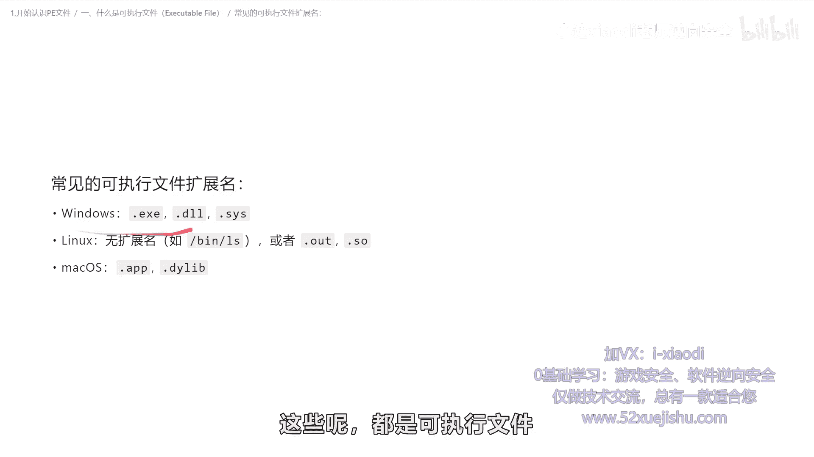
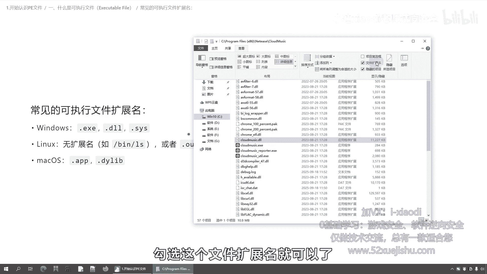
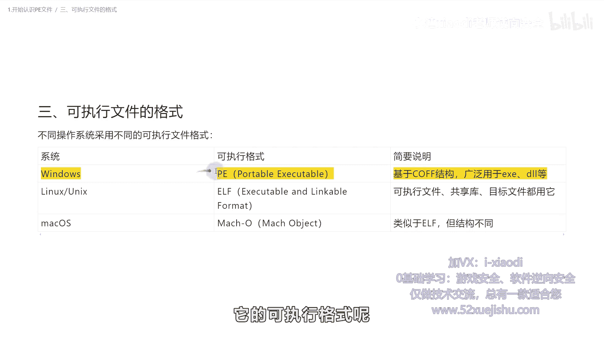
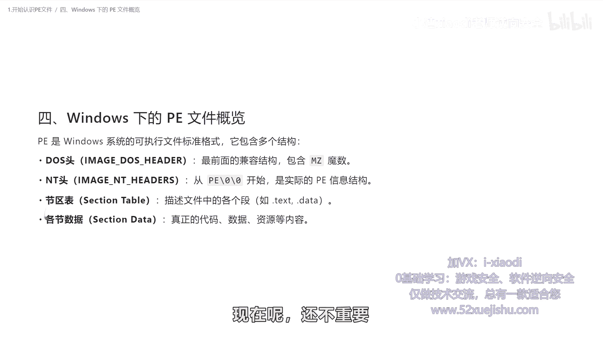
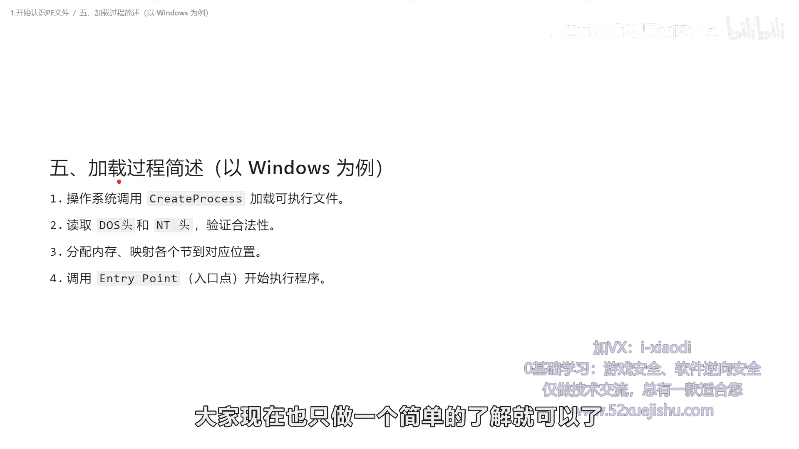
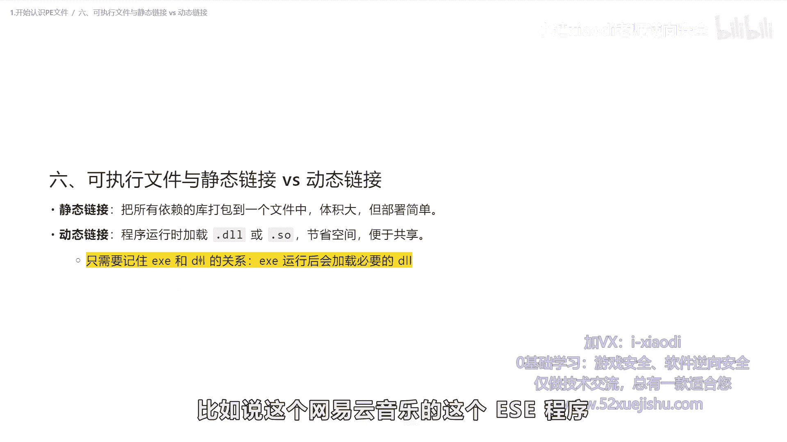
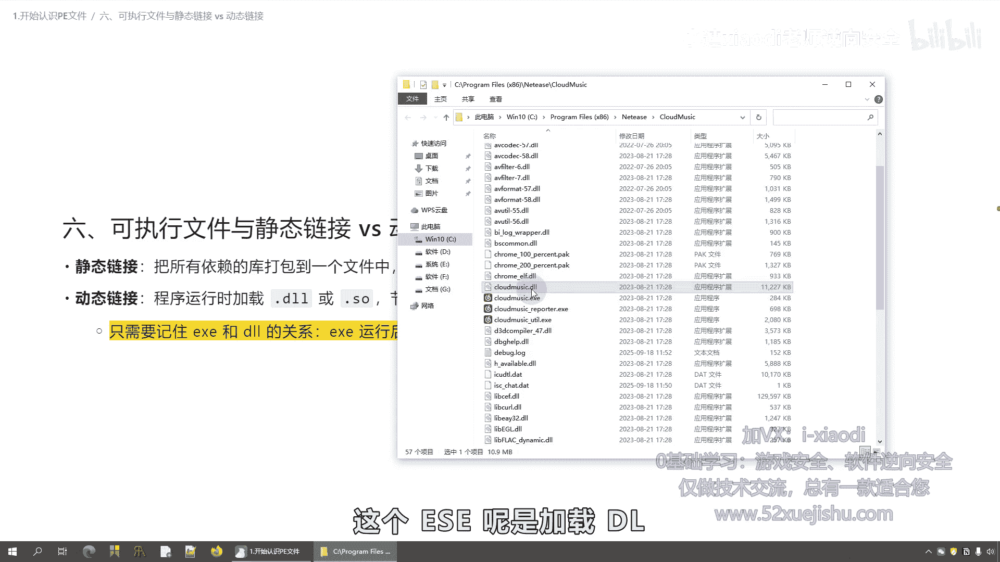
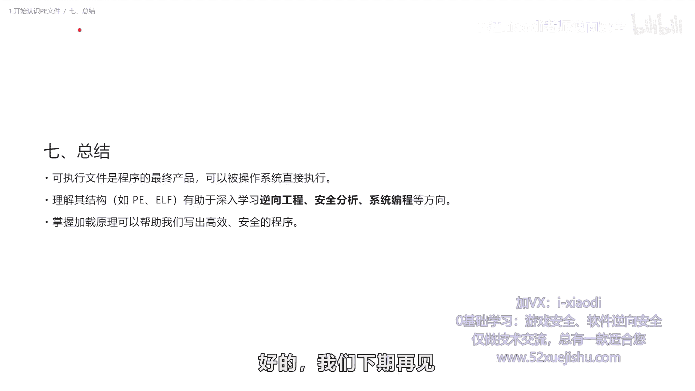

# 🚀 保姆级教学PE文件结构：1：开始认识PE文件

在本节课中，我们将要学习可执行文件是什么、可移植可执行文件PE是什么、Windows常见可执行文件扩展名、Windows下PE文件类型、可执行文件的作用、不同操作系统的可执行文件格式、PE文件概览与加载过程简述、静态链接和动态链接，以及EXE与DLL之间的加载关系。内容会尽量用大白话解释，先把名词和关系理清，为后续深入学习PE文件结构打基础。这些名词看起来多，实际上都围绕一个主线：文件如何被系统加载并执行。先认识名词，再理解关系，后面看PE结构会更顺。

> 完整系统学习软件安全逆向请联系主页方式。  
> 相关标签：2025软件黑客、软件逆向破解、网络验证、Crackme、山寨、封包。  
> 视频编号：BV1viJCzjEvC

## 📄 保姆级教学PE文件结构：1.1：可执行文件是什么

在讲PE文件之前，我们先讲什么是可执行文件。它的英文全称是`executable file`。可执行文件的解释是：可以被操作系统直接加载运行的文件。也就是说，这个文件可以直接运行。文件内部包含程序的机器码指令、数据，以及运行所需的结构信息。简单点说，能够运行的文件就是可执行文件。这个概念是后面理解PE文件的基础，所以先把它记牢。

可以用一个简单公式来记：

```text
可执行文件 = 可被操作系统直接加载并运行的文件
```

从公式可以看出，关键点有两个：一是“可被操作系统加载”，二是“能够运行”。文件本身躺在磁盘上不会自己执行，必须先进入内存，才有机会交给CPU执行。这也是后面学习PE加载过程时反复出现的思路。

## 🧩 保姆级教学PE文件结构：1.2：可移植可执行文件PE

上一节我们介绍了可执行文件的基本概念，本节中我们来看看可移植可执行文件PE。第二个名词是可移植可执行文件，这就是今天要讲解的PE文件。P是`portable`，意思是可移植；E是`executable`，意思是可执行。PE文件类型是微软Windows操作系统的一种特定二进制文件格式。大家记住一句话：微软Windows操作系统上的所有可执行文件都是PE文件。

可以用公式表示：

```text
PE = Portable Executable = 可移植可执行文件
Windows 可执行文件 = PE 格式文件
```

这句话听起来像在说，Windows上的所有可执行文件都是可以移植的。但事实上，微软并没有把“可移植”贯彻到底。这个“可移植”只是微软的一种构想，并没有贯彻落实。所以大家要记住，PE只针对Windows操作系统，不要把PE和其他系统的可执行文件格式混在一起。

## 💻 保姆级教学PE文件结构：1.3：Windows常见可执行文件扩展名

了解了PE这个名称后，本节中我们来看看Windows下常见的可执行文件扩展名，先从文件后缀入手建立直观认识。世界上有各种各样的操作系统，常见的是Windows、Linux，还有苹果的macOS系统。针对这些系统常见的可执行文件扩展名，可以简单了解。在Windows操作系统上，看到后缀是EXE、DLL和SYS的文件，都是可执行文件。

以下是Windows下最常见的几类可执行文件扩展名，先有一个直观印象：

- `.exe`：常见可执行文件后缀。

- `.dll`：常见动态链接库后缀。

- `.sys`：常见设备驱动程序后缀。

比如我们去听歌，可能会用到网易云音乐。打开这个程序的路径，就会发现里面有很多后缀是EXE和DLL的文件，这些文件通通是可执行文件。如果大家看不到后缀，可以点击查看，并勾选“文件扩展名”来显示后缀。其他操作系统的可执行文件扩展名可以简单了解，本节不展开，先把手头的Windows文件后缀认清楚。

## 🗂️ 保姆级教学PE文件结构：1.4：Windows下PE文件类型

上一节从后缀角度看了常见文件，本节中我们再来总结Windows操作系统下所有使用PE文件格式的文件类型。最常见的是EXE可执行文件、DLL动态连接库、SYS设备驱动程序。其他类型可以做了解，后续遇到再补充。

以下是Windows下最常见的PE文件类型，先记住这三类：

- `.exe`：可执行文件。

- `.dll`：动态连接库。

- `.sys`：设备驱动程序。



这三类文件虽然用途不同，但都采用PE文件格式，所以学习PE结构时不能只盯着EXE看。DLL和SYS同样重要，只是现在先把它们的名字和基本定位记住即可。

## ⚙️ 保姆级教学PE文件结构：1.5：可执行文件的作用



到这里可能产生疑问：可执行文件在操作系统中有什么作用。本节中我们来看看它的作用。它的作用其实非常简单：被操作系统加载到内存，然后供CPU执行。也就是说，它的作用就是被用来执行。这一点不要想复杂。

可以用公式概括：

```text
可执行文件的作用 = 被操作系统加载到内存 + 供CPU执行
```

从系统角度看，文件本身在磁盘上只是数据，必须先被加载到内存，才能变成CPU可以执行的指令和数据。所以“加载到内存”和“供CPU执行”是理解后续PE加载过程的关键。现在只需要建立这个基本印象，不需要深入细节。

## 🔗 保姆级教学PE文件结构：1.6：不同系统的可执行文件格式

理解了作用后，本节中我们来看看不同操作系统的可执行文件格式。不同操作系统采用不同的可执行文件格式，这一点要记住。Windows操作系统的可执行格式是PE文件格式，Linux系统或者Unix系统是ELF格式。

可以用公式对照：

```text
Windows 可执行文件格式 = PE
Linux / Unix 可执行文件格式 = ELF
```

这里要记住，PE只针对Windows，ELF针对Linux或Unix，不要把两者混在一起。不同系统有自己的文件格式标准，学习PE时把范围限定在Windows下，思路会更清晰。

## 🧱 保姆级教学PE文件结构：1.7：PE文件概览、加载过程与链接概念简述

上一节我们知道了Windows使用PE、Linux/Unix使用ELF，本节中我们来看看PE文件的概览、加载过程简述，以及静态链接和动态链接这些先做了解的点。现在已经知道PE是Windows系统的可执行文件标准格式，它本身包含多个结构。这些结构可以做一个简单了解，现在还不重要。PE文件加载过程也先做简单了解。静态链接和动态链接同样先做简单了解。

以下是本节只需先做简单了解的三个点，不必现在深挖：

- PE文件本身包含多个结构。

- PE文件有一套加载过程。


- 静态链接和动态链接可以先了解概念。



这些内容现在只需要建立印象，后续章节会逐步展开。当前阶段的目标是认识名词和关系，不要一开始就陷入结构细节，否则容易迷失在名词里。



## 🔄 保姆级教学PE文件结构：1.8：静态链接、动态链接与EXE/DLL关系

上一节把PE概览和加载过程做了简单了解，本节中我们重点看看EXE和DLL的关系。静态链接和动态链接只需要简单了解，但有一点必须记住：EXE和DLL的关系。它们两者的关系是，EXE运行后会加载必要的DLL。也就是说，它们两个之间是一个加载和被加载的关系。DLL被加载，EXE加载DLL。



以下是EXE和DLL之间最核心的关系，记住这两条即可：

- `EXE`运行后会加载必要的`DLL`。

- `DLL`被`EXE`加载，二者是加载与被加载的关系。

也可以用更直白的关系式表示：

```text
EXE = 加载者
DLL = 被加载者
EXE运行 → 加载必要的DLL
```

比如网易云音乐的EXE程序，这个EXE会加载DLL，DLL被它加载。理解这个加载关系后，再看PE文件加载过程会更自然，因为程序运行往往不是单个EXE在干活，还会带上必要的DLL。

## ✅ 保姆级教学PE文件结构：1.9：本节总结

前面我们逐项认识了基础名词和关系，本节总结中我们来收束一下。本节中，我们一起学习了可执行文件、PE文件、Windows常见扩展名、PE文件类型、可执行文件作用、不同系统格式、PE概览与加载过程简述、静态链接和动态链接，以及EXE和DLL关系。



以下是本节需要带走的几个结论：

- 可执行文件是程序的最终产品，可以被操作系统直接执行。



- 理解PE文件结构，有助于深入学习逆向工程、安全分析、系统编程等方向。



- 掌握加载原理，可以帮助我们写出高效安全的程序。

本节全部内容就是认识PE文件。把这些基础名词和关系理顺后，后续再学习PE文件内部结构会更轻松。本节到这里结束，下期再见。
