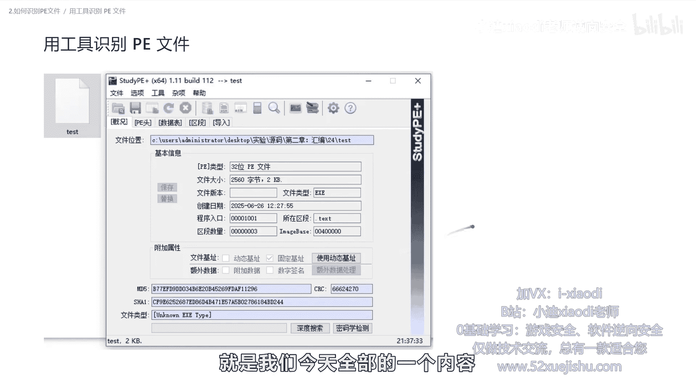

# 🧭 保姆级教学PE文件结构：2：如何识别PE文件

本节是第二讲，主题是如何识别PE文件。本节视频共有4个部分。在本节课中我们将要学习如何通过十六进制标记、后缀名判断和专门工具来识别PE文件。本节属于软件安全逆向相关课程内容，涉及软件黑客、软件逆向破解、网络验证、Crackme、山寨、封包等方向；完整系统学习软件安全逆向可联系主页方式。本讲对应视频编号为BV1viJCzjEHN。接下来会从小实验一、小实验二、PE文件结构示意图和专门识别工具几个方面展开，让初学者也能看懂PE文件的基本识别方法。

在开始实验之前，先说明工具和实验程序的获取方式。视频中提到的所有工具以及实验程序都已经打包上传到社区，大家可以在社区自行下载。如果找不到，可以在群里艾特我。下面先看小实验一，利用十六进制编辑工具观察文件的前两个字节。

## 🧪 小实验一：观察文件前两个字节

小实验一使用的工具是WinHex。直接把准备好的实验课件拖到WinHex里面，就可以开始观察。首先观察文件的前两个字节，发现是`4D 5A`，对应的字符串就是`MZ`。也就是说，`4D 5A`对应`MZ`，这是判断PE文件时非常重要的一个标记。与此同时，还要看第四行的末尾，按1234数过去，第四行末尾最后4个字节是`00 00 00 B0`。这里有一个`B0`，看到这个`B0`之后，直接转到最左边地址列中`B0`对应的地址，就可以看到`50 45`。`50 45`对应的就是`PE`。也就是说，先看到`MZ`，再看到第四行对应位置上的`PE`，就可以得出这个文件是一个PE文件。

下面是这个小实验里需要记住的核心标记，可以用代码形式表示。


```text
文件前两个字节：4D 5A -> ASCII "MZ"
第四行末尾最后4个字节：00 00 00 B0
定位到左侧地址列中的 B0 行：50 45 -> ASCII "PE"

判断公式：
MZ 标记 + PE 标记 => PE文件
```


用大白话解释，就是先看文件开头有没有`MZ`，再顺着十六进制编辑器里的地址找到`PE`标记；两个标记都对上，基本就能判断它是PE文件。上一节我们介绍了常见PE文件的后缀名，本节中我们来看看为什么不能只看后缀名。


## 🕵️ 小实验二：不要只看后缀名


在上节课讲到了常见PE文件的后缀名，通过后缀名可以用肉眼识别很多PE文件。但是很多病毒木马或者某些程序都会通过伪装后缀名来隐藏自己。没有后缀并不意味着它是一个普通文件，它也有可能是一个可执行程序。常见的后缀伪装方式有以下两种。

- 一种可能是把后缀删掉，让文件看起来像没有后缀的普通文件。

- 另一种可能是胡乱起一个后缀名，让你误认为它不是PE文件。

这种情形都可以通过技术手段去辨别。把实验程序直接拖过来，首先可以看到`4D 5A`对应`MZ`；然后第四行`B0`的位置刚好就是`50 45`，也就是`PE`。这样我们就可以揭穿它的伪装。大家还可以思考一个问题：为什么所有Windows可执行文件都可以这样去参考？因为所有Windows可执行文件都遵循同一个结构，也就是PE文件结构。它们的结构都是一样的，所以都是有规律可循的。PE文件结构完整示意图可以简单浏览一下，这个就是PE文件所遵循的结构，所有PE文件都是这样。

为了更直白地理解，可以把判断思路写成下面这个公式。

```text
后缀名只是表面信息
真实类型要看文件结构标记
PE文件识别 = 检查 MZ 标记 + 检查 PE 标记
```

通过小实验二，我们已经知道后缀名可以被伪装，但文件结构标记不容易骗人。理解了这些标记规律后，本节中我们再来看看如何用专门工具识别PE文件。

## 🛠️ 使用专门工具识别PE文件


除了用WinHex这种十六进制编辑工具去肉眼识别PE文件，还可以用一些专门的工具去识别PE文件。例如StudyPE，在我们的工具包里面都有。把实验程序直接拖过来，它就会显示程序的基本信息。其中PE类型会给出提示，例如32位PE文件，说明它就是一个可移植可执行文件。StudyPE通常还会展示以下信息。

- PE类型：例如提示为32位PE文件。

- 文件类型：显示程序属于哪种文件类型。

- 文件大小：显示文件占用的空间大小。

- 创建日期：显示文件的创建时间。

- 其他相关数据：显示与程序相关的其他基本信息。


大家回去之后可以自己去尝试一下。以上是今天全部的内容，我们下节课见。


## 📌 总结



本节课中我们一起学习了如何识别PE文件。我们先通过小实验一，用WinHex观察文件前两个字节`4D 5A`对应`MZ`，再找到`50 45`对应`PE`，从而判断PE文件；接着通过小实验二理解了不能只看后缀名，病毒木马或某些程序可能删除后缀或乱改后缀来伪装自己；然后认识了所有Windows可执行文件都遵循PE文件结构，结构一致所以有规律可循；最后学习了用StudyPE这类专门工具查看PE类型、文件类型、文件大小、创建日期和其他相关数据。掌握这些方法后，初学者也可以从文件结构层面识别PE文件。

