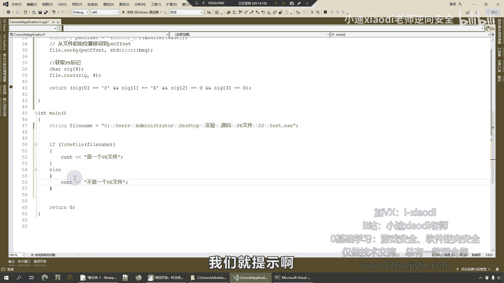
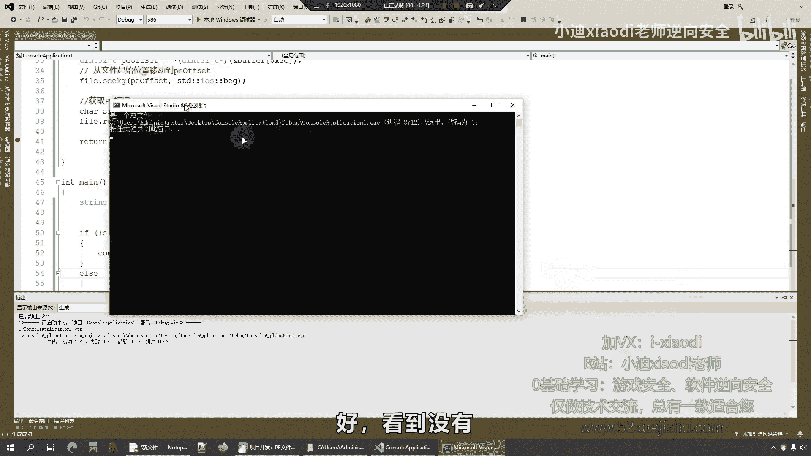
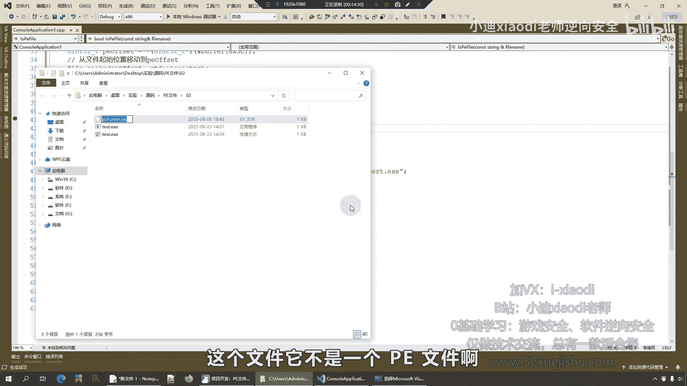
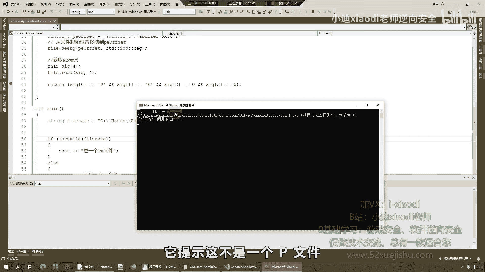
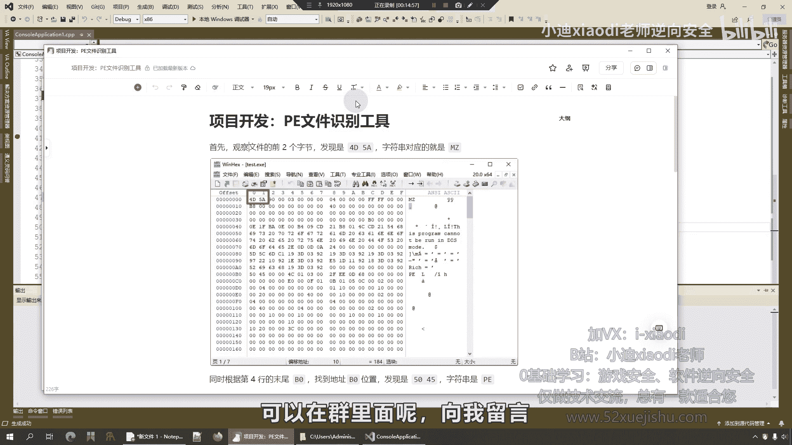

# 🧩 PE文件结构：3：项目开发：PE文件识别工具

本课由小李老师讲解，主题是项目开发：PE文件识别工具。在本节课中，我们将要学习如何把肉眼识别PE文件的流程整理成程序，先回顾用WinHex观察PE文件的方法，再设计一个布尔函数，读取文件前64字节，判断MZ标记，取出PE偏移，读取PE签名，最后用两个文件测试识别结果。整个过程会用大白话解释，并配上关键代码，方便初学者跟着敲一遍。

> 课程信息：完整系统学习软件安全逆向请联系主页方式；相关标签：2025软件黑客、软件逆向破解、网络验证。

在正式写代码前，我们先回顾人工识别PE文件的步骤。后续代码就是把这一套人工流程自动化，因此这一步看起来简单，却是后面理解偏移和判断逻辑的基础。

## 🔍 PE文件结构：3.1：回顾肉眼识别PE文件

上一节我们明确了本课目标，本节来看看如何用肉眼识别PE文件。首先准备工具WinHex，把文件直接拖到工具里。工具会读取这个文件的信息，并把信息罗列出来。讲解过程中会用颜色标出重点，便于观察。

以下是肉眼观察时需要确认的步骤：

- 先看前两个字节是否为4D5A，也就是能否看到MZ字符串。一个是M，一个是Z，两个字符都可以作为判断依据。
- 再看第四行，也就是30这一行，观察该行最后的位置，可以看到B0。
- 然后确认B0所在的行是30行，再往上看B0在该行的下标为C。
- 根据行地址和行内下标计算文件地址，得到B0对应的文件地址是3C。

这里需要特别注意，B0不是单纯按一个字节来读，它实际表示B00000。读取时要从最后一个00开始读，写成000000B0，它是一个四字节的数据。这四个字节不是随意规定，而是PE文件格式规定的。先记住这一点，后面讲PE文件结构时会明白。

核心地址计算可以写成公式：

```
文件地址 = 行首地址 + 行内下标
0x30 + 0xC = 0x3C
```

四字节数据按小端方式理解，可以写成：

```
B0 00 00 00 -> 0x000000B0
```

取出这个值后，再从偏移0开始向下查找B0所在位置。找到B0后，查看50450000，它对应的就是PE。上节课讲看5045，根据PE文件结构，它也是四个字节，例如50450000。这样基本逻辑就清楚了。

## 🧠 PE文件结构：3.2：设计识别函数

上一节我们回顾了人工识别流程，本节来看看如何把这个流程封装成函数。PE文件识别工具可以封装成一个布尔类型函数，函数名可以取isPE，表示判断是否为PE文件。这个函数要回答的问题就是：是不是PE文件，以及如何识别。

以下是函数声明和参数设计：

- 函数返回类型使用bool。
- 函数参数使用const std::string&，名字取fileName，表示文件路径。
- 参数传入后就可以读文件，使用C++自带的文件读写库ifstream。
- 因为这里只是简单读文件，所以用ifstream创建文件对象，并用fileName创建。
- 打开方式使用二进制形式binary。

函数声明可以写成：

```cpp
bool isPE(const std::string& fileName);
```

打开文件的关键代码可以写成：

```cpp
std::ifstream file(fileName, std::ios::binary);
if (!file) {
    std::cout << "打开文件失败" << std::endl;
    return false;
}
```

这样就是先打开文件，也就是读文件流程的第一步。如果打开失败，就加判断，提示错误信息“打开文件失败”，直接return false。打开文件这一步完成后，才可以继续读取文件内容。

## 📂 PE文件结构：3.3：打开文件并读取前64字节

函数框架确定后，下一步就是打开文件并读取固定区域的数据。打开文件后开始读取，读取多少有讲究。有人会问：现在知道B0在这个文件里，读前B0个字节可不可以？对这个文件来说可以，但对其他文件不可以，因为B0由文件里的位置决定，是不确定的。这个文件是B0，其他文件不一定，所以不能直接读这些字节。

哪些内容是固定的？前四行是固定的。读出来之后，再通过里边的数据动态定位。这里需要注意措辞：根据末尾的B0动态定位PE标记，因为PE标记不一定是B0，B0可能会变。哪里不变？前边这些字节不变。一行8个字节，8乘8等于64，因此前64个字节不变。从前64个字节里，可以把4D5A取出来，再把PE标记的地址取出来，所以读64个字节可以。

以下是读取前64字节并检查读取结果的步骤：

- 用vector<char> buffer(64)存放64个字节。
- 因为数据是字节，所以使用char类型，并初始化64个字节。
- 有文件对象file后，直接调用file.read。
- 读到buffer里，从首地址开始读进去。
- vector这种首地址一般用data获取。
- 读取大小使用buffer.size，自动获取。
- 调用file.read(buffer.data(), buffer.size())。
- 直接填64也可以，但将来改这里也要改那里，不如用buffer.size自动获取。
- 判断是否读取成功，可以使用file的成员函数gcount，它返回读取的字节数。
- 如果读取字节数小于64，就return false，表示读取失败。

读取代码可以写成：

```cpp
std::vector<char> buffer(64);
file.read(buffer.data(), buffer.size());
if (file.gcount() < static_cast<std::streamsize>(buffer.size())) {
    return false;
}
```

这样文件就读完了，数据也进入buffer。接下来就可以开始判断文件标记。程序里用buffer[0]和buffer[1]来检查前两个字节。

## 🔎 PE文件结构：3.4：判断MZ标记并获取PE偏移

前64字节读入后，本节先判断MZ标记，再取出PE标记偏移。先判断4D5A，也就是buffer[0]是否不等于M，或者buffer[1]是否不等于Z。只要有一个不满足，就return false。

以下是判断MZ标记的关键代码：

```cpp
if (buffer[0] != 'M' || buffer[1] != 'Z') {
    return false;
}
```

可以先调试一下。给ifstream一个文件名，例如test.exe，并把它传进去。然后直接调用函数，在判断位置打一个断点并调试。断下来后，buffer里开始有数据，可以看到buffer[0]是M，buffer[1]是Z，说明已经读进来。单步执行后跳过了return false分支，说明读取成功。这里判断的就是MZ标记。

判断完MZ标记后，再去获取PE标记的偏移地址。这个地址可以理解为一个偏移地址，读取PE标记的偏移地址。这个地址最好用无符号整数存放，可以使用uint32_t。peOffset直接从buffer的0x3C位置取出来。注意，取buffer[0x3C]只是获取单个字节，而PE标记偏移需要按四个字节整体读出来，所以先把它转成地址，再强制转换成目标类型。需要包含对应头文件，强制转换成指针后，再用星号取出里边的数据。

核心代码可以写成：

```cpp
uint32_t peOffset = *reinterpret_cast<uint32_t*>(&buffer[0x3C]);
```

打一个断点并运行，单步执行后可以看到peOffset是B0，这个值就取出来了。取出来之后就知道B0这个位置放的是PE标记。紧接着要读B0这个位置的数据，因此需要移动文件指针。

## 🛠️ PE文件结构：3.5：移动到PE标记并读取签名

拿到PE偏移后，本节移动文件指针并读取四个字节的PE标记。移动文件指针使用file的成员函数seekg。使用时先提供position位置，也就是要读哪个位置。这个位置相对于文件开头，文件开头有专门的标记beg。这样就是从文件起始位置移动到PE文件标记位置。

以下是移动文件指针、读取PE签名并判断的步骤：

- 调用file.seekg，把位置移动到peOffset。
- 偏移基准使用std::ios::beg，表示从文件开头计算。
- 移动过去之后，把PE标记读到一个数组里，例如char sig[4]。
- 因为PE标记是四个字节，所以数组大小取4。
- 用file.read读取四个字节。
- 读出来后判断sig[0]是否等于P，sig[1]是否等于E，sig[2]是否等于0，sig[3]是否等于0。
- 返回这个判断结果。

关键代码可以写成：

```cpp
file.seekg(peOffset, std::ios::beg);

char sig[4] = {0};
file.read(sig, 4);

return sig[0] == 'P' && sig[1] == 'E' && sig[2] == 0 && sig[3] == 0;
```

这里也可以先用公式记住PE签名的字节形式：

```
50 45 00 00 = "PE\0\0"
```

打一个断点并调试运行，可以看到sig里面就是PE，PE标记已经被读出来。到这里，识别函数的核心逻辑就完成了。接下来就可以调用这个函数进行测试。

## 🚀 PE文件结构：3.6：调用函数并测试

识别逻辑写完后，本节调用函数并用两个文件验证。可以加一个if判断，调用isPE(fileName)。如果是PE文件，就打印“这是一个PE文件”；如果不是，就提示“这不是一个PE文件”。

以下是调用函数进行测试的步骤：

- 准备一个PE文件，例如test.exe，把文件名传给isPE。
- 运行程序，观察输出是否为“这是一个PE文件”。
- 再准备文件夹下另一个不是PE的文件。
- 把另一个文件作为参数传入程序并执行。
- 观察输出是否为“这不是一个PE文件”。

调用代码可以写成：

```cpp
if (isPE(fileName)) {
    std::cout << "这是一个PE文件" << std::endl;
} else {
    std::cout << "这不是一个PE文件" << std::endl;
}
```



运行后可以看到，第一个文件提示是PE文件。文件夹下还有一个文件不是PE文件，把它拖过来或作为参数传入后执行，程序提示这不是PE文件。两个测试结果都符合预期。

## 📝 PE文件结构：3.7：总结





上一节我们完成了两个文件的测试，本节总结本课内容。本节课中我们一起学习了项目开发PE文件识别工具：先回顾用WinHex肉眼识别PE文件的方法，理解MZ标记、B0偏移和四字节读取；再设计布尔函数isPE；读取文件前64字节并检查读取结果；判断MZ标记；从0x3C位置取出PE偏移；用seekg移动到PE标记位置；读取并判断PE签名；最后调用函数测试PE文件和非PE文件。

核心流程可以用一行伪代码概括：



```
打开文件 -> 读64字节 -> 判断MZ -> 取0x3C处PE偏移 -> 跳到偏移 -> 判断PE签名
```



回去之后可以跟着代码自己敲一遍。如果哪里有疑问，可以在群里留言。下期再见。
