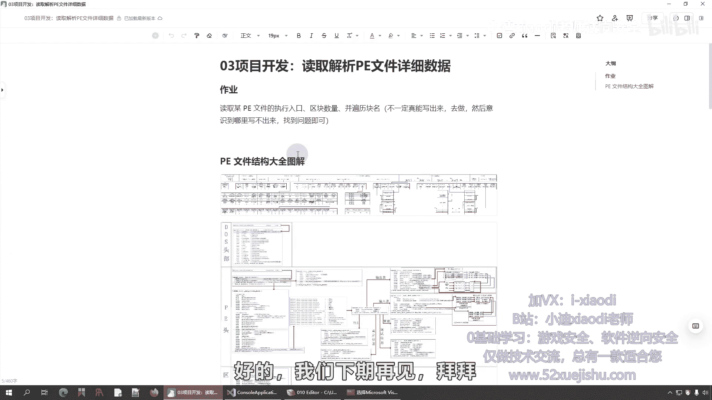

# 🧭 保姆级PE文件结构教程：01：课程目标与整体思路

在本节课中我们将要学习第三讲“读取并解析PE文件详细数据”的整体做法。本课程由小李老师讲解，这一讲实际上就是围绕作业展开：读取某个PE文件的执行入口、区块数量，并遍历所有区块名。前两个目标都非常简单，直接把对应字段读出来即可；遍历区块名也不难，只需要写一个循环，并对区块名称做一点处理。同时，本课程还会梳理这个项目代码应该如何搭建框架，大家需要重点看框架如何组织。原文标题中提到的“完整系统学习软件安全逆向请联系主页方式”，在这里作为课程信息保留说明。

  
以下是本讲作业的三个核心目标，先列出来便于后续对照：

  
- 读取PE文件的执行入口。  
- 读取PE文件的区块数量。  
- 遍历并输出每一个区块的名称。  

  
完成目标梳理后，下一节我们来看看整个程序应该按什么顺序执行。

  
# 🧩 保姆级PE文件结构教程：02：先判断再解析的整体流程

上一节我们明确了课程目标，本节我们来看看整体流程怎么设计。之前已经有一段代码，用来判断一个文件是否是PE文件，函数返回布尔类型，名字可以叫 `isPEfile`。今天要新增一个解析函数，可以叫 `ParsePE`，用来解析PE文件。这个函数需要一个文件路径参数，类型是 `const string`。因为PE文件本身有固定结构，为了解析方便，可以自己定义一个结构体 `PInfo`，把需要的数据集中放进去。

  
`PInfo` 结构体可以包含 DOS 头、NT 头，以及一个保存区块表信息的 `vector`。实验程序有3个区块，一般来说区块数量一定大于等于1，所以用 `vector` 比较合适。

  
```cpp
struct PInfo {
    IMAGE_DOS_HEADER dosHeader;
    IMAGE_NT_HEADERS ntHeaders;
    std::vector<IMAGE_SECTION_HEADER> sections;
};
```

  
主程序逻辑是：先判断文件是否为PE文件，如果是，就执行解析PE文件；解析之前定义一个 `PInfo info` 变量，把解析结果放到 `info` 里面。因此 `ParsePE` 的第二个参数应该用引用传入 `PInfo`，写成 `ParsePE(const std::string& filePath, PInfo& info)`，解析完成后相关数据就保存在 `info` 中。

  
以下是主程序的核心步骤，按顺序执行即可：

  
- 调用 `isPEfile` 判断文件是否为PE文件。  
- 如果不是PE文件，提示“这不是一个PE文件”，然后返回0。  
- 如果是PE文件，调用 `ParsePE(fileName, info)` 进行解析。  
- 如果解析成功，调用打印函数输出信息；如果解析失败，给出提示。  

  
整体流程清楚后，下一节我们来看看解析函数内部如何读取DOS头、PE头和区块表。

  
# 📂 保姆级PE文件结构教程：03：读取DOS头、PE头和区块表

上一节我们确定了先判断再解析的流程，本节我们来看看解析函数内部如何读取数据。解析时依然要先打开文件。因为前面已经判断过它是PE文件，所以这里不需要再寻找 `MZ` 标记，可以直接读取DOS头，把数据读到 `info.dosHeader` 中。读取后要判断有没有读取成功，如果读取数量不等于预期数量，就返回 `false`。

  
读取PE头之前，要把文件指针移动到PE标记位置，也就是 `e_lfanew` 指向的位置，然后再读取 `info.ntHeaders`。读取完PE头后，要读取节表，也就是区块表。读取区块表之前要先知道到底有几个区块，这个数量在标准PE头里，字段是 `NumberOfSections`。先取出区块数量，再给 `info.sections` 分配空间，最后读取区块表。

  
区块表读取大小的核心公式如下：

  
```text
读取字节数 = sizeof(IMAGE_SECTION_HEADER) × NumberOfSections
```

  
以下是解析函数的关键代码结构，重点看读取顺序和判断：

  
```cpp
bool ParsePE(const std::string& filePath, PInfo& info) {
    FILE* fp = nullptr;
    fopen_s(&fp, filePath.c_str(), "rb");
    if (!fp) return false;

    if (fread(&info.dosHeader, sizeof(IMAGE_DOS_HEADER), 1, fp) != 1) {
        fclose(fp);
        return false;
    }

    fseek(fp, info.dosHeader.e_lfanew, SEEK_SET);
    if (fread(&info.ntHeaders, sizeof(IMAGE_NT_HEADERS), 1, fp) != 1) {
        fclose(fp);
        return false;
    }

    DWORD sectionCount = info.ntHeaders.FileHeader.NumberOfSections;
    info.sections.resize(sectionCount);

    if (fread(info.sections.data(), sizeof(IMAGE_SECTION_HEADER),
              sectionCount, fp) != sectionCount) {
        fclose(fp);
        return false;
    }

    fclose(fp);
    return true;
}
```

  
这里要特别注意：`vector` 默认没有分配空间，读取区块表之前必须调用 `resize`，把大小设置为区块数量。否则直接读取到 `vector` 中会导致程序崩溃。解析完成后返回 `true`，表示所有错误条件都没有触发。

  
读取部分完成后，下一节我们来看看如何把执行入口和区块数量打印出来。

  
# 🖨️ 保姆级PE文件结构教程：04：打印执行入口和区块数量


上一节我们完成了PE数据的读取，本节我们来看看如何打印这些数据。打印功能最好单独写一个函数，例如 `PrintInfo`，参数使用 `const PInfo& info`，因为打印时不需要修改数据。执行入口在扩展PE头里，字段是 `OptionalHeader.AddressOfEntryPoint`。输出时最好用十六进制显示，所以使用 `std::hex`。

  
以下是打印执行入口和区块数量的核心代码，先输出执行入口，再输出区块数量：

  
```cpp
void PrintInfo(const PInfo& info) {
    std::cout << std::hex << "执行入口："
              << info.ntHeaders.OptionalHeader.AddressOfEntryPoint
              << std::endl;

    std::cout << std::dec << "区块数量："
              << info.ntHeaders.FileHeader.NumberOfSections
              << std::endl;
}
```

  
区块数量使用十进制输出，所以切回 `std::dec`。在第一次运行时程序直接崩溃，原因是读取区块表时 `vector` 还没有分配空间；调用 `info.sections.resize(sectionCount)` 后再次运行，执行入口就可以正常获取，区块数量也可以正常打印。

  
执行入口和区块数量输出完成后，下一节我们来看看如何遍历并正确输出区块名称。

  
# 🔁 保姆级PE文件结构教程：05：遍历并正确打印区块名

上一节我们打印了执行入口和区块数量，本节我们来看看区块名称怎么处理。区块名称的大小是8个字节，但这8个字节不一定以 `00` 结尾。字符串通常以 `00` 结尾，如果区块名刚好填满8个字节，就没有结束符。因此需要定义一个9字节的字符数组，把第9个字节初始化为0，这样就能得到完整字符串。

  
核心处理方法如下：

  
```cpp
char name[9] = {0};
memcpy(name, info.sections[i].Name, 8);
```

  
以下是遍历区块名称的步骤，循环次数等于区块数量：

  
- 定义循环变量 `i`，从0开始，循环条件是 `i < info.sections.size()`。  
- 每个区块名称在 `info.sections[i].Name` 中。  
- 定义 `char name[9] = {0};`。  
- 使用 `memcpy(name, info.sections[i].Name, 8);` 复制8个字节。  
- 输出“节 i 名称：name”。  

  
完整循环代码可以写成下面这样：

  
```cpp
for (size_t i = 0; i < info.sections.size(); ++i) {
    char name[9] = {0};
    memcpy(name, info.sections[i].Name, 8);
    std::cout << "节" << i << "名称：" << name << std::endl;
}
```

  
运行程序后，执行入口、区块数量以及每一个节对应的名称都能遍历出来。到这里主要功能已经完成，下一节我们来看看编译警告如何处理。

  
# ⚠️ 保姆级PE文件结构教程：06：处理编译警告


上一节完成了区块名遍历，本节我们来看看代码中的编译警告。程序里出现了 `C26451` 算术溢出警告，提示在四字节值上使用乘法运算符，然后把结果转换成八字节值；解决办法是在乘法之前把参与运算的值强制转换为宽类型，例如 `uint64_t`，这样可以避免溢出。

  
核心处理代码如下：

  
```cpp
uint64_t totalSize =
    static_cast<uint64_t>(sizeof(IMAGE_SECTION_HEADER)) *
    static_cast<uint64_t>(sectionCount);
```

  
另外还有“有符号无符号不匹配”的警告，把 `int` 改成 `size_t` 即可，因为 `size_t` 是无符号整数。修改完成后重新生成，警告消失，程序可以完美运行。

  
以下是警告处理的两个要点，修改后重新生成即可：

  
- `C26451`：乘法前把两边数据转换成 `uint64_t` 宽类型。  
- 有符号与无符号不匹配：把循环变量或相关整数改成 `size_t`。  

  
警告处理完成后，下一节我们复盘整个项目的思路并做总结。

  
# ✅ 保姆级PE文件结构教程：07：思路复盘与课程总结




上一节处理了编译警告，本节我们复盘整个项目的思路。整体流程是先判断一个文件是否是PE文件，判断完成后再解析PE文件。因为PE文件本身就是结构化的，所以定义一个 `PInfo` 结构体来承载解析结果比较方便。编写解析函数时两个参数很明确：一个是文件路径，一个是 `PInfo` 结构体引用。

  
在设计软件时，解析功能和打印信息最好分开编写，所以有了 `PrintInfo` 函数。这个函数只负责显示PE文件信息，因此参数用 `const` 修饰，把结构体传进去后完成相关打印即可。这里额外需要注意的是区块名称：区块名称是8个字节，有可能全部填满字符而没有 `00` 结尾，所以要写一个9字节的字符数组，先初始化为0，再把区块名称复制过去，这样就能得到完整的区块名称字符串。

  
以下是本项目最终要记住的关键点，便于回去自己动手写代码：

  
- 先判断是否为PE文件，再解析PE文件。  
- 用 `PInfo` 结构体集中保存DOS头、NT头和区块表。  
- 解析函数接收文件路径和 `PInfo` 引用。  
- 读取区块表前先取 `NumberOfSections`，再 `resize`。  
- 解析和打印分开，打印函数使用 `const PInfo&`。  
- 区块名用9字节数组处理，避免没有 `00` 结尾的问题。  
- 乘法溢出警告用 `uint64_t` 转换，符号不匹配用 `size_t`。  

  
本节课中我们一起学习了如何读取并解析PE文件的详细数据，包括执行入口、区块数量、区块名称遍历，以及结构体设计、解析与打印分离、`vector` 空间分配和编译警告处理。大家回去后可以跟着视频自己写一写代码，有疑问可以在群里提问。下一期再见。

