# 📘 PE文件结构保姆级教程：第八讲：精讲标准PE头


本节课程由小迪老师讲解，是PE结构精讲第八讲：标准PE头。在本节课中我们将要学习PE文件结构里的标准PE头，上节课已经介绍了DOS头，本节会接着DOS头继续往下分析。从示意图可以看到，紧跟在DOS块后面的就是PE头，PE相关结构的简称和历史在之前已经讲过。本节课会先复习PE头指针的计算方式，再说明PE32与PE32+两个版本，然后逐个分析标准PE头的7个成员，最后补充`Characteristics`字段在逆向分析中的实用技巧。整体内容会尽量用直白的方式说明，让初学者也能跟上结构之间的关系。


## 🧭 一、从DOS头到PE头：PE头指针的计算


上一节我们介绍了DOS头，本节我们来看看PE头是如何被定位到的。当某个可执行程序在支持PE文件结构的操作系统中运行时，PE相关结构会从DOS头的`e_lfanew`字段里面找到PE的起始偏移量，再用它加上基值，从而得到PE文件头的指针。这个过程可以写成下面的公式：


```c
PE头指针 = 基址 + e_lfanew;
```


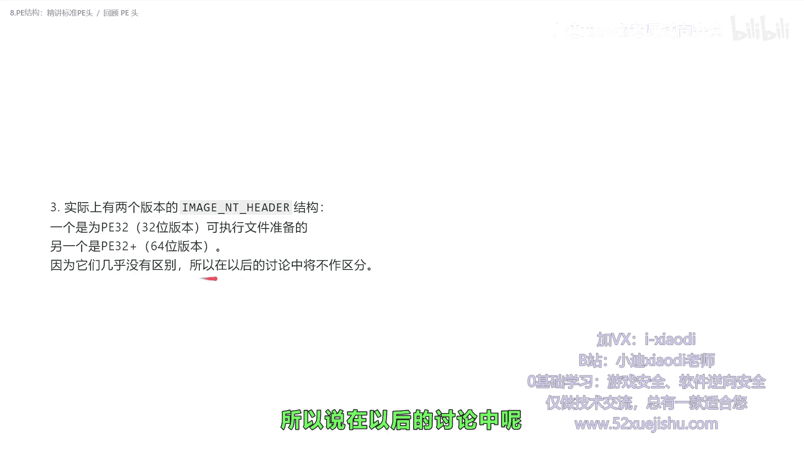

这里的“基址”可以理解为程序或文件映射到内存后的起始地址，而`e_lfanew`就是DOS头中保存的PE头偏移。这个计算方式属于对上一节内容的复习，理解它之后，后面定位标准PE头就不会迷路。PE头本身紧跟在DOS块之后，但它并不是直接靠固定位置找出来的，而是通过DOS头里的偏移字段跳转过去。


## 🧩 二、PE32与PE32+：两个版本几乎一样


在理解PE头之前，需要先知道PE结构有两个版本。以下是两个版本的对应关系：


- **PE32**：面向32位版本可执行文件准备的结构。
- **PE32+**：面向64位版本程序准备的结构。


这两个版本在微软文档中都有列出，从整体框架来看几乎没有区别，所以以后讨论中不做严格区分。也就是说，虽然名字不同，但它们的主体结构和分析思路非常接近，学习时可以先抓住共同部分。理解这一点之后，再看标准PE头的成员就不会被32位和64位的差异打断。


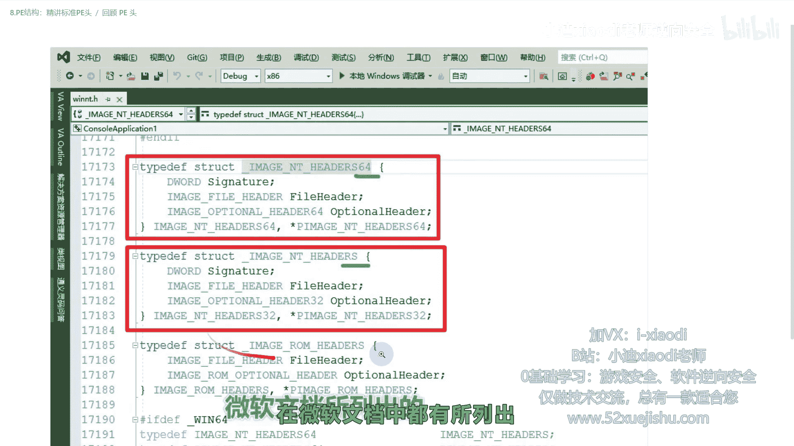

## 🏷️ 三、PE标志：PE\0\0和e_lfanew


现在看到的PE头结构中，有一个PE标志成员。在有效的PE文件里，这个字段会被设置为`4550`字符，也就是`PE\0\0`，总共占用4个字节。它是PE文件头的开始，`e_lfanew`正式指向这里，这个标志不能修改，否则程序就运行不起来。核心值可以写成下面的代码：


```c
DWORD Signature = 0x00004550; // 小端存储后对应 "PE\0\0"
```


理解这个标志之后，我们就可以进入今天的重点：标准PE头。标准PE头一共有7个成员，下面先看成员总览，再逐个展开说明。每个成员都会结合实验程序和实际用途来解释，这样既能看懂字段含义，也能理解逆向分析时如何利用这些字段。


## 🧱 四、标准PE头总览：7个成员


标准PE头就是今天课程的核心结构。为了便于后面的逐个分析，先列出这7个成员名称。以下是标准PE头的7个成员总览：


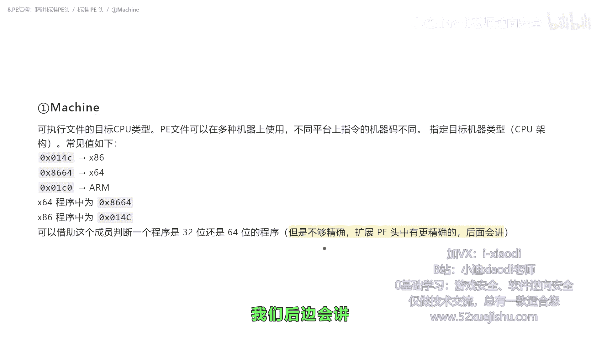

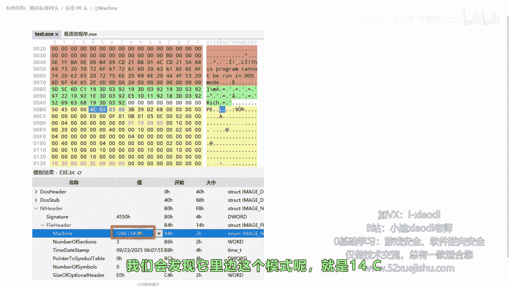

- `Machine`：目标CPU机器类型。
- `NumberOfSections`：区块数目。
- `TimeDateStamp`：文件创建时间戳。
- `PointerToSymbolTable`：COFF符号表文件偏移。
- `NumberOfSymbols`：符号表数量。
- `SizeOfOptionalHeader`：扩展PE头大小。
- `Characteristics`：文件属性位掩码。


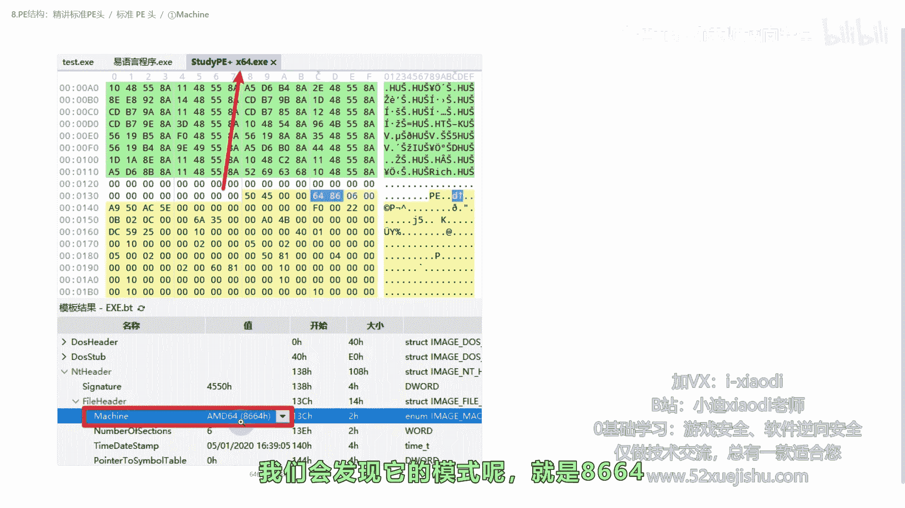

总览之后，我们逐个成员展开。每个成员都结合实验程序和实际用途说明，这样既能看懂字段，也能理解逆向分析时的判断方法。


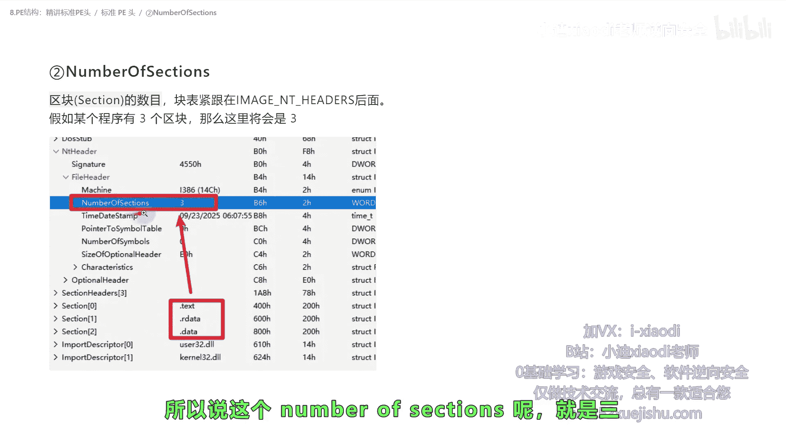

### 4.1 Machine：目标CPU架构


第一个成员是`Machine`，它描述可执行文件的目标CPU。不同平台使用不同指令的机器码，不同CPU架构对应的值也不一样。以下是常见`Machine`值及其含义：


- `0x014C`：说明程序允许在x86的CPU架构上运行。
- `0x8664`：说明程序允许在64位CPU架构上运行。
- `0x0140`：说明程序允许在ARM的CPU架构上运行。


通过这个字段，可以初步判断一个程序是32位还是64位。例如实验中看到的32位程序，`Machine`值是`0x14C`；图片中的64位程序，`Machine`值是`0x8664`。但只用这个字段判断不够精确，扩展头中有更精确的判断方式，后面会讲。这里先建立概念：`Machine`负责描述目标机器类型，是分析PE文件时最先看到的信息之一。


### 4.2 NumberOfSections：区块数目


第二个成员是`NumberOfSections`，它说明区块的数目。例如某个程序有三个区块，这里就会是3。我们的实验程序有三个区，所以这个字段会直接反映节区数量。这个字段主要用于告诉加载器文件中包含多少个节区，在后续分析节表时，这个数量会直接参与定位和遍历。


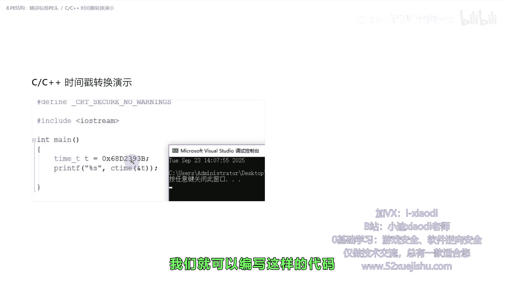

### 4.3 TimeDateStamp：文件创建时间戳


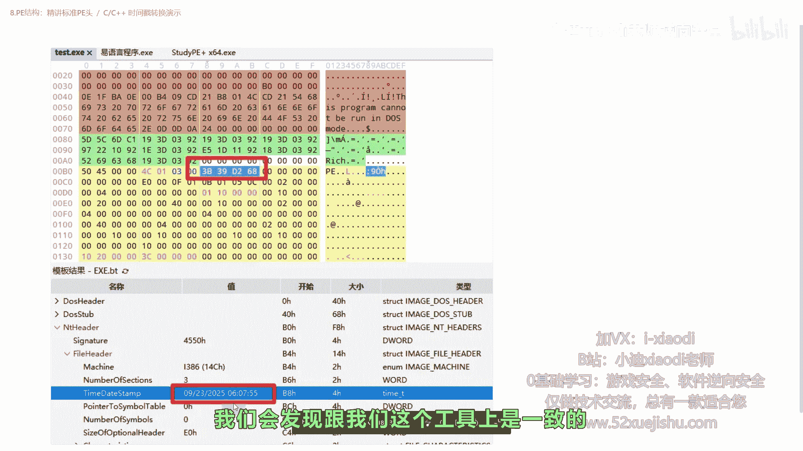

第三个成员是`TimeDateStamp`，表示文件的创建时间。这个值以格林威治时间计算，原文示例值为`197011`，可理解为1970年1月1日相关的时间基准。它描述的是一个比文件系统日期或时间更精确的文件创建时间指示器。不少同学会问，为什么要选1970年1月1日，这和Unix系统时间戳有直接关系。


PE文件格式源自COFF，COFF最初由Unix系统定义，用于目标文件和可执行文件格式。微软在开发NT和PE文件格式时借助了COFF，因此很多地方继承了Unix世界的时间概念。Unix操作系统在1970年问世，所以时间原点被定义为1970年1月1日，从那一刻开始，时间以秒为单位递增。微软为了与Unix保持兼容，也沿用了这个定义。可以用编程手段转换时间戳，例如实验程序中的时间戳是`0x68393B`，可以编写代码调用`ctime`函数打印时间：


```c
#include <stdio.h>
#include <time.h>

int main(void) {
    time_t t = 0x68393B;
    printf("%s", ctime(&t));
    return 0;
}
```


打印出来的时间会和工具上显示的时间一致。这说明时间戳字段本质上是一个Unix时间，理解这一点之后，看到奇怪的时间数值就不会困惑。


### 4.4 PointerToSymbolTable：COFF符号表偏移


第四个成员是`PointerToSymbolTable`，它表示COFF符号表的文件偏移。因为PE文件格式采用了较新的调试格式，所以这个东西在PE文件中较为少见，因此在PE文件中通常为0。以后这个字段不用重点关注，它更多是COFF历史遗留的一部分。


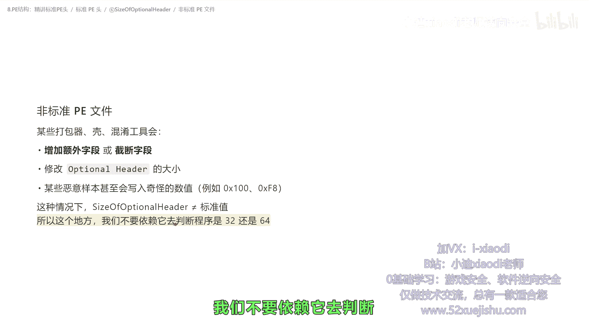

### 4.5 NumberOfSymbols：符号表数量


第五个成员是`NumberOfSymbols`。因为PE文件已经不用这个东西，所以在PE文件中也通常为0。它和上一个成员一样，属于历史遗留字段，在常规PE分析中，看到0就可以跳过。


### 4.6 SizeOfOptionalHeader：扩展PE头大小


第六个成员是`SizeOfOptionalHeader`，它说明扩展PE头的大小。这个大小依赖于当前文件是32位还是64位文件。对于32位程序来说，这个值通常是`0xE0`；对于64位文件来说，这个值通常是`0xF0`。这些是要求的最小值，较大的值也可能出现。例如某些打包器、壳或混淆工具可能增加额外字段，或者截断字段、修改扩展头大小。某些恶意样本，例如木马，甚至会写入奇怪的数值。在这种情况下，`SizeOfOptionalHeader`不等于标准值，所以这个地方不要依赖它去判断程序是32位还是64位。


### 4.7 Characteristics：文件属性位掩码


第七个成员是`Characteristics`，它说明文件属性。严格说，它是标志文件属性的位掩码。普通EXE程序一般是`0x010F`，DLL文件一般是`0x2102`。例如实验程序是一个普通EXE程序，它的值就是`0x010F`。接下来讲如何进行位运算，因为这个字段是位运算字段。把`0x010F`转换成二进制：


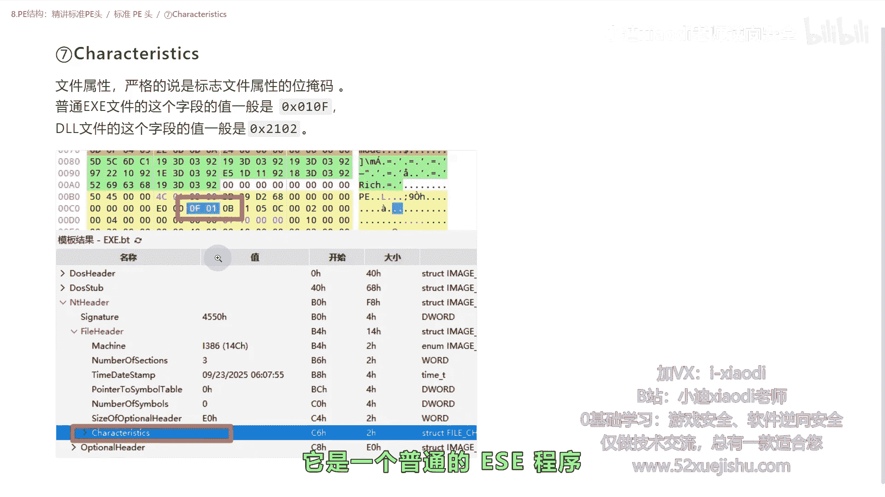

```c
0x010F = 0000 0001 0000 1111
```


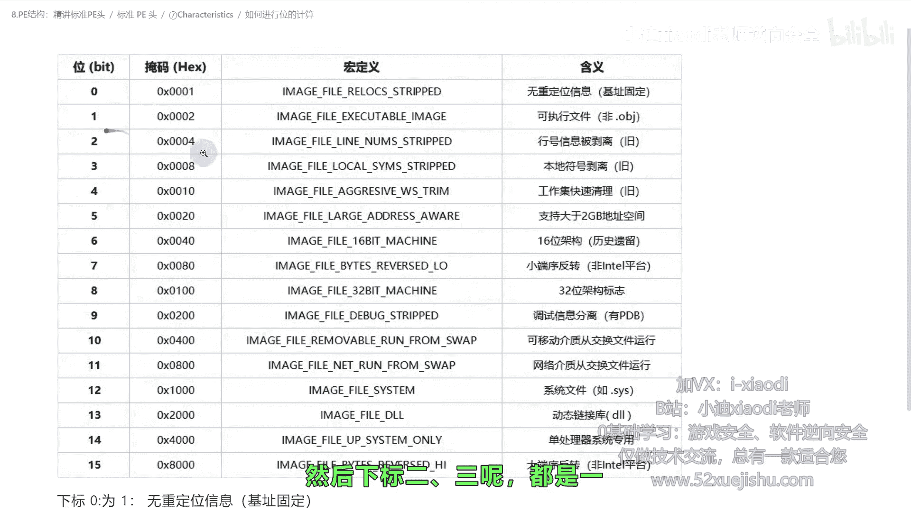

二进制从右往左看，下标0是1，下标1是1，下标2和3都是1，下标4到7都是0，下标8是1。对照位标志表可知，以下是`0x010F`中关键位的含义：


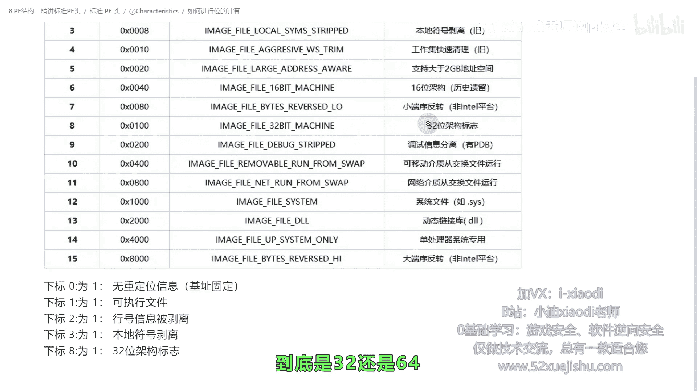

- 下标0为1：无重定位信息，也就是基址固定。
- 下标1为1：这是一个可执行文件。
- 下标2和3为1：行号信息被剥离，本地符号被剥离。
- 下标8为1：这是32位架构标志，说明程序针对32位处理器架构编译。


需要注意，下标8的32位架构标志并不绝对说明这个程序是32位程序还是64位程序。真正判断一个程序到底是32位还是64位，要在扩展PE头里进行，后面会讲。这里先记住：`Machine`和`Characteristics`都只能辅助判断，不能单独下结论。最后再讲一个逆向分析小技巧：`Characteristics`可以快速判断文件类型。


例如，可以用`0x2000`判断这个文件是否是DLL文件。因为16进制的`0x2000`对应下标13的值为1，跟一个数做按位与运算时，都是一才是一，有一个零就是0。所以用下面的表达式可以判断DLL属性：


```c
if ((Characteristics & 0x2000) != 0) {
    // 具有 DLL 属性
}
```


同样的道理，16进制的`0x100`下标是8，下标8是32位架构标志，这个可以辅助判断32位程序还是64位程序。但这个判断不绝对，并不精确，精确判断在扩展PE头里，后面会讲。同样，跟16进制的`0x20`做按位与运算，可以判断是否支持大内存。`0x20`的下标5是1，下标5表示一个程序是否支持大于2GB地址空间。判断代码如下：


```c
if ((Characteristics & 0x20) != 0) {
    // 支持大于 2GB 地址空间
}
```


这个标志有什么用，举一个例子。微软的LAA补丁曾经用于让一些老游戏支持4GB内存。有的老游戏玩着就崩溃，是因为超过了2GB的地址空间。后来只需要在PE头中打开这个标志位，就能够在64位系统上使用更多内存。打开之后，程序就可以使用超过2GB的虚拟地址空间。这种4GB补丁在网上可以搜索到，这里牵扯到一些操作系统知识。


在32位系统中，虚拟地址空间一共是4GB，给用户2GB，又给内核态2GB，所以它们是平分天下的。当把这个标志打开之后，系统就会允许这个程序访问更大的地址空间。因此这种大内存补丁的原理非常简单。下面给出大内存补丁的简化操作步骤：


- 定位到标准PE头的第七个成员`Characteristics`。
- 让它与`0x20`做一个按位或操作。
- 因为按位或运算只要有一个是1结果就是1，都是0结果才是0，这样可以保证下标5的标志位变成1。
- 保存退出。


对应的核心代码如下：


```c
Characteristics |= 0x20;
```


启用大内存补丁之后，游戏或者程序就可以分配更大的内存块，贴图缓存、场景加载会更加稳定，不会因为内存问题崩溃。但是也必须保证程序内部能够正确处理超过2GB的指针，否则可能会出错。所以补丁不是万能的，还要看程序自身是否支持。


## 📝 五、本节总结


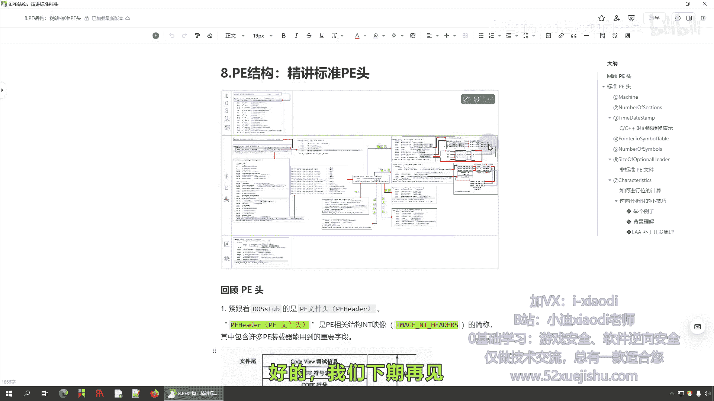

本节课中我们一起学习了PE文件结构第八讲：标准PE头。我们从DOS头中的`e_lfanew`出发，复习了PE头指针的计算方式；然后了解了PE32与PE32+两个版本几乎一样；接着认识了PE标志`PE\0\0`；最后逐个分析了标准PE头的7个成员。其中重点包括`Machine`判断目标CPU、`TimeDateStamp`的Unix时间戳来源、`SizeOfOptionalHeader`不能单独依赖、`Characteristics`的位运算和逆向判断技巧。还讲了大内存补丁的原理和`Characteristics |= 0x20`的操作。本课对标准PE头做了非常详细的讲解，本节内容到这里结束，后续继续学习PE结构。
