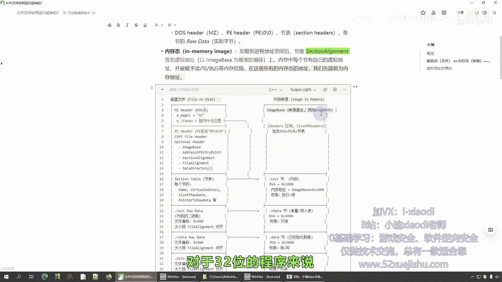
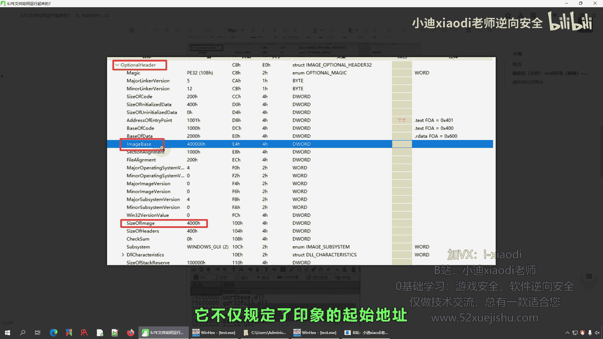
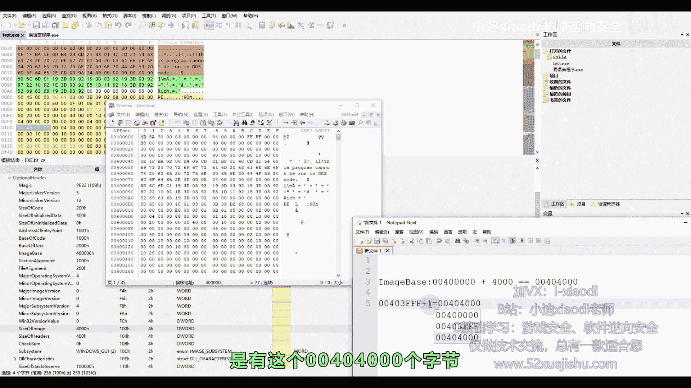

# 💾 PE文件结构：第六讲：PE文件如何运行起来的

  

> 本节由小迪老师主讲，主题是PE文件如何运行起来的。前面已经学过，PE是Windows上的可执行文件格式，常见的有两种：EXE和DLL。本讲会完整梳理程序从双击到运行的全过程。

  

## 🎯 课程概述

  

本节课中我们将要学习PE文件如何运行起来的。很多初学者虽然知道PE文件是Windows平台的可执行文件格式，但对于“双击EXE后系统到底做了什么”这个问题往往比较模糊。本讲的目的是把这条链路打通：操作系统的加载器如何把磁盘上的PE文件搬进内存、如何为进程分配虚拟空间、如何把各个节映射到指定地址、最终又如何把执行权交给程序入口点。这些内容一环扣一环，理解之后就能对PE文件的运行机制建立起一个整体轮廓。

  

## 🔧 加载器是什么

  

当用户双击一个EXE文件，或者某个程序调用LoadLibrary函数加载DLL时，操作系统会执行一系列动作。这些动作不是由用户程序自己完成的，而是由一个叫做加载器（Loader）的组件自动完成的。加载器是操作系统的一部分，它负责把可执行文件从磁盘加载到内存，并让CPU从入口点开始执行。

  

整个动作都是自动化完成的，不需要人为干预。有的同学可能不清楚“加载器”到底是个什么东西，可以把它理解成操作系统内置的一个“搬运工”：你双击一个程序，它就自动把文件搬到内存里，安排好位置，然后启动程序。这个过程中用户只需要做双击这个动作，后面的事全由加载器处理。因此现阶段只需要对程序如何运行起来的机制有一个简单的轮廓就可以了，具体细节不需要死记硬背。

  

## 🖥️ 进程与内存地址

  

上一节我们了解了加载器的基本职责。本节来看看进程和内存地址。进程这个概念之前已经讲过：进程就是运行中的程序。打开Windows的任务管理器，可以看到所有运行中的程序，右侧还有一列内存信息，这说明了运行中的程序是消耗内存的。既然消耗内存，就意味着内存中存放了各种各样的数据，而每一个数据都需要一个类似身份证号的标记来进行标识。对于内存中的数据，这个标识就称为内存地址。简单地说，内存地址就是数据在内存中的位置编号。

  

## 🔁 磁盘态与内存态的差异

  

在深入研究加载过程之前，先来分析一下磁盘态的文件以及内存态的映像，它们之间的区别和联系。磁盘态的文件是按照字节顺序存放的，每一个节在文件里面按照FileAlignment进行对齐。内存态的文件加载到进程的地址空间后，节是按照SectionAlignment放到虚拟地址上的，并且这个虚拟地址是以ImageBase为基准的一个偏移。这两种对齐方式的具体区别，上节课已经讲过了，这里再提一次是为了加深印象。课程内容设计是一环扣一环的。

  

来看一张文件地址与内存地址的对比图：左侧显示文件地址，右侧显示内存地址。可以发现，两者的DOS头部分完全一样，PE标记的位置也完全一样。但文件地址向下对齐到400就结束了，因为FileAlignment是200；内存地址则一路往后延伸，直到401000，因为内存是按照Section进行对齐的，单位是1000。这就是磁盘态与内存态最直观的差异。

  

## 📍 ImageBase与SizeOfImage

  

知道了磁盘态与内存态的对齐差异后，自然会产生一个问题：内存地址是如何从0变化到00400000的？这个问题非常关键，因为它直接关系到程序加载到内存后的地址计算。最根本的原因就是：内存映像有一个ImageBase的概念。

  

对于32位的程序来说，ImageBase默认就是00400000。这个值是由谁规定的呢？是由扩展PE头里面的ImageBase字段规定的。它不仅规定了映像的起始地址，还规定了映像的大小，这个大小就是SizeOfImage。换句话说，ImageBase就是程序默认载入的基地址，调试工具中查看时它也常被称为基址。

  

理解了ImageBase之后，再做一些拓展。当PE文件通过Windows加载器载入内存之后，内存中的PE文件就不再叫“普通文件”了。例如test.exe加载到内存后，它在内存中的版本被称为模块（Module）。映像文件的起始地址，也就是前面说的基址，同时被称为模块句柄，也被称为基地址。这三个称呼指的是同一个东西，它们之间的联系需要大家多看一看、多记一记。

  



SizeOfImage的含义是映像载入内存后的总尺寸。ImageBase和SizeOfImage这两个成员一起规定了程序载入内存后的起始位置以及占用空间的大小，它们在PE文件结构中属于非常重要的成员，后面还会再次讲到。

  



## 🚀 程序加载执行的步骤

  

这些关键概念都准备好之后，我们来看最后的问题：当双击EXE程序的时候，程序是怎么一步一步执行起来的呢？加载器的整个工作流程可以分为以下几个步骤，每一步都有明确的任务：

  

1. **验证文件头**：加载器读取文件头，验证MZ和PE标志。如果发现是标准PE文件，就进入下一步。这个检查相当于安检，确保文件确实是合法的PE格式。

2. **分配虚拟空间**：为进程分配虚拟空间，分配大小由SizeOfImage决定。这里做一点补充说明：SizeOfImage是经过SectionAlignment对齐后的值，所以它一定是SectionAlignment的整数倍。例如，某个文件的SectionAlignment是1000，它的SizeOfImage是4000，正好是整数倍；再看另一个程序，SectionAlignment是1000，SizeOfImage是C1000，同样是1000的整数倍。这样的设计保证了各节在内存中能够整齐排列。

3. **复制头部区域**：把DOS头、PE头、节表拷贝到起始位置。因为这里是直接拷贝的，所以文件态和内存态的前面部分看上去完全一样，左边是文件右边是内存，两者一一对应，这也印证了之前讲过的内容。

4. **依次映射各个节**：把文件的.text段复制到内存的ImageBase+1000。为什么偏偏是1000？这个偏移量实际上是由节表里面的VirtualAddress成员决定的。来看例子会更清楚：

  

```text
.text段：VirtualAddress = 1000，内存地址 = ImageBase + 1000 = 00401000
另一段：VirtualAddress = 2000，内存地址 = ImageBase + 2000 = 00402000
.data段：VirtualAddress = 3000，内存地址 = ImageBase + 3000 = 00403000
```

  

每个节都按照“ImageBase + VirtualAddress”这种计算方法分别映射到对应的内存位置。映射完成后，加载器还会做一些修正操作，这部分的细节比较复杂，本讲先不展开。最后一步，加载器调用程序的入口点，程序就跑起来了。

  

## 🧮 虚拟地址

  

接下来介绍虚拟地址的概念。Windows系统中，PE文件加载到内存后，每个程序都会有自己的虚拟空间，并且这些虚拟空间之间互不干扰。比如说，QQ有QQ的空间，微信有微信的空间，浏览器有浏览器的空间。不可能出现浏览器里面播放的小电影突然跑到微信窗口上、恰好被父母看到的场景，这种现象在虚拟空间隔离的机制下是不存在的。需要记住的是：每个程序都有自己的虚拟空间，这个虚拟空间中的内存地址被称为虚拟地址（Virtual Address，简称VA）。

  

那虚拟地址怎么计算呢？刚才已经体会过了，它实际上是由基址加上相对虚拟地址（RVA）计算出来的。下面是计算公式：

  

```text
VA（虚拟地址） = ImageBase（映像基址） + RVA（相对虚拟地址）
```

  

例如，计算代码段的虚拟地址：已知ImageBase是00400000，代码段的VirtualAddress是1000，那么代码段的地址就是00400000 + 1000 = 00401000。这里的RVA指的就是区块在内存中的相对偏移，后面课程中还会详细讲解。不过需要注意的是，节表里把这个字段写成了VirtualAddress，这个命名可能会给一些朋友造成混淆——它实际上指的是区块的相对虚拟地址RVA，而不是最终的VA。两者相加之后得到的00401000，才是代码段最终的虚拟地址。

  

## 🔍 用WinDbg验证映像大小

  

为了加深理解，再观察一个实际现象。分析test.exe的扩展PE头，找到SizeOfImage字段，它的值是00404000，这意味着程序运行起来之后，系统会为它分配00404000大小的空间。那么实际情况到底是不是这样呢？可以用WinDbg去分析已经运行起来的test.exe进程。WinDbg左侧显示的就是内存地址，往下拉一直拉到最后，最后一行的地址是00403FF0。那么最后一个字节的地址就是00403FFF，从数量上看，这刚好对应00404000个字节。

  

这里大家不要搞混了：地址为0的时候就已经占用了一个字节。所以当地址是00403FFF时，实际占用的是00404000个字节。换句话说，地址从0开始计数，最后一个字节的地址正好落在SizeOfImage - 1的位置，也就是00403FFF。这个观察结果和SizeOfImage字段的值完全吻合，也进一步验证了映像大小确实是由SizeOfImage字段决定的。

  

## 📝 总结

  



本节课中我们一起学习了PE文件如何运行起来的。首先认识了加载器的职责：把磁盘上的PE文件搬到进程的虚拟内存空间。接着分析了磁盘态与内存态的差异，知道了FileAlignment和SectionAlignment对齐方式的不同。然后重点讲解了ImageBase和SizeOfImage这两个扩展PE头中的重要成员，并顺带介绍了模块、模块句柄、基地址这几个概念之间的联系。之后完整梳理了程序加载执行的四个步骤：验证文件头、分配虚拟空间、复制头部区域、依次映射各个节。最后介绍了虚拟地址的概念以及VA、RVA、ImageBase三者之间的计算关系。大家回去之后，把ImageBase和SizeOfImage分别在程序运行过程中如何发挥作用自己梳理一遍，熟悉它们各自的职责就可以了。这节课的内容就到这里，下节课再见。

