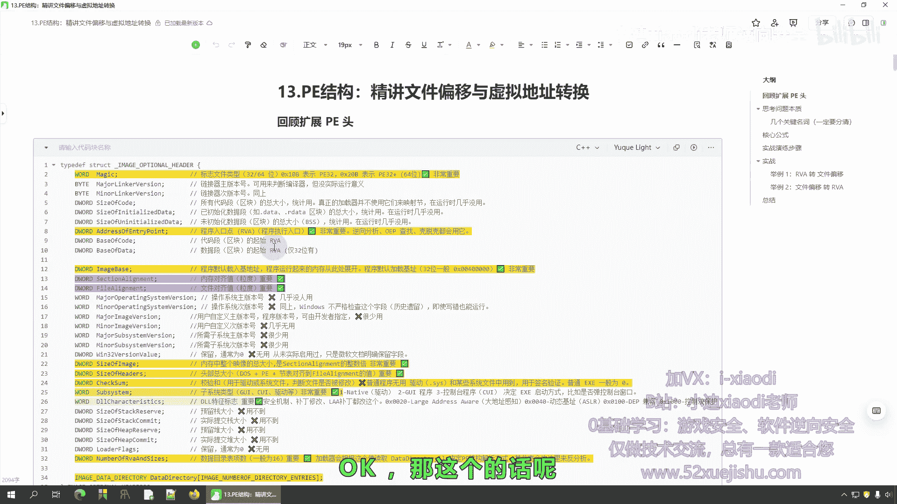

📘 保姆级教学PE文件结构：第十三讲：文件偏移与虚拟地址转换

本节课中，我们将要学习 PE 文件结构里的一个重点问题：文件偏移与虚拟地址转换。本节由小迪老师讲解。先来回顾一下扩展 PE 头（Optional Header）中的内容。它的第一个成员是 `Magic`，可以用来标志这个文件是 32 位还是 64 位。再往后就是 `AddressOfEntryPoint`，它说明了程序的入口点。如果遇到加壳、脱壳相关的问题，就需要重点看这个入口点。然后是 `ImageBase`，它说明了程序默认的载入基址值。程序运行起来之后，内存就从此处展开。


接下来要说到的是今天的主角：`FileAlignment` 和 `SectionAlignment`。它们分别是文件对齐和内存对齐。常见的文件对齐值是 `0x200`，常见的内存对齐值是 `0x1000`。这两个值不一样的时候，我们就需要思考问题的本质了。假如某个 PE 文件真的采用这种对齐方式，当这个文件被映射到内存之后，或者说程序运行起来之后，同一个数据相对于文件开头的偏移量，在内存和磁盘中是不同的，而且通常内在内存中的偏移会更大一些。

举个例子，现在文件中这个位置有一个数据，当程序运行起来之后，它还在这个位置吗？显然不在了。我们可以画一条虚线把位置延伸过去，从图中就可以直观地看出来，它在内存中肯定不是原来的位置。那它到底在哪个位置呢？它大概应该是在中间的位置，你看这个数据位于中间，另一个数据也应该位于中间附近，应该在这个位置才对。所以这个时候，文件偏移地址与虚拟地址的转换问题就出现了。比如我们想知道内存中的某个地址对应文件中的哪一段数据，或者想知道文件中的某个字节数据在运行时被映射到了哪个地址，这些都需要用到转换。

在这里，我们先来介绍几个关键名词。以下是必须掌握的基础概念。


- **File Offset（文件偏移）**：表示文件中某个字节距离文件开头的距离，也就是磁盘上的位置。比如 `0x1234` 就代表这个字节数据相对于文件开头 `0` 的偏移量。
- **RVA（Relative Virtual Address，相对虚拟地址）**：表示内存中某个字节距离映像基址，也就是 `ImageBase` 的距离。比如某个数据的内存地址是 `0x401234`，`ImageBase` 是 `0x400000`，那么这个数据的 RVA 就是 `0x1234`。
- **VA（Virtual Address，绝对虚拟地址）**：表示的是绝对虚拟地址。RVA 加上 `ImageBase` 就得到 VA，反过来用 VA 减去 `ImageBase` 就得到 RVA。

了解完这些名词之后，我们就可以讲一下核心公式了。如果要在两者之间转换，关键就是通过节表找到对应的区段。为什么要找区段呢？因为每个区段中的数据，无论在内存中还是在文件中，相对于该节的偏移量总是一致的。每个节的数据不会因为程序运行就发生重大的变化。我们在之前的第十一节课中就已经讲过：对于大部分普通 PE 程序来说，它各个节、各个区段的数据基本上都是照搬的，不会多做改动。

接下来复习一个容易被忘记的概念：节表里的 `VirtualAddress`。有的同学可能忘了它是什么，这里我们再复习一下。以下是今天要用到的三个节表字段。


- `VirtualAddress`：表示节在内存中的 RVA 地址。
- `SizeOfRawData`：表示节在文件中的大小。
- `PointerToRawData`：表示节在文件中的偏移。

比如此时内存中的某个位置有一个数据，它的 RVA 是 R。那么这个 R 减去节的 `VirtualAddress`，得到的就是内存中某个数据相对于该节的偏移。假设它位于 `.text` 节，`.text` 节的 `VirtualAddress` 是 `0x1000`，那么 `R - 0x1000` 就是节内偏移。同样的道理，文件的 `FileOffset` 减去 `PointerToRawData`，得到的就是文件中的数据相对于该节的偏移。这个偏移不管你是在程序运行时看，还是在本地磁盘状态看，都是一样的。因为每个节的数据不会因为程序运行还是本地状态而发生重大变化。

所以现在转换公式就有了。以下就是两个核心转换公式。

```text
FileOffset = RVA - VirtualAddress + PointerToRawData
RVA = FileOffset - PointerToRawData + VirtualAddress
```

大家要注意的是，上下两个括号里的内容虽然不一样，但本质上说明的都是数据在节内的偏移，所以它们的值是相同的。只不过我们要计算的方向不一样：一个是计算文件偏移，所以要以 `PointerToRawData` 为基准；如果我们要计算内存地址，就要以 `VirtualAddress` 为基准。整体计算步骤我们再来归纳一下。以下是完整的定位步骤。

第一步，先看看这个程序有几个节。第二步，看手上的内存地址或文件偏移属于哪个节的范围，因为每个节的 `VirtualAddress` 是不一样的。如果已知的是 RVA，就可以看 `RVA` 是否在 `VirtualAddress` 到 `VirtualAddress + VirtualSize` 之间；如果已知的是 FileOffset，就可以看 `FileOffset` 是否在 `PointerToRawData` 到 `PointerToRawData + SizeOfRawData` 之间。这样我们就定位到了这个数据属于哪个节。找到所在节之后，就可以套公式了。


下面来看一个具体例子。假设我们要查找的数据的 RVA 等于 `0x1234`。这时候我们可以先判断：`0x1234` 大于等于 `.text` 节的 `VirtualAddress` `0x1000`，并且小于 `VirtualAddress` 加上 `VirtualSize`，所以说它位于 `.text` 节。接着套公式：`0x1234 - 0x1000 + 0x400 = 0x634`。也就是说，文件偏移等于 `0x1234 - 0x1000`，再加上该节在文件中的偏移 `0x400`，最后得到 `0x634`。我们对照一下，内存中这个位置的值是 `0x68978`，在文件的 `0x634` 位置，值也是 `0x68978`。所以文件偏移就是 `0x634`，计算正确。

下面再看第二个例子，这次是文件偏移转 RVA。假设文件偏移是 `0x634`。第一步，我们要先判断它在哪个节，这时使用 `PointerToRawData` 以及 `SizeOfRawData` 来定位。假设它落在 `.text` 节，且该节的 `PointerToRawData` 是 `0x400`。第二步就可以套公式了：`0x634 - 0x400`，得到节内偏移 `0x234`。这个偏移再加上 `.text` 节的 `VirtualAddress` `0x1000`，就得到 `0x1234`。所以说，RVA 等于 `0x1234`。

最后我们再来总结一下。第一，在做转换之前，一定要先判断它属于哪个节，因为每个节都有独立的映射关系，它们的 `VirtualAddress` 和 `PointerToRawData` 都不一样。第二，每个节中的数据相对于该节的偏移是固定的，不会因为程序运行还是本地状态而改变。正是因为这个偏移不变，所以我们才能以不变应万变。第三，RVA 指的是内存偏移，是程序运行时的状态；FileOffset 是文件偏移，是文件在磁盘上的状态。如果你对节表、`VirtualAddress` 和 `PointerToRawData` 还感到陌生，推荐再把之前学过的 PE 结构复习一下。



本节课中，我们一起学习了文件偏移与虚拟地址转换。我们明白了为什么要转换、核心公式是什么、具体怎么定位节，也通过两个例子亲手完成了一次来回转换。以上就是今天的全部内容，下期再见。

