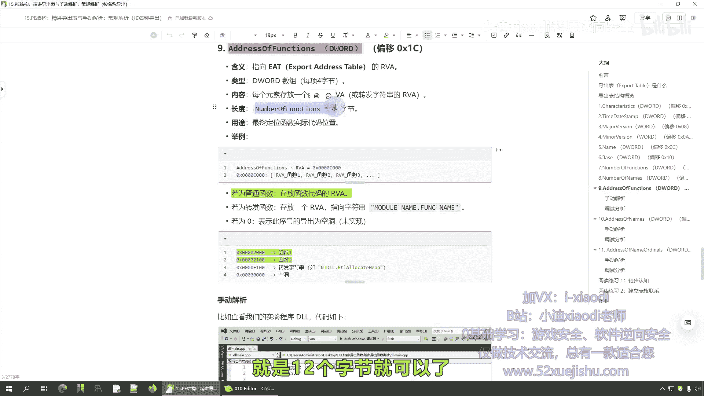
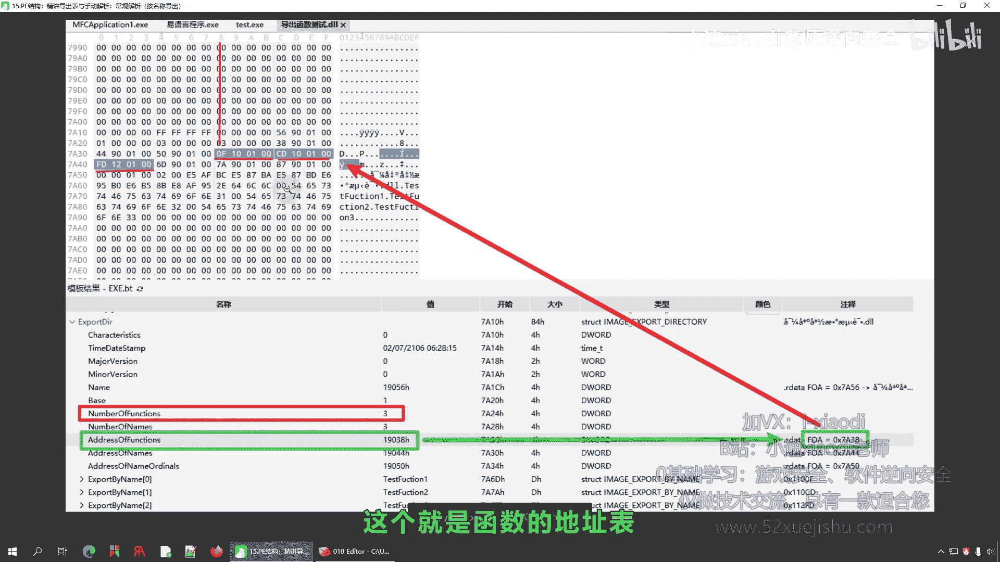
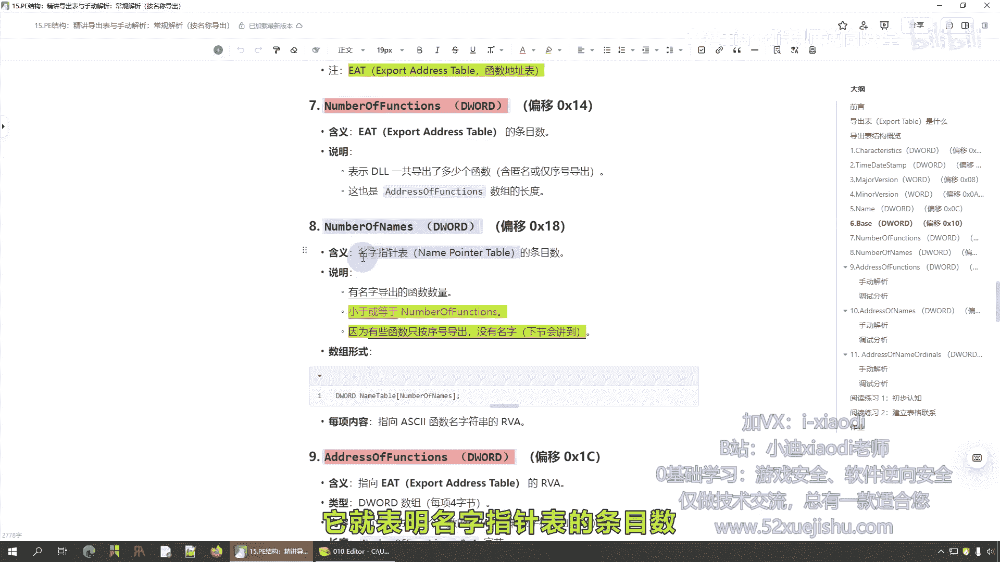
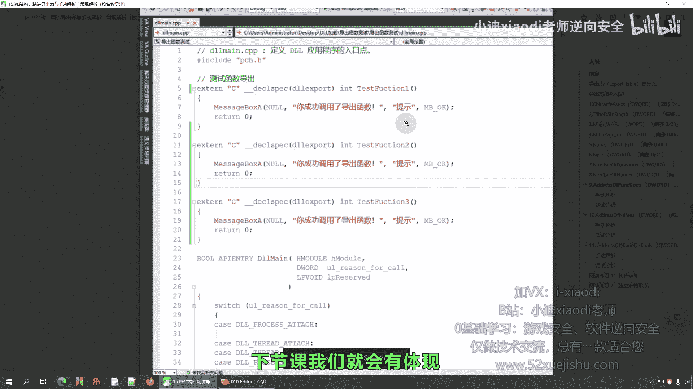
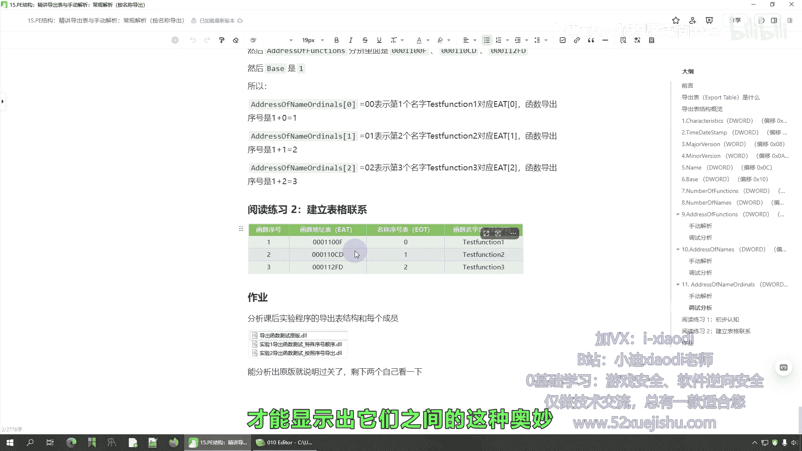

# 🧭 PE文件结构精讲：第15讲：导出表与手动解析——常规解析

在本节课中我们将要学习PE文件结构里的导出表，也就是Export Directory，有时也叫输出表。上一节课我们讲解了数据目录表，数据目录表的作用是指出每个表格的RVA，到底有多少个这样的表格，大家可以看课程图片里列出的很多目录项。本节中我们来看看数据目录表里的第一个表格，也就是导出表，并且用实验程序手动解析导出表里的常规字段和按名称导出的内容。

导出表一般长成一个“大表格”的样子，EXE文件一般不存在这个导出表，它主要存在于大部分DLL文件中。这个说法不是绝对的，有些EXE文件也存在输出函数，也就是导出函数。为了看懂导出表，我们先从一个DLL程序的例子入手：这个程序是DLL应用程序，当前位置是DLL入口，在入口上面我们定义了三个函数，分别是test function1、test function2、test function3，并且分别用带有export的方式导出。此时它们三个就不是普通函数，而是三个导出函数。导出之后，这三个函数就可以给别的EXE程序调用，它们的功能就是给别人调用。

# 📌 PE文件结构精讲：第15讲：导出表是什么

上一节我们说明了导出表在数据目录表中的位置，本节先讲清楚导出表的概念和作用。导出表是一个大表格，记录了模块通常是由DLL暴露的函数或数据，这些函数实际上就叫导出函数。我们在自己开发的DLL应用程序里暴露了三个函数，也就是说这三个函数是暴露给外部的，外部程序可以通过各种各样的方式调用这三个函数。导出表的作用就是记录这些函数的一些信息，导出表包含这些函数的暴露信息，比如有哪些名字能被别的程序调用。比如把程序发给别人，别人直接通过test方式1就可以调用我的函数，以及这些名字对应哪个序号或者地址。

现在我们暴露给别人三个函数，这三个函数实际上是有序号的，虽然现在没有直接看到，但是它确实存在于PE文件中，然后就是地址。因为我们写的DLL应用程序也是可执行文件，所以它运行起来或者被加载之后也是有内存地址的，导出表记录的地址一般是RVA。这些全部信息都被记录在导出表这个大表格里，一旦某个程序加载这个DLL，它就可以通过导出表把这些数据解析到这个程序里面。下面我们先简单了解导出表长什么样。

# 🧱 PE文件结构精讲：第15讲：导出表的11个成员与三个小表

知道了导出表的基本作用后，本节来看看它的内部结构。导出表里面共有11个成员，前四个成员都是一些无关紧要的东西，重点从第五个成员往后去了解。在认识具体成员之前，我们先有一个简单认知：导出表是一个大表格，整个结构就是一张大表。这个大表格里又包含三个重要的小表格，这三个小表格就是最后三个成员，分别是函数地址表、函数名字的指针表、函数名字的序号表。

以下是导出表11个成员的简表，先建立整体印象，后面再逐项展开。

- 第一个成员是导出表标志，目前固定为0，直接忽略。

- 第二个成员是导出表创建时间戳，之前讲过，它是1970年1月1日起的秒数。

- 第三个成员是导出表主版本号，默认为0，通常为1，实际作用不大。

- 第四个成员是导出表次版本号，默认也是0，一般不用。

- 第五个成员是Name，说明模块名称字符串的RVA。

- 第六个成员是Base，表示导出函数的起始序号。

- 第七个成员是NumberOfFunctions，表示这个DLL一共导出了多少个函数。

- 第八个成员是NumberOfNames，表示名字指针表的条目数，也说明有名字导出的函数数量。

- 第九个成员是AddressOfFunctions，指向EAT的RVA，EAT就是导出函数地址表。

- 第十个成员是AddressOfNames，指向名字指针表的RVA。

- 第十一个成员是AddressOfNameOrdinals，指向名字序号表的RVA。

上面的成员可以用下面的结构顺序来记忆，前四项先略过，重点看第五项到第十一项。

```text
导出表成员顺序：
1 Characteristics
2 TimeDateStamp
3 MajorVersion
4 MinorVersion
5 Name
6 Base
7 NumberOfFunctions
8 NumberOfNames
9 AddressOfFunctions
10 AddressOfNames
11 AddressOfNameOrdinals
```

# 🔍 PE文件结构精讲：第15讲：定位导出表与模块名称

上一节我们认识了11个成员，本节我们打开实验程序，先找到导出表的位置。先找到NT头，在里面找到扩展PE头，然后在最下面找到数据目录表，展开export目录项，右边会自动计算FOA在7A10的位置。我们按Ctrl加G，转到7A10的位置并回车，这个位置就是导出表。还有一种简单的查询方法：先把这个关闭，可以看到下面有一个exportIR，双击一下，它会自动寻找到7A10，也就是导出表这个位置。

以下是定位导出表的两种操作方式，实际分析时任选一种即可。

- 方式一：NT头 -> 扩展PE头 -> 数据目录表 -> 展开Export，读取工具计算出的FOA，再用Ctrl加G跳转。

- 方式二：在工具下方双击exportIR目录项，让工具自动跳到导出表位置。

定位到导出表后，我们就可以分析第五个成员Name。它说明的是模块名称字符串的RVA，在这里可以看到Name是19056，转换成FOA就是7A56。这个时候我们去找到7A56，模块名称字符串就在这个位置。字符串以0为结尾，所以我们要选中到0的位置。此时会发现这边好像是乱码，处理方法是复制这边的字节，然后解码。复制出来之后，可以打开openK，点击编程助手，一般来说它是UTF-8，然后粘贴过来，这个时候就可以看到它的名称了。此时Name指向的模块名称就是“导出函数测试点.dll”。

这里还有一个细节：左边这个文件名是我改过的，原本再去生成或者创建这个文件的时候，它原本的文件名就是“导出函数测试点.dll”。也就是说这个名字通常与文件名是相同的，但它只是在程序编译生成过程中写到程序里的一个字符串，并非真正的文件系统路径或文件名。这个东西可以作一个参考，但是它并不可靠。文件名是可以改的，这边这个名字也是可以改的。

```text
Name = 0x19056  ->  FOA = 0x7A56
字符串以 0x00 结尾
```

> 提示：分析导出表时，先找数据目录表中的Export目录项，再顺着RVA和FOA转换查看。RVA是相对虚拟地址，FOA是文件偏移，工具可以在两者之间转换。

# 🔢 PE文件结构精讲：第15讲：Base与导出函数数量

上一节我们定位了导出表并查看了模块名称，本节来看看Base和导出函数数量这两个字段。第六个成员Base表示导出函数的起始序号。因为一开始讲过，每个函数实际上都是有标号的，那么第一个函数的标号是多少，就是从这个Base开始。对于我们的实验程序来说，可以看到Base是1。第七个成员NumberOfFunctions表示这个DLL一共导出了多少个函数，看一下实验程序，NumberOfFunctions是3，说明这个程序向外界暴露了三个导出函数。

以下是Base和数量字段在实验程序中的观察结果，先记住数值，后面结合三个表理解。

- Base = 1，表示导出函数序号的起始值。

- NumberOfFunctions = 3，表示一共导出了3个函数。

- 本实验程序中，三个函数都按名称导出，后面还会看到NumberOfNames也是3。

这里要先把函数序号的统一计算方式记住，后面分析EAT时会反复用到。

```text
真实函数序号 = Base + EAT下标
EAT下标从0开始，因为C++数组下标从0开始
```

> 注意：原文口述中有一处“第三个函数三加一等于四”的说法。结合后文“真实函数序号=Base+下标”和C++数组下标从0开始，本实验应理解为EAT下标0、1、2对应函数序号1、2、3。分析PE时以公式和表内实际数据为准。

# 📚 PE文件结构精讲：第15讲：函数地址表EAT

上一节我们看了Base和函数数量，本节来看第九个成员AddressOfFunctions，它指向EAT的RVA。什么是EAT？EAT就是导出函数的表格，或者叫函数的地址表。这个表的长度是多少？长度就是NumberOfFunctions。比如这个值是3，也就说有三个函数，三个函数也就意味着AddressOfFunctions这个数组的长度是3，因为它里面放的是地址，地址是四个字节。如果我们要找的话，就找3乘4个字节，也就是12个字节。

以下是EAT的手动解析步骤，按这个顺序可以找到三个函数的地址。

- 读取AddressOfFunctions，实验程序里它是19038，对应的FOA是7A38。

- 找到7A38后，从7A38开始取3乘4等于12个字节。

- 12个字节分成三个4字节地址，这三个地址就是三个函数的RVA。



- 如果要查看它们的代码，可以借助DBJ调试分析，用RVA加上ImageBase得到实际地址。



- 比如基地址是100000，加上某个RVA后得到100110F，去这个地址查看，就发现它的确是这个函数。

- 课程里也可以查阅test方式2和test方式3，会发现这三个RVA的的确确是指向地址的，所以它就是函数的地址表。

```text
EAT字节数 = NumberOfFunctions × 4
实验程序：3 × 4 = 12 字节
AddressOfFunctions = 0x19038 -> FOA = 0x7A38
```

这个函数地址表相信大家应该也就看明白了。EAT里放的是函数地址，地址数量由NumberOfFunctions决定，地址宽度是4字节，所以长度计算很直接。

# 🏷️ PE文件结构精讲：第15讲：函数名字指针表

上一节我们讲完了函数地址表，本节来看第二个小表格，也就是函数名字的指针表。有几个函数有名字，就通过第八个成员NumberOfNames去决定，它表明名字指针表的条目数，也说明有名字导出的函数数量。这里可能有人有疑问：我写的这三个函数不是都用名字吗？这里要注意，开发自己的程序时，其实是可以决定进行无名导出的，所以它的名字就会为空，下节课会有体现。因此并不是有几个函数就有几个函数名，函数名数量是小于等于函数数量的。有些函数可以不用名字去导出，不用名字就用序号去导出，这个下节课会讲到。

以下是名字指针表的解析步骤，实验程序里三个函数都按名字导出，所以可以直接对应。

- 实验程序NumberOfNames是3，等于NumberOfFunctions，说明这三个函数都是按照名字去导出的。



- 名字的数量有了，名字的表格就在第十个成员AddressOfNames。



- NumberOfNames和AddressOfNames相对应，NumberOfFunctions和AddressOfFunctions相对应。

- AddressOfNames指向名字指针表的RVA，实验程序里它的FOA是7A44。

- 在7A44位置取三个4字节的RVA，分别是01906D、01907A、019087。

- 加上ImageBase后，可以在内存中查看它们的内容，字符串都是以0为结尾的。

- 如果要在本地查看，就要把RVA转换成FOA，1906D转换成FOA是7A6D，1907A是7A7A，19087是7A87。

- 查看7A6D、7A7A、7A87，右边的字符串就是test方式1、test方式2、test方式3，这边就对应上了。

```text
名字指针表字节数 = NumberOfNames × 4
实验程序：3 × 4 = 12 字节
AddressOfNames FOA = 0x7A44
三个名字RVA：0x1906D、0x1907A、0x19087
对应FOA：0x7A6D、0x7A7A、0x7A87
```

推荐大家自己去动手计算。如果问这个是什么工具，实际上就是openK，打开openK后这里有一个扫描器，这里有一个PE扫描，把这个文件拖过来，点击地址转换就可以去计算。此时我们就讲完了第五、第六、第七、第八、第九、第十个成员，同时也讲完了函数名字的指针表，前两个表格我们都讲完了。

# 🔗 PE文件结构精讲：第15讲：函数名字序号表与对应关系

上一节我们讲完了名字指针表，本节来看最后一个表格，也就是函数名字的序号表。函数名字也是有序号的，这个序号就在第十一个成员AddressOfNameOrdinals，它指向名字序号表的RVA。理解这个东西暂时不用想得太复杂，实际上有几个名字，这个序号表内就有几个序号。比如实验程序最后一个成员的FOA是7A50，我们去查看7A50。由于它这个类型是word，两个字节，有几个名字？实验程序有三个名字，所以查三个两个字节，也就是6个字节。第一个是0000，第二个是0001，第三个是0002，这个就是名字的序号表。

以下是名字序号表和对应关系的要点，先把实验程序里的三个序号记住。

- 名字序号表类型是word，每个序号占2字节。

- 实验程序有3个名字，所以序号表长度是3乘2等于6字节。

- 三个序号分别是0000、0001、0002。

- 第一个函数test function1的名字序号是0。

- 第二个函数test function2的名字序号是1。

- 第三个函数test function3的名字序号是2。

名称序号表里的0、1、2是三个成员，它们对应三个字符串，所以这个成员和字符串是一一对应的关系。第一个成员对应第一个字符串，第二个成员对应第二个字符串，第三个成员对应第三个字符串，这是成员和字符串之间的对应关系。还有字符串和函数地址表之间的对应关系：第一个字符串对应函数地址表里下标为“名称序号表第一个成员的值”的位置。第二个字符串对应函数地址表里下标为“名称序号表第二个成员的值”的位置。举个例子，如果名称序号表里第二个成员是5，那么第二个字符串就对应函数地址表里下标为5的位置。第三个字符串对应函数地址表里下标为“名称序号表第三个成员的值”的位置。实验程序里第三个成员的值是2，所以就是对应下标2。

```text
名字序号表字节数 = NumberOfNames × 2
实验程序：3 × 2 = 6 字节
名字序号表内容：0x0000、0x0001、0x0002
字符串 -> EAT下标：名称序号表成员值
```

如果大家还听不明白，后边还会有两节课专门讲解它们的对应关系，有一些例外的情况，所以要坚持看下去。看到最后一定能够搞明白它们之间的对应关系。

# 🧮 PE文件结构精讲：第15讲：函数序号与名字序号的区别

上一节我们讲到了名字序号表，本节要区分两个概念：函数序号和名字序号。前面还讲到一个序号，这个序号是函数的序号，函数序号和名字序号是完全不一样的概念。函数序号要和函数地址表相挂钩，现在我们已经知道EAT就是函数地址表，这个表格里下标为0对应序号1，下标为1对应序号2，这个计算要看下标，也就是某个函数地址在表内的下标。因为C++数组下标就是从0开始，这个大家可能会有所混淆，可以多思考两遍。最终导出函数的真实序号等于Base加上这个下标。

以下是两个序号概念的区别，分析导出表时不要把它们混在一起。

- 函数序号：和EAT下标挂钩，计算公式是“真实函数序号 = Base + EAT下标”。

- 名字序号：和名字序号表挂钩，表示某个函数名在名字序号表里的序号值。

- 名字序号表里的值不是函数序号本身，而是用来指向EAT下标的索引。

- 实验程序Base是1，EAT下标0、1、2对应的真实函数序号是1、2、3。

- 名字序号表里的0、1、2对应三个字符串，也分别指向EAT的下标0、1、2。

# 📝 PE文件结构精讲：第15讲：三个表的整体关系

上一节我们区分了两个序号概念，本节把三个表整体串起来。比如实验程序有三个函数，名字表里就会有三个函数名，因为名字也有序号，这个序号就放在名称序号表里。通过分析知道它们分别是0、1、2，0对应第一个名字，1对应第二个名字，2对应第三个名字。每个函数实际上也是代码，所以它们都会有一个内存地址，这些内存地址就构成了函数的地址表。导出表最核心的内容就是这三个表：函数地址表、函数名字指针表、函数名字序号表。

以下是三个表的整体关系，先抓住“数量对应”和“下标对应”两条线。

- 函数地址表EAT：由NumberOfFunctions决定长度，里面放函数地址RVA。

- 函数名字指针表：由NumberOfNames决定长度，里面放函数名字字符串的RVA。

- 函数名字序号表：由NumberOfNames决定长度，里面放word类型的名字序号值。

- NumberOfFunctions和AddressOfFunctions对应，NumberOfNames和AddressOfNames对应。

- 名字序号表里的值作为EAT下标，从而把“名字”和“函数地址”连起来。

- 真实函数序号用Base加EAT下标计算，Base典型值是1，本实验程序里也是1。

- 所以下标0对应函数序号1，下标1对应函数序号2，下标2对应函数序号3。

```text
核心关系：
NumberOfFunctions -> EAT长度
NumberOfNames -> 名字指针表长度 + 名字序号表长度
名字序号表值 -> EAT下标
真实函数序号 = Base + EAT下标
```

# ✅ PE文件结构精讲：第15讲：总结与下节预告



本节课中我们一起学习了导出表的基本概念、11个成员、三个小表格，以及常规解析方法。今天实际上只要能够把每个成员分析出来就可以了，具体它们之间的对应关系，下一节会有更加深入的讲解。因为常规的解析不容易区别它们之间到底存在怎样的解析关系，只有特殊的情况才能显示出它们之间的这种奥妙。本讲内容到这里结束，下一节继续分析导出表的对应关系和特殊情况。

