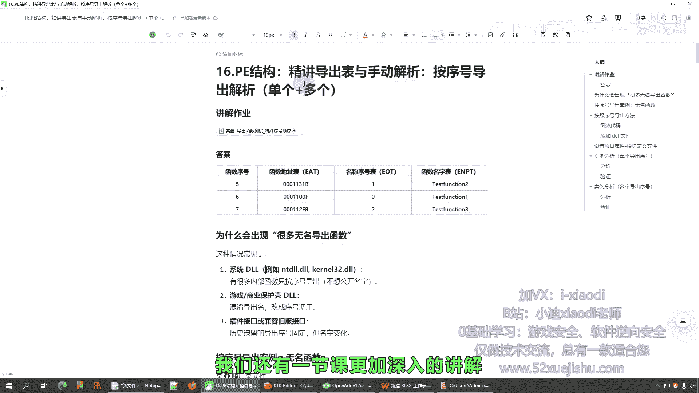

# PE文件结构：第十六讲：导出表与手动解析 🧩

## 📚 内容概述

本节课主要学习 PE 文件导出表的结构、导出函数的手动解析方法，以及按名称导出和按序号导出的区别。

本节内容包括以下几个方面：

- 复习并完成上一节课的导出表作业。
- 解析 `AddressOfFunctions`、`AddressOfNames` 和名称序号表。
- 理解导出函数名称、函数地址与函数序号之间的对应关系。
- 分析无名导出函数产生的原因。
- 学习如何在程序中通过模块定义文件导出无名函数。
- 通过单个序号导出和多个序号导出两个实例进行练习。

上一节课已经介绍了 PE 文件导出表的基本结构。本节课将在此基础上，进一步学习如何不依赖工具，直接根据 PE 文件中的数据手动还原导出函数信息。

---

## 一、复习上一节课的作业 📝

上一节课布置了两个作业。本节课先讲解第一个作业，第二个作业在学习完本节内容后即可理解。

首先，将作业程序拖入 PE 分析工具中，然后展开 `Export`，查看导出表中的关键信息。

以下是工具中需要重点关注的字段：

- `Base`
- `Number of Functions`
- `Number of Names`
- `Address of Functions`
- `Address of Names`
- 名称序号表

---

## 二、解析第一个导出表实例 🔍

### 2.1 确定导出函数数量

首先可以看到：

```text
Base = 5
Number of Functions = 3
Number of Names = 3
```

这三个字段表示：

- `Base` 的值为 `5`。
- 一共有 `3` 个导出函数。
- 一共有 `3` 个导出名称。

因为导出函数数量和导出名称数量相同，所以这三个函数全部按照名称导出。

可以先建立一张记录表，方便后续进行对应：

| 字段 | 数值 |
|---|---:|
| Base | 5 |
| Number of Functions | 3 |
| Number of Names | 3 |

导出函数的最终序号可以通过下面的公式计算：

```text
函数序号 = Base + 函数地址表下标
```

由于下标从 `0` 开始，因此三个函数对应的序号为：

```text
5 + 0 = 5
5 + 1 = 6
5 + 2 = 7
```

所以，最终的函数序号是：

```text
5、6、7
```

---


### 2.2 解析函数地址表

接下来查看 `AddressOfFunctions`。

工具显示它的文件偏移地址，也就是 `FOA`，为：


```text
FOA = 0x7A38
```

找到文件偏移 `0x7A38` 后，由于 `Number of Functions = 3`，所以需要连续读取三个函数地址。

读取到的函数地址如下：


| 函数地址表下标 | 函数地址 |
|---:|---:|
| 0 | `0x01131B` |
| 1 | `0x01100F` |
| 2 | `0x011F8` |

函数地址表的作用是保存每个导出函数在内存中的相对虚拟地址。这里读取到的是函数的 RVA，实际分析时需要根据文件结构判断其对应位置。

截至这里，函数地址表已经解析完成。


---

### 2.3 解析函数名称地址表

接下来查看 `AddressOfNames`。

工具显示：

```text
FOA = 0x7A44
```

因为一共有三个名称，所以从 `0x7A44` 开始读取三个名称地址。

读取结果如下：

| 名称地址表下标 | 名称 RVA |
|---:|---:|
| 0 | `0x01907A` |
| 1 | `0x01906D` |
| 2 | `0x019087` |

这些值是 RVA，需要先转换为文件偏移地址 FOA。

根据当前文件的节区映射关系，转换结果为：

| 名称地址表下标 | 名称 RVA | 名称 FOA |
|---:|---:|---:|
| 0 | `0x01907A` | `0x7A7A` |
| 1 | `0x01906D` | `0x7A6D` |
| 2 | `0x019087` | `0x7A87` |

RVA 转换为 FOA 的过程，通常需要根据节区的虚拟地址、文件偏移和节区大小进行计算。核心思想可以表示为：

```text
FOA = RVA - 节区虚拟地址 + 节区文件偏移
```

---

### 2.4 读取导出函数名称

根据上面计算出的 FOA，分别读取对应位置的字符串。

以下是三个名称的读取结果：

| 名称 FOA | 导出函数名称 |
|---:|---|
| `0x7A7A` | `tex function1` |
| `0x7A6D` | `tex function2` |
| `0x7A87` | `tex function3` |

到这里，我们已经获得了三个函数名称。

但是，当前还不能直接认为名称表中的第一个名称就对应函数地址表中的第一个函数。原因是 `AddressOfNames` 只保存名称地址，而不直接保存函数地址表的下标。

因此，还需要继续解析名称序号表。

---

## 三、解析名称序号表 🔢

### 3.1 找到名称序号表

名称序号表是导出表中的最后一个重要成员。

工具显示名称序号表的文件偏移地址为：


```text
FOA = 0x7A50
```

在 `0x7A50` 位置读取三个序号，得到：

```text
01 00 02
```

这些数据表示三个导出名称分别对应函数地址表中的哪个下标。

需要注意，名称序号表中的值不是最终函数序号，而是函数地址表的下标。

公式如下：

```text
名称对应的函数 = AddressOfFunctions[名称序号]
```

---

### 3.2 建立名称与函数地址的对应关系

函数地址表如下：

| 下标 | 函数地址 |
|---:|---:|
| 0 | `0x01131B` |
| 1 | `0x01100F` |
| 2 | `0x011F8` |

名称序号表的内容为：

| 名称下标 | 名称序号 |
|---:|---:|
| 0 | 1 |
| 1 | 0 |
| 2 | 2 |

根据名称序号表进行对应：

1. 第一个名称的序号为 `1`，因此它对应函数地址表下标为 `1` 的函数。
2. 第二个名称的序号为 `0`，因此它对应函数地址表下标为 `0` 的函数。
3. 第三个名称的序号为 `2`，因此它对应函数地址表下标为 `2` 的函数。

具体对应关系如下：

| 函数地址表下标 | 函数地址 | 导出函数名称 |
|---:|---:|---|
| 0 | `0x01131B` | `tex function2` |
| 1 | `0x01100F` | `tex function1` |
| 2 | `0x011F8` | `tex function3` |

因此，最终可以得到：

```text
0x01131B → tex function2
0x01100F → tex function1
0x011F8  → tex function3
```

这说明，名称表的排列顺序不一定与函数地址表的排列顺序一致。必须通过名称序号表，才能正确建立函数地址与函数名称之间的联系。

---

### 3.3 计算最终函数序号


当前文件的 `Base` 为 `5`。

函数序号计算公式如下：

```text
函数序号 = Base + 函数地址表下标
```


因此，最终对应关系为：

| 函数序号 | 函数地址 | 函数名称 |
|---:|---:|---|
| 5 | `0x01131B` | `tex function2` |
| 6 | `0x01100F` | `tex function1` |
| 7 | `0x011F8` | `tex function3` |

到这里，第一个作业已经完成。


---

## 四、为什么会出现无名导出函数 🕵️


上一节作业中的第二个程序比较特殊。它同样有三个导出函数，但只有两个函数拥有名称，另一个函数没有名称。

这说明：

```text
Number of Functions = 3
Number of Names = 2
```


导出函数数量大于导出名称数量时，就说明至少有一个函数不是按名称导出的，而是按照序号导出的。

上一节课已经介绍过，一个导出函数通常有两种导出方式：

```text
按名称导出
按序号导出
```


如果某个函数没有对应的名称，它通常就是通过序号导出的。

---

### 4.1 系统文件中的无名导出函数

无名导出函数在系统文件中比较常见。

系统文件中可能存在很多内部函数。这些函数只按照序号导出，不公开函数名称，目的是不让外部开发者直接知道函数的功能。

---

### 4.2 游戏和商业保护壳中的无名导出函数

游戏或商业软件保护壳也可能使用无名导出函数。

保护壳可能会混淆导出名称，把原本的导出名称改成序号，使外部分析人员不能直接通过名称判断函数功能。

这种方式可以增加初步分析的难度。

---

### 4.3 为了兼容旧版接口

有些程序为了兼容旧版本接口，也可能继续使用序号导出。

在接口名称发生变化，或者旧版本程序依赖固定序号的情况下，程序可以通过序号保持兼容。

---

### 4.4 通过导出名称隐藏函数功能

例如，分析某些程序的 DLL 文件时，可以将 DLL 拖入工具，查看导出函数列表。

如果导出函数的 `Function Name` 一栏为空，通常说明这些函数没有公开名称，而是按照序号导出。

如果函数名称被显示出来，例如：

```text
tex function1
tex function3
```

那么分析人员就可以直接根据名称推测函数功能。

如果名称被隐藏，只能看到函数序号，那么分析人员就无法直接知道该函数是做什么的。

因此，程序开发者可能会采用以下方式：

```text
想让外部人员知道函数功能 → 按名称导出
想隐藏函数功能或增加分析难度 → 按序号导出
```

不过，按序号导出只能阻挡初学者或经验较少的分析人员，并不能真正阻止逆向分析。

如果逆向人员掌握系统化的分析方法，就可以进入函数内部，查看它调用了哪些核心 Windows API，再结合函数的参数、返回值和执行逻辑，推测函数的实际功能。

---


## 五、如何开发按序号导出的 DLL 🛠️

下面通过一个简单的开发示例，说明如何创建按名称导出和按序号导出的函数。

假设程序中有两个函数：


```cpp
tex function1
tex function2
```

其中，一个函数按照名称导出，另一个函数只按照序号导出。

首先，可以使用 `__stdcall` 对函数进行修饰。然后，在项目中添加一个模块定义文件，也就是 `.def` 文件。


---

### 5.1 模块定义文件的作用

模块定义文件用于描述 DLL 的导出信息。

可以使用类似下面的形式：

```def
EXPORTS
    tex_function1
    tex_function2 @6 NONAME
```

其中：

- `tex_function1` 表示按照名称导出的函数。
- `tex_function2 @6` 表示函数的导出序号为 `6`。
- `NONAME` 表示该函数不导出名称，只按照序号导出。

不同编译器的具体语法可能略有区别，但核心含义是一致的：

```text
函数名称 + @导出序号 + NONAME
```

---

### 5.2 在项目属性中指定模块定义文件

添加 `.def` 文件后，需要在项目属性中指定该文件。

操作路径通常为：

```text
项目属性
→ 链接器
→ 输入
→ 模块定义文件
```

然后，将刚才创建的 `.def` 文件名称填入对应位置。

完成编译后，DLL 的导出表就会按照 `.def` 文件中的定义生成。

---

## 六、实例一：单个无名序号导出 📌

下面分析一个包含两个导出函数的 DLL。

### 6.1 查看导出表基本信息

工具显示：

```text
Base = 5
Number of Functions = 2
Number of Names = 1
```

这些数据表示：

- 导出函数的起始序号为 `5`。
- 一共有两个导出函数。
- 只有一个函数拥有名称。
- 另一个函数没有名称，只能通过序号调用。

`Base` 为什么是 `5`，是因为在 `.def` 文件中定义导出函数序号时，从 `5` 开始设置。

因此，函数的起始序号会受到 `.def` 文件中序号定义的影响。

---

### 6.2 解析函数地址表

工具显示：

```text
AddressOfFunctions FOA = 0x7A78
```

因为 `Number of Functions = 2`，所以从 `0x7A78` 开始读取两个函数地址。

读取结果如下：

| 函数地址表下标 | 函数地址 |
|---:|---:|
| 0 | `0x011104` |
| 1 | `0x01100F` |

函数地址表可以记录为：

```text
AddressOfFunctions[0] = 0x011104
AddressOfFunctions[1] = 0x01100F
```

---

### 6.3 解析名称地址表

接下来查看 `AddressOfNames`。

工具显示：

```text
AddressOfNames FOA = 0x7A80
```

在该位置读取到：

```text
0x01909D
```

将该 RVA 转换为文件偏移地址后，得到：

```text
FOA = 0x7A9D
```

在文件偏移 `0x7A9D` 处读取到的字符串为：

```text
tex function1
```

这说明，当前 DLL 只有一个函数拥有名称，该名称是：

```text
tex function1
```

---

### 6.4 解析名称序号表

接下来查看名称序号表。

工具显示：

```text
FOA = 0x7A84
```

在该位置读取到：

```text
01
```

这个值表示：

```text
名称序号 = 1
```


这里的 `1` 不是最终的导出序号，而是函数地址表的下标。

函数地址表如下：

| 下标 | 函数地址 |
|---:|---:|
| 0 | `0x011104` |
| 1 | `0x01100F` |


名称序号为 `1`，所以带有名称的函数是函数地址表中下标为 `1` 的函数：

```text
AddressOfFunctions[1] = 0x01100F
```

该函数的名称为：


```text
tex function1
```

因此，对应关系如下：

| 函数地址表下标 | 函数地址 | 是否有名称 | 函数名称 |
|---:|---:|---|---|
| 0 | `0x011104` | 否 | 无名导出 |
| 1 | `0x01100F` | 是 | `tex function1` |


---

### 6.5 计算函数序号

当前文件的 `Base` 为 `5`。

根据公式：

```text
函数序号 = Base + 函数地址表下标
```

可以得到：

| 函数地址表下标 | 函数地址 | 函数序号 | 函数名称 |
|---:|---:|---:|---|
| 0 | `0x011104` | 5 | 无名导出 |
| 1 | `0x01100F` | 6 | `tex function1` |

因此：

```text
序号 5 → 0x011104 → 无名导出
序号 6 → 0x01100F → tex function1
```

可以使用工具进行验证。检查导出序号 `5` 和 `6`，会发现它们分别对应：

```text
5 → 0x011104
6 → 0x01100F
```

其中，序号 `6` 对应的函数名称为：

```text
tex function1
```

这个实例说明，有名导出和无名导出的解析方式基本相同，但在有名导出中，不能忽略名称序号表。

名称序号表中的 `1` 表示名称对应函数地址表的下标为 `1` 的函数，而不是下标为 `0` 的函数。

---

## 七、实例二：多个无名序号导出 📊

下面分析第二个实例。这个实例包含五个导出函数，但只有一个函数拥有名称。

### 7.1 查看导出表基本信息

工具显示：

```text
Base = 1
Number of Functions = 5
Number of Names = 1
```

这些数据表示：

- 导出函数的起始序号为 `1`。
- 一共有五个导出函数。
- 只有一个函数按照名称导出。
- 其余四个函数全部按照序号导出。

由于 `Base = 1`，因此五个函数的最终导出序号为：

```text
1、2、3、4、5
```

---

### 7.2 解析函数地址表

工具显示：

```text
AddressOfFunctions FOA = 0x7A78
```


因为有五个导出函数，所以需要从 `0x7A78` 开始读取五个函数地址。

读取流程如下：

```text
第 1 个地址
第 2 个地址
第 3 个地址
第 4 个地址
第 5 个地址
```


手动解析后，可以建立函数地址表。

函数地址表的基本结构如下：

| 函数地址表下标 | 函数地址 |
|---:|---|
| 0 | 第一个函数地址 |
| 1 | 第二个函数地址 |
| 2 | 第三个函数地址 |
| 3 | 第四个函数地址 |
| 4 | 第五个函数地址 |

由于 `Base = 1`，所以这些函数的序号分别为：

| 函数地址表下标 | 导出序号 |
|---:|---:|
| 0 | 1 |
| 1 | 2 |
| 2 | 3 |
| 3 | 4 |
| 4 | 5 |

---

### 7.3 解析名称序号表

名称序号表的地址为：

```text
FOA = 0x7A90
```

在 `0x7A90` 处读取到：

```text
04
```

这个值表示：

```text
名称序号 = 4
```

也就是说，函数地址表中下标为 `4` 的函数拥有名称。

函数地址表的下标从 `0` 开始：

```text
0、1、2、3、4
```

因此，下标为 `4` 的函数就是第五个函数。

由于名称序号表中只有一个值，所以整个导出表中只有一个函数按照名称导出，其余四个函数均为无名序号导出。

---

### 7.4 读取唯一的函数名称

因为只有一个函数拥有名称，所以只需要读取一个名称地址。

读取名称字符串后，可以得到：

```text
tex function1
```

因此，最终对应关系是：

```text
AddressOfFunctions[4] → tex function1
```

也就是说，函数地址表下标为 `4` 的函数，其导出序号为：

```text
Base + 4 = 1 + 4 = 5
```


最终结果可以表示为：

```text
导出序号 5 → tex function1
```


其余序号 `1、2、3、4` 对应的函数均没有名称。

---

## 八、导出表手动解析总流程 🧠


前面已经分别分析了多个实例。现在将整个手动解析过程整理成一套固定流程。

以下是解析 PE 导出表时可以遵循的步骤：

1. 读取 `Base`。
2. 读取 `NumberOfFunctions`。
3. 读取 `NumberOfNames`。
4. 根据 `AddressOfFunctions` 找到函数地址表。
5. 根据函数数量读取全部函数地址。
6. 根据 `AddressOfNames` 找到名称地址表。
7. 根据名称数量读取全部名称地址。
8. 将名称地址对应的 RVA 转换为 FOA。
9. 读取每个导出函数名称。
10. 根据名称序号表，确定名称对应的函数地址表下标。
11. 使用 `Base + 下标` 计算最终导出序号。
12. 将函数序号、函数地址和函数名称整理到表格中。


整个过程可以用下面的伪代码表示：

```cpp
for (int i = 0; i < NumberOfFunctions; i++) {
    ordinal = Base + i;
    function_rva = AddressOfFunctions[i];

    if (该函数存在对应名称) {
        name = 对应的导出名称;
    } else {
        name = "无名导出";
    }

    输出(ordinal, function_rva, name);
}
```

判断某个函数是否有名称时，需要通过名称序号表进行反向对应：


```text
名称序号表中的值 = 函数地址表下标
```

例如：

```text
名称序号表 = [4]
```


表示：

```text
AddressOfFunctions[4] 对应一个有名称的函数
```

而不是表示该函数的最终导出序号为 `4`。

---

## 九、常见错误与注意事项 ⚠️

在手动解析导出表时，容易出现以下问题。

### 9.1 把名称序号当成最终函数序号

名称序号表中的数字只是函数地址表下标。

错误理解：

```text
名称序号为 1，所以函数序号为 1
```

正确理解：

```text
名称序号为 1
→ 对应 AddressOfFunctions[1]
→ 最终函数序号 = Base + 1
```

---


### 9.2 忽略下标从零开始

函数地址表的下标从 `0` 开始，而不是从 `1` 开始。

例如，五个函数的下标为：


```text
0、1、2、3、4
```

如果 `Base = 1`，对应的导出序号才是：

```text
1、2、3、4、5
```


---

### 9.3 认为名称表和函数地址表顺序一定相同

名称地址表的顺序不一定与函数地址表一致。

必须经过以下关系才能建立正确映射：

```text
名称地址表
→ 名称序号表
→ 函数地址表
→ 导出函数序号
```

不能直接按照名称表和函数地址表的排列位置进行对应。

---

### 9.4 认为无名导出函数无法分析

无名导出函数只是没有公开名称，并不代表无法分析。

逆向人员仍然可以通过以下信息判断函数功能：

- 函数内部调用的 Windows API。
- 函数的参数和返回值。
- 函数访问的全局变量。
- 函数执行的字符串操作。
- 函数访问的文件、网络和注册表行为。
- 函数内部的关键算法。

因此，按序号导出主要是增加初步识别难度，并不能完全隐藏函数功能。

---

## 十、本节总结 ✅

本节课学习了 PE 文件导出表的手动解析方法。


核心内容可以总结为以下几点：

- `Base` 表示导出序号的起始值。
- `NumberOfFunctions` 表示导出函数的总数量。
- `NumberOfNames` 表示拥有名称的导出函数数量。
- `AddressOfFunctions` 指向函数地址表。
- `AddressOfNames` 指向函数名称地址表。
- 名称序号表用于把函数名称对应到函数地址表的下标。
- 函数最终序号的计算公式为：

```text
函数序号 = Base + 函数地址表下标
```



- `NumberOfFunctions` 大于 `NumberOfNames` 时，说明存在无名导出函数。
- 无名导出函数通常按照序号调用。
- 系统文件、游戏、商业保护壳以及兼容旧版本接口的程序中，都可能出现无名导出函数。
- `.def` 模块定义文件可以用于指定函数名称、导出序号以及 `NONAME` 属性。
- 手动解析完成后，可以使用 PE 分析工具进行验证。

本节课中，我们一起学习了导出表、函数地址表、名称地址表和名称序号表之间的关系，也完成了按名称导出、单个按序号导出和多个按序号导出的实例分析。

导出表只靠听讲很难真正掌握，最好按照本节课的流程自己动手练习，先手动计算结果，再使用工具进行对照验证。这样才能真正理解 PE 导出表的内部结构。

