# 🧭 保姆级教学PE文件结构：02：利用微软结构识别PE文件

> 完整系统学习软件安全逆向请联系主页方式；关联标签：2025软件黑客、软件逆向破解、网络验证；视频编号：BV1SqnRzMEGJ。

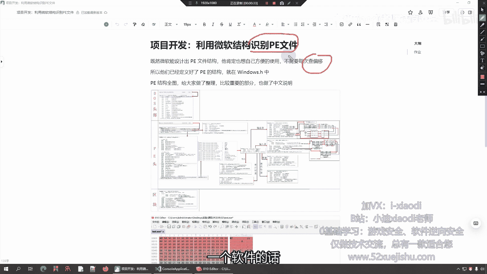

在本节课中，我们将要学习如何利用微软在 `windows.h` 中定义好的 PE 文件结构来识别 PE 文件，并完成一个小工具的开发。我是小李老师，今天继续讲项目开发：利用微软结构识别 PE 文件。既然微软能够设计出 PE 文件结构，它就一定会考虑自己使用时的便利性，因此不需要每次查偏移。上一节课我们通过查偏移的方法开发了一个识别 PE 文件的工具，本节中我们来看看为什么在更完整的项目里要改用微软定义的结构体。

## 🧱 保姆级教学PE文件结构：02-1：为什么不再手动查偏移

上一节我们介绍了通过查偏移识别 PE 文件的方法，本节中我们来看看这种方法的局限。开发一个只查一两次偏移的小工具没有问题，因为仅仅查那么一两次，工作量并不大。但是，如果将来要开发一款识别 PE 文件并且遍历 PE 文件所有结构信息的工具或软件，继续查偏移就会比较痛苦。我们打开 010 Editor（原文中的 010it）把程序拖进来，就可以看到它所有的结构体，所有成员都在这里，每一个成员都有自己独特的偏移。通过查偏移的形式去确定每一个成员，会显得比较痛苦，尤其是在写代码的时候。

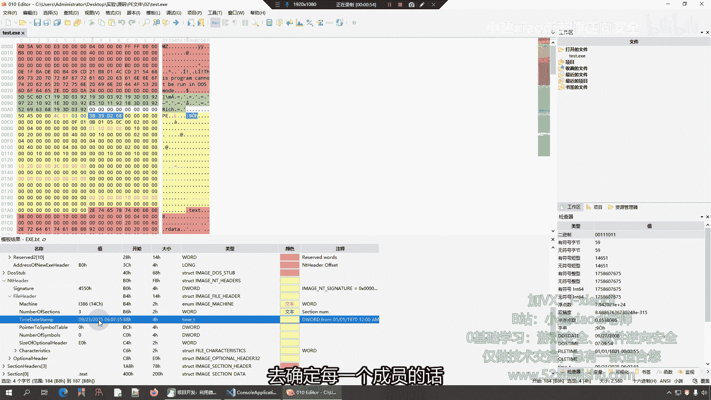

想轻松愉悦地开发，微软也考虑到了这一点，所以微软定义好了 PE 文件的结构，把它们划分成了结构体，放在 `windows.h` 中。因此，如果要开发完整项目，先 `#include <windows.h>`，把这个头文件包含进去。关于 PE 文件结构的全图，我给大家做了一个整理，比较重要的部分也做了中文说明，我向来比较注重把重点整理清楚。核心概念可以用下面的公式描述，结构体成员的位置不需要手工记偏移，而是由结构体类型自动表达。

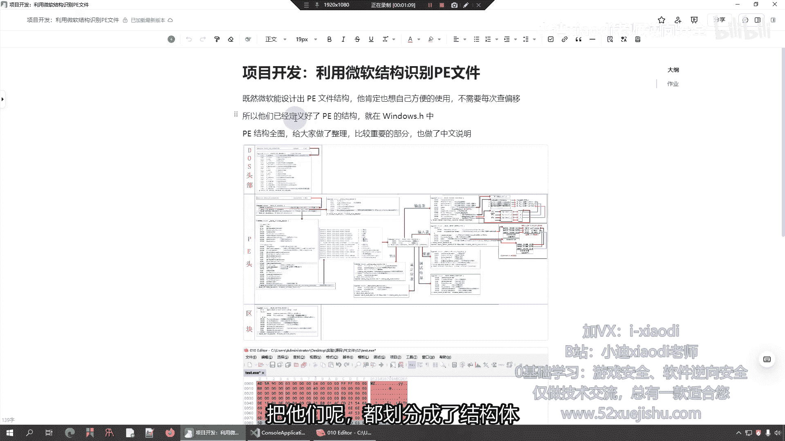

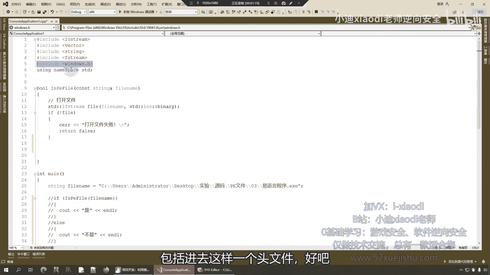

```text
成员地址 = 结构体起始地址 + 成员偏移
e_lfanew = PE 头在文件中的偏移
```

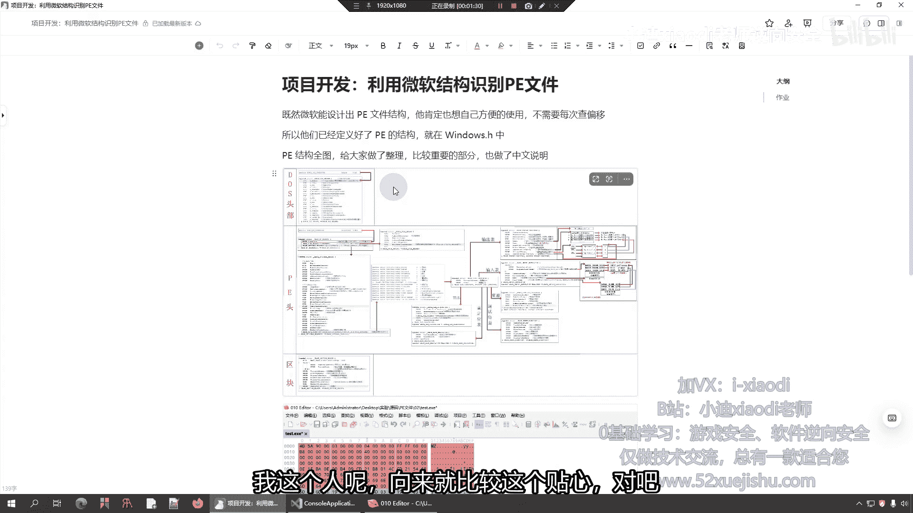

针对今天要开发的项目，我们重点看 DOS 头部。DOS 头部的结构体名称叫作 `IMAGE_DOS_HEADER`，待会写代码的时候就要用到它，把它拉出来练一练。以下是本课需要重点关注的 DOS 头成员：

- 第一个成员是 MZ 标记，它的名称是 `e_magic`。
- 最后一个成员是 `e_lfanew`，它指出 PE 头的文件偏移位置，有时它就指向 PE 标记。

这两个成员就是识别 PE 文件的起点。了解了 DOS 头的关键成员之后，下面开始写代码，打开文件的代码与上一课一致，剩下的代码通过微软的结构去实现。

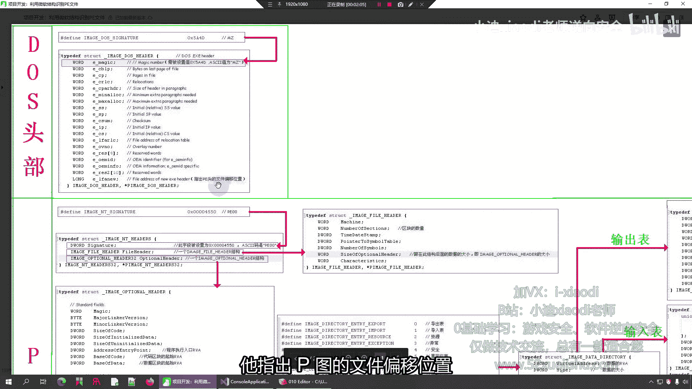

## 💻 保姆级教学PE文件结构：02-2：读取DOS头并判断MZ标记

上一节我们介绍了 DOS 头的关键成员，本节中我们来看看如何用 `IMAGE_DOS_HEADER` 读取 DOS 头并判断 MZ 标记。首先定义一个结构体变量 `dosHeader`，然后把数据读进去，使用 `file.read`。第一个参数是指针类型，先取地址 `&dosHeader`，编译器会提示与 `char*` 类型的形参不兼容，这时直接强制转换成 `char*`。第二个参数比较简单，就是读取的字节数，用 `sizeof(dosHeader)` 自动运算即可。

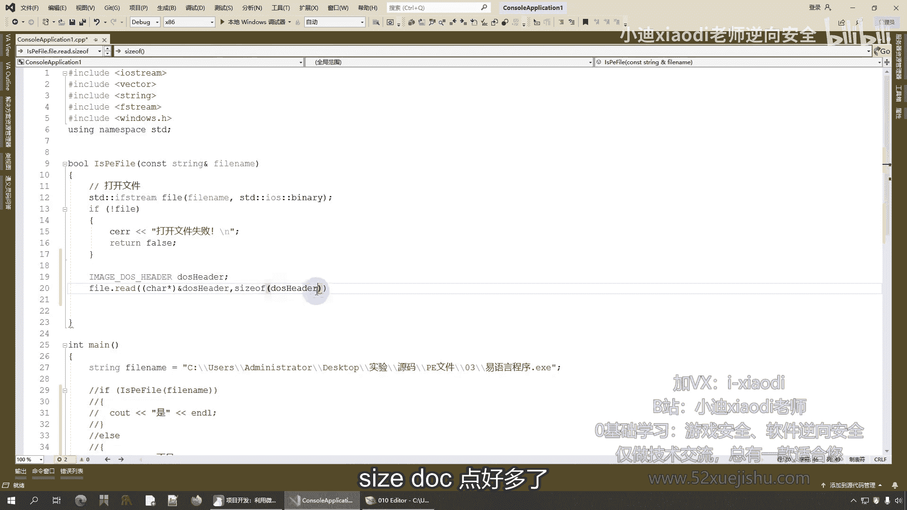

以下是对应的代码骨架，打开文件部分与上一课一致，读取和判断部分使用微软结构：

```cpp
#include <windows.h>
#include <fstream>

bool IsPeFile(const char* path)
{
    std::ifstream file(path, std::ios::binary);
    if (!file) return false;

    IMAGE_DOS_HEADER dosHeader{};
    file.read(reinterpret_cast<char*>(&dosHeader), sizeof(dosHeader));

    if (dosHeader.e_magic != IMAGE_DOS_SIGNATURE)
        return false;

    // 后续继续读取 PE 头
    return true;
}
```

读入 DOS 头之后，就可以把 MZ 标记拉出来。MZ 标记就在结构体的第一个成员，判断时直接写 `if`，使用 `dosHeader.e_magic`。如果它不等于 `IMAGE_DOS_SIGNATURE`，就直接 `return false`。这里当然可以写 `0x5A4D`，但并不推荐，因为微软已经定义好了宏 `IMAGE_DOS_SIGNATURE`，把鼠标放到宏上可以看到它展开为 `0x5A4D`，这个宏已经准备好了，直接使用即可。这样写代码的含义很清楚，也减少了手写魔法数字带来的错误。

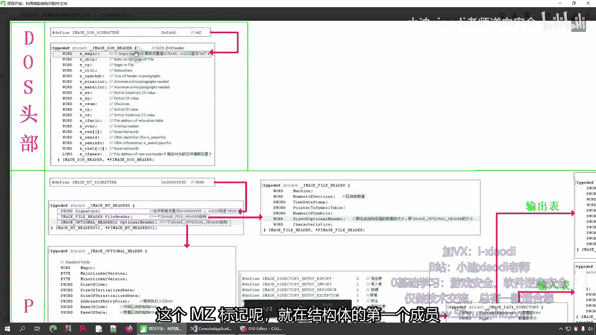

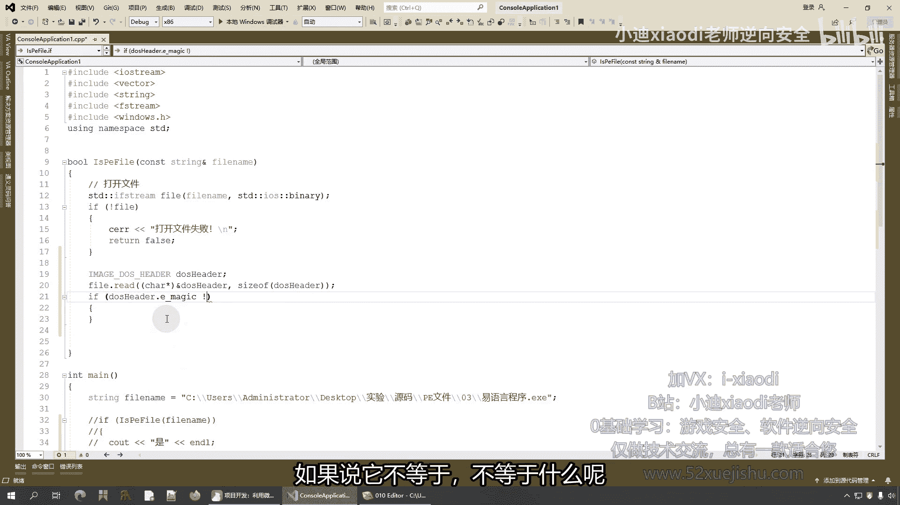

## 🔍 保姆级教学PE文件结构：02-3：读取PE头并判断PE签名

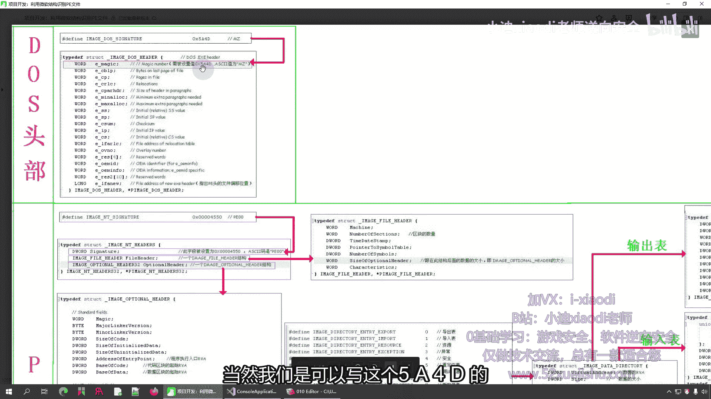

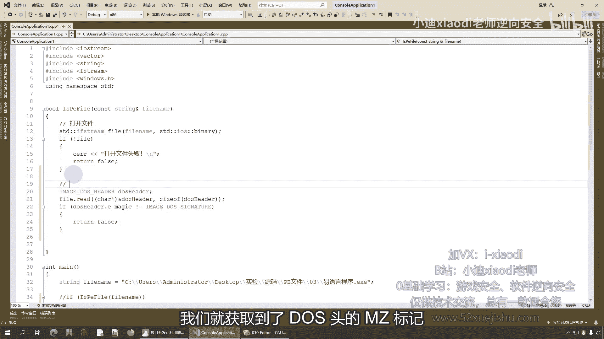

在获取 DOS 头的 MZ 标记之后，紧接着就要获取 PE 标记。PE 标记的获取方式是先把文件指针移动到 PE 标记的位置，这个位置就在 `e_lfanew` 中。移动文件指针时，从文件起始位置开始移动，使用 `std::ios::beg`，移动到 PE 标记的位置。PE 标记在 PE 头里边，PE 头的结构体名称叫作 `IMAGE_NT_HEADERS`，在代码里把它拉出来，并定义一个结构体变量。

以下是读取 PE 头并判断 PE 签名的代码骨架：

```cpp
    file.seekg(dosHeader.e_lfanew, std::ios::beg);

    IMAGE_NT_HEADERS ntHeaders{};
    file.read(reinterpret_cast<char*>(&ntHeaders), sizeof(ntHeaders));

    if (ntHeaders.Signature != IMAGE_NT_SIGNATURE)
        return false;

    return true;
```

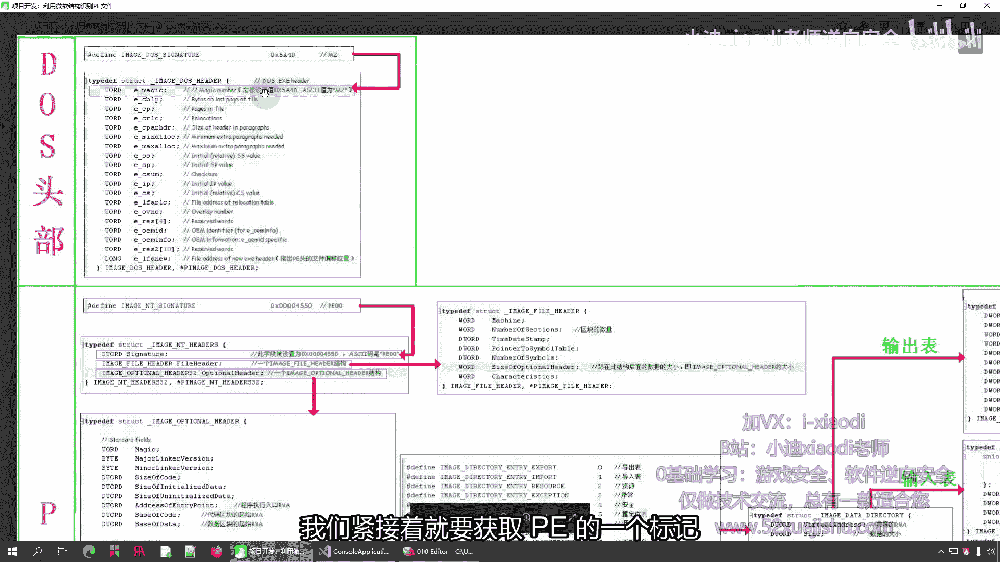

读取 PE 头时，`file.read` 的套路与上面一致，也是取地址，再强制转换成 `char*`，然后使用 `sizeof(ntHeaders)`。这个位置的作用就是读取 PE 头。读完之后就可以直接 `return`，判断方式很简单：使用 `ntHeaders.Signature`，它就是 PE 的标记，判断它是否等于 `IMAGE_NT_SIGNATURE`。`IMAGE_DOS_SIGNATURE` 对应 `0x5A4D`，`IMAGE_NT_SIGNATURE` 对应 `0x4550`，微软都定义好了宏，直接拿来用即可。这样写代码，代码量比较少，可读性也更好。

运行程序时，取消注释，打一个断点，然后运行。这个时候还没有执行，按 F10 单步一下，变量里立刻就有数据，可以看到 `4550`。这说明它是一个 PE 文件，程序也输出它是 PE 文件。核心判断条件可以概括为下面两行代码：

```cpp
if (dosHeader.e_magic != IMAGE_DOS_SIGNATURE) return false;
if (ntHeaders.Signature != IMAGE_NT_SIGNATURE) return false;
```

至此，今天的主体内容就完成了。本课的功能虽然不大，但它把“查偏移”的思路切换成了“用结构体”的思路，后面继续遍历 PE 结构时会更稳定，也更接近实际项目里的写法。

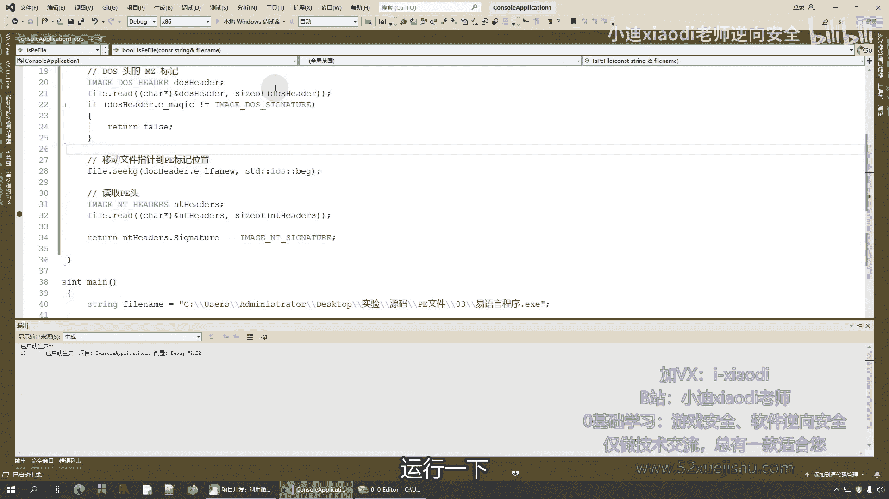

## 📝 保姆级教学PE文件结构：02-4：作业与练习

本课主体功能完成后，最后布置一个作业：读取某个 PE 文件的执行入口、区块数量，并遍历块名。以下是作业需要完成的三项内容：

- 读取某 PE 文件的执行入口，执行入口在 PE 头相关结构里。
- 读取区块数量，区块数量也在 PE 头相关结构里。
- 遍历块名，块名在区块头相关结构里。

遍历块名这个任务，大家不一定真能一次写出来，但是要去做，去意识到哪里写不出来，然后找到问题就可以了。原文所说的执行入口位置、区块数量位置和块名称位置，分别落在 PE 头的相关结构成员中，练习时可以根据结构体成员逐个定位。通过这个作业，可以把本课学到的“使用微软结构体读取字段”的方法继续用起来。

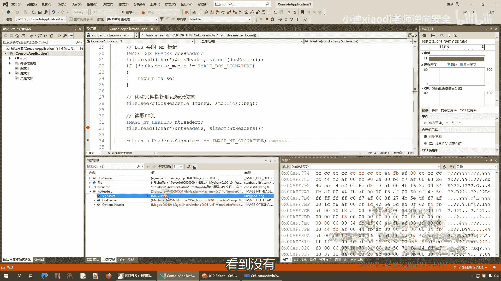

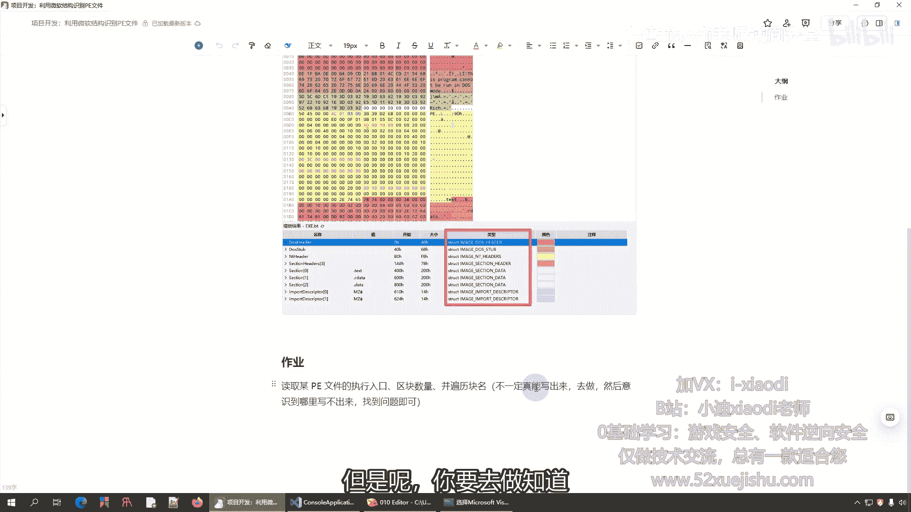

## 📌 保姆级教学PE文件结构：02-5：本课总结

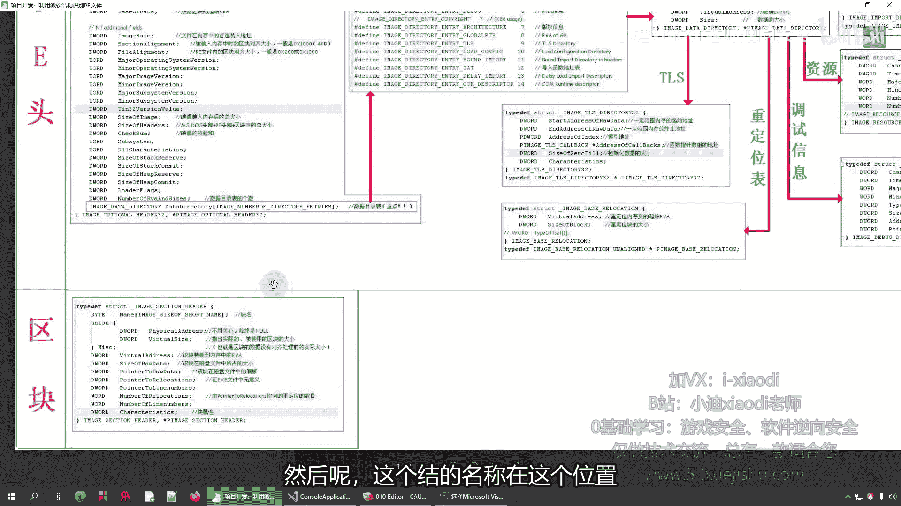

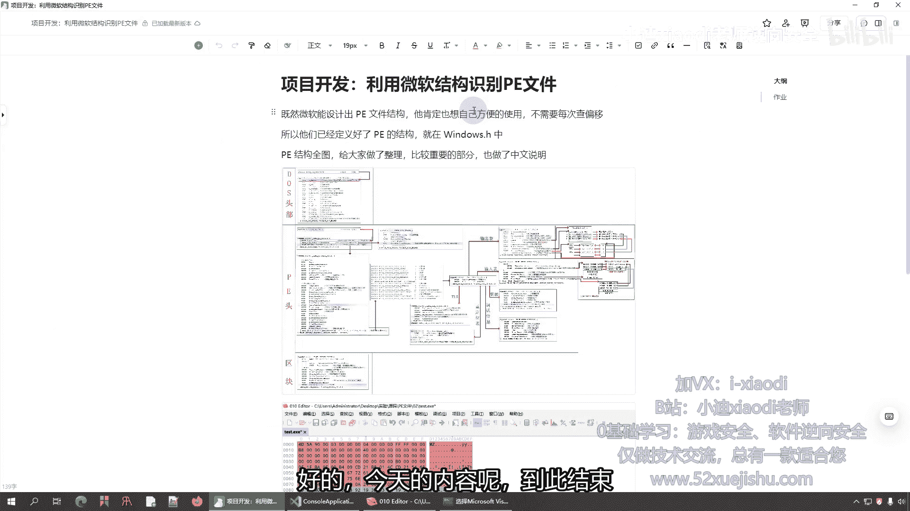

本节课中我们一起学习了如何利用微软结构识别 PE 文件。我们先说明了为什么完整项目里不宜反复查偏移，然后引入 `windows.h` 中定义好的 PE 结构体，接着使用 `IMAGE_DOS_HEADER` 读取 DOS 头并判断 MZ 标记，再使用 `IMAGE_NT_HEADERS` 读取 PE 头并判断 PE 签名，最后布置了读取执行入口、区块数量并遍历块名的作业。今天的内容到此结束，大家回去之后自己练习，下期再见。

