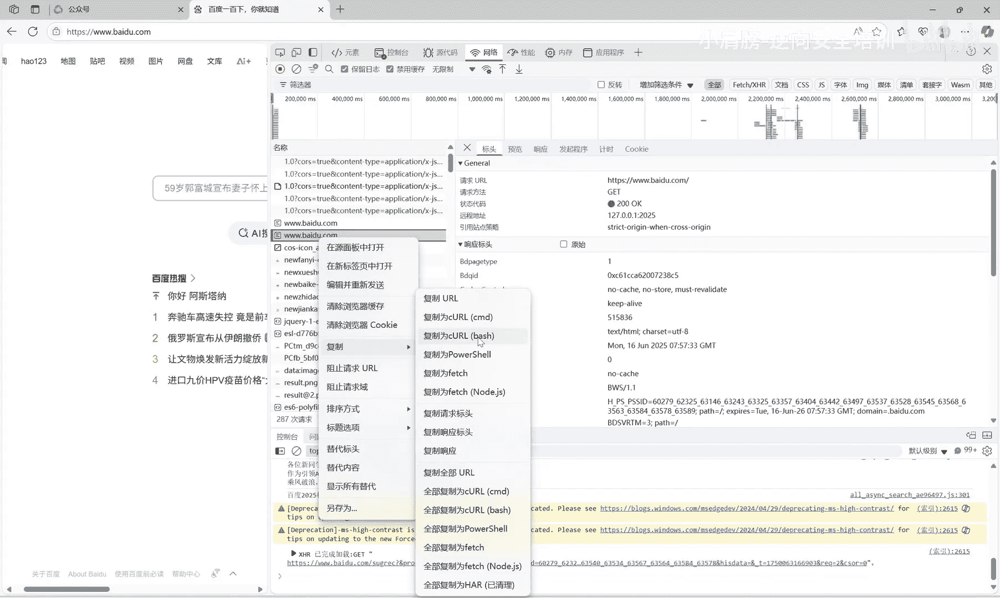
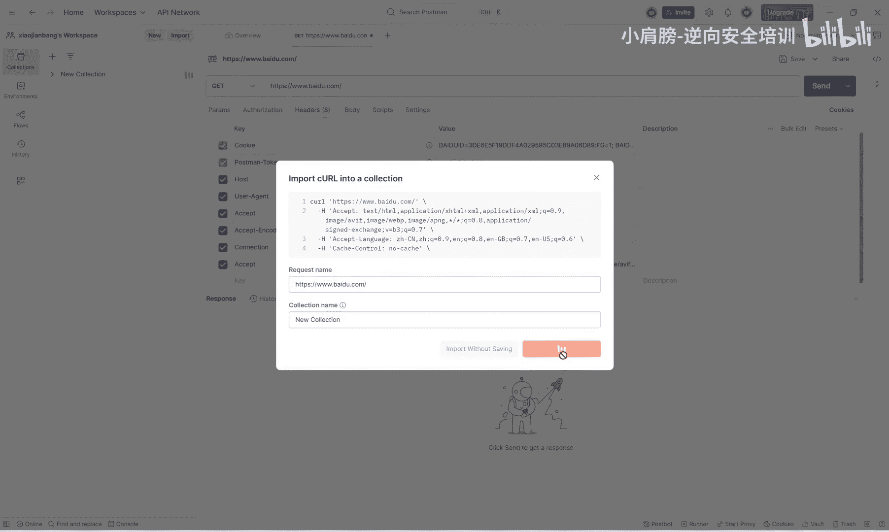
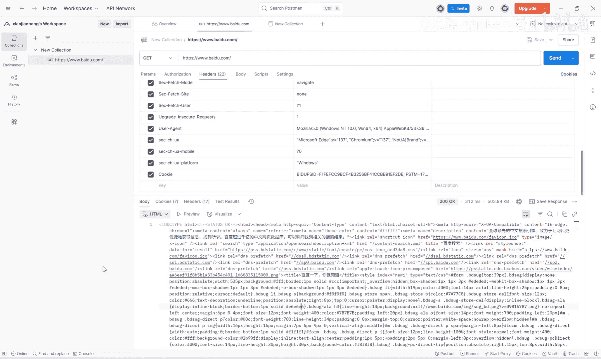
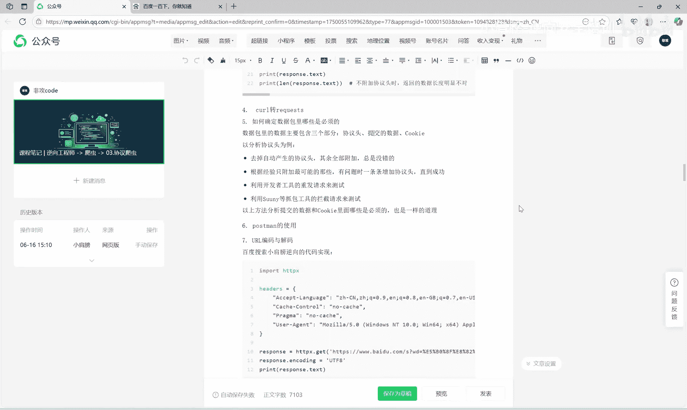

# 【协议爬虫】:11: Postman的使用 📮

在本节课中，我们将来学习Postman这个工具的使用方法。Postman本质上是一个用于测试HTTP请求的工具，在实际开发过程中，它能够帮助我们确认数据包当中哪些字段是必须存在的，同时，当我们自己编写的代码出现问题时，也可以借助这个工具来提交测试请求，从而定位问题到底出在哪个环节。

## 下载与安装 🚀

首先，让我们来了解一下如何获取这个工具。Postman的官方网站提供了相应的下载页面，我们可以打开浏览器访问这个页面，然后根据自己的操作系统选择合适的版本，比如使用的是Windows系统的话，就可以选择Windows版本进行下载。这里需要提醒大家一点，这个网站可能需要能够正常访问互联网才能打开。在下载区域，我们直接点击6四位的安装包下载就可以了。

下载完成后，我们就可以进行安装了。安装过程本身非常简单，只需要双击下载好的安装包，然后按照提示一步一步操作即可。笔者这里已经提前安装好了，所以就不再重复演示安装步骤了。安装完成之后，我们双击图标就可以打开Postman了。

## 登录与注册 🔑

当我们首次打开Postman的时候，它会要求我们进行登录操作。如果你还没有账号的话，是可以直接注册一个的。比较方便的是，它也支持使用GitHub账号进行登录，这样就不需要额外注册新的账号了。完成登录之后，就可以正常使用这个工具了。在登录的过程中，可能会弹出一些升级提示，这是因为Postman提供了收费版本，不过对于我们的日常学习和使用来说，免费版本的功能已经足够满足需求了，所以我们没有必要去升级到收费版。

实际上，Postman有4个不同的版本可供选择，我们使用当前的这个免费版本就可以了，它已经包含了我们后续需要用到的大部分功能。

## 界面初识 🖥️

打开Postman之后，我们会看到它的主界面是这个样子的。在主界面上，我们可以点击"新建"按钮，然后去创建一个自己需要的测试项目。创建的时候，可以选择HTTP类型的请求，也可以选择WebSocket类型的请求，当然还可以选择其他类型的请求。就我们当前的学习内容而言，我们需要使用的是HTTP类型的请求。

在HTTP请求的编辑界面中，我们可以进行一系列的操作。比如，我们可以在URL输入框中输入目标链接，在Params选项卡中输入GET请求所需要的参数，在Headers选项卡中设置请求的头部信息，在Body选项卡中输入POST请求需要提交的数据。除此之外，Postman还支持编写JavaScript脚本，从而实现自动化的测试流程，同时也可以进行一些个性化的设置，比如指定请求的方式等等。另外，在全局设置中也可以进行整体的配置。不过，通常情况下，我们使用默认的设置就已经足够了，不需要进行额外的调整。

## 导入请求 📥

在实际测试的时候，我们可能会面临一个问题：难道需要把请求中的每一个信息都手动复制粘贴过去吗？比如，链接是这个，参数没有，请求头是这些，然后还要逐个去新增，比如Accept字段是这样设置的。这样做确实太麻烦了，效率非常低。

因此，一般情况下，我们会采用另一种更为便捷的方式。首先，在浏览器或者其他工具中，将请求复制为`cURL`格式的命令，然后回到Postman中，点击"Import"导入按钮，在弹出的对话框中，把刚才复制的cURL命令粘贴进去，最后点击"Import into Collection"选项，这样就可以将请求完整地导入到Postman中了。

完成导入操作后，Postman会自动创建一个collection。需要注意的是，在创建collection的过程中，Postman可能需要访问网络。如果你的电脑没有开启科学上网的话，这个过程可能会稍微慢一些，不过这并不会影响最终的结果。

创建完成之后，我们可以看到，在collection下面已经自动创建了一个对应的请求。关于collection这个概念，大家可以简单地把它理解成一个工程或者项目的集合，你可以在同一个collection里面创建很多个测试请求，并且这些请求是可以被保存下来的，这样在下次打开Postman的时候，就可以继续使用这些保存好的请求进行测试了。

至于之前手动创建的那个请求，我们就不再需要了，可以将其删除。实际上，通过导入方式创建collection，和直接在界面上点击按钮创建collection，最终得到的效果是一样的，这个collection的名字也是可以随时修改的。

导入成功之后，我们不难发现，所有必要的设置都已经自动配置好了，不需要我们手动去调整。可以看到，请求的URL已经填好了，协议头也已经配置好了，GET请求的参数是空的，POST请求的参数也是空的，都符合预期。

## 发送与测试请求 🧪

接下来，我们点击"Send"按钮发送这个请求，可以看到请求目前是正常的，服务器返回了预期的响应。当然，在请求发送的过程中，我们也可以借助抓包工具来观察实际的网络请求。可以看到，在这个地方，我们实际上是能够抓到数据包的，这里显示的其实就是刚才我们发送出去的那个请求。同时，我们也可以查看Postman为我们自动组合出的数据包具体长什么样。

那么，如何进行参数必要性的测试呢？我们可以通过勾选或者取消勾选的方式，去掉请求中的某些部分来测试服务器是否依然能够正常响应。比如说，我们把这几个请求头去掉，只需要把前面的勾取消掉就可以了。Cookie字段也可以取消勾选，这样就只剩下剩余的这些请求头了。

这里有一个细节需要注意，如果你后续添加了同名的协议头，那么前面默认添加的那些协议头会被覆盖掉。界面中显示为灰色的这些请求头，实际上是Postman默认帮我们添加的。当我们调整完之后，再点击发送，可以看到请求依然是正常的。这时候，我们实际发出去的数据包就是这个样子的，和刚才相比，数据包中少了很多内容。

在这个界面中进行参数必要性的测试就非常方便了，我们可以随意调整参数组合，观察服务器的响应情况。当然，你也可以直接把不需要的参数删除掉。不过，一般情况下，我们不太建议直接删除参数，因为有可能你删除之后，请求就不再正常了，那到时候你还得把它重新添加回来，这样反而更加麻烦。在Postman中，通过勾选或取消勾选的方式，就可以很方便地测试请求头的必要性。

## 总结 📝

本节课中，我们一起学习了Postman工具的基本使用方法。我们首先了解了如何下载和安装Postman，接着学习了如何注册和登录账号，然后认识了Postman的主界面布局，并且掌握了通过导入cURL命令来快速创建请求的技巧。最后，我们重点学习了如何使用Postman来分析请求中各项参数的必要性，包括协议头参数的必要性、GET请求参数的必要性，以及POST提交数据的必要性。这些功能在实际的爬虫开发过程中非常实用，能够帮助我们更高效地分析和调试请求。

