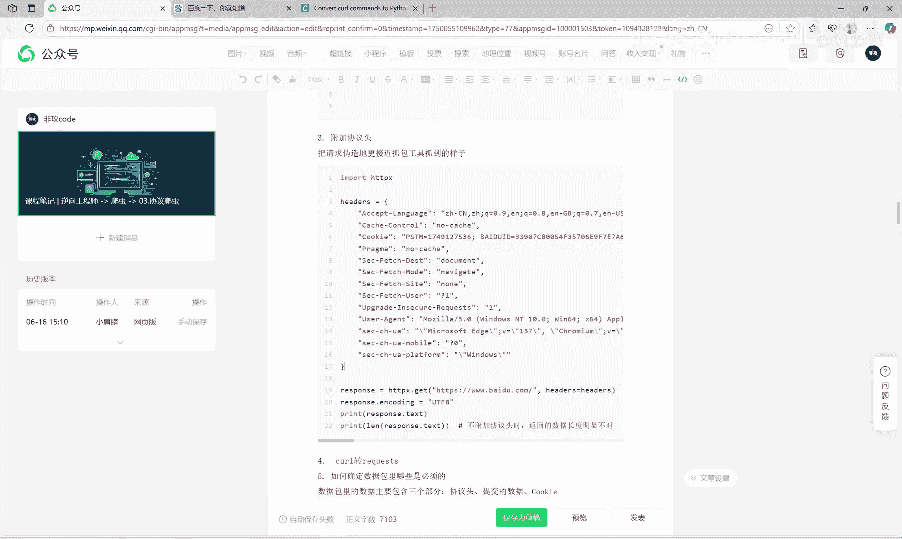
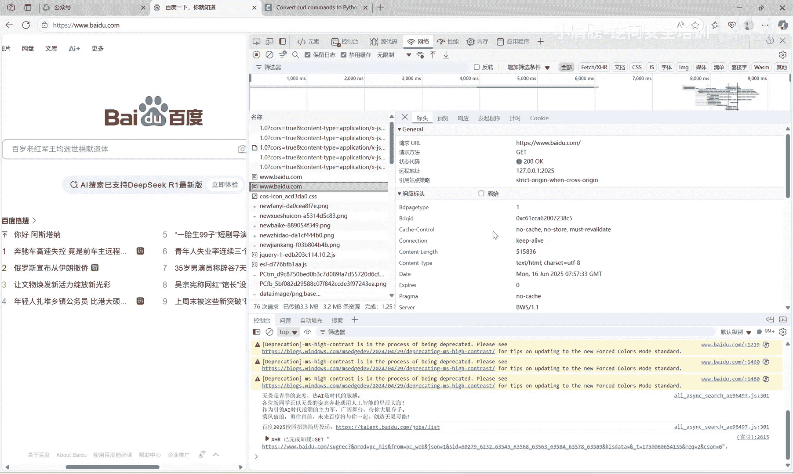
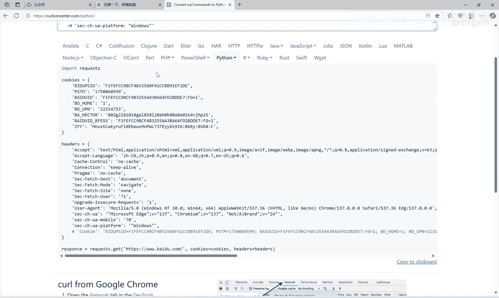
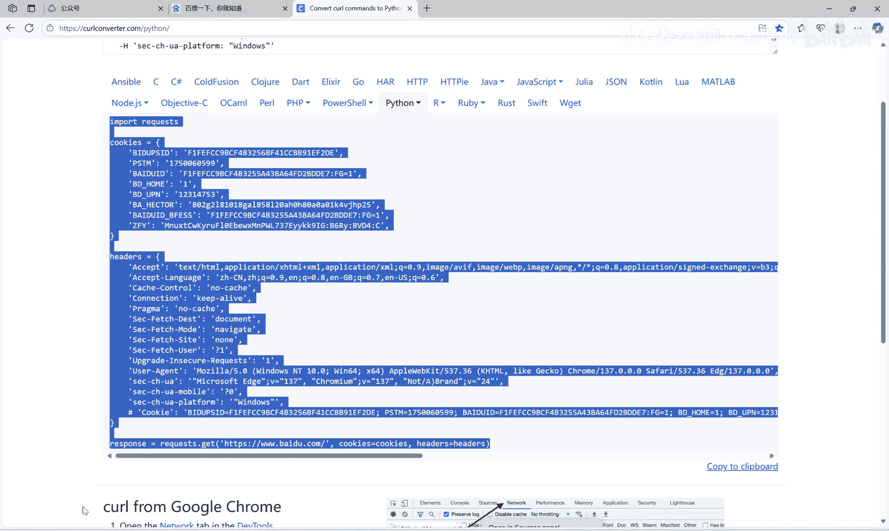
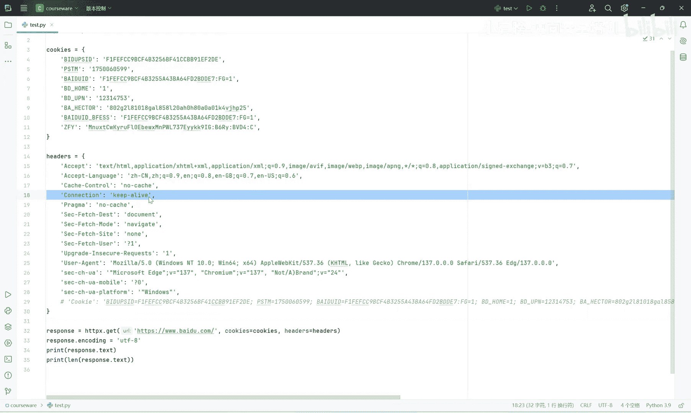

# 🕷️ 协议爬虫：09：curl转requests

在本节课中我们将要学习如何扩展 requests 的用法：不再手动一条条写协议头，而是从浏览器复制 cURL，再转换成 Python 请求代码，并在需要时把 requests 改成 httpx。这个技巧能减少重复劳动，也能降低抄错请求头的概率。对初学者来说，先理解流程，再照着动手做，会更容易掌握。

## 🧭 协议爬虫：09.1：为什么需要curl转请求代码

上一节我们介绍了伪造请求时手动附加协议头的做法，本节中我们来看看为什么需要 cURL 转请求代码。上节课伪造请求时，协议头是自己一个个写进去的；如果协议头比较多，一个个写就比较麻烦，也容易漏掉或写错。于是就有一个问题：有没有更快捷的方法？

核心流程可以用下面的公式表示：



\[
\text{cURL 命令} \xrightarrow{\text{cURL 转代码工具}} \text{Python 请求代码}
\]

这个流程的意义在于：浏览器已经帮我们记录了完整请求，我们只需要把请求复制出来，再交给转换工具生成代码。这样写代码会更方便，也更适合初学者快速完成请求复现。

既然手动写协议头比较麻烦，下面我们来看看怎样从浏览器里复制 cURL。

## 🧰 协议爬虫：09.2：从浏览器复制cURL



上一节我们说明了手动写协议头的痛点，本节中我们来看看从浏览器复制 cURL 的具体方法。操作入口就在开发者工具的数据包区域，找到目标请求后右键复制即可。

下面是复制 cURL 的具体操作步骤。

1. 打开浏览器开发者工具，在数据包或网络请求区域找到目标请求。
2. 在目标请求上右键，选择“复制”。
3. 选择“复制为 cURL”，并选择 bash 格式。
4. 把复制出来的 cURL 内容先保存好，后面粘贴到转换工具里。

完成复制后，我们就拿到了浏览器记录下来的完整请求。接下来要做的，就是把这个 cURL 内容转换成 Python 代码。

## 🔁 协议爬虫：09.3：把cURL转换成Python代码

上一节我们拿到了 cURL 内容，本节中我们来看看怎样把它转换成 Python 请求代码。打开 cURL 转代码网站后，在语言选项里选择 Python，再把刚才复制的内容粘贴进去即可。

下面是转换代码的具体步骤。

1. 打开 cURL 转代码网站。
2. 在语言选项中选择 Python。
3. 在请求库选项中选择 requests 或 httpx。
4. 把复制上来的 cURL 内容粘贴到转换区域。
5. 查看生成的 Python 代码，并直接复制到代码编辑器中。

转换工具通常会给出请求库选项，其中一个常见选项是 requests；requests 是非常常用的请求库，但它对 HTTP/2.0 的支持不够好，所以更推荐使用 httpx。httpx 同样是用来做请求的库，而且 requests 和 httpx 的 API 几乎一模一样，可以用下面的公式表示：

\[
\text{requests 的 API} \approx \text{httpx 的 API}
\]

因此，转换工具生成 requests 代码后，我们也可以把 requests 改成 httpx 来使用。转换结果复制到编辑器后，下一步就是做少量调整。



## 🛠️ 协议爬虫：09.4：把requests改成httpx并处理Cookie

上一节我们得到了转换后的 Python 代码，本节中我们来看看怎样把 requests 改成 httpx，并处理 Cookie。转换结果复制到代码编辑器后，先检查导入和调用方式，再把请求库统一改成 httpx。

下面是调整代码时需要注意的几个点。



1. 把代码里的 requests 改成 httpx，并确认导入的是 `httpx`。
2. 转换结果会把 Cookie 单独列出来，放进 `cookies` 参数中。
3. Cookie 没有直接附加在协议头里，而是作为参数传进去。
4. 如果要把 Cookie 附加在协议头里也可以，但单独传更清晰。
5. 在 print 之前最好先指定响应超时，避免程序一直卡住。
6. 最后用 print 输出响应内容，并打印数据长度。

调整后的代码结构可以参考下面这段示例。

```python
import httpx

url = "https://example.com/api"
headers = {
    "User-Agent": "...",
    "Accept": "...",
}
cookies = {
    "sessionid": "...",
}

response = httpx.get(
    url,
    headers=headers,
    cookies=cookies,
    timeout=10,
)

print(response.text)
print(len(response.text))
```

这段代码和上一节课的区别在于：Cookie 被单独列出来，并作为参数传进去，没有直接附加在协议头里；当然，把 Cookie 放进协议头里也可以。代码改好后，就可以运行看结果了。

## 🚦 协议爬虫：09.5：运行代码与代理排错

上一节我们改好了 httpx 代码，本节中我们来看看运行代码时可能遇到的代理问题。运行代码后，如果本机开启了系统代理，而代码里没有设置代理，就可能报错。

下面是运行和代理排错的步骤。

1. 先运行代码并观察报错信息。
2. 如果开启了系统代理，但代码没有设置代理，就可能出现请求报错。
3. 把系统代理关闭，再运行一次代码。
4. 观察是否能正常获取到数据。
5. 打印数据长度，检查结果是否和预期差不多。

代理问题可以先用下面的提示来理解。

> 注意：如果系统代理开着，而代码里没有设置代理，请求可能报错。可以关闭系统代理，或者在 httpx 中显式配置代理。

关闭系统代理后再次运行，可以看到代码已经能够正常获取数据。再打印数据长度，理论上没有问题，长度差不多就说明请求基本成功。这样写代码就比较方便，也减少了手动拼接协议头的工作量。

## ✅ 协议爬虫：09.6：验证结果与精简协议头

上一节我们跑通了请求并处理了代理问题，本节中我们来看看如何验证结果和精简协议头。请求能返回数据后，还要确认数据长度是否合理，并检查哪些协议头是必须保留的。

下面是验证结果和精简协议头的要点。

1. 打印 `response.text` 查看响应内容。
2. 打印 `len(response.text)` 查看数据长度。
3. 数据长度和预期差不多，说明请求基本成功。
4. 不是所有从浏览器复制出来的协议头都需要附加。
5. 有些协议头可以删掉，例如转换结果中的某些非必要头。
6. 初学阶段可以先保留协议头，跑通后再逐个删除并测试。

有些协议头不需要附加，原文提到“比如说这个”，实际处理时可以先保留，确认请求稳定后再按需精简。这样既保证请求能跑通，也能让代码逐渐变得简洁。

## 📌 协议爬虫：09.7：小结



前面几节我们完成了从复制 cURL 到生成 Python 请求代码的完整流程，本节中我们来做一个小结。下面是本节课需要记住的主要内容。

1. 手动写协议头较多时比较麻烦，可以用 cURL 转代码提高效率。
2. 在开发者工具的数据包区域右键复制 cURL，并选择 bash 格式。
3. 在 cURL 转代码网站选择 Python，把 cURL 粘贴进去生成代码。
4. requests 很常用，但对 HTTP/2.0 支持不够好，推荐使用 httpx。
5. requests 和 httpx 的 API 几乎一样，可以把 requests 改成 httpx。
6. 转换结果会把 Cookie 单独作为参数传入，也可以放进协议头。
7. print 之前最好设置响应超时，运行时注意系统代理问题。
8. 请求跑通后打印数据长度验证结果，并逐步精简不必要的协议头。

本节课中我们一起学习了如何把 cURL 转换成 Python 请求代码，如何把 requests 改成 httpx，如何处理 Cookie、超时和代理问题，以及如何验证结果和精简协议头。掌握这个流程后，再写协议爬虫请求就会更方便。本教程到这里结束。

