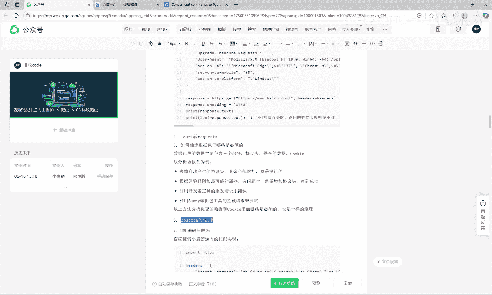

# 🕷️ 协议爬虫：10：如何确定数据包中哪些内容是必须的

在本节课中，我们将要学习如何确定数据包中哪些内容是必须的，也就是在协议爬虫分析过程中，怎样判断哪些协议头、提交参数和 Cookie 需要附加，哪些可以删掉。我们会先从数据包的组成讲起，再介绍删减测试的基本思路，然后分别演示使用开发者工具重发请求、使用抓包工具拦截请求来测试的方法，最后说明这些方法更适合用在哪些场景，以及为什么实际工作中最常用的还不是这些方法。整节内容会尽量用直白的方式解释，让初学者也能按步骤理解和操作。

## 📦 协议爬虫：10.1：数据包由哪些部分组成

上一节我们明确了本节课要解决的问题，本节中我们来看看数据包里面到底包含哪些内容。数据包里的数据主要包含三个部分：第一部分是协议头，例如请求中常见的各类头部字段；第二部分是提交的数据，例如 GET 请求的参数和 POST 请求的参数；第三部分是 Cookie。可以把这件事先概括成一个简单的公式：

```text
数据包 = 协议头 + 提交数据 + Cookie
```

那么这么多数据都需要附加吗？答案主要看网站后台检测哪些内容，后台检测哪些，我们就给它附加哪些。这个判断过程就是本节要讨论的“必须性分析”。理解数据包的组成之后，下面就可以进入具体分析思路，先从协议头开始举例说明。

## 🧭 协议爬虫：10.2：协议头必须项的分析思路

上一节我们介绍了数据包由协议头、提交数据和 Cookie 组成，本节中我们来看看如何分析协议头中哪些内容是必须的。以分析协议头为例，首先去掉这些自动产生的协议头，也就是浏览器或工具自动加上、我们不一定需要手动附加的部分。剩下的全部附加，这个思路肯定是没错的，虽然繁琐，但必然没错。也可以根据经验只附加最可能的一些协议头，出现问题的时候，再一条条增加协议头，直到请求成功。

例如在这个案例中，可以逐项判断：有些内容没有必要互相附加，有些内容没有必要附加，这个也没有必要，这个也没有必要，这个也没有必要，这个也没有用，这个也没有用，这个也没有用，甚至 Cookie 也不需要。因为这是最初的一个请求，最初那个请求没有 Cookie 是很正常的。然后运行，可以看到它还是正常的。这两个协议头表示禁止缓存，去掉也没有关系，结果也是正常的。因此只需要保留这两个协议头。如果去掉多了，访问出错了，就把刚才那些一条条加回去，例如加上这些协议头，看它正不正常，不正常再加；加上 Cookie，看它正不正常，不正常再加，一条条测试。

为了更清楚，以下是删减测试时可以采用的几种基本策略：


- 先把自动产生的协议头去掉，剩余内容全部附加，保证请求先能成功。
- 再根据经验只附加最可能需要的协议头，减少无关内容。
- 如果访问出错，就把删掉的协议头逐条加回，直到请求恢复正常。
- 对 Cookie 也采用同样思路，先判断最初请求是否真的需要 Cookie，再逐步测试。


这些策略的核心都是“先保证可用，再逐步删减或回加”。如果刚开始经验不够，并不知道哪些是必须的、哪些不是必须的，也可以自己来测试，用重发请求来测试。下面我们进入开发者工具中的具体测试方法。


## 🛠️ 协议爬虫：10.3：用开发者工具重发请求测试


上一节我们介绍了协议头必须项的删减思路，本节中我们来看看如何用开发者工具重发请求来做测试。在开发者工具里面，可以复制为 Fetch，然后粘贴到相应位置。接着去掉一些协议头，例如把这个协议头去掉，把这些也去掉，然后回去观察结果。可以发现它返回的数据是 124KB，但实际上它的资源是 515KB。这个现象跟它的数据接收方式有关系，这个地方使用的是 `Transfer-Encoding: chunked`，也就是分块接收，并不是一次性发送过来，但总共可以看到它有 515KB，这个数值是正常的。它跟我们刚才发送回来的情况不太一样，刚才在这个地方是 `Content-Length`，直接就是 51 万个字节，并没有分块接收。因此只需要附加这么一些协议头。


不过，在开发者工具里面进行重发请求测试时，有一些内容是没有办法处理的。例如 Cookie 它没有，它会直接将这个地方存储的 Cookie 带上去；User-Agent 也是没有的，因为本身就是在浏览器里面发送的，到时候发出去的时候，浏览器会给你带上。因此在这个地方测试并不是很好。既然开发者工具重发请求有局限，下面我们看看如何利用抓包工具拦截请求来测试。


## 🧪 协议爬虫：10.4：用抓包工具拦截请求测试

上一节我们说明了开发者工具重发请求的局限，本节中我们来看看利用 Burp Suite 等抓包工具拦截请求来测试的方法。例如在这个地方去拦截一下百度首页的请求，就是这个请求。然后在这个地方可以使用 `BPUURL` 拦截上行和下行；上行的意思是发出去的请求，下行就是返回的响应。也可以输入 `BPDUIU` 来拦截下行，也可以输入“清除”来删除全部已经设置的规则。在这个地方直接输入 `BPU`，再加空格和链接。

这个时候设置系统代理，然后去刷新。可以看到在这个地方它会转圈，实际上就是请求被拦截了，它没有办法继续向下进行。在这个地方可以放行。在放行之前，可以去删除一些协议头，例如把这些东西删除，Cookie 也不要，这个也不要，然后这些东西保留。但这个地方的结构一定要符合 HTTP 请求的结构。可以把它理解为下面的形式：

```text
HTTP请求 = 请求行 + 协议头 + 空行 + 数据部分
```

协议头后面有一个空行，空行后面是数据的部分。然后放行，放行以后它返回的响应也可以改，改完以后再放行。这个时候它就请求出这个页面。后面的这些请求由于也是这个链接开头的，所以也需要去放行。一个个放行太麻烦，可以在这个地方全部放行。查看这个地方是否还有拦截，然后可以看到页面显示是正常的，并没有问题。

如果在拦截的时候把 User-Agent 去掉，其他保留并放行，这个时候可以看到它返回的数据是有问题的，然后它会在这个地方重新去请求。如果还把这个删掉，这个时候它请求的又是有问题的，然后它又会重新去请求。这个重新请求是浏览器自己发起的，并不是抓包工具发起的。然后看到这个东西应该是必须的，就把这个东西保留，其他的删掉。注意结构一定要符合 HTTP 协议的规则，上面是协议头，协议头后面有一个空行，空行后面是数据的部分，一定要是这个样子；即使没有数据，也一定要到这个位置。然后放行，这个时候就正常了。如果不想拦截了，就输入“清除”，然后就可以了。

这也是一种测试方法，但这种测试方法会让人觉得麻烦。虽然它能够测试很多数据，比开发者工具重发请求里面测试的数据要全，但它很麻烦，需要自己去删一些东西，而且要注意 HTTP 协议的结构。所以这种方式一般不是用来做参数必须性测试的，一般用来修改返回的数据。下面我们看看它在修改返回数据方面的常见用途。

## 🔍 协议爬虫：10.5：拦截数据包的常见用途

上一节我们介绍了抓包工具拦截请求的测试方法和局限，本节中我们来看看拦截数据包最常见的用途。先演示修改返回数据：拦截百度首页，然后刷新一下。请求头里面放行，在它返回响应的时候，我们想要把它的标题改掉，然后再放行。剩下的都不要了，全部放行。这个时候会发现它的标题已经变成了“百度100下”。这是抓包工具里面拦截数据包最常使用的一个场景：多数请求是需要的，只是其中某几个请求，我们想要把它的请求头里面的数据或者返回的响应改掉，这个时候就使用这个功能。

还有一个比较常用的场景是改 JS。JS 实际上也是通过发送请求去获取的，这个就是 JS。如果要修改这里面的代码，就可以在响应返回的时候，把里面的代码改掉，来绕过一些检测。理解这些用途之后，就能明白拦截请求不仅能做必须性测试，还能做响应修改和代码替换。下面我们对本节课的内容做一个小结。

## ✅ 协议爬虫：10.6：本节总结



上一节我们介绍了拦截数据包的常见用途，本节中我们对整节课进行总结。以上这些方法可以用来分析数据包里面哪些是必须的：对于协议头来说是这个样子，对于提交的参数来说也是这个样子，对于 Cookie 里面哪些是必须的，也是一样的道理。但实际上这些方法都不是最常用的，最常用的是下一个要讲的 Host man。本节课中我们一起学习了数据包的三个组成部分、协议头删减测试思路、开发者工具重发请求测试、抓包工具拦截请求测试，以及拦截数据包修改响应和修改 JS 的常见场景。掌握这些内容后，就可以在面对一个数据包时，先判断需要附加哪些内容，再选择合适的工具进行验证和调整。

