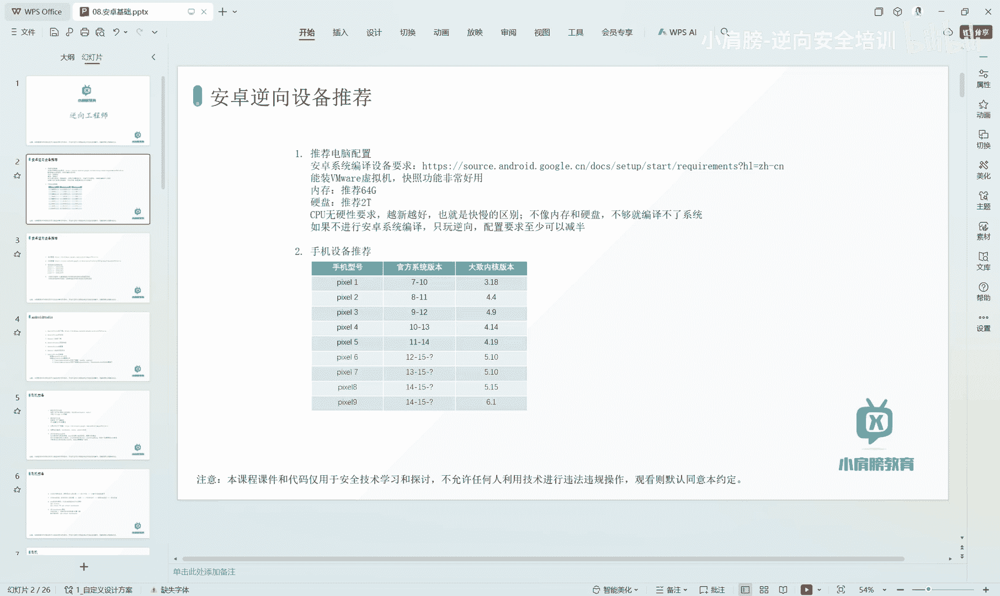

# 安卓逆向：01：安卓逆向设备推荐 🧰


在本节课中，我们将要学习安卓逆向所需设备的推荐配置，包括电脑配置和手机设备选择。电脑配置又分为能够编译安卓系统与只进行安卓逆向两种情况；手机部分会讲到 Pixel 型号、系统版本、内核版本以及刷机包支持情况。通过本节，初学者可以知道为什么推荐某些配置，以及如何根据自己的学习目标选择设备。


## 安卓逆向：01.1：电脑配置：能编译安卓系统 💻

上一节我们明确了课程范围，本节中我们来看看能够编译安卓系统的电脑需要什么配置。这里有一篇谷歌文档，打开后可以看到安卓系统编译推荐的硬件配置。下面先给出整体结论，后面再逐项解释，方便初学者建立直观印象。


```text
CPU：64 位 x86 系统（基本都满足）
内存：推荐 64 GB，最低可按版本降低
硬盘：至少 400 GB，推荐 2 TB
```


第一个是 64 位 x86 系统。这个条件基本上都能满足，因为 32 位系统只能编译 Android 2.3 这类很低的安卓版本，而现在基本不存在使用这么低版本的情况，这么低的版本现在也用不了。第二个是硬件空间，至少需要 400 GB。但我推荐 2 TB，因为我们会使用虚拟机，需要在虚拟机里打很多快照。修改系统不可能每次一次成功，为了快速回到上一个可用系统状态，就需要用快照回退。打快照会消耗空间，而且虚拟机有一个特点：在系统里删除东西后，空间仍然被占用，不会释放。也就是说，虚拟机的空间只会越用越大，所以推荐一步到位，直接 2 TB。第三个是内存，谷歌文档写的是至少 64 GB，但实际上低于 64 GB 也可以用。例如 Android 10 编译只需要 16 GB，Android 13 用 32 GB 足够，Android 15 用 32 GB 也可以。不过还是推荐 64 GB，一步到位。对于 CPU 没有硬性要求，当然越新越好，主要区别是编译速度快慢。CPU 不像内存和硬盘那样是硬性要求，内存和硬盘不够，系统就编译不了。例如硬盘只有 500 GB，可能拉取安卓系统源码就没了，因为自己电脑还要装系统、装其他软件，空间不够就无法编译系统。内存方面，Android 10 编译至少需要 16 GB，如果只有 10 GB 能不能编译？实际上也可以，需要配置 swap 分区，把硬盘当内存用，但最终仍然需要占用 16 GB 的资源，所以推荐一步到位。这里可以用一个简单关系理解资源需求：

```text
有效内存 ≈ 物理内存 + swap 空间
编译需求：Android 10 ≈ 16 GB，Android 13/15 ≈ 32 GB，推荐 64 GB
```

如果你不进行安卓系统编译，只玩逆向，配置要求可以减半：32 GB 内存足够，1 TB 硬盘也够用。当然，在逆向工程师课程里只介绍现成定制系统的使用方法。如果你想学习如何自己定制系统，这套课程里还有“安卓系统定制终生版”。所以如果你只买了逆向工程师课程，配置不需要这么高，可以直接使用我定制好的系统。

## 安卓逆向：01.2：手机设备推荐 📱

上一节我们介绍了电脑配置，本节中我们来看看手机设备。推荐使用谷歌手机，因为使用谷歌手机坑比较少，用起来比较方便。谷歌手机目前更新的型号是 Pixel，从第一代已经出到第九代，目前最新的是第九代。不同型号对应的官方系统版本也不同，例如 Pixel 1 只能刷 Android 7、8、9、10 这四个系统版本；Pixel 2 只能刷 Android 8、9、10、11 这四个系统版本；Pixel 3 是 Android 9 到 12；Pixel 4 是 Android 10 到 13；Pixel 5 是 Android 11 到 14。可以看到，基本上是维护四个大版本。Pixel 6 设备是 Android 12 到 15，后面还有没有不清楚，因为目前 Android 16 还是测试版，估计会有。从 Pixel 6 开始，它会维护更多大版本。下面用代码形式列出原文中的对应关系，方便查阅：

```text
Pixel 1：Android 7 ~ 10
Pixel 2：Android 8、9、10、11
Pixel 3：Android 9 ~ 12
Pixel 4：Android 10 ~ 13
Pixel 5：Android 11 ~ 14
Pixel 6：Android 12 ~ 15（后续可能更多）
```

选择手机设备时，还要注意手机的内核版本。对于 Pixel 1 到 Pixel 5 的设备，内核版本出厂后就是固定的。例如 Pixel 1 设备，不管是 Android 7 还是 Android 10，内核版本都是 3.18；Pixel 5 设备，不管是 Android 11 还是 Android 14，内核版本都是 4.19。内核版本过低主要会影响 eBPF 的使用，一些 eBPF 工具要求内核版本一般最低是 5.10。所以推荐 Pixel 6 之后的设备，也就是 Pixel 6、Pixel 7、Pixel 8、Pixel 9。目前这四个设备里最便宜的是 Pixel 6，但 Pixel 6 容易黑砖；Pixel 7、Pixel 8、Pixel 9 没有黑砖问题，可以自行选择。从 Pixel 6 开始，由于谷歌搞了 GKI 内核，所以它的内核版本可以自己升级。手机设备这里推荐 Pixel 6，推荐不带任何后缀、最便宜的那个，不是 Pixel 6 Pro，也不是 Pixel 6a。可以用下面的关系概括内核情况：

```text
Pixel 1 ~ Pixel 5：kernel_version = 出厂固定
Pixel 6：kernel_version = 5.10
Pixel 7：kernel_version = 5.10
Pixel 8：kernel_version = 5.15
Pixel 9：kernel_version = 6.1
Pixel 6 起：支持 GKI，内核版本可通过特殊方法升级
```


## 安卓逆向：01.3：系统版本与刷机包查询 🗂️


上一节我们提到了不同 Pixel 型号支持的系统版本，本节中我们来看看如何查询每个设备支持哪些系统版本，以及如何查看内核版本。每个设备支持哪些系统版本，可以在一个网站上面查看，这个网站需要科学上网。在这个地方可以看到 Pixel 9 设备现在有 Android 14、15 的刷机包；Pixel 9 Pro 也有 Android 14、15 的刷机包；Pixel 8 有 Android 14、15 的刷机包；Pixel 7 有 Android 13、14、15 的刷机包。然后看 Pixel 4，可以看到有 Android 11、12、13 的刷机包，没有 Android 14，也没有 Android 15，所以 Pixel 4 最高支持 Android 13。这里提示初学者，查询刷机包时要以具体设备页面为准，不要只看系列名称，避免下载错包。


接下来是内核版本的查看。在这个网址上面可以查看内核版本。内核版本当然可以直接在手机上通过命令查看，或者在设置里面查看，但不可能为了查看内核版本去购买所有机型，所以在这个文档里大致能够查出设备的内核版本。例如 Pixel 6 设备内核版本是 5.10，Pixel 7 设备也是 5.10，Pixel 8 设备是 5.15，Pixel 9 设备是 6.1，默认情况下是这个样子。通过特殊方法可以升级内核版本。当然，对于 Pixel 6 以下的设备，要升级内核版本是比较困难的。下面用命令示例表示手机上查看内核版本的常见方式：


```bash
uname -r
# 输出示例：5.10.xxx
```


## 安卓逆向：01.4：定制系统刷机包与最终推荐 ✅


上一节我们介绍了系统版本和内核版本的查询方法，本节中我们来看看现成定制系统刷机包以及最终设备推荐。现在定制好的系统刷机包主要有四个：一个是 Pixel 1 设备 Android 10 的刷机包；一个是 Pixel 3 设备 Android 10 的刷机包；一个是 Pixel 4 设备 Android 13 的刷机包；一个是 Pixel 6 设备 Android 15 的刷机包。目前还在维护的是 Pixel 6 设备，另外三个已经不维护了。所以电脑配置推荐是内存 64 GB、硬盘 2 TB；手机设备推荐是 Pixel 6。可以用下面的配置清单收尾：


```text
电脑推荐：内存 64 GB，硬盘 2 TB
手机推荐：Pixel 6（无后缀标准版）
现成刷机包：Pixel 1/Android 10，Pixel 3/Android 10，Pixel 4/Android 13，Pixel 6/Android 15
维护状态：目前维护 Pixel 6，其余三个不再维护
```



本节课中我们一起学习了安卓逆向设备推荐，包括编译安卓系统所需的电脑配置、只做逆向时的降配方案、Pixel 手机型号与系统版本对应关系、内核版本对 eBPF 工具的影响、刷机包与内核版本的查询方式，以及现成定制系统刷机包和最终推荐配置。对于初学者来说，先根据自己的学习目标选择配置：只学逆向可以直接使用现成定制系统，想自己定制系统再考虑更高配置和可升级内核的 Pixel 6 之后设备。
