# 📱 安卓逆向：第01章：Pixel 6 设备安卓16降级安卓15教程


在本节课中我们将要学习 Pixel 6（P6）设备从安卓 16 降级到安卓 15 的完整思路和操作注意事项。课程会围绕两个学员常见问题展开：一是系统自动更新如何关闭，二是 P6 到底能不能降级系统。我们还会解释谷歌官方关于防回滚机制的特殊说明，并一步步说明如何查看 bootloader 版本、如何保证两个分区版本一致、如何修改官方刷机包，以及最后如何完成刷机。下面从最常见的问题开始说明。


## ❓ 常见问题一：系统自动更新怎么关闭


有些同学最先遇到的是系统自动更新问题。这个问题的处理并不复杂：进入开发者模式，在开发者选项里把系统自动更新关闭即可。关闭之后，系统就不容易在后台自动升级，降级和刷机过程也更可控。这里需要提醒的是，操作前先确认开发者选项已经打开，避免找不到对应开关。


## 🔒 常见问题二：P6 设备能不能降级系统


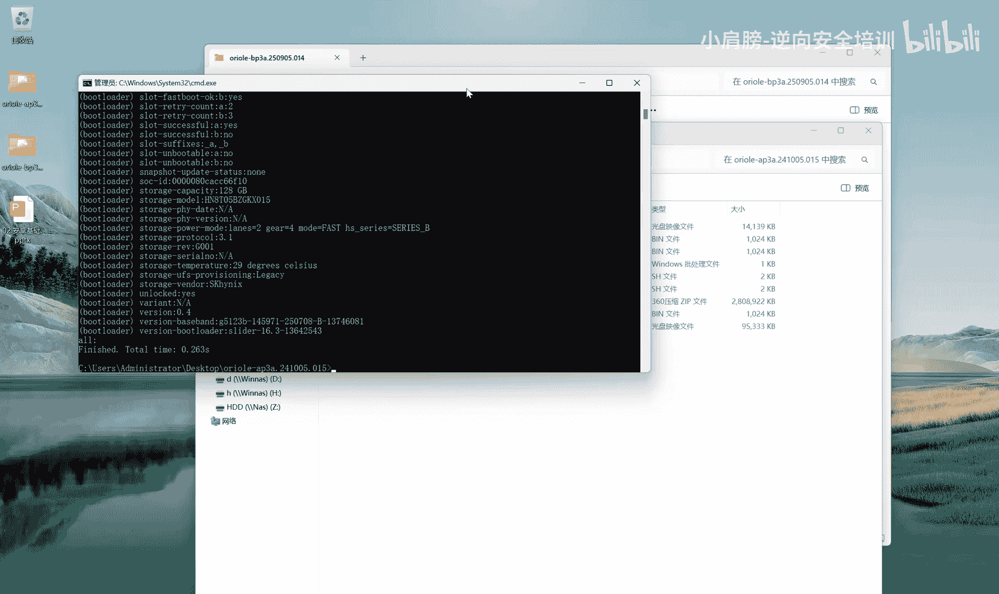

第二个问得比较多的问题是，P6 设备是不是不能降级系统。答案是可以降级，否则也就不会有这节课。接下来我们来看看谷歌官方网站的特殊说明。这个网站用于下载谷歌官方刷机包，在相关页面中有关于 P6 设备以及 P8 系列设备的说明。说明中提到，从某次更新开始，设备增加了防回滚机制。这个机制实际限制的是：不能把 bootloader 的版本刷回以前的版本，并不是说系统不能降级到之前的版本。例如，当前是安卓 16 的刷机包，当你刷了这个版本的 bootloader 之后，就不能再刷回之前版本的 bootloader。


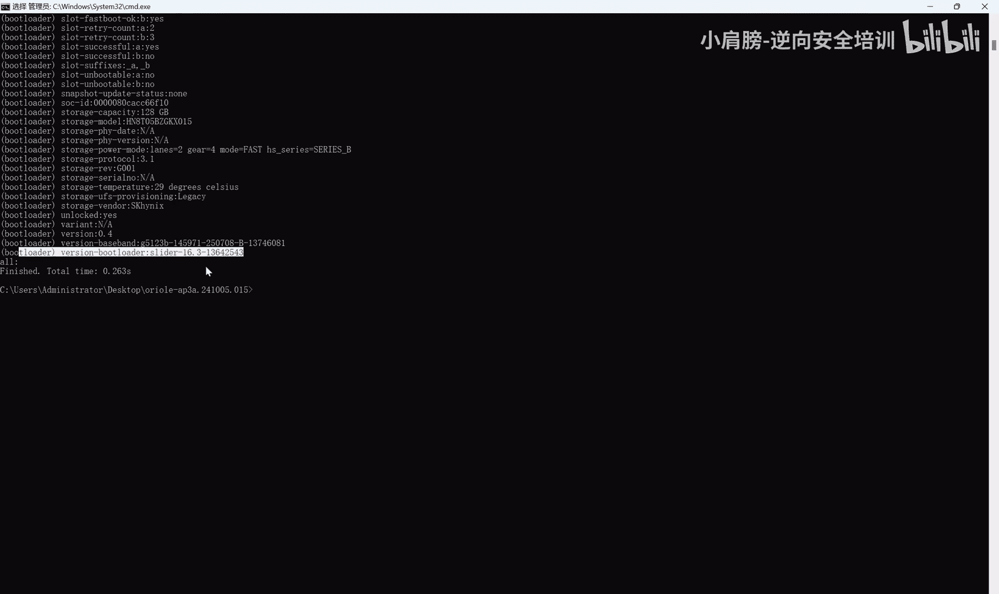

这里要区分两个概念：**bootloader 版本**和**系统版本**不是一回事。可以用下面的关系来理解：


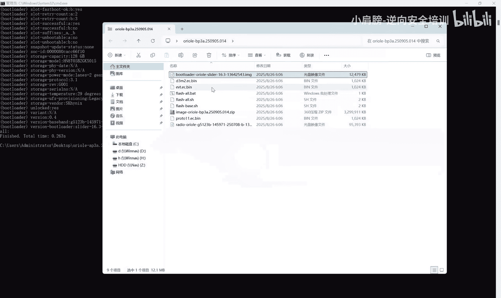

```text
防回滚限制：bootloader 新版本 -> 不能回退到旧 bootloader
系统降级：安卓 16 -> 安卓 15 仍然可以尝试
```


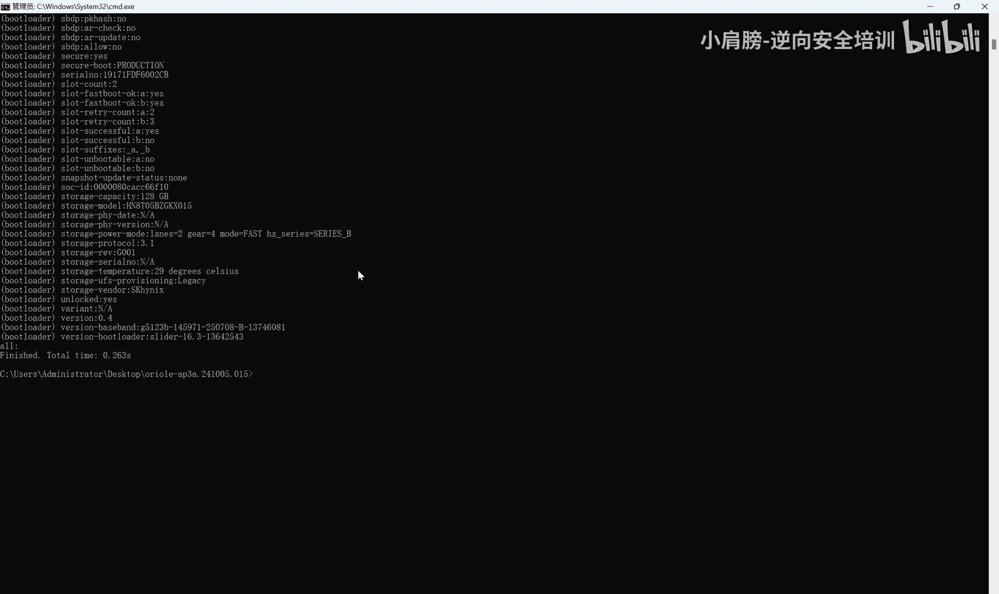

也就是说，bootloader 不能回退，并不代表系统版本不能刷回去。一般情况下，我们要求系统版本和 bootloader 版本匹配，最好以官方刷机包里的版本为准，不推荐用其他 bootloader 去刷这个系统。但这并不是说别的版本就真的完全不能刷这个系统，实际是可以的，我们也可以用当前这个版本的 bootloader 去刷安卓 15 的系统。


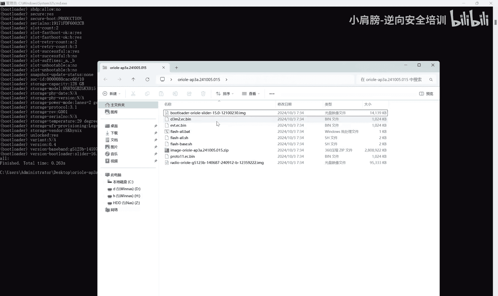

## 🔍 查看当前系统版本、活动分区和 bootloader 版本


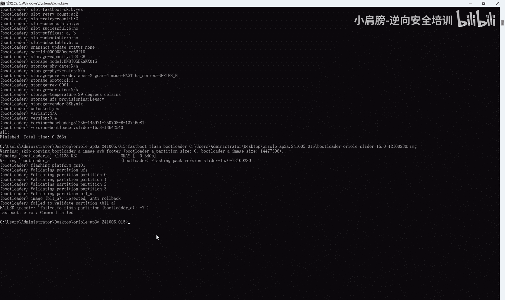

先确认当前安卓系统版本，原文环境是安卓 16。然后重启到 bootloader 模式，通过 fastboot 查看当前 bootloader 版本以及当前活动分区。设备上会显示当前 bootloader 版本，也会显示当前活动分区是 A 分区。以下是常用的查看命令，具体变量名和输出以设备实际显示为准：


```bash
fastboot getvar current-slot
fastboot getvar version-bootloader
```


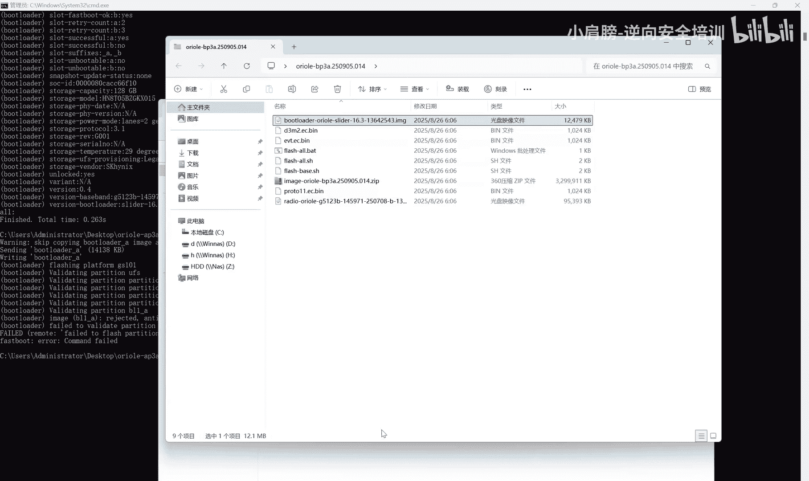

查看之后可以尝试刷之前的 bootloader 版本，你会发现操作失败。说白了就是 bootloader 不能回退。但 bootloader 版本不能回退，并不代表系统版本不能刷回去。这个结论是后续操作的基础，所以要先理解清楚。


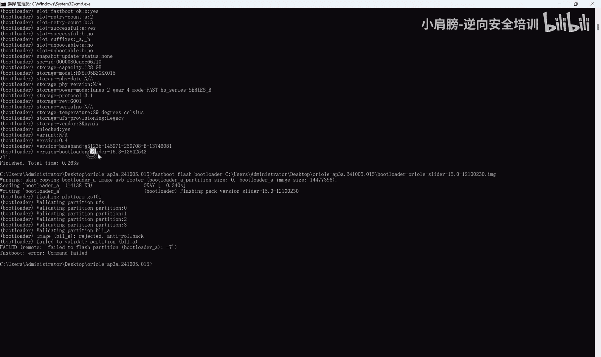

## 🧩 刷机前为什么要保证两个分区 bootloader 版本一致


在刷机之前再强调一点：刷机前要保证两个分区的 bootloader 版本一致。这个操作在一定程度上能够降低手机变砖的风险。查看当前分区和该分区 bootloader 版本的方法，前面已经说过，使用 fastboot 查看即可。P6 设备通常有两个分区，那么如何激活另外一个分区？可以使用切换分区命令。如果当前分区是 A，就可以切换到 B；如果当前分区是 B，就可以切换到 A。切换完成之后，再使用查看命令，就能看到当前分区的 bootloader 版本，以及当前是哪一个分区。


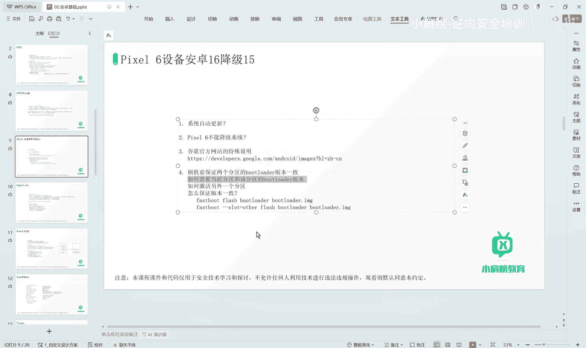

以下是切换分区和再次查看的示例命令：


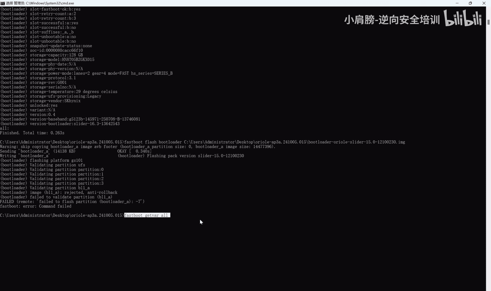

```bash
# 当前是 A 时切到 B
fastboot --set-active=b

# 当前是 B 时切到 A
fastboot --set-active=a

# 切换后再次查看
fastboot getvar current-slot
fastboot getvar version-bootloader
```


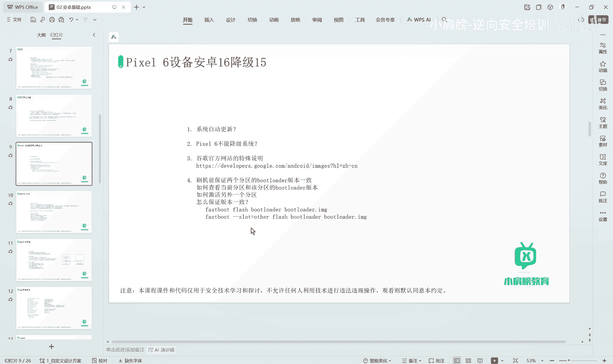

切换并查看之后，要保证 A 分区和 B 分区的 bootloader 版本一致。怎么保证版本一致？需要运行两条刷 bootloader 的命令：第一条刷当前活动分区，第二条刷另外一个分区。示例中当前刷的是 bootloader B，另一条刷的是 bootloader A。这样就能保证两个 bootloader 分区的版本一致。以下是示例，实际分区后缀要根据当前活动分区调整：


```bash
# 当前活动分区为 B 时，先刷 B，再刷 A
fastboot flash bootloader_b bootloader.img
fastboot flash bootloader_a bootloader.img
```


## 🛠️ 修改官方刷机包并刷入安卓 15


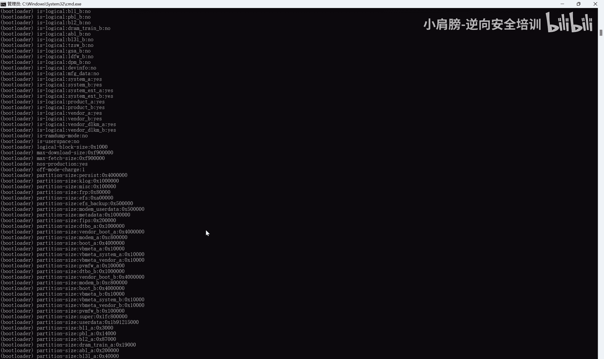

两个分区的 bootloader 版本一致后，再去刷系统。例如刷安卓 15 系统。但在刷之前，需要修改官方刷机包里的一个文件，因为这个文件里有两个信息，指定了当前系统需要使用的 bootloader 版本。需要把这两个值删掉，或者改成刚才安卓 16 刷机包中对应的 16.3 版本。说白了，即使刷低版本系统，我们的 bootloader 和 radio 也不去动它。修改完成后，把这个文件放回原处，再使用刷机包里的命令进行刷机。


也可以用另一种方式：把刷机包解压出来，然后使用 `fastboot flashall -w` 命令刷机。这个命令需要设定一个环境变量，把环境变量指定为解压后的镜像路径。使用这条命令时，它会在这个路径下面把所有镜像都刷进去。修改环境变量之后，需要重新打开 CMD，然后等待刷机完成即可。以下是操作示意：


```bat
set ANDROID_PRODUCT_OUT=解压后的镜像目录路径
fastboot flashall -w
```


如果继续使用官方脚本刷机，则要找到脚本中类似下面两个版本校验值的位置，具体变量名以官方脚本为准。把它们删除，或者替换成当前安卓 16 刷机包对应的版本：


```text
BOOTLOADER_VERSION=...
RADIO_VERSION=...
```


## ⚠️ P6 设备降级系统注意事项总结


这里再总结一下 P6 设备降级系统的注意事项。以下是几个关键点，按操作顺序理解会更清楚：


1. 刷机前保证两个分区的 bootloader 版本一致。如果你当前使用的是安卓 16 刷机包里的 bootloader，那么就用这个版本，因为你也回不到之前的 bootloader 版本。


2. 在 bootloader 和 radio 不动的情况下，直接去刷老版本系统是没有问题的。这个思路可以理解为：系统镜像可以换成安卓 15，但底层的 bootloader 和 radio 保持当前版本。


3. 刷老版本系统时，需要把刷机脚本里的两个版本值删掉，或者替换成当前版本对应的值。这样脚本就不会因为版本校验而阻止刷机。


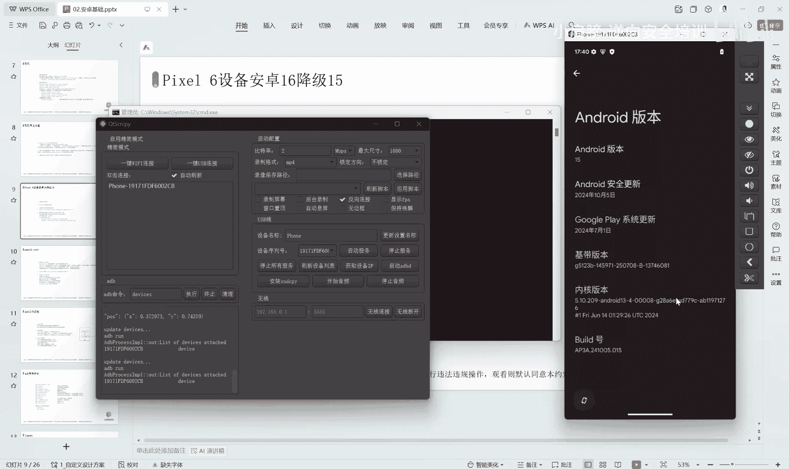

手机刷机完成后，等待它重启完毕。可以看到当前安卓版本已经变成 15，说明降级操作完成。本节课中我们一起学习了 P6 设备从安卓 16 降级到安卓 15 的核心流程：先关闭系统自动更新，再理解防回滚机制只限制 bootloader 回退，然后查看活动分区和 bootloader 版本，保证两个分区版本一致，修改官方刷机包中的版本校验值，最后使用 fastboot 完成刷机并重启确认系统版本。只要按步骤确认分区和版本，整个降级过程就会清晰很多。这节课就说到这里。
