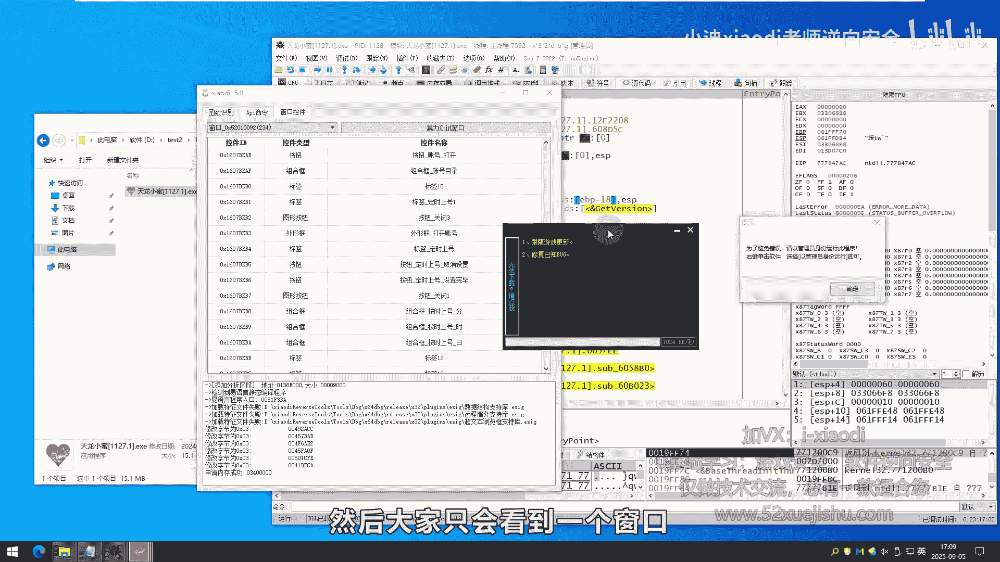
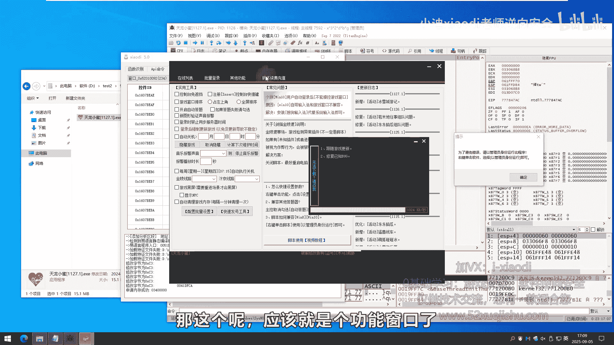
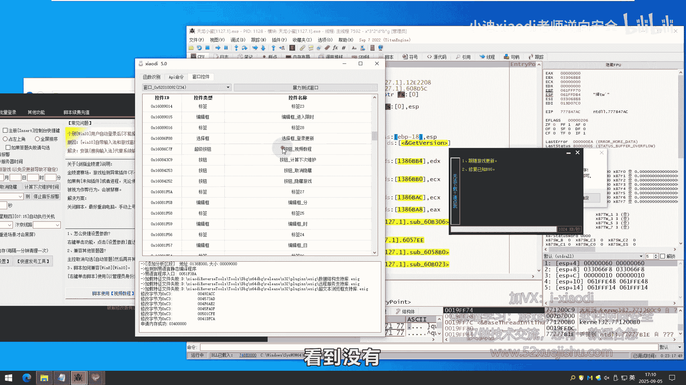
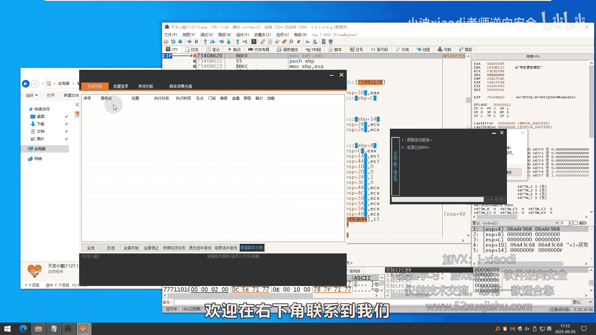

# 🛠️ 软件逆向破解实战：第一节：窗口爆破法复活跑路外挂

在本节课中，我们将要学习一项软件逆向破解实战技术：当某款游戏外挂的服务器关闭、软件无法打开时，如何利用窗口爆破法将其复活。这是一项黑客小技术，也是逆向破解技术在日常生活中最常见的应用场景之一。我们会先交代问题背景，再逐步演示具体操作，最后解释背后的原理。整个过程不使用晦涩术语，只用大白话，保证初学者能够看懂。

> ⚠️ 郑重声明：本技术为正规网络安全技术科普，所有操作仅仅用于技术交流，切勿把技术用在非法用途。

## 🧩 问题背景：外挂跑路了，钱也被带走了

大家好，我是小迪老师。今天我们来讲一下某游戏外挂跑路软件的复活。所谓“跑路”，是指外挂作者关闭了服务器，让软件无法联网使用。这个实例是逆向破解技术实战中的一个典型应用，能够帮助大家解决日常生活中的一些实际问题。

之前经常有同学问：小迪老师，为什么你讲软件逆向破解，还有这么多人听？因为你遇到的问题，它真的能解决。举个例子，你自己找了一个游戏外挂，甚至可能已经付了钱。结果突然某一天，这个游戏外挂跑路了，带着你的钱款一起消失了。这种行为显然属于违法行为。那怎么办？怎么惩治它？答案很简单，就是用今天要学的逆向破解技术。

## 🧱 核心思路：什么是窗口爆破法

先来看一下软件出现的问题。运行这个软件之后，它会先弹出一个提示：正在连接服务器。然后，程序就直接退出了。这个现象说明，软件在启动时依赖远程服务器进行验证。服务器一关，本地功能自然就无法打开。这就带来一个问题：软件原本能用，很多功能都是好的，只是服务器关闭了，所以你打不开软件。这确实很让人恼火。

怎么解决？方法非常简单，就是使用窗口爆破法。窗口爆破法并不是真的去“爆破”物理窗口，而是通过逆向工具暴力列出程序内部的所有窗口控件，从中找到承载核心功能的功能窗口，然后绕过服务器的连接校验，直接使用本地功能界面。你可以把这个过程理解成在一栋没有电梯的老楼里找房间：窗户很多，但真正能办公的那个房间一定窗户最多、最显眼。

它的核心判断依据可以用一句话总结：控件最多的窗口，往往就是功能窗口。用公式表示就是：

\[
\text{功能窗口} \approx \arg\max_{W} \text{控件数量}(W)
\]

这里的 \(W\) 表示程序中的每一个窗口，控件数量指窗口里包含的按钮、输入框、列表等可视化元素。对应的伪代码如下：

```text
功能窗口 = 空
最大控件数 = 0

for 窗口 in 程序全部窗口列表:
    if 窗口.控件数量 > 最大控件数:
        最大控件数 = 窗口.控件数量
        功能窗口 = 窗口
```

之所以这样判断，是因为功能窗口往往集中了批量登录、功能开关、账号管理等各种核心操作，所以它的控件数量会远远超过其他窗口。这就是我们后面定位窗口时采用的核心思路。

## 🔍 实战步骤：加载程序并开始分析

明白了原理之后，我们进入实际操作。第一步，把这个外挂软件直接拖到逆向分析工具里。这里的“拖”指的是用鼠标把软件主程序文件拖拽到工具的界面中。拖进去之后，直接点击“运行”。工具会弹出一个提示框，内容是：为了避免错误，请以管理员身份运行此程序。看到这个提示，不用管它，直接忽略，因为并不影响我们后续的分析。

接下来，点击工具菜单里的“插件”，然后点击“开始分析”。这一步的目的是让工具扫描软件运行时内部的所有关键信息。分析完成后，工具会把软件用到的所有重要核心命令全部列出来，例如网络传输、远程服务等等。这些命令会密密麻麻地显示在界面上。不过，这些内容都不是我们今天关心的重点。

我们要关心的，是窗口控件相关的信息。点击“窗口控件”这个分类，界面中就会显示出很多窗口控件，比如“按钮最小化”“图片框封面”之类的。这些控件只是软件界面的基础元素，也不是我们的目标。

## 🎯 定位功能窗口

那么，哪一部分才是我们的目标？答案是功能窗口。因为这是一个游戏辅助软件，所以它的脚本功能应该一眼就能看出来。点击功能窗口相关的标签，你会发现里面有很多窗口。一般来说，控件最多的那个窗口就是功能窗口，因为核心功能往往会集中放在同一个窗口里，方便用户操作。

按照这个规律，我猜测编号为 `52010092` 的窗口正是我们要找的功能窗口。点开这个窗口后，可以看到以下功能项：

- 快速发号密保
- 帮会在线
- 报警
- 主控
- 随机性别
- 使用财富卡
- 账号升级链级

看到这些功能项，就可以基本确定，这个窗口就是功能窗口了。

## 🧨 暴力测试窗口：把隐藏的功能窗口拉出来

确定功能窗口之后，下一步就是把它真正“拉出来”。怎么拉？直接点击“暴力测试窗口”按钮。这个按钮的功能是遍历软件中所有窗口，并尝试把它们全部显示出来。

点击后，界面上可能只会看到一个窗口。不要紧，往下方看，所有被测试出来的窗口都会出现在下面的列表中。这时候再点击一下我们刚刚定位的 `52010092` 窗口。为什么认定这个窗口就是功能窗口？因为窗口里有一个按钮，上面写着“视频教程”，对应的正是功能界面中的教学入口。有这个按钮在，就可以确认它没有找错。

## 🖥️ 使用复活后的功能



功能窗口成功显示后，软件就可以正常使用了。下面来看看具体是怎么操作的。



首先，找到“批量登录”区域。把游戏账号填好，再选择游戏路径，然后点击添加账号。接着，选择你所在的游戏大区，再选择对应的服务器。有的版本里还会出现类似密保卡的设置项，根据你的账号情况填写即可。确认各种路径和账号信息都没问题后，点击添加，账号就成功进入批量登录列表了。



账号添加好之后，就可以多开游戏，然后进行连接。打开“链接设置”，你会发现这里并不要求你设置账号，软件会根据当前状态给出相应提示。这说明，软件的功能都被保留了下来，是可以直接使用的。这些操作其实和正常外挂的使用方式完全一样，因为本地功能本来就没有被破坏。

继续往下看，点击“其他功能”，里面的各种功能都可以自由选择。如果某个账号成功在线，软件会在“在线列表”里把它显示出来。也就是说，通过窗口爆破法，这个跑路外挂的核心功能已经被成功复活了。

## 📝 总结

本节课中，我们一起学习了如何利用窗口爆破法复活一款跑路的游戏外挂。我们从问题背景出发，介绍了外挂跑路时“连接服务器失败、程序直接退出”的现象，然后讲解了窗口爆破法的核心思路和判断公式，最后一步步完成了加载程序、开始分析、定位功能窗口、暴力测试窗口、验证窗口和使用功能等操作。



我们再次强调，逆向破解技术本身是一项正规的网络安全技术，只适合用来做技术交流和安全研究，千万不要用于非法用途。如果你还希望学习更多相关内容，或者想获取文中用到的工具，欢迎在右下角联系我们的团队。我们下期再见。
