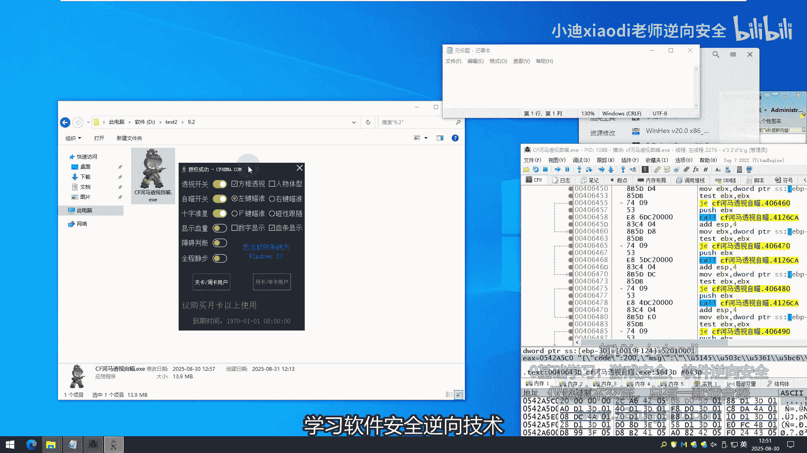

# 🛡️ 软件安全分析：第一章：网络验证机制与逆向防护

## 📘 课程概述

本节课将介绍一个游戏辅助软件的网络验证案例，并从软件安全与防御性逆向分析的角度，说明程序如何连接服务器、校验卡密、接收验证结果以及显示提示信息。

案例中涉及的原始操作包含修改程序运行数据、绕过网络验证和破解软件授权。这类行为可能侵犯软件作者权益、破坏游戏公平性，甚至违反法律法规。因此，本教程不提供可直接用于破解外挂、绕过授权或修改服务器响应的操作步骤，而是保留案例中的技术逻辑，用于帮助初学者理解网络验证系统的安全风险与防护方法。

本节内容适合用于合法授权的软件审计、内部安全测试、教学实验环境和自研程序防护分析。学习逆向技术的重点不是绕过验证，而是理解程序如何工作，并进一步发现和修复安全问题。

---

## 一、案例背景：网络验证程序如何工作 🎮

上一部分介绍了本节课的学习范围，下面先了解案例中的基本场景。

案例中的对象是一个游戏辅助软件。程序启动后，用户需要输入卡密，软件会将卡密提交给服务器进行验证。如果卡密正确，服务器返回成功结果，软件继续运行；如果卡密错误，程序会在界面中显示错误提示。

整个验证过程可以抽象为以下流程：

```text
用户输入卡密
        ↓
客户端向服务器发送验证请求
        ↓
服务器检查卡密是否有效
        ↓
服务器返回验证结果
        ↓
客户端根据结果显示提示或继续运行
```

用公式表示，可以写成：

```text
验证结果 = ServerCheck(卡密, 设备信息, 时间信息, 软件版本)
```

其中，`ServerCheck` 表示服务器端的验证逻辑。服务器可能同时检查卡密是否存在、是否过期、是否绑定设备、是否超过使用次数，以及当前软件版本是否符合要求。

原案例中，程序在没有购买卡密的情况下输入任意内容，界面会提示卡密错误。这说明程序已经完成了网络请求，并根据服务器返回的数据执行了失败分支。

---

## 二、客户端界面提示的实现方式 🖥️

了解整体流程后，下面分析客户端如何显示“卡密错误”等文本信息。

程序在验证失败后，通常会调用界面控制函数，将文本写入输入框、标签或状态栏。Windows 程序中，常见的界面操作可能包括设置窗口文本、更新控件内容或刷新状态信息。

可以用抽象代码表示：

```cpp
if (verify_result == VERIFY_FAILED) {
    SetControlText(status_label, "您输入的卡密有误");
}
```

在这个示例中：

- `verify_result` 表示服务器返回的验证结果；
- `VERIFY_FAILED` 表示验证失败；
- `SetControlText` 表示修改界面控件中的文本；
- `"您输入的卡密有误"` 是用户看到的错误提示。

需要注意的是，界面文本只是最终表现，不一定代表真正的安全判断位置。程序可能先在网络通信模块中解析服务器响应，再把解析后的结果传递给界面模块。

因此，在合法的软件审计中，应当区分以下两个位置：

1. **结果来源位置**：服务器响应被接收和解析的位置。

2. **结果使用位置**：程序根据验证结果决定显示什么内容或执行什么功能的位置。

如果只关注界面提示，而不分析数据流，就容易把表现层误认为验证核心。

---

## 三、网络验证的基本数据流 🌐

上一节介绍了界面提示的实现方式，本节继续分析网络验证的数据流。

程序通常会向指定服务器发送请求。请求中可能包含以下信息：

```json
{
  "card_key": "用户输入的卡密",
  "device_id": "设备标识",
  "version": "客户端版本",
  "timestamp": 1710000000
}
```

服务器收到请求后，会进行校验，并返回结构化数据。例如：

```json
{
  "code": 200,
  "message": "验证成功",
  "expire_at": 1719999999
}
```

也可能返回失败信息：

```json
{
  "code": 401,
  "message": "卡密无效",
  "expire_at": 0
}
```

常见的验证逻辑可以表示为：

```python
def verify_card(response):
    if response["code"] != 200:
        return False

    if response["expire_at"] < current_timestamp():
        return False

    return True
```

从防御角度看，客户端不应只依赖一个简单的数字字段判断授权状态。否则，攻击者可能通过修改本地内存、拦截通信或替换程序执行路径，影响客户端的判断结果。

---

## 四、为什么只依赖客户端验证存在风险 ⚠️

下面进一步说明案例中暴露出的安全问题。

如果关键授权逻辑完全放在客户端，程序可能出现以下风险：

以下是常见的客户端验证风险：

- 客户端可以被调试和逆向分析；
- 本地判断逻辑可能被修改；
- 网络响应可能被拦截或篡改；
- 程序中的服务器地址可能被提取；
- 固定的成功状态码可能被识别；
- 关键字符串可能暴露验证流程；
- 程序可能只根据单个字段决定是否授权。

例如，下面这种逻辑不够安全：

```cpp
if (server_code == 200) {
    enable_all_features();
}
```

问题在于，程序只根据一个简单的返回值决定是否开启功能。对于攻击者来说，这类逻辑容易被定位，也容易成为篡改目标。


更加稳妥的设计应当同时检查多个条件：

```cpp
bool authorized =
    signature_valid &&
    token_not_expired &&
    device_matches &&
    version_allowed &&
    server_timestamp_valid;
```

但是，即使客户端检查多个条件，也不能把客户端视为完全可信的环境。客户端最终仍然运行在用户控制的设备上，因此关键权限必须由服务器端再次确认。

---


## 五、更加安全的网络验证设计 🔐

理解风险后，下面介绍如何设计更可靠的验证系统。

### 1. 使用数字签名验证服务器响应

服务器返回的数据不应只包含普通状态码，还应包含数字签名。

服务器端可以生成如下响应：

```json
{
  "status": "authorized",
  "user_id": "10001",
  "expire_at": 1719999999,
  "nonce": "随机数",
  "signature": "数字签名"
}
```

客户端验证逻辑可以抽象为：

```text
签名是否有效
    且
响应是否过期
    且
随机数是否未被重复使用
    且
设备信息是否匹配
```

形式化表示为：

```text
Authorized =
VerifySignature(response, public_key)
∧ CheckTimestamp(response)
∧ CheckNonce(response)
∧ CheckDeviceBinding(response)
```

这样可以减少攻击者直接伪造成功响应的可能性。

### 2. 不在客户端保存私钥

以下是密钥管理中的基本原则：

- 私钥只能保存在服务器端；
- 客户端只保存用于验证签名的公钥；
- 不应将服务器私钥编译进客户端；
- 不应把固定密钥写入程序字符串；
- 密钥应支持轮换和吊销；
- 关键密钥操作应放在受保护的服务端环境中。

客户端可以使用公钥验证服务器消息，但不能利用公钥生成合法签名。

### 3. 让服务器决定关键权限

对于重要功能，客户端不应只执行一次验证后永久开放。服务器应在关键操作时再次检查权限。

例如：

```text
客户端请求使用功能
        ↓
服务器检查当前授权状态
        ↓
服务器返回短期令牌
        ↓
客户端使用令牌完成操作
```

短期令牌可以设置过期时间：

```text
TokenValid = CurrentTime < TokenExpireTime
```

如果令牌过期，客户端必须重新向服务器申请。这样可以降低本地修改带来的影响。

### 4. 使用随机数防止重放

网络验证请求中应加入随机数或唯一请求编号：

```json
{
  "request_id": "随机请求编号",
  "timestamp": 1710000000,
  "card_key": "卡密摘要"
}
```

服务器需要记录已经使用过的请求编号。如果同一个请求被重复提交，服务器应拒绝处理。

防重放逻辑可以表示为：

```python
if request_id in used_request_ids:
    reject("重复请求")

if abs(server_time - client_time) > allowed_drift:
    reject("时间异常")

accept_request()
```

这样可以减少攻击者复制旧通信内容并重复使用的风险。

---

## 六、合法逆向分析的安全流程 🔍

上一节介绍了如何改进网络验证系统，本节说明如何在合法范围内开展逆向分析。

逆向分析应当针对自有软件、获得授权的软件，或专门用于教学的实验程序。分析目标应是理解程序结构、发现安全问题和验证防护措施，而不是绕过付费功能或破坏第三方软件。

以下是推荐的安全分析流程：

1. **确认授权范围**

   明确软件所有者、测试目标、允许使用的工具，以及禁止执行的操作。没有授权时，不应分析或修改第三方程序。

2. **建立隔离环境**

   使用虚拟机、测试账号和模拟服务器，避免影响真实用户、生产服务器或在线游戏环境。

3. **记录正常通信**

   只在合法环境中观察请求和响应结构，重点关注字段含义、错误处理、超时机制和加密方式。

4. **分析程序结构**

   了解网络模块、界面模块、日志模块和错误处理模块之间的调用关系，不以绕过验证为目标。

5. **验证防护效果**

   使用自研测试程序检查签名验证、时间校验、令牌过期和防重放机制是否有效。

6. **修复并复测**

   对发现的问题进行修复，再次测试客户端和服务器是否能够正确拒绝异常请求。

在整个过程中，应保留测试记录，包括测试时间、测试环境、测试账号、测试结果和修复建议。这样既便于复盘，也能避免误操作。


---

## 七、如何检测客户端验证是否容易被篡改 🧪

为了保护软件，开发者可以从以下角度进行安全评估。

以下是常见的防护检查项目：

- 是否把核心授权逻辑全部放在客户端；
- 是否仅依赖单一状态码；
- 是否验证服务器响应签名；
- 是否检查响应时间和令牌有效期；
- 是否使用随机数防止重放；
- 是否绑定设备或账号；
- 是否限制异常请求频率；
- 是否记录多次失败验证；
- 是否能够及时吊销泄露的授权；
- 是否对服务器地址和通信协议进行保护；
- 是否在服务端重新确认关键功能权限。

可以使用以下抽象测试模型：

```python
def security_test(response, request):
    assert verify_signature(response)
    assert not expired(response)
    assert valid_nonce(response)
    assert valid_device(response, request)
    assert valid_version(response)
```

需要强调的是，这段代码用于防御性测试和自研程序验证，不应被用于修改第三方软件的运行结果。

---

## 八、常见错误与改进方式 🛠️

下面总结网络验证系统中容易出现的设计错误。

### 错误一：把“界面显示成功”当成“授权成功”

界面提示只是表现层，不能作为真正的权限依据。正确做法是让服务器端记录并确认授权状态。

### 错误二：只判断固定状态码

单个状态码不应决定全部权限。应结合数字签名、时间戳、设备信息、令牌状态和服务端记录共同判断。

### 错误三：把敏感逻辑全部写在客户端

客户端代码可以被查看、调试和分析。关键规则、授权数据和风控判断应尽量放在服务器端。

### 错误四：缺少请求过期机制

没有时间戳和随机数的请求可能被重复使用。应使用短期令牌、唯一请求编号和服务器端请求记录。

### 错误五：忽略异常行为监控

如果同一个账号在多个设备频繁切换，或者连续提交大量失败请求，系统应触发限制、验证或人工审核。

以下是一个简单的异常检测示例：

```python
if failed_attempts(user_id, window="10m") > 10:
    require_additional_verification(user_id)

if device_count(user_id, window="1h") > allowed_devices:
    temporarily_lock(user_id)
```

这些机制可以帮助开发者尽早发现异常访问行为。

---

## 🧾 本节总结

本节课我们一起学习了一个网络验证软件案例，并从防御性软件安全的角度分析了其中的技术结构。

我们了解了以下内容：



- 软件如何接收用户输入并发起网络验证；
- 服务器如何返回授权结果；
- 客户端如何根据结果显示界面提示；
- 为什么只依赖客户端判断存在安全风险；
- 如何使用数字签名、时间戳、随机数和短期令牌增强验证；
- 为什么关键权限应由服务器端决定；
- 如何在合法授权和隔离环境中开展逆向分析；
- 如何通过日志、风控和异常检测保护网络验证系统。

网络验证的核心原则可以概括为：

```text
客户端负责展示和发起请求，
服务器负责确认身份和授权，
关键权限必须由服务器最终决定。
```

逆向分析技术本身是一种中性的技术能力，真正重要的是使用边界。将其用于自研软件审计、漏洞修复和安全研究，可以提升系统防护能力；将其用于破解授权、绕过验证或破坏游戏公平性，则可能造成法律和实际损害。

