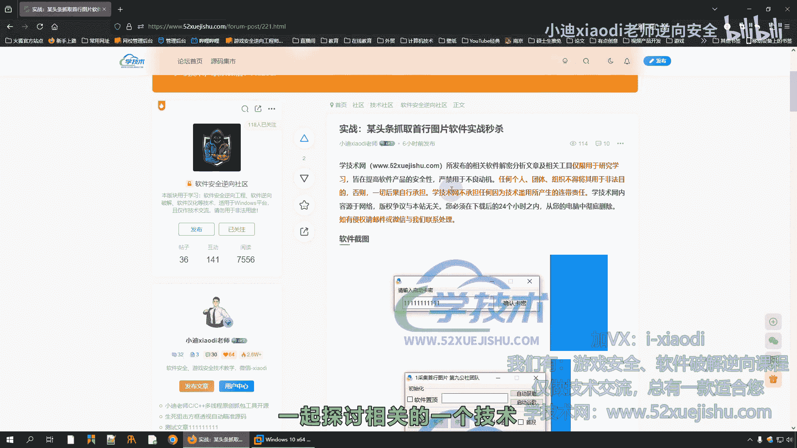

# 软件逆向分析基础：第一章：在授权环境中定位网络验证逻辑 🔍

## 课程概述 📘

本节课将介绍软件逆向分析的基本思路，以及如何在获得授权的前提下，使用调试器观察软件的运行流程、定位弹窗来源、分析函数调用关系和识别网络验证逻辑。

教程中的案例围绕“输入卡密后进行验证”的软件展开。需要特别说明的是，逆向分析只能用于已购买软件的安全研究、兼容性测试、漏洞分析、软件防护评估和技术交流，不得用于绕过授权、伪造卡密、破解商业软件或进行其他未经许可的操作。

在实际学习中，应当重点理解“程序为什么这样运行”，而不是简单修改程序结果。只有理解执行流程，才能把逆向技术应用到合法的软件调试和安全分析中。

## 一、为什么要学习软件逆向分析 🧭

上一节我们先明确了学习边界，本节继续说明软件逆向分析可以解决什么问题。

当我们拿到一款自己购买的软件时，可以在授权范围内研究它的运行机制。例如，可以分析软件的防护程度、观察程序如何处理输入、检查网络通信是否安全，以及定位软件崩溃或异常弹窗的原因。

以下是逆向分析常见的合法用途：

- 研究自己开发的软件是否容易被分析。

- 测试软件的授权验证是否存在安全漏洞。

- 分析程序崩溃、卡顿、异常退出等问题。

- 检查网络验证流程是否存在明文传输或错误处理。

- 进行软件兼容性测试和安全审计。

- 学习汇编、调试器、调用栈和程序执行流程。

逆向分析的核心目标可以概括为：

```text
理解程序行为
= 观察输入
+ 跟踪执行流程
+ 分析函数调用
+ 验证输出结果
```

因此，逆向分析并不等同于破解。是否取得授权，是判断行为是否合法的重要标准。

## 二、准备测试环境和分析对象 🧪

上一节我们介绍了逆向分析的用途，本节开始进入案例环境。

案例中的软件大致流程是：用户输入卡密，点击确认，软件进行验证，然后显示验证结果或弹出提示窗口。

为了避免影响真实用户和生产环境，测试时应当使用专门准备的测试程序、实验样本或自己编写的演示程序。不要直接对第三方商业软件进行修改，也不要使用真实用户数据或真实授权信息。

以下是建议准备的环境：

- 一份明确允许分析的测试软件。


- 一台用于调试的隔离虚拟机。

- 调试器或反汇编工具。

- 网络抓包工具，用于观察经过授权的测试通信。

- 软件符号、日志或开发文档，如果这些资料可以合法获取。


- 测试账号、测试卡密或模拟验证接口。

在测试环境中，建议先记录软件的正常行为，包括输入内容、弹窗提示、返回时间和最终状态。这样后续分析时，才能判断程序是否按照预期运行。

## 三、运行程序并观察正常行为 👀

上一节完成了测试环境准备，本节先不急着分析代码，而是观察程序的表面行为。

运行测试软件后，通常可以看到一个输入框。用户输入卡密并点击确认，程序会进行验证，然后弹出提示窗口或显示验证结果。

分析时应当重点记录以下内容：

- 输入框接受什么类型的数据。

- 点击确认后是否出现弹窗。

- 弹窗显示的是成功、失败、过期还是网络错误。

- 软件是否显示授权到期时间。

- 验证失败后程序是否退出或限制功能。

- 验证过程中是否存在明显的网络请求。

程序的外部行为可以简单表示为：

```text
输入卡密
    ↓
提交验证请求
    ↓
接收验证结果
    ↓
判断验证状态
    ↓
显示提示或开放功能
```

这个流程只是表面现象，真正的验证逻辑可能分布在多个函数中。下一步需要通过调试器，把这些表面行为和底层代码对应起来。

## 四、将调试器连接到目标进程 🔗

上一节我们观察了软件的正常运行，本节开始使用调试器定位执行过程。

在获得授权的测试环境中，可以让调试器附加到正在运行的程序。附加操作的作用，是让调试器能够观察目标进程的线程、模块、寄存器、内存和函数执行情况。

需要注意的是，调试器显示的内容可能首先是系统线程或公共模块，而不是软件自身的业务代码。此时应当进一步定位目标程序的主模块或有效符号信息。

常见的观察对象包括：

- 进程和线程。

- 主模块和动态链接库。

- 当前执行地址。

- 调用栈。

- CPU寄存器。

- 内存中的字符串和结构体。

程序执行位置通常可以抽象为：

```text
当前指令地址 = 程序下一条将要执行的指令位置
```

当当前指令发生变化时，说明程序正在沿着不同的控制流继续执行。通过记录这些变化，可以逐步还原程序的执行路径。

## 五、使用断点定位弹窗来源 🛑

上一节完成了调试器连接，本节通过断点寻找弹窗触发位置。

断点可以理解为“让程序在指定位置暂停”。当程序执行到断点位置时，调试器会暂停目标进程，使分析人员能够查看当时的调用栈、寄存器和内存状态。

断点的基本作用可以表示为：

```text
执行到指定地址
    ↓
暂停程序
    ↓
读取上下文信息
    ↓
分析调用来源
```

如果软件在输入卡密后弹出提示窗口，可以围绕弹窗相关函数设置断点。在测试环境中，程序弹窗时暂停，随后可以查看是谁调用了这个弹窗函数。

分析时可以重点查看：

- 当前调用函数。

- 上一级调用者。

- 调用栈中的业务函数。

- 传入弹窗函数的字符串。

- 当前线程的执行状态。

- 弹窗出现前的条件判断。


如果弹窗内容包含“卡密错误”“卡密过期”或“网络异常”等文本，那么这些字符串可能帮助我们快速定位相关代码区域。

## 六、通过调用栈回溯业务逻辑 🧩

上一节通过断点捕获了弹窗位置，本节继续沿调用栈回溯到业务逻辑。

调用栈记录了函数之间的调用关系。简单来说，当前函数是如何被调用的、上一级是谁、再上一级是谁，都可以通过调用栈查看。

调用关系可以表示为：

```text
主流程
  → 验证函数
    → 结果处理函数
      → 弹窗函数
```

当程序在弹窗函数处暂停时，可以逐层返回上一级函数，观察每一层函数负责的任务。

常见的调试动作包括：

- 返回调用者。

- 单步执行当前函数。

- 进入下一级函数。

- 查看函数参数。

- 查看返回值。

- 观察执行前后的寄存器变化。

在分析过程中，不要只关注某一条指令。更重要的是理解整个函数的输入、处理过程和输出结果。

一个函数可以抽象为：

```text
输出 = 函数(输入, 环境状态)
```

例如：

```text
验证结果 = Validate(卡密, 服务器响应, 本地时间)
```

只有同时分析输入、服务器响应和本地状态，才能判断验证结果是由哪一部分决定的。

## 七、识别条件判断和错误分支 ⚖️

上一节我们介绍了如何回溯调用关系，本节分析程序中的条件判断。

网络验证程序通常会根据返回结果进入不同分支，例如验证成功、卡密错误、卡密过期、网络失败等。反汇编代码中经常可以看到比较指令和条件跳转指令。

其逻辑可以抽象为：

```text
如果 验证结果 == 成功：
    开放功能
否则如果 验证结果 == 过期：
    显示过期提示
否则：
    显示错误提示
```

也可以使用公式表示：

\[
状态 =
\begin{cases}
成功, & result = 1 \\
过期, & result = expired \\
失败, & result = 0 \\
网络错误, & request\_failed = true
\end{cases}
\]

在调试器中，条件跳转的执行情况可以帮助我们判断当前代码属于哪条分支。需要注意的是，观察分支和修改分支是两件不同的事情。授权的安全分析可以记录分支逻辑，但不应通过修改跳转来绕过授权验证。

以下是分析条件分支时应关注的内容：

- 比较了哪些数据。

- 比较结果来自本地还是服务器。

- 条件跳转对应哪一种状态。

- 是否存在异常处理分支。

- 是否对服务器返回值进行了完整校验。

- 是否对时间、签名和设备信息进行了验证。

## 八、理解网络验证和到期时间 ⏱️

上一节定位了条件分支，本节进一步分析网络验证结果和到期时间。

部分软件会从服务器接收授权状态和到期时间，然后在本地进行显示。到期时间可能来自时间戳，也可能来自格式化后的日期字符串。

Unix时间戳通常可以表示为：

\[
timestamp = \text{从1970年1月1日00:00:00 UTC开始计算的秒数}
\]

日期转换过程可以表示为：

```text
服务器时间戳
    ↓
时间解析
    ↓
时区转换
    ↓
日期格式化
    ↓
界面显示
```

如果界面显示为 `1970-01-01`，通常说明时间戳可能为零、解析失败、字段为空或单位不匹配。例如，程序把毫秒误当成秒，或者把秒误当成毫秒，都可能导致时间显示异常。

常见问题包括：

- 服务器没有返回到期时间。

- JSON字段名称不一致。

- 时间戳单位不一致。

- 时间解析函数处理失败。

- 时区转换出现错误。

- 本地变量没有正确初始化。

在合法的软件调试中，应当修复数据来源、字段解析或时间转换问题，而不是修改程序分支来伪造有效授权。

## 九、如何正确处理验证异常 🛠️

上一节说明了到期时间异常的可能原因，本节介绍合法的修复方法。

如果测试程序显示错误日期或错误状态，应当从数据链路开始排查，而不是直接修改最终显示结果。正确的排查顺序通常是从服务器响应一路检查到界面展示。

以下是推荐的排查步骤：

1. 检查服务器是否返回了到期时间字段。

2. 检查字段名称和数据类型是否正确。

3. 确认时间戳使用的是秒还是毫秒。

4. 确认程序是否正确解析了服务器响应。

5. 检查时区和日期格式化逻辑。

6. 检查异常情况下是否进行了默认值处理。

7. 使用测试数据验证不同日期是否能够正确显示。

示例代码如下：

```python
from datetime import datetime, timezone

def format_expire_time(timestamp: int) -> str:
    if timestamp <= 0:
        return "未获取到有效到期时间"

    dt = datetime.fromtimestamp(timestamp, tz=timezone.utc)
    return dt.strftime("%Y-%m-%d %H:%M:%S UTC")
```

如果服务器返回的是毫秒时间戳，可以先转换为秒：

```python
seconds = milliseconds // 1000
```

实际项目中还应当加入签名验证、错误提示和日志记录，防止客户端直接信任未经验证的数据。

## 十、为什么不能通过修改跳转绕过验证 🚫

上一节介绍了如何修复合法的时间处理问题，本节说明为什么不能把修改条件跳转、填充空指令或伪造验证结果作为实际操作方案。

有些逆向教程会演示修改程序分支，让程序跳过错误处理并直接进入功能界面。这种做法本质上是在绕过授权控制，可能侵犯软件著作权、违反服务协议，也可能造成账户滥用和数据安全问题。

因此，本教程不提供以下操作步骤：

- 修改条件跳转指令。

- 使用空指令覆盖验证逻辑。

- 伪造服务器返回结果。

- 制作或传播破解版本。

- 绕过卡密有效期。

- 修改程序以使用未经授权的功能。

在安全研究中，可以记录漏洞现象并向软件开发者报告。推荐采用以下方式：

```text
发现问题
    ↓
在隔离环境复现
    ↓
记录影响范围
    ↓
保留最小化证据
    ↓
向开发者负责任披露
    ↓
等待修复和验证
```

如果是自己开发的软件，则应当从服务端重新设计验证机制，不能只依赖客户端的判断。

## 十一、改进软件验证机制 🔐

上一节说明了不应通过修改客户端绕过验证，本节进一步介绍更可靠的设计思路。

网络授权不应只依赖客户端返回的一个布尔值，也不应把关键授权信息完全放在客户端。更稳妥的设计是由服务器生成签名授权结果，客户端只负责验证签名并展示状态。

一种简化的验证模型如下：

\[
Valid = VerifySignature(payload, signature, publicKey)
\]

其中：

- `payload` 表示授权内容。

- `signature` 表示服务器生成的数字签名。

- `publicKey` 表示客户端内置的公钥。

- `Valid` 表示签名是否有效。

示例数据结构可以表示为：

```json
{
  "user_id": "test-user",
  "product": "demo",
  "expires_at": 1735689600,
  "nonce": "random-value",
  "signature": "server-signature"
}
```

服务端还应当结合以下措施：

- 使用 HTTPS保护传输过程。

- 对授权响应进行数字签名。

- 使用随机数防止重放攻击。

- 在服务器端保存真实授权状态。

- 记录异常请求和设备风险。

- 对客户端错误进行清晰分类。

- 不把核心授权逻辑完全交给客户端。

客户端可以被分析和修改，因此客户端判断只能作为用户界面提示，不能作为唯一的安全边界。

## 十二、合法学习逆向技术的建议 📚

上一节我们讨论了更安全的验证设计，本节给出适合初学者的学习方向。

对于刚开始学习的人，可以先从自己编写的小程序开始，逐步理解编译、调试、反汇编和网络通信。这样既能掌握技术，也不会涉及未经授权的软件。

以下是推荐的学习路径：

- 学习C语言和基础数据结构。

- 理解栈、堆、寄存器和内存地址。


- 学习汇编语言中的常见指令。

- 掌握断点、单步执行和调用栈。

- 使用自己编写的程序进行调试。

- 学习网络协议和数据格式。

- 了解数字签名、哈希和加密。

- 练习漏洞复现和负责任披露。

- 使用合法的Crackme、CTF和教学样本。

学习时可以通过一个简单程序理解控制流：

```c
int check_result(int result) {
    if (result == 1) {
        return 0;
    }

    return -1;
}
```

编译后再使用调试器观察条件判断，就能理解源代码、汇编指令和程序行为之间的对应关系。



## 总结 ✅

本节课中我们一起学习了软件逆向分析的基本流程，包括观察软件行为、连接调试器、设置断点、查看调用栈、定位弹窗来源、分析条件分支，以及排查网络验证和到期时间显示问题。

我们还了解到，显示 `1970-01-01` 等异常日期，可能与时间戳为空、时间单位错误、字段解析失败或时区处理错误有关。正确的解决方式是修复数据链路和验证逻辑，而不是修改程序分支来绕过授权。

最后需要再次强调，逆向技术应当用于已获授权的软件调试、安全研究、兼容性测试和漏洞分析。不得使用这些技术破解商业软件、伪造卡密、绕过授权或进行其他不当用途。

