# 逆向安全PE文件结构：01：课程概述与可执行文件 🧩

在本节课中，我们将要学习PE文件结构的基础知识。课程内容面向零基础学习者，也会覆盖游戏安全、软件安全、网络安全和CTF比赛中常见的PE基础知识。PE文件结构和可执行文件概念紧密相关，因此先把“什么是可执行文件”讲清楚。可执行文件是可以被操作系统直接加载并运行的文件，它包含程序的机器码指令、数据以及运行所需的结构信息。

这里用代码描述核心概念：

```text
可执行文件 = 机器码指令 + 数据 + 结构信息
可执行文件的关键 = 包含程序机器码指令，可被操作系统直接加载运行
```

为了理解“程序”和“文本文档”的区别，可以看一个桌面备份文本文档的例子。文本文档不是程序，它本身不包含程序代码，所以它不是可执行文件。文本文档之所以能打开，是因为它依赖外部程序加载，例如记事本`notepad.exe`。这里的“打开方式”只是用某个软件打开文件，并不代表文件本身就是程序。

下面用列表对比文本文档和可执行文件的区别：

- 文本文档：不是程序，不包含程序机器码指令，不是可执行文件。
- 文本文档的打开：依赖外部程序加载，例如`notepad.exe`。
- 可执行文件：包含程序机器码指令、数据和结构信息，能被操作系统直接加载运行。
- 判断要点：文件是否包含程序代码，是否能被操作系统直接加载运行。

上一节从可执行文件概念入手，本节来看看PE文件的来历、扩展名以及它和COFF、ELF的关系。PE文件是可移植可执行文件，英文为Portable Executable，其中Portable表示可移植，Executable表示可执行。PE文件格式是微软设计的东西，看到PE相关格式就可以知道它属于微软体系。微软当初设计PE时有一个理念：让程序或文件既能在Windows上运行，也能在Linux或其他机器上运行。虽然现在Windows程序并没有完全移植到Linux上，但PE格式确实有这样的历史设计理念。

PE格式遵循通用目标文件格式COFF规范，这个规范也被大多数Unix可执行文件采用。因此PE的可移植性并不是完全不存在，而是有历史渊源。PE文件的作用是被操作系统加载进内存，然后供CPU执行。Windows下的可执行文件格式是PE，Linux下的可执行格式是ELF，即Executable and Linkable Format，表示可运行并且可链接的格式。CTF比赛中需要知道：Windows下常见PE格式，Linux下常见ELF格式。

下面用代码总结可执行文件格式：

```text
Windows 可执行文件格式 = PE（Portable Executable），基于 COFF 结构
Linux 可执行文件格式 = ELF（Executable and Linkable Format）
PE 文件作用 = 被操作系统加载进内存，供 CPU 执行
```

下面列出常见可执行文件扩展名，作为初步了解：

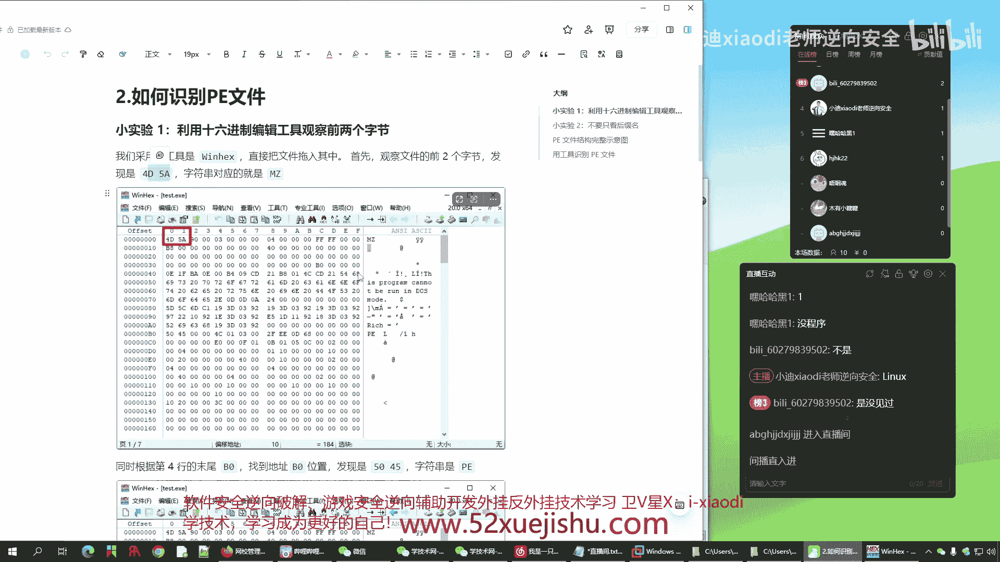

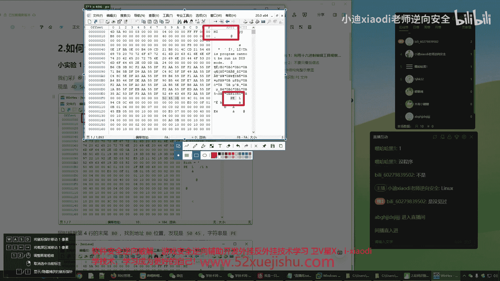

- Windows常见可执行文件扩展名：`.exe`、`.dll`、`.sys`。
- 属于PE格式的扩展名示例：`.exe`、`.dll`、`.sys`、`.scr`、`.tsp`、`.cpl`、`.drv`、`.ocx`。
- `.scr`：屏幕保护程序。
- `.tsp`：Windows电话服务商提供相关文件。
- `.cpl`：控制面板相关文件。
- `.drv`：驱动文件。
- `.ocx`：ActiveX表单相关文件。

上一节介绍了PE的历史和扩展名，本节来看看如何识别一个文件是不是PE文件。识别方法很直接：使用十六进制编辑工具观察文件的前两个字节。常见工具是`010 Editor`，把程序拖进去，或者点击文件打开，就能看到十六进制内容。无论文件有没有加壳，例如是否加了VIP壳，前两个字节通常都能看到`4D5A`。只要文件前两个字节是`4D5A`，基本可以判断它可能是PE文件，也就是可执行程序。

同时还要往下找PE标志。通常在下方可以看到`50 45`，也就是`PE`标志。如果上面看到`MZ`，下面看到`PE`，那么文件就是PE文件。用代码表示识别特征如下：

```text
MZ 标记 = 0x4D5A（十六进制显示为 4D 5A）
PE 标志 = 0x5045（十六进制显示为 50 45，也就是字符 PE）
识别条件：文件开头出现 MZ，并在后部出现 PE 标志
```

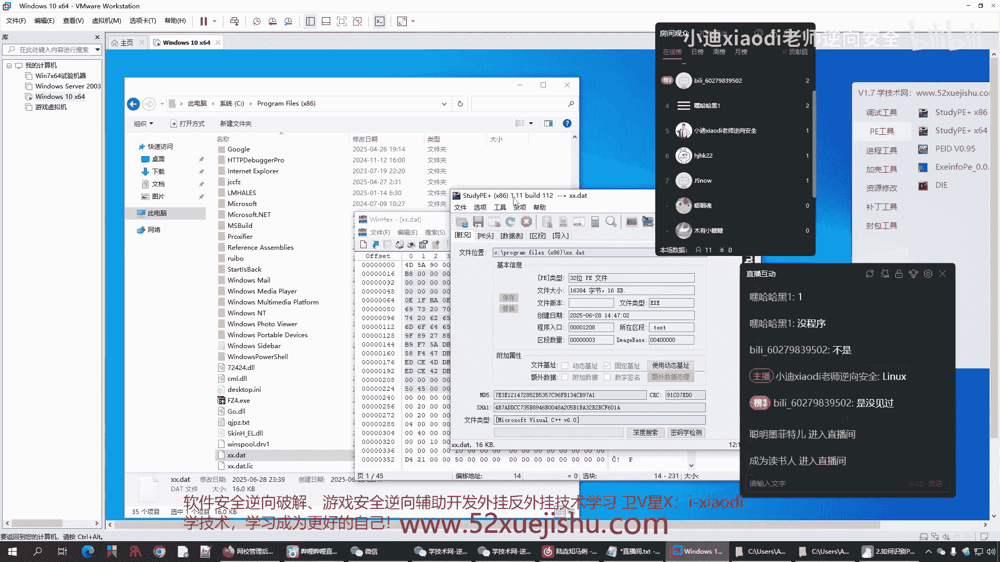

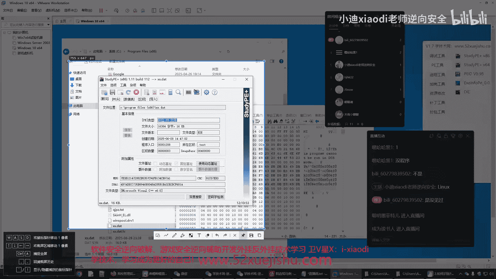

下面列出识别PE文件的基本步骤：

- 第一步：用十六进制编辑工具打开文件。
- 第二步：观察前两个字节是否为`4D5A`，也就是`MZ`标记。
- 第三步：继续向下查找`PE`标志，十六进制显示为`50 45`。
- 第四步：看到`MZ`和`PE`，基本可以判断文件是PE文件。
- 第五步：可以用`StarPE`等工具辅助识别，工具会直接显示文件类型和位数。

上一节用十六进制特征识别PE文件，本节来看看伪装后缀的情况和识别工具的实战用法。很多病毒、木马或某些程序会通过伪装后缀名来隐藏自己。没有后缀并不意味着文件是普通文件，它也可能是可执行程序。一个典型例子是外挂程序会生成`.dat`文件。只看`.dat`后缀，很难看出它是可执行文件。但把文件拖入`010 Editor`，看到`MZ`和`PE`标志，就可以判断它其实是PE文件，也就是可执行文件。

因此，不能只通过后缀判断文件类型。后缀可以修改，没有见过的后缀也可能对应可执行程序，需要留心。也可以用`StarPE`这类工具识别，工具一识别就会显示“32位PE文件”等信息，文件就会露出马脚。

下面用引用强调识别原则：

> 注意：不要只看后缀名判断文件类型。没有后缀、后缀被修改、后缀不常见，都不能排除它是可执行程序的可能。应结合十六进制特征和工具综合分析。

上一节介绍了识别PE的实战方法，本节来看看PE文件的整体结构。所有PE文件都遵循一定的结构，这个结构就是PE文件结构的游戏规则。完整PE结构大致分为几个部分：第一部分是DOS头，第二部分是PE文件头，第三部分是节表，也叫块表或Section Table，第四部分是节区，也叫Section。调试信息属于可选部分，可有可无。主干部分是DOS头、PE文件头、节表和节区。

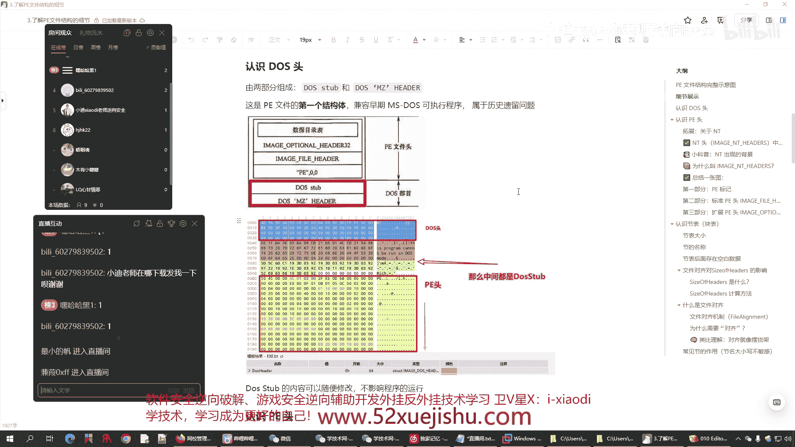

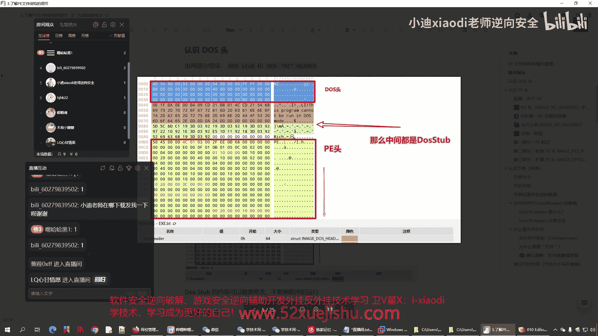

下面用代码表示PE整体结构：

```text
PE文件 = DOS头 + PE文件头 + 节表 + 节区 +（可选调试信息）
主干部分 = DOS头 + PE文件头 + 节表 + 节区
```

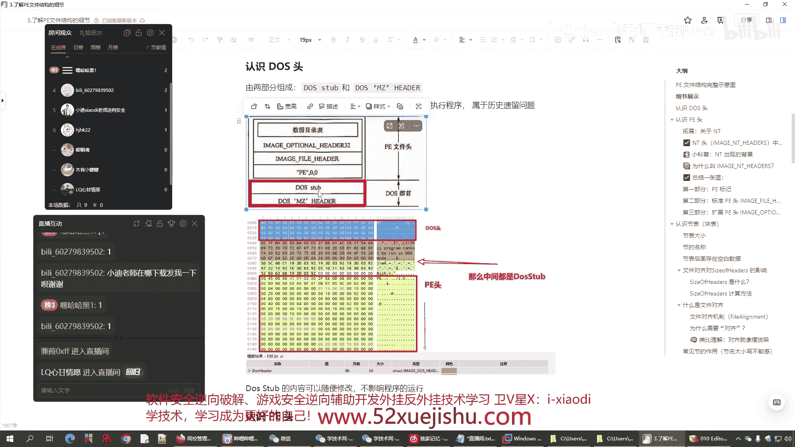


下面列出PE结构的组成部分：


- DOS头：PE结构第一部分。
- PE文件头：PE结构第二部分。
- 节表：也叫块表、Section Table，PE结构第三部分。
- 节区：也叫Section，PE结构第四部分，可有可无的调试信息另算。
- 调试信息：可选部分，不是主干必需内容。

学习PE结构可以使用`010 Editor`。这个工具提供模板解析功能，选择Executable，也就是可执行文件模板后，工具会自动解析PE文件头。点击不同结构时，工具会高亮对应区域，不需要逐个字段查资料。相比一些旧教程里的手工查表方式，这种方式更方便。工具可以在论坛下载，学习时建议下载`010 Editor`。

上一节看了PE整体结构，本节来认识DOS头和PE文件头的细节。先看DOS头。DOS头大致分为两部分：第一部分是DOS MZ，也就是MZ标记，十六进制为`4D5A`；第二部分是DOS Stub。在十六进制编辑器中，从MZ开始查看前四行，可以看到DOS头区域。MZ标记到PE标记之间的连续空间属于DOS Stub，这段内存空间是连续的，因此容易分辨。

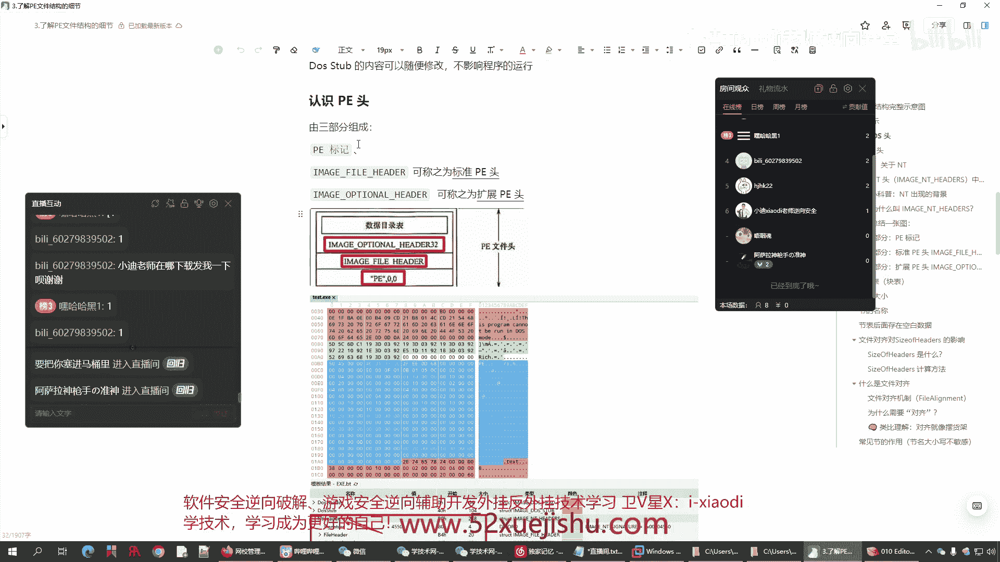

下面用代码表示DOS头组成：

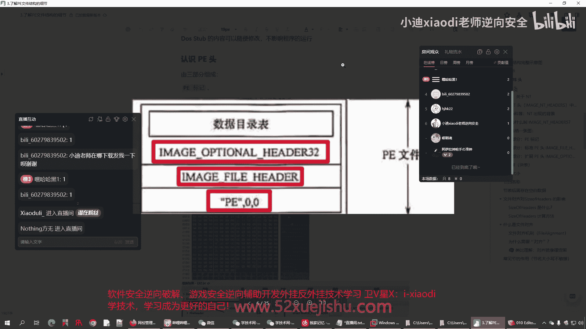

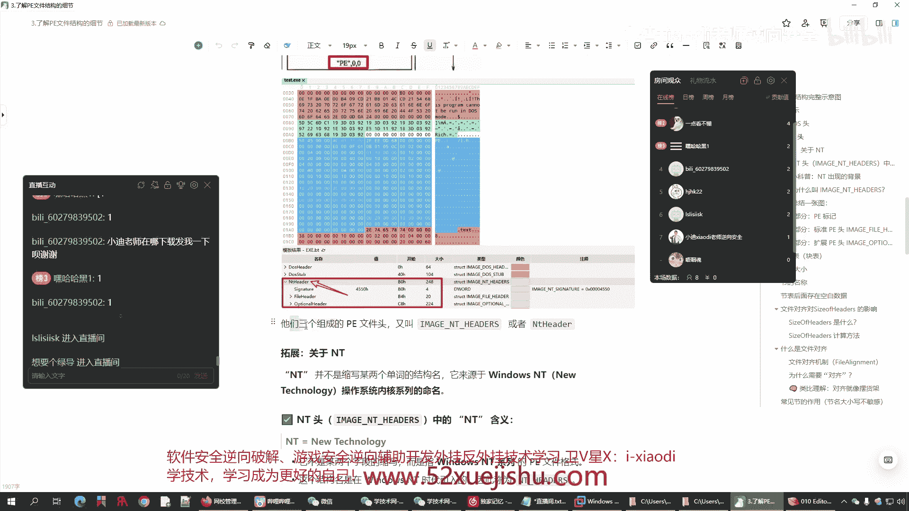

```text
DOS头 = DOS MZ 标记（MZ，0x4D5A） + DOS Stub
DOS Stub = MZ 标记与 PE 标记之间的连续空间
```

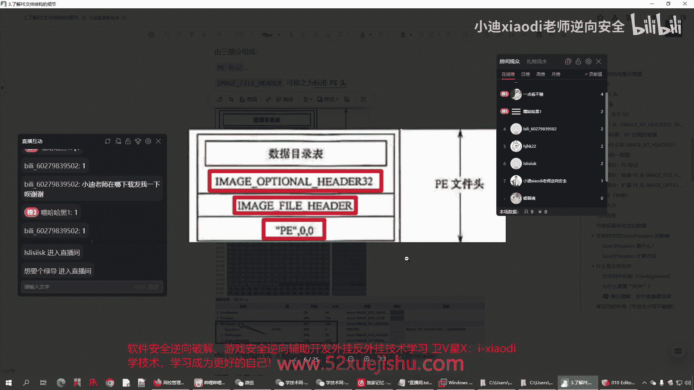

下面列出DOS头的理解要点：

- DOS MZ：就是MZ标记，十六进制为`4D5A`。
- DOS Stub：MZ标记到PE标记之间的连续区域。
- DOS Stub内容：可以理解为一些DOS相关数据。
- DOS Stub修改：内容可以随便修改，不影响程序运行。
- DOS Stub用途：兼容早期MS-DOS可执行程序，是历史遗留问题。

学习DOS头时，不需要马上了解DOS Stub每个字段的功能。它是历史遗留内容，主要用于兼容早期DOS操作系统。简单了解即可。

接着看PE文件头。PE文件头由三部分组成：第一部分是PE标记，第二部分是File Header，也叫文件头、标准PE头、标准文件头；第三部分是Optional Header，也叫可选文件头、扩展PE头。一般可以叫PE标记、标准PE头和扩展PE头。这三部分共同组成PE文件头，PE文件头又叫`Image_NT_Headers`或`NT Header`。

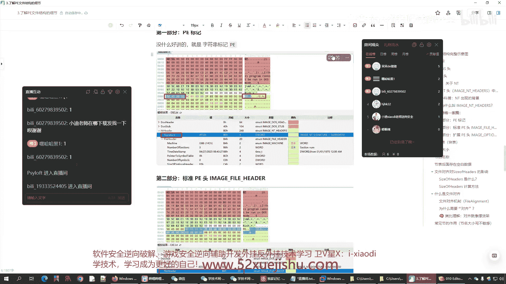

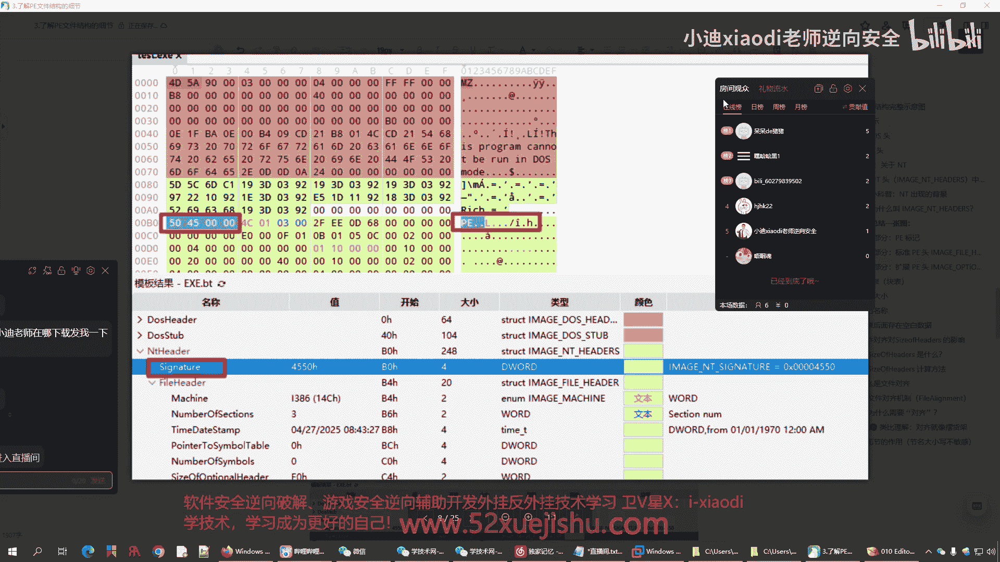

下面用代码表示PE文件头组成：

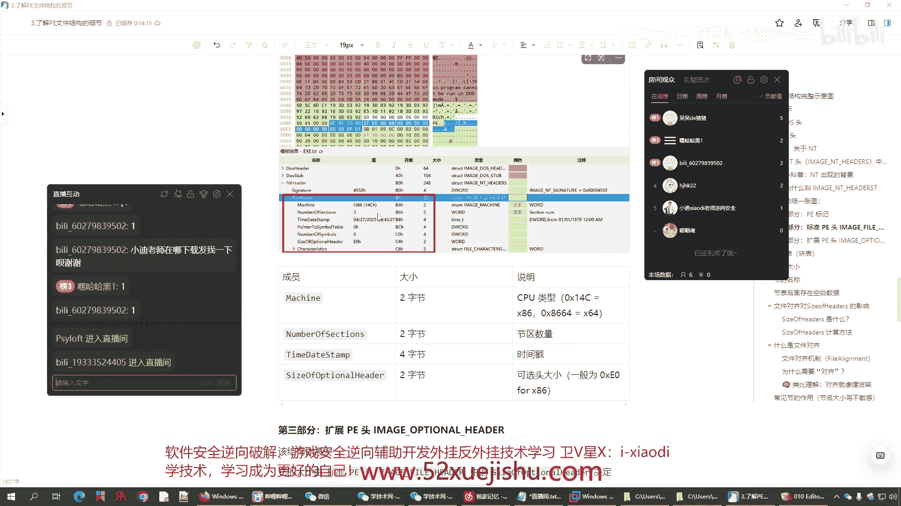

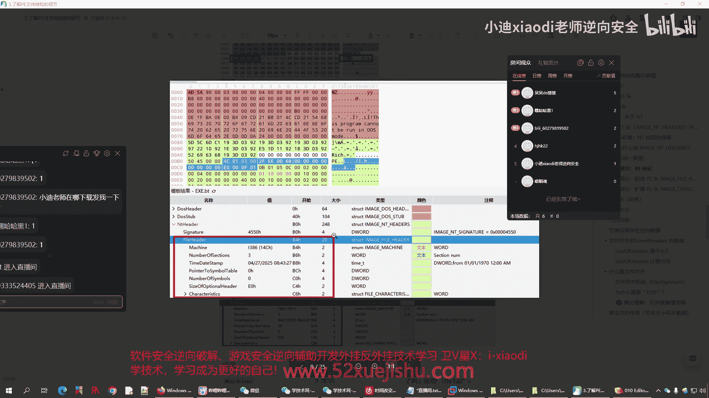

```text
PE文件头 = PE标记 + File Header（标准PE头） + Optional Header（扩展PE头）
PE文件头别名 = Image_NT_Headers / NT Header
```

下面列出PE文件头的组成：

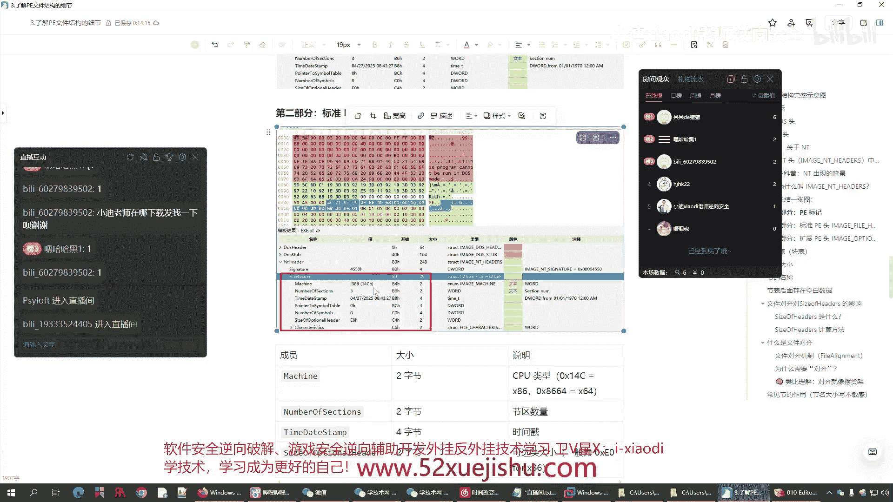

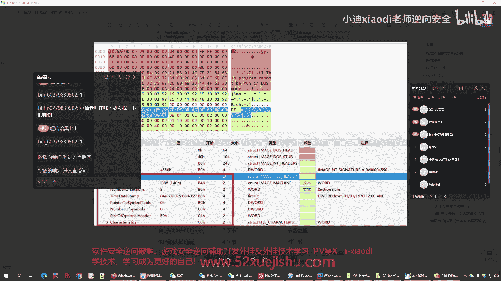

- PE标记：字符串`PE`，十六进制显示为`50 45`。
- File Header：标准PE头，也叫标准文件头。
- Optional Header：可选文件头，也叫扩展PE头。

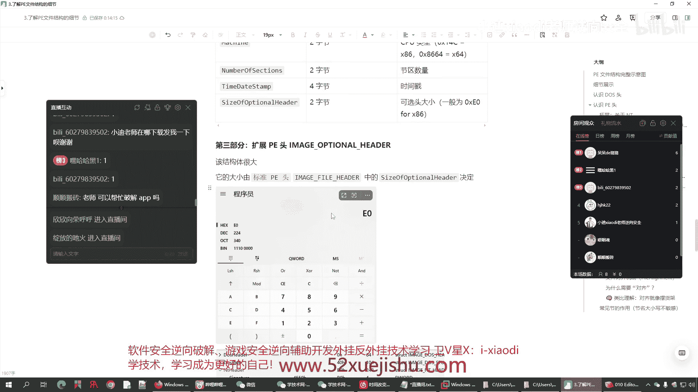

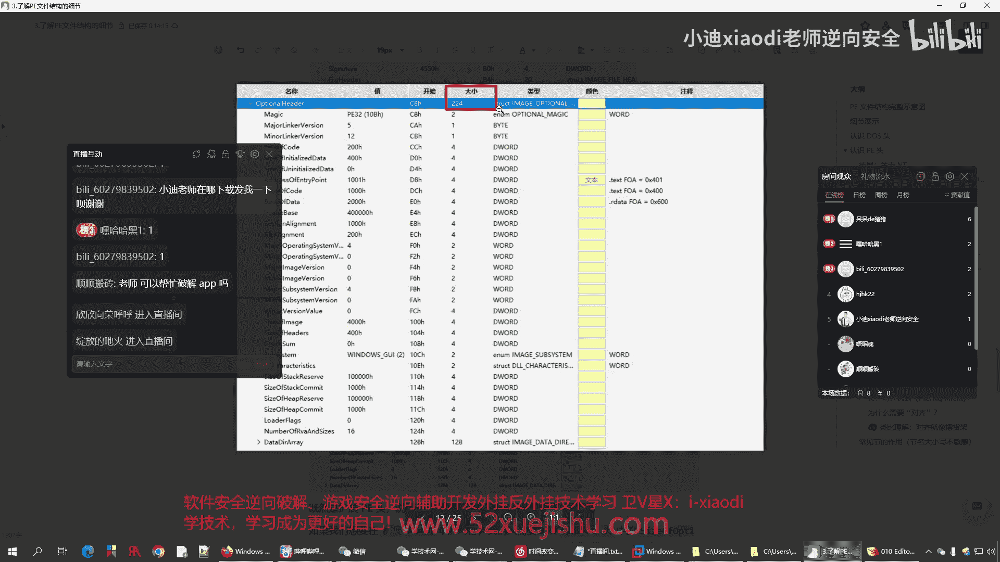

`NT Header`中的NT不是随便两个单词的缩写，它来源于Windows NT。NT指New Technology。Windows NT是20世纪90年代微软推出的操作系统系列。PE文件格式从这个时代开始引入，因此结构名保留为NT Header。`Image_NT_Headers`这个名称也和NT系列有关：DOS可执行文件使用的是EXE格式，而带NT头的PE格式是NT系列中使用的格式。记住从NT开始使用PE文件格式即可，其他历史细节简单了解。

PE标记本身就是一个字符串`PE`。标准PE头可以简单了解，大小是20个字节。扩展PE头比较大，它的大小由标准PE头中的`SizeOfOptionalHeader`决定。也就是说，扩展PE头大小不是固定的，而是由标准PE头里的成员控制。示例中扩展PE头大小是224字节，工具显示为`0xE0`，十进制为224。扩展PE头之所以叫“扩展”，说明它的大小可以扩展、可以变化。如果空间不够，需要往扩展PE头里添加内容，只需要修改标准PE头里的`SizeOfOptionalHeader`即可，因为它决定了扩展PE头大小。

下面用代码总结PE文件头的大小关系：

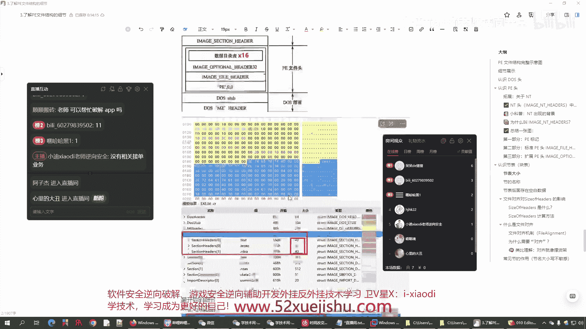

```text
File Header 大小 = 20 字节
Optional Header 大小 = FileHeader.SizeOfOptionalHeader
示例：SizeOfOptionalHeader = 0xE0 = 224 字节
扩展PE头空间不够时：修改 SizeOfOptionalHeader 来改变大小
```

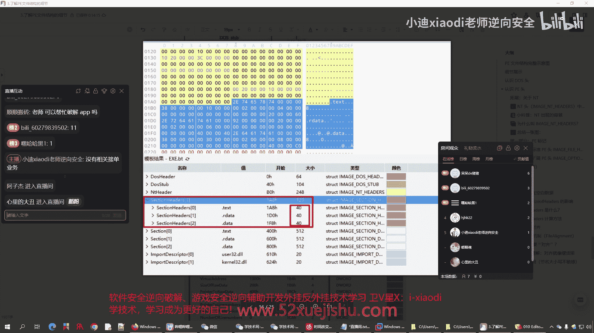

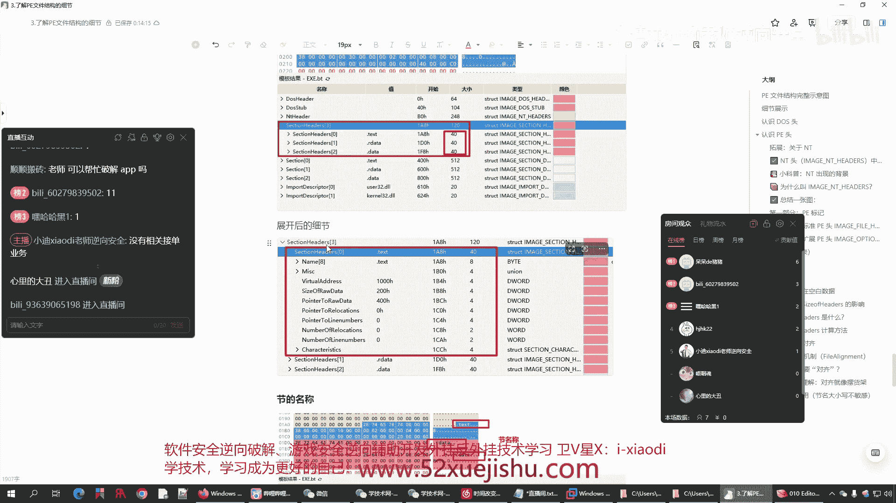

上一节介绍了DOS头和PE文件头，本节来看看节表和文件对齐机制。节表也叫块表，位于PE文件头之后。节表长度等于节区数乘以40个字节，每个节对应一个`IMAGE_SECTION_HEADER`结构。每个节表项固定为40个字节，这是规定好的大小。展开节表后可以看到虚拟地址等字段，初学阶段不需要全部了解，先了解节的名称即可。节的名称在Name成员中，常见的区段名字有`.text`、`.idata`、`.data`，这些名字就存放在节表里。因此要记住：区段名字属于节表，在节表中存放。

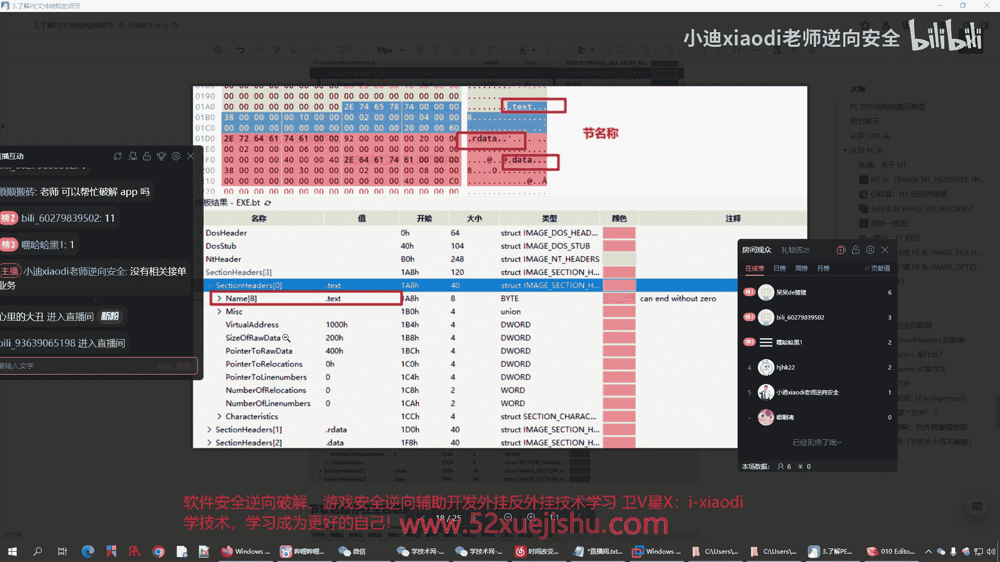

下面用代码表示节表长度：

```text
节表长度 = 节区数 × 40 字节
每个节对应 = IMAGE_SECTION_HEADER 结构
每个节表项大小 = 40 字节
常见节名 = .text / .idata / .data
节名存放位置 = 节表项的 Name 成员
```

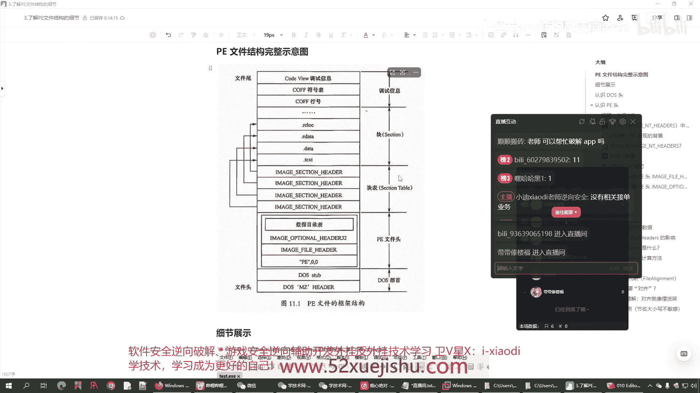

下面列出节表的理解要点：

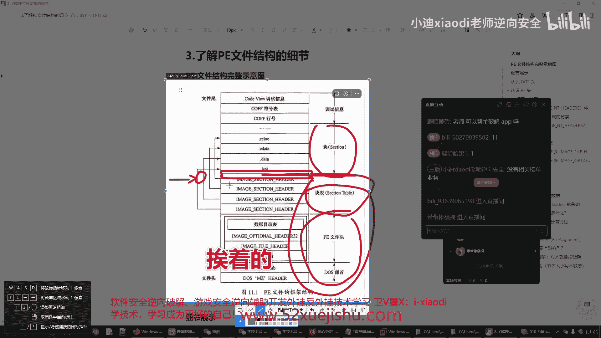

- 节表位置：位于PE文件头之后。
- 节表长度：节区数乘以40字节。
- 每个节表项：对应一个`IMAGE_SECTION_HEADER`结构。
- 节名：例如`.text`、`.idata`、`.data`，存放在Name成员中。
- 节表后空白：节表之后可能出现大量空白零数据，这与文件对齐有关。

观察节表后会发现大量空白数据，这些空白零出现在节表之后、节区之前。前面DOS头、PE文件头、节表是挨着的，为什么到节表后面突然出现空白零？原因是PE文件存在文件对齐机制。文件对齐机制的本质是：PE文件中每个节在文件中存储时，都必须按某个字节大小对齐。常见默认值是`0x200`，这个值存放在扩展PE头的`FileAlignment`成员中。因此所有节的地址通常都是`0x200`的整数倍。

例如节表结束位置是`0x21F`，`0x21F`不是`0x200`的整数倍，因此要向上延伸到`0x400`。这样`0x220`到`0x3FF`之间就会出现大量空白数据，第一个节从`0x400`开始。后续节的开始地址可能是`0x400`、`0x600`、`0x800`，它们都是`0x200`的整数倍。文件对齐看的是前三块的总和，也就是DOS头、PE文件头和节表的总和。这个总和对应扩展PE头中的`SizeOfHeaders`，示例值为`0x400`。也就是说，`0x400`之前属于头部区域，头部之后才是节区数据。

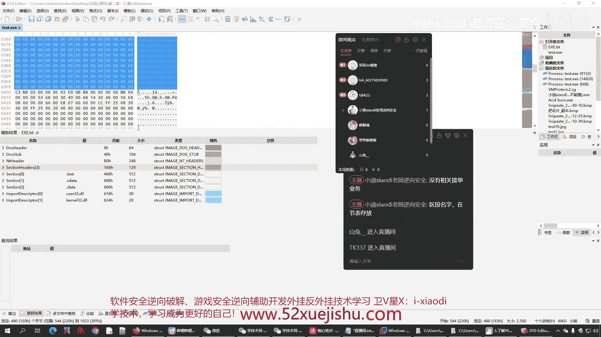

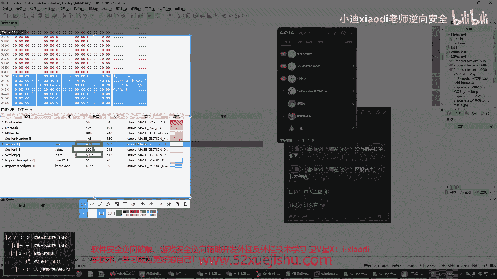

下面用代码表示文件对齐：

```text
文件对齐常见值 FileAlignment = 0x200
对齐后偏移 = ceil(原始偏移 / FileAlignment) × FileAlignment
示例：节表尾部 0x21F，不是 0x200 的整数倍，向上对齐到 0x400
前三块总和 = DOS头 + PE文件头 + 节表 = SizeOfHeaders，示例 0x400
0x220 ~ 0x3FF = 对齐产生的空白数据
第一个节开始偏移示例 = 0x400
后续节开始偏移示例 = 0x600 / 0x800，都是 0x200 的整数倍
```

下面列出文件对齐的理解要点：

- 文件对齐机制：每个节在文件中存储时按某个字节大小对齐。
- 对齐值来源：扩展PE头中的`FileAlignment`，常见值为`0x200`。
- 对齐效果：所有节地址倾向于`0x200`的整数倍。
- 空白数据原因：节表尾部不是`0x200`整数倍，需要向上补齐。
- 头部总和：DOS头、PE文件头、节表的总和由`SizeOfHeaders`表示。
- 设计目的：整数倍地址便于计算，也便于一次性高速加载整块内存，读取更快。
- 内存对齐预告：内存对齐和文件对齐类似，只是加载到内存时有拉伸操作，后续再讲。

本节先讲文件对齐，内存对齐留到后续课程。内存对齐同样重要，只是它发生在加载到内存时，会有一个拉伸操作。文件对齐和内存对齐都是PE学习中很关键的机制，学会后对后续分析会有好处。

# 逆向安全PE文件结构：07：课程总结 ✅

本节课中我们一起学习了PE文件结构的基础内容。我们从可执行文件概念开始，明确了可执行文件是能被操作系统直接加载运行、包含机器码指令、数据和结构信息的文件。文本文档依赖外部程序加载，不是可执行文件。接着了解了PE文件是可移植可执行文件，是微软设计的格式，基于COFF结构，Linux下对应ELF格式。然后学习了用十六进制特征识别PE文件：看到`MZ`和`PE`标志基本可以判断是PE文件，不能只依赖后缀名。之后认识了PE整体结构：DOS头、PE文件头、节表、节区和可选调试信息。进一步学习了DOS头由MZ标记和DOS Stub组成，PE文件头由PE标记、标准PE头和扩展PE头组成，标准PE头20字节，扩展PE头大小由`SizeOfOptionalHeader`决定。最后学习了节表长度等于节区数乘以40字节，以及文件对齐机制：常见对齐值为`0x200`，节表尾部会向上补齐到对齐边界，`SizeOfHeaders`表示前三块总和，示例为`0x400`。文件对齐的核心公式是：

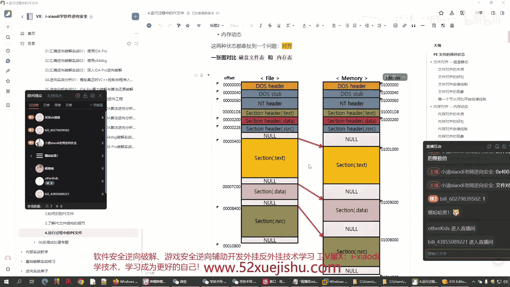

```text
对齐后偏移 = ceil(原始偏移 / FileAlignment) × FileAlignment
```

