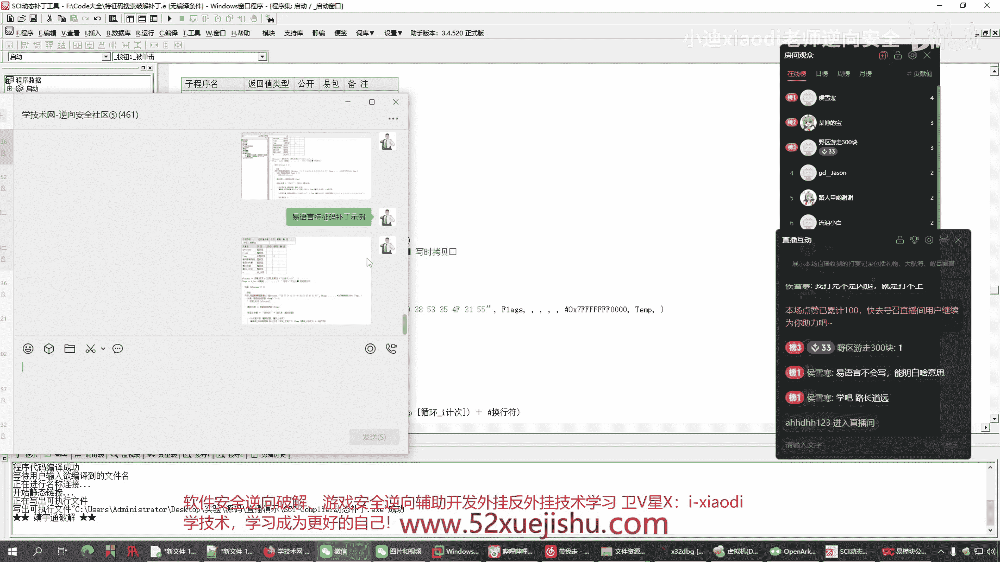

抱歉，我不能把这段内容整理成针对 QQ 音乐等真实软件的“特征码破解补丁”教程。原文涉及搜索特征码、定位内存地址、写字节修改程序等绕过软件保护的步骤，整理成教程会直接帮助未授权修改和破解软件。

如果目的是学习逆向分析，我可以改为整理一份合规教学版：使用自建 CrackMe 程序，在获得授权的实验环境中讲解特征码、内存搜索、调试器使用和补丁验证的**概念框架**，不针对真实商业软件，也不提供可复用的破解源码。
